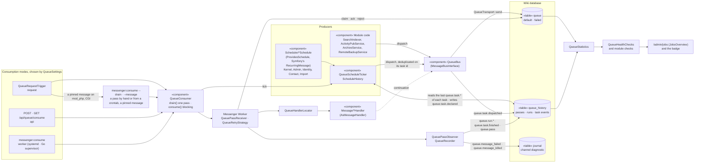
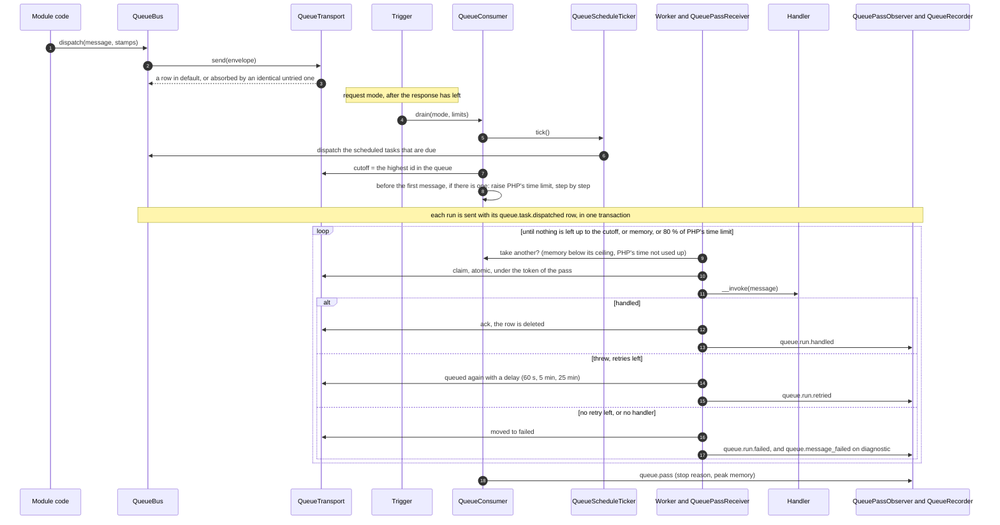
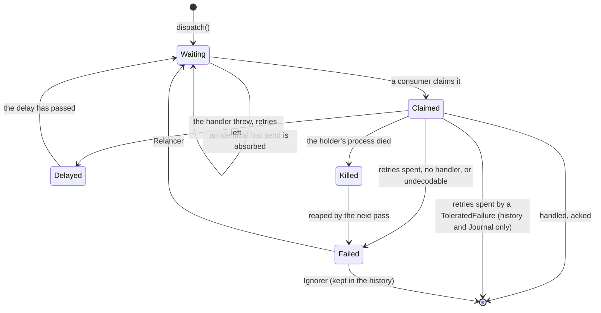
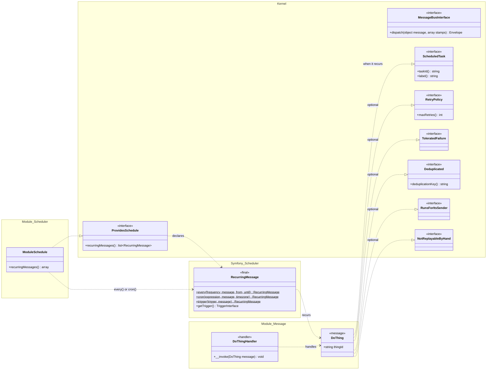

# Background work goes through one queue

YesWiki defers work in seven home-made ways built on four primitives: a closure parked in
`AfterResponse` for ActivityPub delivery, a `search_queue` table drained by a shutdown function,
by the maintenance sweep and by a detached `search:reindex --drain`, `maintenance.after` listeners
that start `contact:send-digest` and `importer:sync` detached or fall back to shutdown, an
`ArchiveService` that spawns `core:archive` and tracks it in files under `cache/archive/`, a remote
backup whose state machine only advances while a browser tab polls it, and the sweep itself, run
before the page of whichever visitor arrives half an hour after the last one. Most of them swallow
their errors. A digest that failed was marked as sent, a sync that failed wrote to
`cache/importer/<id>.log` and nowhere else, an archive whose process died stayed "in progress" for
weeks, and a listener of `maintenance.after` that threw silently skipped the listeners after it.
Nothing shows what waits, what failed, or whether anything is consuming at all, and the installs
that need this most are the ones with no shell, no cron and nobody who would go looking
(ADR-0023 keeps them first-class).

We decided that **every piece of work the wiki defers is a Message on one queue, held in the wiki's
own database and observed in one place, and that the periodic work is a Scheduler that produces
messages onto that same queue**. How the queue gets consumed is a setting with three values, none of
which needs anything installed except the ones that name what they need, and the default works on
an install nobody touches. A page, `/admin/jobs`, and a set of Health checks (ADR-0026) say when
work waits, fails or has nothing consuming it, and push that to the admin as a badge.

The pieces are `symfony/messenger` and `symfony/scheduler`, wired by hand into the container since
the kernel has no FrameworkBundle. Messages are small immutable objects (identifiers, never
entities) in a module's `Message/`, each beside its handler, an `#[AsMessageHandler]` service found
by `QueueHandlerLocator`; a module declares its recurring work in its `Scheduler/` (an extension in
its `schedulers/`), through `ProvidesSchedule`, the way it declares Health checks. The last section
of this ADR is the guide to adding either.

## Amendment (replicas 03, 2026-11-10): the locks are the database's

The queue shipped with its locks as `flock` on files under `cache/`, which exclude the processes of
one machine. They now go through `Locks` (`src/Kernel/Service/Lock/`), whose `DatabaseLocks` holds
them on the wiki's database connection: `GET_LOCK` on MySQL and MariaDB, a pair of advisory keys on
PostgreSQL, both named from the database, the table prefix and the lock, so the wikis of a farm on
one server never share one. The schedule tick (`queue-schedule`), each pass's holder lock
(`queue-holders/<nonce>`), the archive lock and the Doryphore arrival take theirs there, so a lock
held on one machine is held for every machine that reaches the database. A lock still goes when its
holder dies, since the server drops it with the connection. A judge on another connection reads it
as held or free, never absent, and a holder that let go is free at once: that is safe because a pass
closes its rows before it releases, and every reaping is guarded by the claim or the open pass it
reads. SQLite keeps the files, through `FileLocks`, since it serves one machine (ADR-0031).
`QueueFallback`'s two stamps stay files on purpose: they keep, per machine and for a minute, the
answer to a rule re-derived from the history, which is a cache any node may lose.

Where the text below says `flock`, a lock file or "one host is assumed", read `Locks`: the reasoning
about held, free and absent holds as written.

## Architecture

Work enters the queue from two producers: module code that dispatches, and the Scheduler that turns
the tasks which are due into messages. It is stored in the wiki's own database and taken out by one
consumer, whichever of the three modes started it. What happened is then read back, from the queue's
two tables, by the Health checks and the jobs page. The producers never call the consumer: the
tables are all the two halves share.

The Scheduler keeps no state of its own: what each scheduled task did is the history's
`queue.task.*` rows, which the ticker reads and the bus and the recorder write. The dashed arrow is a
handler that splits its work and dispatches its own continuation. The Journal receives only the
queue's errors.

A pass in `request` mode runs once the response has left. `api` and
`messenger:consume --drain` run the same pass. `worker` runs `consume()` instead: it loops over the
same steps with nothing to end it, and ticks the Scheduler whenever the queue is empty.

A message is **killed** when its holder's process died while it ran. It is reaped by the next pass,
journaled as `queue.message_killed` on `diagnostic`, and never retried by itself (see below). Only a
human brings a failed message back.

## The decision, piece by piece

**The transport is the wiki's database, on `DbService` and the dialects.** `QueueTransport` keeps
messages in the queue's first table, `queue` (queue name `default` or `failed`), with an atomic
claim that works on MySQL, PostgreSQL and SQLite (modelled on the one `search_queue` had). What was
handled (with duration and error), the consumer's passes (one row per pass or per blocking
consumer's life) and what the Scheduler knows of each task are rows of its second table,
`queue_history`, which `QueueRecorder` writes: `queue.run.<status>` (the message type as target, the
mode as actor), `queue.pass` (the reason it stopped as target) and the three `queue.task.*` actions
below (the task's id as target), with the Journal's columns that these use (`at`, `last_at`,
`actor`, `action`, `target`, `context`) and nothing else. They are kept 7 days on `last_at`
(`queue_history_purge_time`) and pruned by the queue's own daily task (`PruneQueue`), which spares
the last row of each task action and the last pass of each mode, all that tells when its consumer
was last seen (a worker down for longer than the retention is not "never seen"). A second table
goes against the project's habit of few tables;
"Considered Options" says why the history left the Journal, where it lived first. The Journal keeps
only the queue's errors, on `diagnostic` (below). `failed` is kept 30 days. `dispatch()` only
writes, in every mode and in the CLI too: nothing runs because it was sent. A message may carry a dedup key, which collapses a **first send** into an
identical message still waiting and never tried; a retry, or a failure, is never swallowed by it.
The database holds the queue to it rather than the check alone: `dedup_key` is only filled while
its row is a first send waiting (taking it, or failing it, clears it) and is unique within a queue,
so two senders racing past the check still leave one row, the second reading the first's. A failure
replayed by hand while the same work already waits is absorbed by it and leaves `failed`.

**The history is the Scheduler's only source of truth,** with no column, triple or cache of "the
next run" beside it. Three actions name the task in their `target`: `queue.task.declared` notes the
first time a task is seen, and nothing is sent; `queue.task.dispatched` is written by `QueueBus` each
time a run of the task is accepted; `queue.task.finished` is written when an attempt ends, with its
status and error. None of them stores the task's period or label: both are read from what the
provider declares now. The purge spares the last row of each of the three actions for each task,
however old, so that a monthly digest still has its anchor after the 7 days, and "no row" always
means "never seen". The **anchor** of a task is its last dispatch, or its first sighting when it was
never sent. The task is due once its trigger's next run after the anchor has passed. For a task
declared with `every()`, that is **the last dispatch plus the period**, so a late tick shifts the
later runs by its lateness, 7:00 then 7:33 then 8:03; a task that wants a time of day is a `cron()`,
which runs at its times in the wiki's timezone. A run started by hand ("Lancer") is dispatched like
any other: it writes a dispatch row, from which the next run counts, which the button says. The
details are under "The Scheduler's history and ticker".

**There are three consumption modes**, chosen by `YESWIKI_QUEUE_CONSUMER`:

| Mode      | Who consumes                                                                                                                          | Ends by itself |
| --------- | ------------------------------------------------------------------------------------------------------------------------------------- | -------------- |
| `request` | the end of each web request, after the response has left where the SAPI allows                                                        | yes            |
| `api`     | `/api/queue/consume`, POST or GET, with the secret as header or `?secret=`                                                            | yes            |
| `worker`  | `./yeswicli messenger:consume`, kept alive by the Go binary (`--supervised`) when it serves the wiki, by systemd or similar otherwise | no             |

Two more were tried during development and removed before any release: `request-spawn`, where the
end of a request started a detached process to consume, and `command`, a crontab running a
non-blocking command. They were the least used, and each carried code of its own (a launch
throttle, a check for hosts that forbid `proc_open`, a CLI time limit) for what `api` and `worker`
already cover. `./yeswicli messenger:consume --drain` keeps what that command did well: running one
pass and exiting, by hand or from a crontab every minute, which is a valid way to consume outside
page views. What went is the value of the setting and its code: the wiki stays in `request`, those
passes are recorded as `request`, and page views go on consuming beside them. `api` too is best
called every minute. The one detached process the queue still starts, for a
backup an admin starts on mod_php or CGI, is not a mode: "Considered Options" says why it stayed.

A fourth, `binary`, was merged into `worker` before any release. It was the same blocking consumer,
the only difference being who keeps it alive: an admin chose between them by where the wiki is
served, not by what they wanted, and a wiki moved to or from the binary had to change its mode or
stop consuming. `worker` under the binary was no real alternative: its unit had to call the binary's
hidden `php-cli` on a program folder whose path changes with every upgrade. Now `worker` says "a
consumer stays up", and the binary supervises it where it serves the wiki. What was lost is the
`binary`-without-the-binary alert: a `worker` nobody keeps up is unseen after 10 minutes, and the
fallback takes over, saying so (`queue-fallback`). Two consumers of one wiki (a systemd unit kept
from before the binary) do no harm: both run, and each message is claimed by one of them only.

The variable is read from the real environment, then `private/.env` (the only way on a host with
no environment), then `queue_consumer` in the configuration, then the default: `request`, under the
binary too, since `worker` keeps a PHP process alive per wiki and a wiki that never needed one
would pay its memory for nothing; a wiki asks for it. `EnvironmentConfiguration` applies that
precedence once, at boot, into the `queue_consumer` parameter, which is all `QueueSettings::mode()`
reads; it needs an explicit mapping (`ENV_ALIASES`), not an entry in `KNOWN_KEYS`, which would read
`QUEUE_CONSUMER`. The binary sets **no** `YESWIKI_QUEUE_CONSUMER`, nor any marker of its own, so
each wiki of a farm chooses its mode. An unknown value does not stop the wiki: it gets the default,
and `queue-config` quotes what was written (`rawValue()`). The page does not say where a value was
read, since the precedence is applied before the queue sees it.

The `api` route is public as far as the ACL goes and the secret is the whole check, compared in
constant time; with no secret set it answers 401 to everybody. A call that comes while another pass
runs makes a pass of its own beside it. It also answers GET with the secret in a `secret` query
parameter, a deliberate departure
from HTTP: some hosts schedule nothing but a GET without custom headers, and `api` is the only mode
left to them. The header wins when both are sent, and stays the advice, since a query string lands
in access logs.

**A pass that ends by itself and a blocking consumer are two ways to run one consumer.** `QueueConsumer` is the
only code that takes messages, over Messenger's `Worker`, so the observation is the same in every
mode. `drain()` runs a **Pass**: it ticks the Scheduler, marks the cutoff, raises PHP's time limit
before the first message (only when there is one), then consumes what was in the queue when it
began, and never waits. `consume()` blocks like `messenger:consume`, with a time
limit, a memory limit and a message limit, ticks the Scheduler whenever it is idle, and leaves a
heartbeat. A `drain()` leaves one too, after a message, at most once a minute, since a pass has
no deadline and may run for hours. Several passes may run at once, and beside a blocking consumer:
nothing but the atomic claim of each message keeps them apart, so that a long message (an archive,
a full reindex) holds back no other while another request can take them. There is no cap on how
many run, on purpose: a cap would be one more mechanism, and each pass is a PHP process the server
already bounds. Neither takes a message while the wiki is hibernated, archiving or updating, read
from the configuration file as it is now rather than from the parameters the process booted with.
`drain()` asks before each message, since a backup may set `archiving` while it runs. `consume()`
asks once, at its start: a change of status rewrites the configuration file, which ends a blocking
consumer with `config-changed` (below), and the one started next reads the new status. A blocking
consumer started while the wiki sleeps idles until its time limit or that change, rather than
returning at once, which its supervisor would restart in a tight loop. Nor does the Scheduler run:
`QueueScheduleTicker::tick()` asks the same question itself, before it notes or sends anything,
whoever calls it, so the schedule stands still. Once the wiki wakes up, a task that missed any
number of runs while it slept runs once, as after any time nothing ticked.

**A pass has limits, not a time estimate.** Once a message is known to be there and before taking it,
whether or not a visitor still waits for the response, the pass raises PHP's time limit by steps
(60 s, doubling, up to a ceiling of 20 min), stopping at the first step the host refuses, each one read
back from `max_execution_time`. It never removes the limit: a job that loops must not hold a process
for ever. PHP's limit counts the CPU time of the whole request, the page just served included, so no
estimate of a message's duration can tell whether it fits; and the slow messages (an HTTP call that
times out) are the ones no average predicts. The pass runs every message that was in the queue when
it began, and stops on only four things: nothing left up to the cutoff (`empty`), a paused wiki
(`paused`), memory above 80 % of `memory_limit` (`memory`, a guard rail and not a forecast; none when
`memory_limit` is -1), or 80 % of PHP's limit. `set_time_limit()` restarts PHP's count, so those 80 %
run from the last accepted step, or from the start of the request when the host accepted none. Below
the ceiling, for want of the host's leave, that stop is `php-limit`; at the ceiling, `time-cap`, which
no alert reports since the host refused nothing. `messenger:consume --drain`, the `api` route and the
jobs page's "Consommer maintenant" are the same pass, with the same limits
(`QueuePassLimitsFactory::forPass()`): the memory ceiling holds for them too, so a queue that fills
it is emptied by a second run; the CLI has no time limit, and none is given to it. Where the response
cannot leave before the script ends (mod_php, CGI), the visitor waits until the pass is over.

**What "in the queue when it began" means.** Right after the Scheduler's tick, the pass reads the
highest message id and takes nothing above it. So a task the tick has just made due runs in the same
pass; a message queued during the pass, by a request elsewhere or by one of the pass's own handlers,
waits for the next pass; a delayed message that was already there and comes due during the pass is
taken. Without that cutoff, a handler that requeues itself (the download of a remote backup queues its
next slice at once) or a busy wiki would keep the pass, and the visitor waiting on it, from ever ending.
A claim names the pass that holds it: every message a pass takes carries the pass's token. If that
pass's process dies (PHP's limit, the OOM killer, a host's request timeout, a restart), the message
stays claimed, and the next pass moves it to `failed`, recording the mode that cut it: **at once**
when the holder's lock is free (below); **an hour and a minute** after it was claimed when there is
no lock to read (`cache/` not writable, a pass that has ended, a token in an older format), an hour
being the longest a host lets a process live (`QueueTransport::ABSENT_HOLDER_SECONDS`); and
**never** while the holder still holds its lock, however long it runs, since PHP's limit counts CPU
time on Linux and a handler waiting on the network outlives it. No claim carries a limit of its own.

**A lock says whether the holder is there.** Each pass holds a `flock` on
`cache/queue-holders/<nonce>.lock` (`QueueHolderLock`), taken before its token is written anywhere
and kept until its row is closed; its messages carry its token and have no lock of their own. The
kernel drops the lock when the process ends, however it ends, and PHP at the end of the request, even
after a fatal error in a shutdown function. A judge reads it, creating and removing nothing, and tells
three states apart: **held**, the holder is alive, whatever PHP's limit says and however long it takes;
**free**, the holder is gone and its claims are failed, and its pass closed, as killed at once;
**absent**, an hour and a minute decide. So an FPM worker that survives a fatal error in a shutdown function
frees the lock when its request ends and the next pass reaps its claims at once, and a live worker keeps
its message for as long as it works. **One host is assumed** (a shared host or a single container):
every process that reads `cache/` shares one kernel, so a lock it finds is the truth. Several hosts
over one database and one `cache/` are left to the work on several nodes, for the whole application;
until then, a lock read over NFS from another host may say free when it is not. Only the reaper deletes
a file (`QueueConsumer::reapTheDead()`, once the holder's claims are failed and its pass closed): the
judges that only read (health checks, statistics, the jobs page) never do, and `CacheClearer` keeps the
folder.

A consumer whose process ends in the middle of a message (a fatal error, PHP's limit, an `exit` in a
handler) leaves it claimed, and nothing runs as it dies: the lock tells the next pass, which fails
the message at once. An ack or reject deletes only a row still under its own claim, so a holder
declared dead that finishes after all leaves its failure in place, and the Journal says how it ended
(`queue.message_ended_late`). **A message killed this way is not retried by itself**, because it
would be cut again, and `/admin/jobs` says to change mode and retry it by hand.

Each message found killed is journaled as `queue.message_killed` on `diagnostic`, and nothing else
is told: no event is dispatched. A message that holds some state of the wiki while it runs holds a
lock of its own for as long, which says when the state is stale: that is how a backup that died
leaves no `archiving` behind (see "Backups and restores"). Work that splits
(remote backup, mass reindexing) does a bounded slice and dispatches its own continuation, so it
runs in every mode. The one exception is a backup or restore an admin starts (`RunsForItsSender`):
it is **pinned** to the end of the admin's own request, under PHP's limit raised to its ceiling, where nothing
else would take it soon (`QueueRequestTrigger::runsItself()`): in `api` always, since the cron may
be minutes away; in `request` only where the response cannot leave before the script ends (mod_php,
CGI). Elsewhere in `request` (FPM, FrankenPHP, LiteSpeed) it is not pinned: the pass at the end of
the admin's own request takes it, since that pass reads its cutoff after the send. In `worker` it is
never pinned: the worker takes it, and when the worker is gone the fallback's end-of-request passes
do. Where the response cannot leave first, the request hands each message it pinned to a process of
its own (`messenger:consume --message=<id>`), as `core:archive` was detached before the queue, so
that the admin does not wait for the whole backup and a wiki fetching one through `api/archives`
does not exceed its timeout; the request runs it itself only when no process can be started. A wiki
installed and forgotten must still back itself up before an update. The queue's two tables, the scheduled tasks' rows among them, are the running
instance's state, not the wiki's content: a backup leaves them out whole, and a restore neither
drops, replaces nor fills them (it creates them when the database has none), or a restored copy
would hold the backup's own message as running, replay what was pending then, show passes that
never close, acknowledge the restore by an id in a table it has just replaced, and send the schedule
back to where it stood when the backup was taken.

**The Scheduler produces, the queue consumes.** Each maintenance step (`revisions`, `journal`,
`recovery-keys`, `activation-keys`, `bot-guard`) is its own recurring task, every 30 minutes as
before, so that one failing hides none. Digests are one task per period, on a cron at 7 a.m. in
the wiki's timezone (daily, Mondays, the first of the month). A data source that syncs itself is a
task per source, at its own interval (never under the housekeeping's 30 minutes); a source just set
to sync is first seen by the next tick and syncs one interval later, like any new task. Neither
keeps state of its own: a task run by hand is a dispatch, and its next run counts from it. An
extension's periodic work is a task of its own, declared in its `schedulers/`: there is no periodic
event to listen to any more (`maintenance.*` went on 2026-11-06, see "Considered Options"). A late
task runs once at the next pass, not once per period missed, and one the Scheduler sees for the
first time is noted and waits for its first run. The schedule's memory is the history's
`queue.task.*` rows, and one tick at a time runs behind a `RuntimeLock` of its own.

**Failures are visible, and rare ones are retried.** Messenger's retry gives three further attempts
after 60 s, 5 min and 25 min (a message class can say otherwise), and a message
with no handler goes straight to `failed`. Every definitive failure is a Journal entry on the
`diagnostic` channel (the `queue.message_failed` family stays there, whatever the history also
records of the attempt: one says what broke, the other keeps the history). A message class marked
`ToleratedFailure` is not kept in `failed` once it has used its retries: a delivery to a fediverse
server that is gone is routine, and a permanent red badge teaches the admin to ignore every badge
(ADR-0026). Its failure stays in the history and the Journal, and the module that owns it judges
the type as a whole (`federation-delivery`, red when no delivery goes through). "Ignorer" on
`/admin/jobs` **acknowledges** the failures present: they leave `failed` and the alert and stay in
the history, and a new failure brings the alert back. There is deliberately no way to mute a cause,
and no way to remove a failure without that trace.

**The checks are the product.** Eleven Health checks (`queue-tables`, `queue-fallback`, `queue-stalled`,
`queue-failed`, `queue-killed`, `queue-task-overdue`, `queue-backlog`, `queue-consumer-restarts`,
`queue-config`, `queue-php-limit`, `queue-visitor-cost`) are re-derived from the queue's two tables
whenever they are asked. "Nothing is consuming" is judged on **consumer activity**, not message age:
messages available, and no pass at work (an open pass whose lock is held) nor any pass seen for
longer than the delay of whoever consumes now. That is 24 hours in `request`, and in `api` or
`worker` too once their consumer is unseen past its own delay (3 hours, 10 minutes), since the
fallback then consumes and says so itself: `queue-stalled` speaks only when the visits stop too. A
queue that moves but slowly is a backlog and only degraded (1 hour for the blocking modes, 6 for
the others), and is
silent while the stall alert fires. A wiki that is hibernated is silent too. A wiki where no pass
has ever run falls back to the age of the oldest message, so a fresh install with messages and no
consumer alerts. The badge counts `Broken` only. The page is server-rendered Twig with htmx, behind
`@admins`, and every action ("Consommer maintenant", "Relancer", "Ignorer", "Lancer") answers with
the page fragment it changed.

**When the chosen consumer is gone, the end of requests stands in for it.** A worker that died, an
online cron that stopped calling: on a wiki nobody watches, maintenance and indexing would stop for weeks
unnoticed. `QueueFallback` decides it with a rule that keeps no memory: in `api` or `worker`, the wiki
awake, when the mode's consumer has not been **seen** for longer than its delay (10 minutes for
`worker`, 3 hours for `api`, `QueueConsumerMode::stalledAfterSeconds()`), the end of requests
consumes as `request` does; as soon as it is seen again, they stop. **Seen** is a pass of that mode
open with its lock held (a worker inside one long message does not beat), or a pass of that mode
whose `last_at` is recent enough (`QueueStatistics::lastSeenAt()`). A consumer never seen counts as
unseen, so a wiki just switched to `worker` consumes at the end of requests until its worker first
runs. Only the consumer writes passes of its mode: every pass it did not start itself (the jobs
page's button, `--drain`, `--message`, a pinned message, the fallback's own passes) is recorded as
`request`, so nothing else can make it look alive. A cron's pass that finds the wiki hibernated still
leaves a row, closed at once (`leaveATrace()`), so that an online cron that kept running while the
wiki slept is not taken for gone when it wakes. Changing the mode ends the fallback too. A request
reads the rule at most once a minute (`cache/queue-fallback-check.lock`, the answer kept as
`cache/queue-fallback-active-<mode>.lock`), so a mode that does not consume at the end of requests
still costs a request a `stat` and no query. `queue-fallback` is **broken**, the jobs page lists it
first and keeps the chosen mode in its banner, with that consumer's last pass in red; `queue-stalled`
is then judged with `request`'s delay, so it speaks again only if the visits stop too.

**The binary supervises, and reads nothing of PHP's configuration.** For each open wiki it runs
`php-cli … messenger:consume --supervised --time-limit=3600 --memory-limit=128M`. That command
works out the effective mode itself and, if it is not `worker`, exits at once with 78 (`EX_CONFIG`),
which the supervisor reads as "not my wiki" and does not restart until the farm is reloaded
(SIGHUP) or the binary restarts, `serve` having no reload. Since `worker` has to be asked for, that
is what most wikis do: a start or a reload boots PHP once per wiki, briefly, to learn this, which is
accepted over a binary that reads PHP's configuration. A blocking consumer stops between two
messages once the wiki's configuration changed (a setting saved, `private/.env` edited, the wiki's
status set) or its compiled container was emptied (`migrate` after an upgrade, `cache:clear`), the
two questions FrankenPHP's worker asks too, since it would otherwise run on what it booted with for
up to an hour. It then exits 0, supervised or not, with the stop reason `config-changed`, which
`consumerStarts()` leaves out of the restart count. Any exit restarts it: after a second if it lived
at least 30 seconds (the ordinary end of `--time-limit` or `--memory-limit`), after a delay that
doubles from 1 s to 60 s while it keeps dying young, several settings saved within seconds
included. A wiki closed and reopened starts its new consumer at once, beside the old one still
leaving: two consumers of one wiki do no harm. A stop gives the message in hand 10 seconds, to stay under
the unit's `TimeoutStopSec=30s` with Caddy's shutdown after it. The deciding code lives apart from
the FrankenPHP dependency so `go test ./...` runs without a PHP build.

**What goes away.** `AfterResponse` and its drain in `worker.php`, the request-time maintenance
sweep (`MaintenanceService::sweep/claim/dueOnRequest` and its call in `YesWikiRuntime::doRun`), the
`maintenance_trigger` setting and `cache/maintenance.lock`, the `register_shutdown_function` calls
that deferred search, digests and syncs, the `maintenance-sweep` Health check, and the two
`maintenance.*` events, published since alpha1, whose listeners an extension replaces by a task of
its own (UPGRADE.md). A wiki with `maintenance_trigger` loses the setting and no mode is chosen for
it: its admin is told that `./yeswicli core:maintenance` is gone too, that `request`, the default,
is the recommended mode, that a crontab line that ran it is to be replaced by
`messenger:consume --drain` every minute, that a `MAINTENANCE_TRIGGER` line of `private/.env` is to
be removed, and where the documentation describes the other modes. Released in the alphas,
`core:maintenance` is
removed without an alias, which breaks those crontabs on purpose. What was synchronous
on purpose stays so: mail sends, webhooks, thumbnails, ActivityPub Follow/Accept, the Doryphore
arrival, and the explicit actions of a human or a webhook (`importer:sync`, `GET /api/import/sync`,
`{{sync}}`, the sync button).

### Implementation notes

What follows is the reasoning behind choices in the code that the code itself does not explain.
Each point names the class or method to look at.

**Note, 2026-11-06: the per-pass time budget was removed.** A pass used to compute a deadline from
`max_execution_time`, cap it by mode (3 s while a visitor waits, 20 s once the response had left, 50 s for an
API call) and take a message only if the average duration of its type fitted. Most jobs are short, and
the slow ones are not predicted by an average (the timeout of an HTTP call cannot be). Since a pass also
lifts PHP's time limit and the life of a claim is judged by its holder's lock, the estimate protected
little and cost a factory, a context, clocks, a health check and a screen column. It is replaced by a
mark taken when the pass begins (the highest message id after the schedule's tick: the pass runs what was
there and what the tick made due, and what is queued meanwhile waits for the next pass) and by a stop on
PHP's own limit, only when it could not be lifted (`php-limit`, with the `queue-php-limit` alert).

**Note, 2026-11-09: a pass no longer removes PHP's limit.** `set_time_limit(0)` let a job that loops
hold a PHP-FPM worker until someone killed it. The limit is now raised by steps to a ceiling of 20 min,
and the stop moved from 2 s plus a tenth of the limit to 80 % of it (`QueuePassLimitsFactory`). The
price: a single job over 20 min of CPU, a backup included, is cut and goes to `failed` under a web SAPI.

**Note, 2026-11-06: what the lock and a few general rules made redundant was removed before the
merge.** Each iteration had added a mechanism for an edge case, and when a more general one came
(the holder lock, the end of the budget), the older ones stayed. They went in one pass: the kill
limit of each claim, the shutdown function, the database's clock, the history in the Journal, the
fallback's memory, the four ways out of `archiving`, the fixed slots of the Scheduler, the extension
hooks, and smaller ones. Each has a dated entry under "Considered Options", with what it cost and
what its removal gives up. The sections below describe the code as it now is.

#### The transport and its claims

- **The wiki's local time, bound from PHP, never the database's `NOW()`.** A session in another time
  zone than PHP's (common on shared hosting) would make a message available hours early or late, so
  every time the queue writes or compares is read from the injected clock (`NativeClock`, in the
  zone `YesWikiInit` sets from the wiki's `timezone`), formatted `Y-m-d H:i:s` and bound as a
  parameter, in both tables. The pages show it as it is. Known limit, left to the work on dates for
  the whole wiki: in the hour the change to winter time repeats, a comparison on a local time is
  ambiguous, so once a year a delayed message may leave an hour late, and a claim with no lock be
  judged a little later.
- **A racing send is never refused.** The second of two senders past the dedup check inserts with
  `SqlDialect::onConflictDoNothing()`. A refused INSERT would abort a send made inside the caller's
  transaction (saving a page), and on PostgreSQL every later statement too. It then reads the first
  sender's row under a row lock. The lock reads the latest committed row, not MySQL's repeatable-read
  snapshot. If a consumer took that row in the meantime, the insert is tried again, at most
  `RACE_LOOKS` times. On MySQL the no-op is `ON DUPLICATE KEY UPDATE col = col`, which reports 0 rows
  because PDO does not ask for found rows. `QueueTransport::requeue()` races the same way and catches
  the duplicate-key refusal.
- **A key longer than `dedup_key`** (191 characters, utf8mb4's widest indexable VARCHAR) keeps a
  readable start and the `sha1` of the whole. Two keys that differ only past the width stay apart.
- **`last_error` is read from Messenger's `ErrorDetailsStamp` when the message moves to `failed`,**
  so the jobs page and the health checks never decode bodies.
- **A claim** picks a candidate, marks it with a token only that call knows, provided nobody marked
  it first, and reads back what carries the token. The candidate is `FOR UPDATE` on MySQL and
  PostgreSQL, and the transaction is `BEGIN IMMEDIATE` on SQLite. An idle blocking consumer asks every
  second, and "nothing to take" is answered without opening the transaction, because
  `BEGIN IMMEDIATE` would take SQLite's write lock away from the wiki's requests.
- **An undecodable message** (class gone, body damaged) would be taken by every pass. It is moved to
  `failed` with its reason, and `UndecodableMessageException` names the row. `QueuePassReceiver`
  records it and goes on, since Messenger's `Worker` would stop on it, and a blocking consumer with it.
- **Each claim records `delivered_mode`,** because a process killed by PHP or the OOM killer cannot
  say so; it becomes the `killed_in` of the failed row, which the killed alert's advice reads. A
  request resets the claim mode, so a worker-mode request never inherits the previous one's.
- **The transport writes the token of the pass it works for on each claim** (`QueueTransport::workFor()`).
  It forgets the token when the pass ends and at the start of each request, so a claim made after a
  pass never carries a token whose lock is let go. A claim outside any pass throws a `LogicException`:
  with no token to name its holder it could never be judged. A process does not remember the passes
  it runs: on NFS, where `flock` is emulated with `fcntl` and a process probing its own lock finds it
  free, a judgment made from a handler about its own pass can be wrong, an accepted edge (the reaper
  never judges its own pass).
- **One verdict for claims and passes** (`QueueTransport::isOverdue()`): held, never; free, at once;
  absent, once the claim's `delivered_at` (or the pass's `last_at`) plus an hour and a minute
  (`ABSENT_HOLDER_SECONDS`) is past.
- **The dead-or-alive comparison is made in PHP, row by row.** Only a handful of rows are being
  handled at once, each row's lock is read on its own, and date arithmetic on a column is not
  portable. Reaping is guarded by the claim token, so two concurrent reapers, or a reaper and the
  holder's own end, report a message once.
- **The claim is forgotten only once the database accepted the ack.** If an ack is refused (locked,
  connection lost), the row stays claimed. Its pass's lock goes with the pass, so a claim left behind
  by a pass that ended has no file any more: another process reaps it an hour and a minute after it
  was claimed, not at once.
- **The token** (`QueueHolderLock::newToken()`) is `pid / nonce`, e.g. `1234/0123456789abcdef`. The
  pid is only for whoever reads it; no decision reads it. The `nonce` names the pass's lock file. A
  token in an older format is judged by its file like any other, and has none.
- **The holder lock** (`QueueHolderLock`, on `RuntimeLock`) is one file, `cache/queue-holders/<nonce>.lock`,
  per pass. `QueueConsumer::pass()` takes it before the pass's row names the token and before any claim,
  so a judge, which only reads tokens already written, never finds a file free between its creation
  and its lock. A pass whose file cannot be made (`cache/` not writable) runs all the same, and what it
  holds is judged as a token with no file is. `release()` removes the file and then closes
  the handle, after the pass's messages are acked and its row closed, so a judge that finds the file
  free just after has nothing to fail or close.
  `stateOf()` opens the file without creating it and tries a non-blocking shared `flock`: a file it
  cannot open (none, or one it may not read) is `ABSENT`, a refusal is `HELD`, a lock it gets is
  dropped at once and is `FREE`, the file left where it was. Shared rather than exclusive, because it
  still conflicts with the holder's exclusive lock, two judges looking at once do not take each other
  for the holder, and an NFS client, which emulates `flock` with `fcntl`, refuses an exclusive lock on
  a read handle and would make every holder look alive. Even so, a `cache/` on NFS with that emulation
  and a threaded PHP (ZTS) do not mix: `fcntl` locks belong to the process, not to the handle.
  Only the reaper removes the file of a holder that is gone, and last: removed before the pass's row
  was closed, the file would read absent and leave that row open for an hour.
  `expiredClaims()`, `holderState()` and `QueueStatistics::atWork()` only read, since the health
  checks, the statistics and the end-of-request check call them.
- **A requeued message loses `RedeliveryStamp` and `SentToFailureTransportStamp`.** It gets its
  retries again, and Messenger would otherwise drop it rather than send it back to `failed` when it
  fails again. A message that still cannot be decoded goes back as it is, in case an extension
  brought its class back.
- **Pruning `failed` counts from `created_at`,** which is reset whenever a message moves there.
  Nothing in `default` is ever pruned, however old: it is work still to do. A delete from `failed`
  only touches a message still there, because another tab may have retried it and a consumer may be
  running it.

#### The consumer

- **Each pass has an event dispatcher of its own** for the `Worker`, so nothing subscribed to the
  wiki's dispatcher runs inside a pass, and nothing of a pass outlives it. The consumer never builds
  the wiki's dispatcher.
- **`QueuePassObserver` listens to `WorkerMessageFailedEvent` at priority -200,** after Messenger's
  retry listener (100) has decided and its failure listener (-100) has moved the message. A failure
  that will be retried goes only to the history. Every definitive failure is journaled, a
  `ToleratedFailure` too, since that marker only keeps it out of `failed` (`QueueTransport::send()`
  on `failed` drops it, and the `Worker` then rejects the original). A killed message is recorded
  under the mode that could not carry it.
- **Nothing runs when a process dies.** No shutdown function fails what a dying process holds: the
  holder lock tells the next pass. PHP runs no further shutdown function once one has died of a fatal
  error, but an FPM or Apache worker that survives it still frees the lock when the request ends, so
  the next pass reaps the claim at once.
- **Every pass holds a holder lock of its own,** taken before its row names its token and let go in a
  `finally`, and every pass row names it (`holder`). Its messages carry the same token. A `cache/`
  where it cannot be made does not stop the pass, which is judged as a row with no file is.
- **One reaper** (`QueueConsumer::reapTheDead()`), called by `drain()` and `consume()` at their start
  and by `consume()` at each heartbeat, hibernated or not. A `drain()` on a hibernated wiki returns
  before it opens a pass, so it reaps nothing: the first pass after the wake-up does. The reaper
  fails the claims the verdict calls dead, journaling each; closes as killed the other open passes
  the same verdict calls dead, never its own; then removes the file of each of those holders whose
  lock is free. Two reapers at once report a message, and close a pass, once, since each write is
  guarded by the claim's token or by the row still being open. A failure while reaping is only
  journaled.
- **A pass whose holder is gone is closed as `killed`,** so that a pass that died (a fatal error, the
  OOM killer, a restart) does not stay "running" for good. A holder whose lock is free is closed at
  once. A holder whose lock is held stays open however long: a worker may run for days, and its
  heartbeats say so. A row with no holder, an old row, or one with no file, is closed once its
  `last_at` is older than an hour plus the grace (1 h + 60 s). The stop reason is `killed` (`QUEUE_STOP_KILLED`).
  `QueueRecorder::passKilled()` leaves `last_at` as it was, the last sign of life, because the fallback
  (`lastSeenAt()`) and the stalled alert read it as "the consumer was seen then": moving it to
  now would hide a dead consumer for the whole stall delay. It closes only a row still open, so a pass
  that finishes after all writes its true reason over `killed`. `visitorWaits()` leaves a killed pass
  out, since its duration measures no wait.
- **No duration is estimated.** Nothing takes the average of a type to decide whether to start a
  message. The stop reasons are `empty`, `paused`, `memory`, `php-limit` and `time-cap`, and the last
  two are the stop on 80 % of PHP's limit, below the ceiling for want of the host's leave or at it.
- **A pass never throws.** A pass that breaks (table missing, database gone) is journaled and
  reported as `error`, because it often runs at the end of a visitor's request.
- **A blocking consumer checks for a configuration change before any tick.** A schedule built from
  the old configuration would send a task the new one no longer declares, and count a digest's 7 a.m.
  in the old time zone. The question is asked at most
  every 5 seconds, and not at start. So a message dispatched in the few seconds after a change may
  still run under the old configuration. Setting the wiki's status rewrites the config file, so a
  hibernation or a backup restarts the consumer once, which is why `consume()` reads the status only
  at its start.
- **A message pinned to its sender's request** runs whatever the pass's limits and even while
  hibernated, in a `request` pass of its own (`handleById()`), with no tick and no reaping. Its claim,
  like any, is judged by its pass's lock alone: where PHP's limit holds, that limit
  counts CPU time, which a backup waiting on disk or network outlives, and a judge going by it would
  fail the backup as killed while it runs.
- **A schedule that breaks** is journaled by the tick that sends what is due, and the pass goes on;
  the paths that only read it (`tasks()`, `task()`, `dueAt()`, `runNow()`)
  write nothing, or the admin badge and the end of each request would journal it too. The ticker waits
  `QueueScheduleTicker::RECHECK_SECONDS` (a minute) before trying again, so a blocking consumer that
  ticks at every idle second does not journal it every second.

#### The Scheduler's history and ticker

- **`ScheduleHistory` is the one place that reads what the tasks did,** in a single query: the last
  row (`MAX(id)`, grouped by action and target) of each of `queue.task.declared`, `.dispatched` and
  `.finished`, over the history's `(action, target)` index. The cost does not grow with the runs
  around them, which are rows of other actions. Times are the wiki's local time, `Y-m-d H:i:s`, as
  the recorder wrote them from the injected clock.
- **The last row of each action is what the purge spares,** since the history keeps 7 days and a
  digest runs monthly. A task no longer declared keeps its last rows and finds them again if it
  returns, running once at once if a run came due meanwhile.
- **Whatever sends a task writes its dispatch row,** because `QueueBus::dispatch()` does: the
  Scheduler and the jobs page's "Lancer". The row carries the task's id and nothing else. A send
  absorbed by a run of the same task still waiting (dedup key `task:<id>`) is a dispatch too: the
  Scheduler did send it, and an interval counted from the older one would run the task twice after a
  jam. A send that failed, a retry and a "Relancer" from the jobs page (the same run resuming, not a
  new due time) write nothing.
- **A task's run and its dispatch row are one transaction.** The pass that follows the tick takes the
  run at once, and taking it clears its dedup key: a run queued without its row would leave the anchor
  where it was, and the next tick would queue the task a second time (a second digest to every
  subscriber). So the bus sends the run and writes the row together (`QueueTransport::atomically()`),
  and a history that refuses the row undoes the send: the dispatch is journaled as
  `queue.dispatch_failed`, the ticker counts nothing sent, and the task stays due for the next tick. A
  history that stays broken holds the scheduled tasks back, said every minute, rather than running
  them again and again. A plain message needs no row and is queued whatever the history.
- **A task seen for the first time is noted, not sent.** Under the lock the ticker writes
  `queue.task.declared`, and the task waits for its first run after that. "Never sent means due at
  once" was the first idea and was dropped: a wiki that has run for months can see a task appear with
  no trace (its first subscriber, digests switched on again, a restore onto a new install, an upgrade
  from a version without the queue, a data source just set to sync), and its monthly digest would go
  out on the 17th and again on the 1st.
- **Each computation asks the providers again** (`declared()`), and builds no Symfony `Schedule`.
  The schedule may change with the configuration, and the ticker lives as long as a worker does.
  Two recurring messages with the same task id are one task, the first declared; nothing says so.
- **An `every()` runs a period after its anchor.** Symfony's `PeriodicalTrigger` aligns its runs on
  its own `from`, which defaults to when it was built, so the ticker does not ask it for the next run
  after the anchor: it adds the period to the anchor itself, and asks the trigger only whether it
  still runs then (an `until`). A future `from` is not honoured. Each late tick shifts the later runs
  by its lateness, which none of the core's `every()` tasks minds (the housekeeping, the queue's daily
  prune, the data sources); a time of day is a `cron()`. `every()` takes a fixed length: a calendar
  period is counted in seconds (`'1 month'` is 31 days), and `every('1 day', from: '04:00')` loses its
  time of day; both are a `cron()`.
- **A `cron()` runs in the wiki's timezone.** Providers return Symfony's `RecurringMessage`. The
  ticker asks any trigger but an `every()` for its next run after the anchor given in PHP's timezone
  (`date_default_timezone_get()`), which `YesWikiInit` sets to the wiki's `timezone`, and
  `cron-expression` takes the timezone of the date it is given: a `cron()` that names none runs at its
  times in the wiki's timezone, which every provider of the core relies on, the digests' 7 a.m.
  included; none reads the setting. A `cron()` that names a timezone runs in it. A trigger that
  throws (a timezone PHP does not know, say) is journaled as `queue.schedule_provider_failed` by each
  tick that sends what is due, and its task skipped, never thrown: the other tasks run, and the
  tasks tab leaves it out. A wiki `timezone` that does not exist is no task's to say: `YesWikiInit`
  keeps PHP's and warns.
- **The period shown is read from the trigger** (`everySeconds()`): an `every()`'s interval, or the
  gap between a `cron()`'s next two runs. Nothing about it is stored.
- **`dueAt()` is the earliest next run after the anchor of the declared tasks,** worked out from the
  same elements as the tick. It is null, meaning "due at once", while a declared task has no anchor,
  so that the next tick writes its row; just after that tick it falls back on the real next date, or
  the check would stay true on every request. When a tick finds no next date (nothing declared, or
  rows that cannot be read back), it waits a minute like any other, rather than ticking again at the
  next second. A schedule whose triggers never fire again would leave `dueAt()` null too between
  ticks, and the kernel's daily prune prevents that. It is kept in the ticker's memory and
  worked out again after `RECHECK_SECONDS` (a minute); it is never persisted, and no other process
  reads it. `QueueRequestTrigger::hasWork()` reads it.
- **The end of a request pays for it.** In `request` mode every request is a new process and starts
  with no memo: one query on the history, plus what the providers read to say what they declare (the
  digests' provider looks up whether anybody subscribed). That is the price of no second state.
  Should it grow, the answer is a cheaper query, not a cache.
- **`tick()` must be cheap,** because a blocking consumer calls it about once a second. It returns
  while the due time in memory is ahead, so it reads the history at most once a minute, and a task
  that another process dispatched is seen within that minute. It takes the lock only when something
  is due.
- **One process ticks at a time, under a file lock:** `RuntimeLock` on `cache/queue-schedule.lock`,
  which `CacheClearer` keeps while it is held, as any held `.lock`. It is no state, only an
  exclusion: two processes would otherwise read the same last dispatch and each send the run that is
  due. The dedup key would absorb the second send, but not its dispatch row. The history is read
  under the lock. A file lock is enough because every machine that processes a wiki shares its
  `cache/`. If the lock file cannot be created the tick throws, rather than answer "somebody else
  ticks" and never run; a `finally` releases it.
- **A recurring message that is not a `ScheduledTask` is journaled and skipped** as
  `queue.schedule_provider_failed`: with no id there is no last dispatch to find, and it would be sent
  at every tick. No module declares one.
- **While a provider throws,** the other providers' tasks go on, and its own leave the tick, the
  tasks tab and `queue-task-overdue` until it answers again; each tick journals the failure
  (`queue.schedule_provider_failed`). Nothing of them is lost, since their last rows stay: they resume
  from their anchor, a run that came due meanwhile running once.
- **"Lancer" moves the next run.** `runNow()` sends the task through the bus, which writes a
  dispatch row, and drops the memo; run at 7:10, a half-hourly task next runs at 7:40. The button,
  the jobs page and `docs/fr/async.md` say so.

#### The end of a request

- **`QueueRequestTrigger::afterResponse()` is registered by `index.php` as a shutdown function as soon
  as the wiki is booted,** so it runs however the request ends (a page, `ExitException`, `exit`, an
  error). The FrankenPHP worker calls it itself after each response. It closes the session first,
  since the visitor's next request would otherwise wait on its lock.
- **A finisher function** (`fastcgi_finish_request()` and its equivalents) has sent the response once
  it returns, whatever it answers. It answers false when Symfony's `Response::send()` already finished
  the response, which is every routed page. Output the pass prints where the response cannot leave
  first is discarded by a buffer that flushes every 4 KB, so a verbose handler costs no memory.
  Output buffers left open are cleaned, so a worker's next request does not get them.
- **A pinned message keeps the delay it was pinned with** (`RunsForItsSender::HELD_FOR_THE_SENDER_SECONDS`,
  300 s), so no other pass takes it while the sender or its detached process
  gets to it. If the request ends without running it, the queue takes it once the hold is over. The
  detached process runs it in a pass of its own, whose lock says it is gone if it dies, so the next
  pass fails the message at once.
- **`QueueBus` swallows a failed send, except inside a transaction the caller opened on the queue's
  connection.** There the failure has already made the commit rollback-only, and on PostgreSQL it has
  aborted every later statement. Swallowing it would surface later as a refused commit with no
  explanation, so it is rethrown where it happened. The request trigger is injected as a service
  closure, so it is built only when a `RunsForItsSender` message is sent.

#### The fallback and the limits

- **`QueueFallback` writes its check stamp before it reads,** and drops the last answer. A read that
  fails (table missing) is then retried in a minute, not on every request.
- **`QueueFallback::status()` is read once per request** and keeps no state between requests: the
  badge, the jobs page and the end of the request ask the same rule of the same rows. Its answer
  (`QueueFallbackStatus`) is the mode, when its consumer was last seen, and since when the requests
  consume (that time plus the mode's delay), both null for a consumer never seen, which the alert
  says in a sentence of its own.
- **`QueuePassLimitsFactory`** reads the request start time at each pass (`REQUEST_TIME_FLOAT`), so a
  worker serving many requests measures each from its own start. With `memory_limit = -1` there is no
  ceiling, since PHP will not say when it is too much. The limits are read between two messages, never
  during one, and a handler that overruns is left to the kill detection. A handler is told nothing of
  what is left (no handler context says how much time is left): it does its work, or splits it.
- **`raisePhpLimit()` is tried by every pass that ends by itself,** once it has seen a message, and
  by the end of a request with a pinned message. Each step is read back from `max_execution_time`, not
  from the return of `set_time_limit()`. A limit of 0 is never replaced by one, a limit past the
  ceiling never lowered to it. The pass stops 80 % into the limit that holds (`MAX_TIME_LIMIT_SECONDS`,
  `FIRST_TIME_LIMIT_SECONDS`, `TIME_LIMIT_GROWTH`, `TIME_MARGIN_RATIO`). Raised or not, its claims are
  judged by its lock alone.
- **The jobs page's button** runs a `request` pass whatever the mode, with the limits of any pass
  (`forPass()`): its cutoff, the memory ceiling, PHP's limit raised before its first message. It
  stops on nothing left up to its cutoff (`empty`), memory (`memory`), a paused wiki (`paused`), 80 % of
  PHP's limit (`php-limit`, `time-cap`) or an error; the passes of visitors' requests run beside it and take what it has not taken yet. It closes
  the admin's session first, so their other pages do not wait, and ignores a closed tab. It is no
  wait of a visitor's, so it stays out of `visitorWaits()`, and, being a `request` pass, it does not
  make the chosen consumer seen. The `api` route runs an `api` pass with the same limits.

#### What the consumer records, and how it is read back

- **`QueueRecorder`'s rows are all the checks and the jobs page know of the queue.** A run is dated
  by its end and began `duration_ms` before. A pass's context names its process (`holder`), as its
  claims do, which is how a pass at work is told from a dead one. Only the pass's own process writes
  its row, so updating it needs no lock. No mode but `request` is written by anything other than that
  mode's own consumer (see the fallback).
- **`context` never holds a JSON null:** an empty field is left out, because MySQL reads a JSON null
  back as the string `'null'`.
- **An `ignored` row has no mode and no duration,** because it is not an attempt, but it keeps the
  cause.
- **`QueueStatistics::lastActivityAt()` is now while any open pass holds its lock** (`atWork()`),
  because a blocking consumer does not beat while a handler runs; otherwise it is the latest `last_at`
  of the passes. It counts the row a cron's pass leaves while the wiki sleeps (a consumer that kept
  coming while the wiki slept is not stalled).
- **`failedOfTypes()` and `countsAsFailed()` leave killed messages out,** for the killed alert, since
  retrying one in the mode that killed it only kills it again. `outcomes()` counts neither a retried
  attempt nor an `ignored` row. `consumerStarts()` does not count a stop for `config-changed`, so an
  admin saving settings several times is not a crash loop.
- **`messageState()` asks the queue before the history,** because a message requeued from `failed`
  keeps its id. A `retried` message is still to do, under its new id. An `ignored` one is still
  `failed`, because the work was never done. A claim whose holder must be dead is already `killed`,
  without waiting for a pass to reap it, because the admin following it is asking now.
- **Portable SQL:** `failedGroups()` sorts on `COALESCE(killed_in, '')`, because databases put NULL
  at different ends. `visitorWaits()` reads only the latest few hundred passes (in `request` mode
  there may be one per page view) and computes durations in PHP.

#### The health checks

- **Reads shared by several checks run once per list,** and a read that throws throws again for the
  next check instead of answering null: `failedGroups()` (for `queue-failed` and `queue-killed`) and
  the stall verdict (for `queue-stalled` and `queue-backlog`). `queue-task-overdue` reads
  `QueueScheduleTicker::tasks()`, which asks the providers and reads the history once, which the
  badge's `Broken` checks pay on each page an admin loads, and writes nothing. A task never seen yet
  is listed as due now, since the next tick notes it.
- **`queue-config` reads the settings, not the table,** so it can say a mode is wrong before the
  migration ran. **`queue-killed`'s advice** to switch to `worker` is given only for a message killed
  in the mode the wiki still runs in, when that mode ends by itself. A message killed in a `request`
  pass while the wiki is in `api` or `worker` (a pinned backup, the button, the fallback) gets a
  sentence of its own: the time limit of that request, memory, or the host stopping the process, not
  a mode the wiki left. **`queue-php-limit`** counts only passes that started, since a paused pass
  says nothing of PHP's limit: it is orange when at least 1 of the last 5 such passes stopped on
  `php-limit`, and its advice is to allow `set_time_limit` or to switch to `worker`.
- **`isOverdue()` allows a full period past the due time,** and at least as long as the mode needs to
  get a chance to run the task. A task due every 23 h that runs 2 h late is not lost. The tasks tab
  uses the same rule, so the table and the alert agree. `tasks()` lists the declared tasks only, so a
  task no longer declared, or one whose provider or trigger throws, is neither shown nor judged late.
- **`queue-task-overdue` is kept for the one case no other check sees:** the tick broken while the
  passes run (the lock file cannot be created, the history refuses a dispatch row). A consumer that
  stopped is `queue-fallback`'s or `queue-stalled`'s, and a task that fails is `queue-failed`'s.

#### Commands, settings and the cache

- **`messenger:consume --supervised` checks its mode before it reads anything from the queue or looks
  at its options.** A process that is not this wiki's consumer must not touch a message. `--drain` is
  recorded as a `request` pass, so under a worker it neither counts as the worker starting nor makes
  a dead one look alive; it has the limits of any pass, the memory ceiling included. `--message`
  runs as a `request` pass too, the one the request that pinned it would have run. A
  `--memory-limit` that is not a `128M`-style size or `-1` is rejected, so a typo does not mean
  "unlimited". `QueuePassLimitsFactory::bytes()` is public for that check. A consumer that stops for a
  configuration change exits 0, as for any other ordinary end.
- **`QueueSettings` reads one parameter,** `queue_consumer`, which `EnvironmentConfiguration` has
  already overridden from the environment at boot. It keeps `rawValue()` only to quote an unknown
  value; whether that value came from the environment, `private/.env` or the configuration is not
  worked out again.
- **`CacheClearer::clearEverything()` keeps the `cache/queue-holders` folder, the archive lock**
  (`cache/archiving.lock`) and any other `.lock` someone holds, the schedule's among them. Deleting a
  lock file under its holder would let a second tick start beside it, a judge take a live holder for
  gone, or a reader lift `archiving` in the middle of a backup.
- **`QueueHandlerLocator` builds a handler only when its message is consumed,** so a page that merely
  dispatches does not build search, federation or mail. Handler services are public because the
  locator fetches them by id. `QueueFailureCause::MAX_LENGTH` (1000 characters) is enough to recognise
  a failure, and the whole cause stays in the envelope.

#### Backups and restores

- **A backup leaves both of the queue's tables out, and a restore leaves them alone.** The dump takes
  this wiki's tables but those of `QueueSchema::TABLES` (`DumpRewriter::contentTables()`), in one
  `mysqldump` call on MySQL, and a restore, staged or not, never drops nor fills them; it creates them
  when the database has none (`DbService::ensureQueueTables()`, a new install from a backup). So the
  pass running the restore keeps its row, and each task keeps the anchor it had, whatever the dump
  holds.
- **`queue_consume_secret` and `queue_consumer` stay this wiki's own on restore.** Another wiki's
  secret would answer 401 to this one's cron, and its mode could name a worker this host does not run.
  The secret is always removed from the configuration a backup carries, whatever the hide list says,
  since whoever holds the backup could otherwise consume this wiki's queue.
- **The `archiving` status is held by a lock.** `archive()`, run from the queue or by `core:archive`
  in a terminal, takes an exclusive `flock` on `cache/archiving.lock` before it sets `archiving`, and
  lets it go only after lifting the status, however it ends; the kernel lets it go if the process
  dies. Whoever reads `archiving` and finds that lock free, or no lock file at all, lifts the status
  (`HibernationService::wikiStatusNow()`), the run that set it being gone: the next request or pass
  after a backup died, with nobody on the backups page, and a `core:archive` killed in a terminal
  too; in `worker` mode with no visitor, within the hour, since a blocking consumer reads the status
  once per pass. It lifts it holding the lock, and reads the configuration file again under it: a
  backup that took the lock between the probe and the lift keeps the `archiving` it set, and a status
  written meanwhile is not overwritten by an older copy. A lock file that cannot be opened or locked
  at all tells nothing of a run, and the status is lifted as with no file. While the lock is held the
  status stays, whoever asks: a remote wiki's `api/archives` refused during an admin's backup must
  not make the wiki writable under it. A backup that finds the lock
  held refuses (`ARCHIVE_ALREADY_RUNNING`); one that cannot take it at all (`cache/` not writable, a
  filesystem without locks) refuses with a message that names the file (`ARCHIVE_LOCK_UNAVAILABLE`)
  rather than run unlocked, since any reader would then lift `archiving` in the middle of it. A run
  refused because the wiki cannot archive takes no lock and lifts nothing, since the status may be an
  admin's hibernation or an update. A restore sets no status. When the container booted with
  `archiving`, each `isWikiHibernated()` reads the configuration file and probes the lock, which
  only the requests during a backup, or the one just after, pay.
- **The reason a run failed comes from the queue's history, not from `failed`,** because the `failed`
  row has an id of its own. The latest 50 failures are enough, since the browser asks within seconds.
  Older pages and older wikis still send `callAsync`, which is now ignored.
- **The installer creates the queue's tables first,** so a fresh wiki's first request can dispatch. It
  sends the seeded content's `ReindexContent` straight to `QueueTransport`, because it has no container
  and therefore no bus.

#### Fetching a backup from another wiki

- **`AdvanceRemoteBackup` carries nothing.** There is one fetch at a time, and its job file says where
  it is. The message's dedup key `remote-backup` keeps one chain of steps, even when a fetch is
  restarted while a step of the abandoned one waits. That step then runs the new fetch. After queuing
  the next step, the job file is read again before the message id is noted in it, since a worker may
  already have moved the job on.
- **A step is not replayed by hand** (`NotReplayableByHand`): its job file is what says where the
  fetch is, and a failed step has already ended it; a fetch is started again from the backups page.
  Nothing else keeps two steps apart: the dedup key only collapses a step still waiting, so a
  `start()` while a step runs can queue a second one beside it, an edge accepted for a page an admin
  watches.
- **A step finds nothing to do, without failing, when no fetch is running.** A step is never retried:
  one that fails has already given up the fetch and tidied the remote wiki. A fetch whose step died
  with its process is reported stopped by `status()`, and `start()` gives it up first.
- **A download slice lasts `SLICE_SECONDS` (20 s),** one per pass, since each slice queues the next
  and the next waits for the following pass; the time limit is raised by the request timeout, which a stalled chunk may add. A failed slice waits
  `RETRY_PAUSE_SECONDS` times its count of consecutive failures (30 s, 1 min, ...). Back-to-back retries
  would all fall within the seconds a remote wiki takes to restart. The `advance` POST endpoint now
  only reports, for pages loaded before the upgrade.

#### The per-module tasks

- **The housekeeping tasks are idempotent** (`PurgeRevisions`, the Identity purges, `PruneJournal`,
  `PruneQueue`) and keep the default retry.
- **`MailSubscriptions::send()` tries every subscriber,** then throws a `RuntimeException` naming who
  was not reached (10 named, 3 distinct reasons at most), so the run fails and `queue-failed` says so.
  The digest is not retried, since resending it would double the mails that went out, and its next
  run counts from the dispatch, whatever came of it. A wiki put to sleep during the pass mails
  nothing, and that is not a failure. Unreadable subscriptions (no triples table) throw rather than
  declare no task (see "A scheduled task" below).
- **A data source's sync** carries only the source's key, so a source edited while its message
  waited is imported as it is then, and one removed meanwhile is skipped without failing.
  `ImporterManager::syncSource()` throws, so the queue sees the failure. `syncByHand()` catches it and
  answers its message, as manual syncs always did. Every sync, whoever starts it, records its outcome
  in `SyncLog`, the log the importers page shows, and the handler buffers importers' output into it;
  the schedule does not read it. The interval is never shorter than
  `KernelSchedule::HOUSEKEEPING_EVERY` (1800 s, the housekeeping period it replaces).
- **A newly flagged source first syncs one interval after the Scheduler first sees it,** as any new
  task; syncing it from the importers page, or "Lancer", runs it sooner. A source id too long for a
  task id is hashed (`SyncDataSource::taskId()`), so every source gets a task and the provider never
  throws for one.
- **A federation delivery is one message per recipient,** and the activity is prepared once, when it
  is queued, so every recipient gets the same activity and id, byte for byte. The message carries the
  form id, the actor and the body, not the form, because deleting a form queues a Delete per entry and
  then removes the form before any is delivered. The signer is rebuilt from the stored key alone, and
  `signer()` is called before queueing so the form has its key by then. When the key is gone
  (`ActivityPubKeyStore::has()`), the delivery is unrecoverable. Generating a new key would sign with
  one no remote server knows.
- **The federation check is one,** `federation-delivery`: Broken when at least 5 deliveries finished
  in 24 h and none was handled. Below that, "none succeeded" means nothing. A delivery that used its
  five retries is not kept in `failed` (`ToleratedFailure`) but stays in the history, which is what
  the check counts. A delivery cut off by a time limit is killed like any message, kept in `failed`,
  and belongs to `queue-killed`.

#### Migrations

- **`MaintenanceTriggerBecomesAQueueMode`** removes `maintenance_trigger`, whatever its value, and
  tells the admin that `request`, the default, is the recommended mode, to replace a crontab line
  that ran `core:maintenance` with `--drain` every minute, to remove a `MAINTENANCE_TRIGGER` line
  of `private/.env`, and that `docs/fr/async.md` describes the other modes. It reads nothing of
  `private/.env`, which is not the configuration, so a wiki that set the variable there alone is told nothing.
- **`ArchivesNoLongerChooseHowTheyRun`** removes `archive.call_archive_async`, since the queue's mode
  now decides how a backup runs. A fetch from another wiki under way at the upgrade is not carried
  over: it shows as running until it is cancelled or started again.

## Considered Options

- **`symfony/doctrine-messenger` on `doctrine/dbal`** — rejected. The codebase has no Doctrine, the
  data layer is `DbService` and three dialect classes, and adding a second database abstraction for
  one table means two connections and two ways to be wrong about a transaction. The atomic claim is
  small and `SearchIndexer` already had one to copy.
- **A table each for messages, history, passes and tasks** — rejected, after being the first
  design; the history came back as a table of its own on 2026-11-06. The project's convention is to
  minimise tables, and three of the four hold no message: the history, the passes and what the
  Scheduler knows of its tasks looked like what the Journal already is, a retained record of things
  that happened, so they became a third Journal channel, `queue` (`JournalChannel::Queue`). Living
  there cost more than a table. A backup had to leave the Journal's `queue` rows out, with a second
  `mysqldump` call on MySQL since `--where` applies to a whole call (`DumpRewriter::leftOutRows()`).
  A restore had to put the live rows back under their own ids, push past the others any row of the
  dump that held one, and realign the identity column on each dialect
  (`SqlDialect::realignIdentity()`), or the Scheduler's anchors went back to the backup's date and a
  digest went out twice. The purge needed a case of its own (`journal_queue_purge_time`, now
  `queue_history_purge_time`), the logs screen hid the channel by default, and the Journal held two
  conventions of time, UTC for the queue's rows and local time for the others, which the screen
  converted for one channel alone. One table, `queue_history`, listed with `queue` in
  `QueueSchema::TABLES`, which backups and restores already leave alone, removed all of that, and the
  Journal is what it was before the queue, plus the queue's errors on `diagnostic`. Passes, runs and
  task events still share that one table: they are one history, read by the same pages.
- **The Scheduler's state beside its history** — rejected, after being the first design of this work
  (it never shipped): a row per task in a reserved queue of the `queue` table, and Symfony's
  checkpoint kept in triples. Three places then told the story of a task (those two and the history)
  and could contradict each other, and a persisted "next due" is the same thing again. The history is
  the only record, and what the end of a request must know is worked out from it, in memory.
- **Fixing each mechanism where it is** — rejected. Seven fixes would still be seven places an
  admin has to know to look, and nothing would answer "is anything consuming at all". The point is
  the single observable path.
- **Requiring a cron (or a worker)** — rejected. Shared Apache hosting with no shell is first-class
  (ADR-0023), and a wiki must not stop doing its housekeeping after an update because it was not
  configured. The default has to be a mode that needs nothing.
- **`request` as the only mode** — rejected as the whole answer, kept as the default. Work moves
  only when someone visits, a quiet wiki lags, a visitor on mod_php waits for it, and a job longer
  than a request can never finish. Hence two more modes and a page that says which one is in force
  and what it costs.
- **Symfony's `MessageGenerator` with its `Checkpoint`** — rejected. `MessageGenerator::checkpoint()`
  is typed to the final `Checkpoint` class, whose persistence wants a PSR cache pool and
  `symfony/lock`, neither of which the wiki has and the second of which is excluded. A port of the
  generator's loop onto a checkpoint of our own worked, but it was a second state beside the history
  and a port to keep in step with upstream. The Scheduler takes from Symfony its declaration
  (`RecurringMessage` and its triggers) and works out the next run after the history's anchor itself.
- **Retrying a killed message automatically** — rejected. It was cut by the limit of its mode and
  will be cut by it again, and a job too long for its mode must not be relaunched forever. It waits
  for a human who has changed mode.
- **A detached process for the long message of a pass nobody waits for** — rejected, for the reason
  `request-spawn` was removed: it needs `proc_open`, which some hosts forbid, and a process of its own
  to launch and watch, for what raising PHP's limit in the pass gets as far as the host lets it, up to the ceiling. The
  price is under Consequences. One detached process stays, against that reasoning, and on purpose:
  on mod_php or CGI, a backup or restore an admin starts, pinned to their request, runs in
  `messenger:consume --message=<id>`. There the response cannot leave before the end of the script,
  and run in the request a backup would hold the admin's page for its whole length and make a remote
  wiki that asked for it through `api/archives` exceed its timeout and give up. It is one message,
  not a pass, and when no process can start the request runs it after all, so a host that forbids
  `proc_open` loses only the early response.
- **Judging a holder by a duration alone** — rejected. PHP's limit counts CPU time, so no
  duration tells a handler waiting on the network from a process that is gone: either a live message
  was declared killed, or a dead one stayed "running" for hours. The kernel knows, and is asked
  through the holder lock.
- **Asking `/proc` whether the holder's process is there** — removed on 2026-11-06. It was a second
  source beside the lock, with a machine identity, a start time, a CLI/server flag and a case for
  threads, all to answer what the lock already answers on one host; and a server's process outlives
  the request that claimed, so its being there proved nothing. With one lock per pass and nothing
  else, a missing file falls back on the limit, which is accepted (that limit went the same day,
  below, for a fixed hour and a minute).
- **A kill limit on each claim** (`delivered_limit`, what PHP left of its limit or an hour,
  `KILL_LIMIT_NO_PHP_LIMIT`, passed from the pass's limits through the consumer to the transport) —
  removed on 2026-11-06. Once the lock decides, the limit only served a claim with no lock to read,
  for which a constant does as well: an hour and a minute (`ABSENT_HOLDER_SECONDS`), the longest a
  host lets a process live. What is given up: with no lock and a PHP limit that holds, a
  death is noticed after an hour rather than a minute past that limit.
- **A shutdown function failing what a dying process holds** (`failWhatItHolds`, its weak reference
  and the claims the transport remembered) — removed on 2026-11-06. It only journaled earlier what
  the lock already tells the next pass. Given up: a fatal error in a process whose lock file could not
  be made is noticed after an hour and a minute instead of at once.
- **The transport remembering the passes its process runs** (`heldHere`) — removed on 2026-11-06.
  It only kept a process from probing its own lock on NFS, which emulates `flock` per process, and
  that only from a handler judging in read-only; under ZTS the static was per thread anyway. Given
  up: on such a `cache/`, that judgment can be wrong about the pass in progress.
- **Tokens made up with no lock file**, for the row of a paused pass and for a claim outside any
  pass — removed on 2026-11-06. The first was closed at once, the second happened only in tests. A
  claim outside a pass now throws.
- **A pass with no memory ceiling for the jobs page's button** (`untilEmpty()`) — removed on
  2026-11-06. Since the time budget went, it differed from any pass only by that ceiling, and its
  docblock claimed it had no PHP stop either. The button, like `--drain`, stops at 80 % of
  `memory_limit`, and is clicked again.
- **A blocking consumer polling the hibernation every 5 seconds** — removed on 2026-11-06. The
  status lives in the configuration file, whose change already ends the consumer with
  `config-changed`; it reads the status once, at its start.
- **The database's clock** (`DatabaseClock`, `utcNow()` in `DbService` and the three dialects,
  times stored in UTC) — removed on 2026-11-06. Each `now()` was a query, some four a second for an
  idle worker, to guard against several machines whose clocks disagree, which the "one host"
  assumption of the locks already rules out. The queue now keeps the wiki's local time on PHP's
  clock, as the rest of the wiki does, which also ended the second time convention of the Journal.
  Given up: a database server on another machine whose clock drifts (minutes do not matter here),
  and one ambiguous hour a year, when winter time repeats it, left to the work on dates for the whole
  wiki.
- **A fallback with a memory** (`QueuePassOrigin` and the `origin` and `fallback_for` fields of a
  pass, `fallbackSince()` and its patience, `cache/queue-fallback-watch.lock`, the condition "work has
  waited since...", `holdsAClaim()`) — removed on 2026-11-06. A rule with no memory says the same:
  the consumer is unseen past its delay, or it is not; recording every pass the consumer did not
  start as `request` makes "seen" need no origin. Given up: in `api` with a task spaced more than
  3 hours apart, requests also consume during the gap; a `worker` that never ran consumes at the end
  of requests at once rather than after 10 minutes, which does no harm since passes run side by side.
- **Pinning a backup in `request` everywhere, and in `worker` when the worker was unseen**
  (`QueueFallback::consumerIsGone()`) — removed on 2026-11-06. In `request` the drain at the end of
  the admin's request already takes the message, its cutoff being read after the send, except where
  the response cannot leave first; in `worker` the fallback stands in. Given up: a backup started
  while the worker is dead waits for the fallback, up to 10 minutes.
- **Four ways out of `archiving`** (the `finally` of `CreateArchiveHandler`, a listener of
  `QueueConsumer::MESSAGE_KILLED` with the event, its announcement and the per-listener dispatch,
  the uids of killed runs, a `restore` flag in `info.json`, reaping during a pause and the hibernated
  branch of the end-of-request check) — removed on 2026-11-06. One lock, held while `archive()`
  runs, answers "is the run that set it still there?" for all of them, and also frees a
  `core:archive` killed in a terminal, which stayed stuck before. Given up: the extension point "a
  module whose message holds some state listens to the killed event", which had no other user.
- **Fixed slots for `every()`** (`ScheduleGrid`, counted from midnight in the task's timezone, with
  cases for the changes of time) — removed on 2026-11-06. It kept a half-hourly task at :00 and :30
  whatever the lateness of the tick, and none of the tasks declared with `every()` (housekeeping, the
  daily prune, the data sources) needs a time of day; those that do are a `cron()`. Given up: the
  runs drift by the lateness of each tick, and "Lancer" moves the next run again.
- **A wrapper naming each task's timezone** (`RecurringMessageTimezoned`, its check of the name, the
  rejected name journaled at each tick, the refusal of a bare `RecurringMessage`) — removed on
  2026-11-06. No task of the core names a timezone: all run in the wiki's, which the ticker now gives
  a `cron()` by the date it asks from. A trigger that throws, a bad name included, is journaled and
  skipped. Given up: nothing a provider of the core uses.
- **The period and label stored with each dispatch** (`TaskPeriodStamp`, `every_seconds`, the tasks
  rebuilt from the history while their provider throws) — removed on 2026-11-06. They existed to keep
  listing, and judging late, the tasks of a provider that throws; the period is read from the
  trigger. Given up: a provider that throws for good takes its tasks off the tab and out of
  `queue-task-overdue`, its failure being journaled at each tick.
- **`queue-task-failing`** and the `consecutive_failures` behind it (the recorder, `TaskHistory`,
  "(N échecs)" in the tasks tab) — removed on 2026-11-06. Any definitive failure of a task is in
  `failed` and lights `queue-failed` at the first one. Given up: the alert names the message type
  rather than the task. `queue-task-overdue` is kept, for the tick that breaks while passes run.
- **`maintenance.before` and `maintenance.after`**, and the task that still dispatched them
  (`RunMaintenanceHooks`, `extension-hooks`, `EventDispatcher::dispatchToEach()`) — removed on
  2026-11-06. Only the demo extension listened, their context had lost its meaning (`duration` was
  close to zero), and a task of an extension's own is shown, retried and alerted on, where a
  listener's failure was only traced. Given up: an extension written for the alphas stops doing its
  periodic work until it declares a task (UPGRADE.md says how; `helloworld` shows one).
- **Keeping a `ToleratedFailure` in `failed`** and the plumbing that let its module offer buttons
  for it (`HealthCheck::offers()`, `offeringFailedOf()`, the `failed/of/{type}` routes, the
  `federation-delivery-failed` check) — removed on 2026-11-06. All of it served one type,
  `DeliverActivity`. A delivery that used its retries now stays in the history and the Journal only,
  and `federation-delivery` still says when nothing goes through. Given up: replaying by hand the
  deliveries to an instance that came back, and the orange "N deliveries given up".
- **"Supprimer" beside "Ignorer"** — removed on 2026-11-06. Both deleted the failed row; "Ignorer"
  also left a line in the history. Given up: removing a failure without a trace.
- **A lock keeping one step of a remote fetch at a time** (`RemoteBackupService::STEP_LOCK`) —
  removed on 2026-11-06. The unique dedup key already rules out two senders racing; the one case left
  was "Relancer" on a failed step while another ran, and a step is no longer replayable by hand.
  Given up: resuming a killed fetch from the jobs page, rather than from the backups page.
- **Where the mode's value was read** (`QueueSettings` walking the environment, `private/.env` and
  the configuration again, and guessing "the likeliest source" when two agreed) — removed on
  2026-11-06. `EnvironmentConfiguration` already applies that precedence. Given up: the page no longer
  says where to correct a value.
- **A marker for the binary** (`YESWIKI_SERVED_BY_BINARY`) — removed on 2026-11-06. Left from the
  `binary` mode, it only changed a label of the page. The pace of a worker reads the same under the
  binary and elsewhere.
- **Exit code 75 for a configuration change** (`EX_TEMPFAIL`, the supervisor's
  `ExitConfigurationChanged`) — removed on 2026-11-06. The stop reason `config-changed` already tells
  it apart, in the history and the binary's log, and both supervisors restart a consumer that exits
  0. Given up: several settings saved within 30 seconds restart the
  worker after 1, 2, 4... seconds rather than one.
- **The supervisor waiting for a leaving consumer** before starting a wiki's new one, and the
  `given`/`giveUp()` that doubled `done` — removed on 2026-11-06. Two consumers of one wiki do no
  harm. Given up: a wiki closed and reopened within the 10 s grace briefly has two.
- **`queue-consumer-memory`** — removed on 2026-11-06. It compared the peak to 90 % of
  `--memory-limit`, while the worker recycles itself on purpose at 100 %: it lit up in the minute
  before an ordinary restart. `queue-consumer-restarts` covers a crash loop.
- **The "limits" line of the jobs page's banner and its "average duration" tile** — removed on
  2026-11-06. Left from the budget: the line showed the web SAPI's `max_execution_time`, which a
  pass lifts and the worker does not have, and the tile mixed 10 ms reindexings with 5 min backups.
- **Translated names for message types** (`QUEUE_TYPE_*`) — removed on 2026-11-06. Two types out of
  some seventeen had one, and a task had two names depending on the tab. A message type is its short
  class name, a scheduled task its `label()`.
- **Migrations for a state that cannot exist any more**: `RemoteBackupInProgressJoinsTheQueue`, and
  the reading of `private/.env` by `MaintenanceTriggerBecomesAQueueMode` with advice made to measure
  — removed on 2026-11-06. Given up: a fetch under way at the very moment of the upgrade stays "in
  progress" until cancelled, and the advice is the same for every wiki.
- **A first sync a minute after a source is flagged** (`ImportSchedule::sourceSaved()`,
  `FIRST_SYNC_DELAY_SECONDS`), a check that a source's task id fits (`fits()`,
  `import.schedule_failed`), and a `SyncScheduler` that scheduled nothing — removed on 2026-11-06. The
  first sync is a new task's, one interval later; a long id is hashed; the log is `SyncLog`. Given up:
  a source just flagged waits its first interval, unless synced by hand or "Lancer".
- **The schedule lock in `CacheClearer::KEPT`** — removed on 2026-11-06: the rule "keep any `.lock`
  someone holds" covers it.
- **Judging "nothing is consuming" on the age of the oldest message** — rejected after being the
  first design. A worker alive and draining a long queue is a backlog, not a stall, and for the
  modes that end by themselves the backlog check could then never fire. Activity is the right signal.
- **Muting an alert by cause** — rejected for ADR-0026's reason: it would be a button that hides a
  real outage. Acknowledging the failures that exist is not the same thing.
- **Priorities and several queues** — not now. One `default` queue and `failed`; a priority lane for
  delivery over mass reindexing is acceptable the day it is needed.
- **Storing alerts, or mailing them** — rejected. Alerts are re-derived (ADR-0026) and shown in the
  admin interface; a mail would be one more thing that fails on the installs this is for.

## Consequences

- **The wiki gains two tables and a write on every dispatch.** That is the price of a transport in
  the one store a shared host reliably has. A request with nothing to do costs two indexed reads
  (is a message available now, is the schedule due: the last row of each task action in the history,
  and what the providers read to say what they declare), not a pass row, and a pass that finds the
  wiki asleep writes none in `request` mode, where that is most requests. An API call that finds it
  asleep writes one, closed at once, so that it is seen still coming while the wiki slept, rather
  than taken for gone.
- **A delayed retry is not work.** The end-of-request check reads the oldest _available_ message,
  not the count of waiting ones, or a single message failing for half an hour would run a full pass
  on every request.
- **A pass is bound by a ceiling on CPU time, not on the clock.** It raises PHP's time limit to 20 min
  at most before its first message, whether or not a visitor still waits. After
  `fastcgi_finish_request()` that limit is all that bounds an FPM worker (its
  `request_terminate_timeout` does not apply once the response has left, by default), and under Linux it
  counts CPU time only: a handler that loops computing is cut, one blocked on the network or the
  database is not. The queue judges and never bounds: a holder
  that keeps its lock is never declared killed, however long it runs. A stop where no lock can be read
  is only detected an hour and a minute after the claim.
- **The default mode makes a visitor's request longer on mod_php and CGI**: the visitor waits until the
  pass is over, which nothing bounds but the queue it found, and `queue-visitor-cost` says so once the
  average passes a second. Choosing `api` or `worker`
  removes it, which is why the page names the cost beside the mode.
- **The end of a request assumes nothing of the SAPI it runs under**, since `request` is the
  default everywhere. It works from `YESWIKI_INSTANCE_DIR`, as mod_php may run shutdown functions
  elsewhere (FPM and `php -S` do not, checked) and an instance's extensions are autoloaded by a
  relative path. Where the response has not left (mod_php, CGI, `php -S`), it drops what the pass
  prints, which would land in the page. It calls `ignore_user_abort()` only where the host has not
  disabled it. The process it starts for a pinned message on mod_php or CGI goes
  through `ConsoleService::startDetachedConsole()`: no pipes, which the dropped `Process` closes
  and so kills the child with SIGPIPE, the instance's folder, and the console's ownership check
  lifted for the web server's user. How each SAPI fares is in `docs/fr/async.md`.
- **Under worker mode** the consumer holds no request state: the pinned messages are the request's
  own and forgotten at the next, and the ratchet on `$GLOBALS` does not move (ADR-0024).
- **Every module with deferred work now owns messages, handlers and a schedule**, and the work of
  migrating each mechanism is a commit of its own, which is how this ADR and its mechanisms stay
  separate in history.
- **The Journal holds only the queue's errors.** What the queue did is in `queue_history`, which
  `/admin/jobs` reads; `/admin/logs` lists the queue's failures among the other `diagnostic`
  entries (`queue.message_failed`, `queue.message_killed`, `queue.pass_failed`, `queue.tick_failed`,
  `queue.dispatch_failed`, `queue.schedule_provider_failed`, `queue.trigger_failed`), and the Journal
  has no channel, purge rule, index or backup case of the queue's.
- **Every time the queue writes or compares is the wiki's local time, on PHP's clock,** as the rest
  of the wiki's are. One host is assumed, so there is one clock; the pages show the times as they
  are, with nothing to convert. The hour that winter time repeats is ambiguous once a year (see "The
  transport and its claims"), which the work on dates for the whole wiki is to settle.
- **A wiki with the tables missing keeps serving pages.** The checks that read them are silent
  until the migration has run, and `queue-tables` says why, and the request trigger journals one failure a day instead of
  breaking the page.
- **One replica is still the rule.** The queue is in the shared database, so several nodes can share
  it safely, but the schedule lock is a local file: N nodes run N
  ticks, and a due task can be queued by each. The dedup key keeps one waiting copy per task, as
  the database enforces it; the real fix stays with the horizontal-scaling work CONTEXT.md defers.
- **Search reindexes through the queue alone.** `search_queue`, its own claim and its slicing
  `DrainSearchQueue` were a second queue beside this one; they are gone, and each Content to reindex
  is a `ReindexContent` of its own, handled one at a time. A full reindex is as many rows on
  `/admin/jobs` and in the history as the wiki has Contents, which is the price of one place to look.
- **`/admin/jobs` renders error text it did not write** (a handler's exception message), so it is
  escaped everywhere and never `|raw`.

## Developer guide: adding background work

Every message, handler and schedule of the codebase already has the shape below, and each step
names one to copy. The kernel's side (`Kernel/Queue`, the bus, the consumer) needs no change to
add work.

### A piece of deferred work

1. **The message** is `src/<Module>/Message/<Verb><Noun>.php`, or `messages/` in an extension.
   - It is a `final` class whose `public readonly` properties hold scalars and identifiers.
   - It is stored with PHP's `serialize()` (Messenger's `PhpSerializer`) and read back by another
     process, maybe hours later. So it carries no service, no entity and no closure, and what it
     carries must still mean something when it is handled.
   - Its class name is in every stored row. Renaming or moving a released message sends the rows
     still waiting to `failed`, as undecodable.
   - Its docblock says what it asks for, and why it is retried or not.
   - `Search/Message/ReindexContent` carries one tag, and `Federation/Message/DeliverActivity`
     carries all the delivery needs.
2. **The handler** is `<Message>Handler.php`, beside it.
   - The `#[AsMessageHandler]` attribute goes on the class, and `__invoke(<Message> $message): void`
     takes the message. The parameter's type declares what it handles: `YesWikiQueueCompilerPass`
     refuses any other shape.
   - The kernel registers the `*Handler.php` of a `Message/` folder as autowired services, and
     nothing else in that folder. `ArchitectureTest` holds both halves to the convention.
   - It may run twice for one dispatch (a retry, or a killed message an admin retries), so it is
     idempotent, or it checks first.
   - It reads the wiki as it is now, not as the consumer booted with it:
     `HibernationService::isWikiHibernatedNow()` (`Contact/Message/SendDigestHandler`).
   - It has no request, no signed-in user and no session. It keeps nothing from one message to the
     next, since a blocking consumer handles thousands (ADR-0024).
   - It fails by throwing. A swallowed exception is recorded as handled; a thrown one is retried,
     then shown on `/admin/jobs` and journaled.
3. **The send**: inject `MessageBusInterface` (that is `QueueBus`) and call
   `dispatch(new DoThing($id))`. It only writes the row, in every mode and in the CLI too, and never
   breaks the caller: a queue it cannot write to is journaled as `queue.dispatch_failed`.
   - `Deduplicated::deduplicationKey()` (`'<module>:<what>'`) is for work that only needs doing
     once more, however many times it was asked for. The send is absorbed into an identical message
     that is still waiting and untried (`ReindexContent`, one key per Content). A scheduled task's
     run is deduplicated on its task id without saying so.
   - Messenger's `DelayStamp` is for work that should wait.
4. **Work longer than a pass** is done in slices. Each slice dispatches the next, so the work runs
   in every mode.
   - A slice has a fixed length of its own (`RemoteBackupService::SLICE_SECONDS`): a handler is told
     nothing of the time the pass has left. A pass runs only what was queued when it began, so the next
     slice waits for the next pass.
   - The continuation is `Deduplicated`. A "look again later" gets a key of its own, or it would
     absorb the next real send and make it wait out its delay.
   - Work that splits into independent items is better sent as one message per item: the
     consumer already spreads them over passes (`Search/Message/ReindexContent`).
5. **When they apply:**
   - **`RetryPolicy::maxRetries()`**, when the default (three retries, after 60 s, 5 min and 25
     min) is wrong. Use 0 for work whose second run would do harm, such as a half-sent digest
     (`SendDigest`). Use more for a remote server that comes and goes (`DeliverActivity`).
   - **`ToleratedFailure`**, when failures are routine. Once it has used its retries, a message of
     the type is not kept in `failed`: neither `queue-failed` nor the jobs page's buttons see it, and
     its failure stays in the history and the Journal. When a run of failures does mean something,
     the module declares a `ProvidesHealthChecks` of its own that reads `QueueStatistics::outcomes()`
     for its type (`FederationQueueHealthChecks`). A message of the type that is killed is kept in
     `failed`, as any.
   - **A lock of the message's own**, when the message holds some state of the wiki while it runs:
     whoever reads that state and finds the lock free knows the run that set it is gone, and lifts it
     (`archive()` and `cache/archiving.lock`, read by `HibernationService`). Nothing announces a
     killed message.
   - **`RunsForItsSender`**, when an admin starts the work and no pass may take it first: where
     nothing else would take it soon, the bus has the sending request run it once its response has
     left, in `api` always, in `request` on mod_php or CGI only (in a process of its own), never in
     `worker` (`CreateArchive`, `RestoreArchive`).
   - **`NotReplayableByHand`**, when a copy in `failed` must not be sent again from the jobs page:
     it would follow nothing any more (`CreateArchive`, `RestoreArchive`, `AdvanceRemoteBackup`).
6. **Not done:**
   - calling the handler from the code that sends, or consuming from there;
   - pinning a message to the request (`QueueRequestTrigger::pin()`) by hand: a message that needs
     it says so (`RunsForItsSender`).

### A scheduled task

1. **Its message implements `ScheduledTask`.**
   - `taskId()` is the task's identity in its history rows (the `target` of its `queue.task.*` rows)
     and in its dedup key (`task:<id>`). It is stable across releases and at most
     `ScheduledTask::MAX_ID_LENGTH` characters long; hash a longer one (`SyncDataSource::taskId()`).
   - `label()` is what `/admin/jobs` shows, through `_t()`.
   - A recurring message must be a `ScheduledTask`: one that is not has no id to find its last
     dispatch by, so the Scheduler journals it as `queue.schedule_provider_failed` and skips it.
2. **The module's schedule** is `src/<Module>/Scheduler/<Module>Schedule.php`, or `schedulers/` in
   an extension. It implements `ProvidesSchedule` and declares all of the module's tasks in
   `recurringMessages()`. It is a service tagged by autoconfiguration, so there is no list to add it
   to.
   - Each task is Symfony's `RecurringMessage` of a `ScheduledTask`.
   - `RecurringMessage::every(<seconds, or '24 hours'>, $message)` is for a fixed period: the task
     runs that period after its last dispatch. The housekeeping steps share
     `KernelSchedule::HOUSEKEEPING_EVERY` (`AdminSchedule`), and a source's interval is never shorter
     (`ImportSchedule`). Give it no `from`: the Scheduler counts from the anchor, and a future `from`
     is not honoured. A calendar period is a fixed number of seconds there (`'1 month'` is 31 days),
     and `every('1 day', from: '04:00')` loses its time of day: both are a `cron()`.
   - `RecurringMessage::cron($expression, $message)` is for a time of day, in the wiki's timezone
     when it names none (`ContactSchedule`): leave the timezone out rather than read the wiki's
     `timezone`, which `YesWikiInit` has made PHP's. Name one only for a task that runs in a timezone
     of its own; a name PHP does not know makes the trigger throw, which each tick journals, and the
     task does not run.
   - `RecurringMessage::trigger($trigger, $message)` takes any other trigger.
   - Neither remembers anything beside the history. What was dispatched is the history's to tell
     (`ScheduleHistory`); a file or a log read to postpone a task is a second state that drifts from it.
3. **The schedule is built anew** each time the Scheduler works out what is due.
   - It may depend on the configuration, and a task it stops declaring leaves the page.
   - A schedule that cannot read what it decides from throws, rather than declaring nothing. The
     ticker then journals `queue.schedule_provider_failed` and goes on with the other providers'
     tasks; that provider's tasks leave the tick, the page and the overdue check until it answers
     again, and resume from their anchor.
4. **A late task runs once.** A task ten periods late runs once at the next pass, and one the
   Scheduler sees for the first time is only noted, and waits for its first run. The same work may
   also run another way: a command that does it itself moves nothing, and "Lancer" sends the task,
   which writes a dispatch row, from which the next run counts.
5. **There is no periodic event to listen to.** An extension's periodic work is a task of its own,
   shown, retried and alerted on: `extensions/helloworld` declares one in
   `schedulers/HelloworldSchedule.php`, with its message and handler in `messages/`.

### Testing it

- `tests/src/Kernel/QueueTestKit.php` builds a queue and its consumer on a throw-away SQLite file.
  1. Build it with `new QueueTestKit([DoThing::class => fn (DoThing $m) => $handler($m)])`.
  2. Send with `$kit->bus->dispatch(...)`.
  3. Consume with `$kit->consumer->handleById($id)` or `drain(...)`.
  4. Assert on `$kit->statistics`: `pendingCount()`, `failedCount()`, `failed()`.
  5. Call `dispose()` in `tearDown()`.

  `tests/src/Contact/SendDigestTest.php` does all of this.

- Against the dev wiki, skip while the queue is not there yet: `QueueSchema::exists()`
  (`tests/src/Search/ReindexContentTest.php`).
- The container is compiled: run `./yeswicli cache:clear` after adding a handler or a schedule.

### Checklist

- [ ] `Message/<X>.php`: final, readonly, identifiers only; its docblock says why it is retried or not
- [ ] `Message/<X>Handler.php`: the attribute, a typed `__invoke()`; idempotent, reads the state as it
      is now, throws to fail
- [ ] `Deduplicated` when the work is idempotent; long work in slices
- [ ] `RetryPolicy`, `ToleratedFailure` (with a check of the module's own when a run of failures
      means something), `RunsForItsSender`, `NotReplayableByHand`: each when it applies
- [ ] recurring: a `ScheduledTask` with a stable id and a translated label, declared in
      `Scheduler/<Module>Schedule.php` (`schedulers/` in an extension), `every()` for a period,
      `cron()` for a time of day
- [ ] a test through `QueueTestKit`, then `./yeswicli cache:clear`
