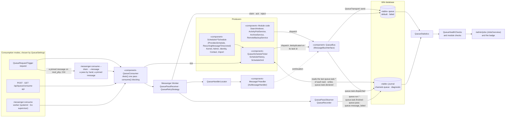
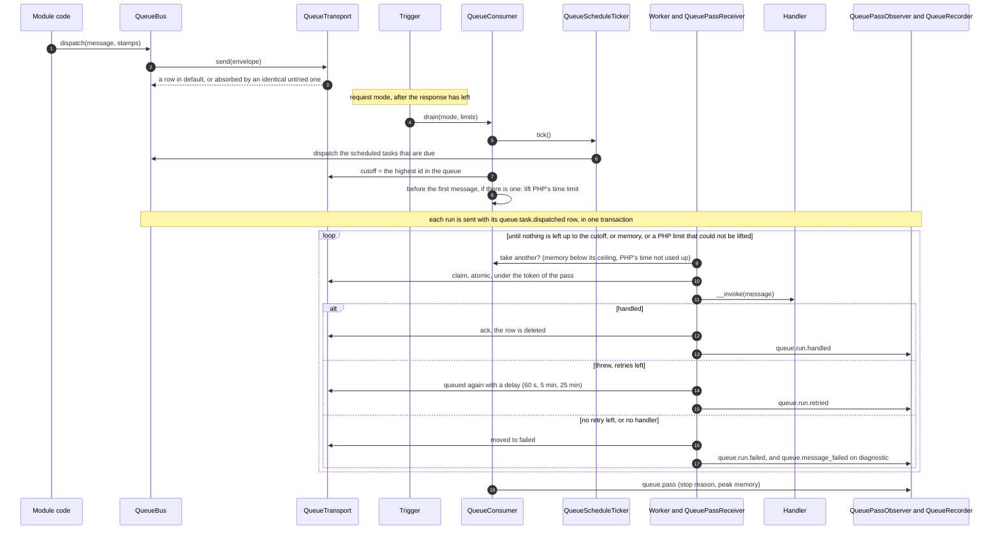
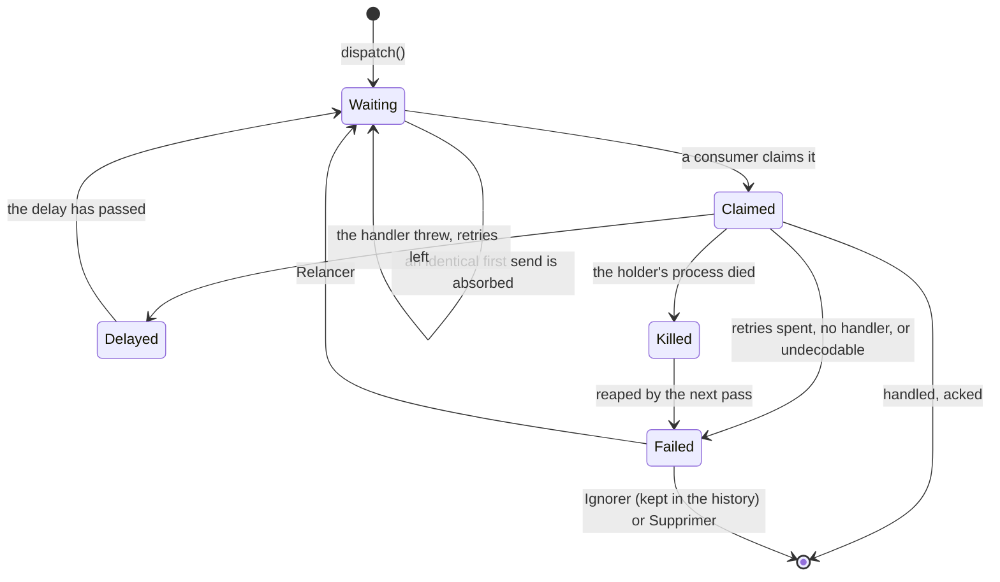
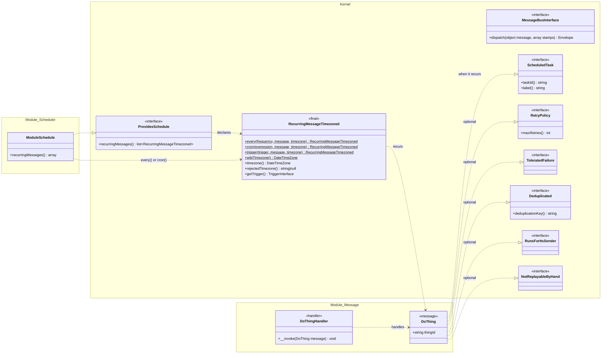

# Background work goes through one queue

YesWiki defers work in seven home-made ways built on four primitives: a closure parked in
`AfterResponse` for ActivityPub delivery, a `search_queue` table drained by a shutdown function,
by the maintenance sweep and by a detached `search:reindex --drain`, `maintenance.after` listeners
that start `contact:send-digest` and `importer:sync` detached or fall back to shutdown, an
`ArchiveService` that spawns `core:archive` and tracks it in files under `cache/archive/`, a remote
backup whose state machine only advances while a browser tab polls it, and the sweep itself, run
before the page of whichever visitor arrives half an hour after the last one. Most of them swallow
their errors. A digest that failed was marked as sent, a sync that failed wrote to
`cache/importer/<id>.log` and nowhere else, an archive whose process died stayed "in progress" for
weeks, and a listener of `maintenance.after` that threw silently skipped the listeners after it.
Nothing shows what waits, what failed, or whether anything is consuming at all, and the installs
that need this most are the ones with no shell, no cron and nobody who would go looking
(ADR-0023 keeps them first-class).

We decided that **every piece of work the wiki defers is a Message on one queue, held in the wiki's
own database and observed in one place, and that the periodic work is a Scheduler that produces
messages onto that same queue**. How the queue gets consumed is a setting with four values, none of
which needs anything installed except the ones that name what they need, and the default works on
an install nobody touches. A page, `/admin/jobs`, and a set of Health checks (ADR-0026) say when
work waits, fails or has nothing consuming it, and push that to the admin as a badge.

The pieces are `symfony/messenger` and `symfony/scheduler`, wired by hand into the container since
the kernel has no FrameworkBundle. Messages are small immutable objects (identifiers, never
entities) in a module's `Message/`, each beside its handler, an `#[AsMessageHandler]` service found
by `QueueHandlerLocator`; a module declares its recurring work in its `Scheduler/`, through
`ProvidesSchedule`, the way it declares Health checks. The last section of this ADR is the guide to
adding either.

## Architecture

Work enters the queue from two producers: module code that dispatches, and the Scheduler that turns
the tasks which are due into messages. It is stored in the wiki's own database and taken out by one
consumer, whichever of the three modes started it. What happened is then read back, from the queue
and from the Journal, by the Health checks and the jobs page. The producers never call the consumer:
the table is all the two halves share.

The Scheduler keeps no state of its own: what each scheduled task did is the Journal's
`queue.task.*` rows, which the ticker reads and the bus and the recorder write. The dashed arrow is a
handler that splits its work and dispatches its own continuation.

A pass in `request` mode runs once the response has left. `api` and
`messenger:consume --drain` run the same pass. `worker` runs `consume()` instead: it loops over the
same steps with nothing to end it, and ticks the Scheduler whenever the queue is empty.

A message is **killed** when its holder's process died while it ran. It is reaped by the next pass,
announced as `queue.message_killed`, and never retried by itself (see below). Only a human brings a
failed message back.

## The decision, piece by piece

**The transport is the wiki's database, on `DbService` and the dialects.** `QueueTransport` keeps
messages in the one table the queue adds, `queue` (queue name `default` or `failed`), with an atomic
claim that works on MySQL, PostgreSQL and SQLite (modelled on the one `search_queue` had). The rest is
not a table of its own, because the project keeps its number of tables down. What was
handled (with duration and error), the consumer's passes (one row per pass or per blocking
consumer's life) and what the Scheduler knows of each task are rows of the Journal's third channel,
`queue` (ADR-0025): `queue.run.<status>` (the message type as target, the mode as actor),
`queue.pass` (the reason it stopped as target) and the three `queue.task.*` actions below (the task's
id as target), kept 7 days on `last_at` (`journal_queue_purge_time`) and pruned by the Journal itself.
`QueueRecorder` writes them by direct SQL, never through `Journal::store()`, so that none of them
reaches stderr, the daily ceiling and the fingerprint dedup do not apply, and their times stay UTC.
`failed` is kept 30 days. `dispatch()` only writes, in every mode and in the CLI too: nothing
runs because it was sent. A message may carry a dedup key, which collapses a **first send** into an
identical message still waiting and never tried; a retry, or a failure, is never swallowed by it.
The database holds the queue to it rather than the check alone: `dedup_key` is only filled while
its row is a first send waiting (taking it, or failing it, clears it) and is unique within a queue,
so two senders racing past the check still leave one row, the second reading the first's. A failure
replayed by hand while the same work already waits is absorbed by it and leaves `failed`.

**The Journal is the Scheduler's only source of truth,** with no column, triple or cache of "the
next run" beside it. Three actions of the `queue` channel name the task in their `target`:
`queue.task.declared` notes the first time a task is seen, and nothing is sent; `queue.task.dispatched`
is written by `QueueBus` each time a run of the task is accepted; both carry the task's label and
period (`every_seconds`). `queue.task.finished` is written, at `info`, when an attempt ends, with the
task's `consecutive_failures` in its context. The purge spares the last
row of each of the three actions for each task, however old, so that a monthly digest still has its
anchor after the 7 days, and "no row" always means "never seen". The **anchor** of a task is its last
dispatch, or its first sighting when it was never sent. The task is due once its first run after the
anchor has passed. A task declared with `every()` runs on **fixed slots** in its timezone, the
wiki's unless it names another (`RecurringMessageTimezoned`), counted from midnight
(`ScheduleGrid`): every 30 minutes is at :00 and :30, every 24 hours at midnight, whenever the tick
that sent the last one came. A period counted from the send drifted by
the lateness of each tick, half an hour becoming 7:00, 7:33, 8:05. A run started by hand ("Lancer")
is dispatched like any other: it writes a dispatch row, and the next run stays on its slot, which the
button says. The details are under "The Scheduler's history and ticker".

**There are three consumption modes**, chosen by `YESWIKI_QUEUE_CONSUMER`:

| Mode      | Who consumes                                                                                                                          | Ends by itself |
| --------- | ------------------------------------------------------------------------------------------------------------------------------------- | -------------- |
| `request` | the end of each web request, after the response has left where the SAPI allows                                                        | yes            |
| `api`     | `/api/queue/consume`, POST or GET, with the secret as header or `?secret=`                                                            | yes            |
| `worker`  | `./yeswicli messenger:consume`, kept alive by the Go binary (`--supervised`) when it serves the wiki, by systemd or similar otherwise | no             |

Two more were tried during development and removed before any release: `request-spawn`, where the
end of a request started a detached process to consume, and `command`, a crontab running a
non-blocking command. They were the least used, and each carried code of its own (a launch
throttle, a check for hosts that forbid `proc_open`, a CLI time limit) for what `api` and `worker`
already cover. `./yeswicli messenger:consume --drain` keeps the one thing that command did well:
emptying the queue by hand, and exiting.

A fourth, `binary`, was merged into `worker` before any release. It was the same blocking consumer,
the only difference being who keeps it alive: an admin chose between them by where the wiki is
served, not by what they wanted, and a wiki moved to or from the binary had to change its mode or
stop consuming. `worker` under the binary was no real alternative: its unit had to call the binary's
hidden `php-cli` on a program folder whose path changes with every upgrade. Now `worker` says "a
consumer stays up", and the binary supervises it where it serves the wiki. What was lost is the
`binary`-without-the-binary alert: a `worker` nobody keeps up is reported as stalled after 10 minutes,
and the fallback takes over. Two consumers of one wiki (a systemd unit kept from before the binary)
do no harm: both run, and each message is claimed by one of them only.

The variable is read from the real environment, then `private/.env` (the only way on a host with
no environment), then `queue_consumer` in the configuration, then the default: `request`, under the
binary too, since `worker` keeps a PHP process alive per wiki and a wiki that never needed one
would pay its memory for nothing; a wiki asks for it. It needs an explicit mapping, not an entry in `KNOWN_KEYS`,
which would read `QUEUE_CONSUMER`. The binary sets **no** `YESWIKI_QUEUE_CONSUMER`: it sets
`YESWIKI_SERVED_BY_BINARY`, so each wiki of a farm chooses its mode, and the jobs page can say that
the binary keeps the worker up. An unknown value does not stop the wiki; it gets the default and
keeps the origin it was found in, so the page can say where to correct it, and "origin is `default`"
keeps meaning that nobody chose. The `api` route is public as far as the ACL goes and the
secret is the whole check, compared in constant time; with no secret set it answers 401 to
everybody. A call that comes while another pass runs makes a pass of its own beside it. It also answers GET with the secret in a `secret` query parameter, a deliberate departure
from HTTP: some hosts schedule nothing but a GET without custom headers, and `api` is the only mode
left to them. The header wins when both are sent, and stays the advice, since a query string lands
in access logs.

**A pass that ends by itself and a blocking consumer are two ways to run one consumer.** `QueueConsumer` is the
only code that takes messages, over Messenger's `Worker`, so the observation is the same in every
mode. `drain()` runs a **Pass**: it ticks the Scheduler, marks the cutoff, lifts PHP's time limit
before the first message (only when there is one), then consumes what was in the queue when it
began, and never waits. `consume()` blocks like `messenger:consume`, with a time
limit, a memory limit and a message limit, ticks the Scheduler whenever it is idle, and leaves a
heartbeat. A `drain()` leaves one too, after a message, at most once a minute, since a pass has
no deadline and may run for hours. Several passes may run at once, and beside a blocking consumer:
nothing but the atomic claim of each message keeps them apart, so that a long message (an archive,
a full reindex) holds back no other while another request can take them. There is no cap on how
many run, on purpose: a cap would be one more mechanism, and each pass is a PHP process the server
already bounds. Neither runs while the wiki is hibernated, archiving or updating, read from the
configuration as it is now since an archive sets it while a consumer is running. Nor does the
Scheduler: `QueueScheduleTicker::tick()` asks the same question itself, before it notes or sends
anything, whoever calls it, so the schedule stands still. Once the wiki wakes up, a task that missed
any number of runs while it slept runs once, as after any time nothing ticked. A blocking consumer
idles through that rather than returning, because returning would look to the supervisor like a
crash.

**A pass has limits, not a time allowance.** Before its first message, whether or not a visitor still
waits for the response, the pass lifts PHP's time limit (`set_time_limit(0)`) and reads
`max_execution_time` back. PHP's limit counts the CPU time of the whole request, the page just served
included, so no estimate of a message's duration can tell whether it fits; and the slow messages (an
HTTP call that times out) are the ones no average predicts. With the limit lifted, the pass runs every
message that was in the queue when it began, and stops on only four things: nothing left up to the
cutoff (`empty`), a paused wiki (`paused`), memory above 80 % of `memory_limit`
(`memory`, a guard rail and not a forecast; none when `memory_limit` is -1), or, only when the limit
could not be lifted (`php_admin_value`, `set_time_limit` disabled), PHP's remaining time less a margin of
2 s plus a tenth of `max_execution_time` (`php-limit`). `messenger:consume --drain` and the jobs page's
"Consommer maintenant" are the same pass; the button has no memory ceiling either
(`QueuePassLimitsFactory::untilEmpty()`). Where the response cannot leave before the script ends
(mod_php, CGI), the visitor waits until the pass is over.

**What "in the queue when it began" means.** Right after the Scheduler's tick, the pass reads the
highest message id and takes nothing above it. So a task the tick has just made due runs in the same
pass; a message queued during the pass, by a request elsewhere or by one of the pass's own handlers,
waits for the next pass; a delayed message that was already there and comes due during the pass is
taken. Without that cutoff, a handler that requeues itself (the download of a remote backup queues its
next slice at once) or a busy wiki would keep the pass, and the visitor waiting on it, from ever ending.
The same figures give each claim its **kill limit**: what PHP leaves of its limit, or **one hour**
when it has none, since a host does not let a process live longer. A claim also names the pass
that holds it: every message a pass takes carries the pass's token. If that pass's process dies
(PHP's limit, the OOM killer, a host's request timeout, a restart), the message stays claimed, and
the next pass moves it to `failed`, recording the mode that cut it: **at once** when the holder's
lock is free (below); **past the limit plus a minute** when there is no lock to read (`cache/` not
writable, a pass that has ended, a token in an older format); and **never** while the holder still
holds its lock, however long past its limit, since PHP's limit counts CPU time on Linux and a
handler waiting on the network outlives it.

**A lock says whether the holder is there.** Each pass holds a `flock` on
`cache/queue-holders/<nonce>.lock` (`QueueHolderLock`), taken before its token is written anywhere
and kept until its row is closed; its messages carry its token and have no lock of their own. The
kernel drops the lock when the process ends, however it ends, and PHP at the end of the request, even
after a fatal error in a shutdown function. A judge reads it, creating and removing nothing, and tells
three states apart: **held**, the holder is alive, whatever PHP's limit says and however long it takes;
**free**, the holder is gone and its claims are failed, and its pass closed, as killed at once;
**absent**, the rules above apply. So an FPM worker that survives a fatal error in a shutdown function
frees the lock when its request ends and the next pass reaps its claims at once, and a live worker keeps
its message for as long as it works. **One host is assumed** (a shared host or a single container):
every process that reads `cache/` shares one kernel, so a lock it finds is the truth. Several hosts
over one database and one `cache/` are left to the work on several nodes, for the whole application;
until then, a lock read over NFS from another host may say free when it is not. Only the reaper deletes
a file (`QueueConsumer::reapTheDead()`, once the holder's claims are failed and its pass closed): the
judges that only read (health checks, statistics, the jobs page) never do, and `CacheClearer` keeps the
folder.

A consumer whose process ends in the middle of a message (a fatal error, PHP's limit, an `exit` in a
handler) still fails it itself, from a shutdown function, but that only journals it earlier, since the
lock already tells the next pass; and an ack or reject deletes only a row still under its own claim,
so a holder declared dead that finishes after all leaves its failure in place and the Journal says
how it ended. **A message killed this way is not retried by itself**, because it would be cut again,
and `/admin/jobs` says to change mode and retry it by hand.

Each message found killed is announced on the wiki's own dispatcher as **`queue.message_killed`**
(`QueueConsumer::MESSAGE_KILLED`), once it is in `failed`, with `messageId`, `type` (its class),
`mode` (the one it was killed in) and `message` (null when it cannot be read back). Each listener
is called on its own: one that throws is journaled as `queue.listener_failed` and stops neither the
next nor the pass. That is how a backup PHP killed lifts the `archiving` status it left, with
nobody on the backups page; a module whose message holds some state of the wiki listens the same
way. Reaping changes no content, so a paused pass still reaps, and goes on once a listener has
lifted the pause. Work that splits
(remote backup, mass reindexing) does a bounded slice and dispatches its own continuation, so it
runs in every mode. The one exception is a backup or restore an admin starts: it keeps a path
through the admin's own request, **pinned** to the end of that request, run with
`set_time_limit(0)`, in `request` and `api`, the modes that would otherwise run it only when
something calls them. In `worker` it is queued for the worker while the worker is
seen at work, and pinned too when it is not (`QueueFallback::consumerIsGone()`): left to the end of
visitors' requests, in passes where PHP's limit may hold, it could be cut. Where the response cannot leave before
the script ends (mod_php, CGI), the request hands each message it pinned to a process of its own
(`messenger:consume --message=<id>`), as `core:archive` was detached before the queue, so that the admin
does not wait for the whole backup and a wiki fetching one does not give up; the request runs it
itself only when no process can be started. A wiki
installed and forgotten must still back itself up before an update. The queue's table and the Journal's
`queue` rows, the scheduled tasks' among them, are the running instance's state, not the wiki's
content: a backup leaves them out, and a restore neither drops, replaces nor fills the table (it
creates it when the database has none) and puts the live Journal `queue` rows
back in place of any the dump brings (`DumpRewriter::leftOutRows()`), or a restored copy would hold
the backup's own message as running, replay what was pending then, show passes that never close,
acknowledge the restore by an id in a table it has just replaced, and send the schedule back to
where it stood when the backup was taken.

**The Scheduler produces, the queue consumes.** Each maintenance step (`revisions`, `journal`,
`recovery-keys`, `activation-keys`, `bot-guard`) is its own recurring task, every 30 minutes as
before, so that one failing hides none. Digests are one task per period, on a cron at 7 a.m. in
the wiki's timezone (daily, Mondays, the first of the month). A data source that syncs itself is a
task per source, at its own interval, on the slots of that interval; saving a source just
set to sync queues its first sync a minute later, which is a dispatch like any other. Neither keeps
state of its own: a task run by hand is a dispatch, and its next run stays on its slot. `maintenance.before` and `maintenance.after` are still dispatched, by a task of their
own (`extension-hooks`), and a listener that throws is traced and no longer stops the next. Their
context keeps its keys but not all its meaning, which an extension author should know: the
listeners run in a queue pass, with no request, no logged-in user and no session; `previousRun` is
when the `extension-hooks` task last finished (null before its first run); and `duration`, on
`maintenance.after`, measures only the `before` listeners -- close to zero -- since the
housekeeping steps no longer run between the two. A late task runs once at the
next pass, not once per period missed, and one the Scheduler sees for the first time is noted and
waits for its first run. The schedule's memory is the Journal's `queue.task.*` rows, and one tick at
a time runs behind a `RuntimeLock` of its own.

**Failures are visible, and rare ones are retried.** Messenger's retry gives three further attempts
after 60 s, 5 min and 25 min (a message class can say otherwise), and a message
with no handler goes straight to `failed`. Every definitive failure is a Journal entry on the
`diagnostic` channel (the `queue.message_failed` family stays there, whatever the `queue` channel
also records of the attempt: one says what broke, the other keeps the history). The one thing that is exempt from the generic failed-messages alert is a
message class marked `ToleratedFailure`: a delivery to a fediverse server that is gone is routine,
and a permanent red badge teaches the admin to ignore every badge (ADR-0026). The module that owns
such a message raises its own, calibrated check instead, and that check can ask the jobs page for
"Relancer" and "Ignorer" buttons that act on every failed message of the type (the "all" buttons of the
generic alert skip it). "Ignorer" on `/admin/jobs` **acknowledges**
the failures present: they leave `failed` and the alert and stay in the history, and a new failure
brings the alert back. There is deliberately no way to mute a cause.

**The checks are the product.** Thirteen Health checks (`queue-tables`, `queue-fallback`, `queue-stalled`,
`queue-failed`, `queue-killed`, `queue-task-overdue`, `queue-task-failing`, `queue-backlog`,
`queue-consumer-restarts`, `queue-consumer-memory`, `queue-config`, `queue-php-limit`, `queue-visitor-cost`) are re-derived from the `queue` table and the Journal's `queue` channel whenever they
are asked. "Nothing is consuming" is judged on **consumer activity**, not message age: messages
available and no pass, heartbeat or claim within its limit for 10 minutes in `worker`,
3 hours in `api`, 24 hours in `request`. A queue that moves but
slowly is a backlog and only degraded (1 hour for the blocking modes, 6 for the others), and is
silent while the stall alert fires. A wiki that is hibernated is silent too. A wiki where no pass
has ever run falls back to the age of the oldest message, so a fresh install with messages and no
consumer alerts. The badge counts `Broken` only. The page is server-rendered Twig with htmx, behind
`@admins`, and every action ("Consommer maintenant", "Relancer", "Ignorer", "Lancer") answers with
the page fragment it changed.

**When the chosen consumer is gone, the end of requests stands in for it.** A worker that died, an
online cron that stopped calling: on a wiki nobody watches, maintenance and indexing would stop for weeks
unnoticed. `QueueFallback` decides it, from what is already recorded. Every pass row says what started
it (`origin` in its context, written only when it is not the consumer's own, so older rows read as the
consumer's): the consumer of the mode, the messages a request **pinned**, the jobs page's **manual**
button, or the **fallback**. Only the consumer's own passes make it "seen" (`lastSeenAt`), and so does
a live claim of its mode held by the process of one of its open passes, since a worker inside one long
message does not beat. A consumer's pass that finds the wiki hibernated still
leaves a row, closed at once, outside `request`, so that an online cron that kept running while the wiki slept
is not taken for gone when it wakes. The fallback
starts when work (an available message, or the schedule being due — on a quiet wiki nothing else is
queued while nothing ticks) has waited longer than the mode's stall delay and the consumer has not
been seen for as long; a schedule that never ticked has waited since the rule was first read
(`cache/queue-fallback-watch.lock`). The fallback consumes as `request` does, and its passes carry `fallback_for`: it lasts until the
consumer is seen after its first fallback pass (`fallbackSince`), not until the queue is empty,
which would make it flap; changing the mode ends it too. Outside it, a request reads the rule at
most once a minute (`cache/queue-fallback-check.lock`, the answer kept as
`cache/queue-fallback-active-<mode>.lock`), so a mode that does not consume at the end of requests still
costs a request a `stat` and no query. `queue-fallback` is **broken**, the jobs page lists it first
and keeps the chosen mode in its banner, with that consumer's last pass in red; `queue-stalled` is
then judged with `request`'s delay, so it speaks again only if the visits stop too.

**The binary supervises, and reads nothing of PHP's configuration.** For each open wiki it runs
`php-cli … messenger:consume --supervised --time-limit=3600 --memory-limit=128M` with the binary's
marker in the environment. That command works out the effective mode itself and, if it is not
`worker`, exits at once with 78 (`EX_CONFIG`), which the supervisor reads as "not my wiki" and does
not restart until a SIGHUP reload. Since `worker` is asked for, that is what most wikis do: a start
or a reload boots PHP once per wiki, briefly, to learn this, which is accepted over a binary that
reads PHP's configuration. A blocking consumer stops between two messages once the wiki's
configuration changed (a setting saved, `private/.env` edited) or its compiled container was
emptied (`migrate` after an upgrade, `cache:clear`), the two questions FrankenPHP's worker asks
too, since it would otherwise run on what it booted with for up to an hour. Supervised, it then
exits with **75** (`EX_TEMPFAIL`, stop reason `config-changed`), which the supervisor restarts at
once and does not count towards the backoff; unsupervised it exits 0, for systemd's
`Restart=always`. Any other exit restarts it: after a second if it lived at least 30 seconds (the ordinary end of
`--time-limit` or `--memory-limit`), after a delay that doubles from 1 s to 60 s while it keeps
dying young. A stop gives the message in hand 10
seconds, to stay under the unit's `TimeoutStopSec=30s` with Caddy's shutdown after it. The deciding
code lives apart from the FrankenPHP dependency so `go test ./...` runs without a PHP build.

**What goes away.** `AfterResponse` and its drain in `worker.php`, the request-time maintenance
sweep (`MaintenanceService::sweep/claim/dueOnRequest` and its call in `YesWikiRuntime::doRun`), the
`maintenance_trigger` setting and `cache/maintenance.lock`, the `register_shutdown_function` calls
that deferred search, digests and syncs, and the `maintenance-sweep` Health check. A wiki with
`maintenance_trigger: cron` loses the setting and no mode is chosen for it: its admin is told that
`./yeswicli core:maintenance` is gone too, that the crontab line is to be removed, and that `worker`
or `api` is the way to consume outside page views. Released in the alphas, `core:maintenance` is
removed without an alias, which breaks those crontabs on purpose. What was synchronous
on purpose stays so: mail sends, webhooks, thumbnails, ActivityPub Follow/Accept, the Doryphore
arrival, and the explicit actions of a human or a webhook (`importer:sync`, `GET /api/import/sync`,
`{{sync}}`, the sync button).

### Implementation notes

What follows is the reasoning behind choices in the code that the code itself does not explain.
Each point names the class or method to look at.

**Note, 2026-11-06: the per-pass time budget was removed.** A pass used to compute a deadline from
`max_execution_time`, cap it by mode (3 s while a visitor waits, 20 s once the response had left, 50 s for an
API call) and take a message only if the average duration of its type fitted. Most jobs are short, and
the slow ones are not predicted by an average (the timeout of an HTTP call cannot be). Since a pass also
lifts PHP's time limit and the life of a claim is judged by its holder's lock, the estimate protected
little and cost a factory, a context, clocks, a health check and a screen column. It is replaced by a
mark taken when the pass begins (the highest message id after the schedule's tick: the pass runs what was
there and what the tick made due, and what is queued meanwhile waits for the next pass) and by a stop on
PHP's own limit, only when it could not be lifted (`php-limit`, with the `queue-php-limit` alert). The
sections below describe the code as it now is.

#### The transport and its claims

- **UTC, not the database's `NOW()`.** A session in another time zone than the rows' (common on
  shared hosting) would make a message available hours early or late, so `SqlDialect::utcNow()`
  is bound as a parameter. On PostgreSQL it reads `clock_timestamp()`, because `NOW()` stands still
  for the whole transaction.
- **A racing send is never refused.** The second of two senders past the dedup check inserts with
  `SqlDialect::onConflictDoNothing()`. A refused INSERT would abort a send made inside the caller's
  transaction (saving a page), and on PostgreSQL every later statement too. It then reads the first
  sender's row under a row lock. The lock reads the latest committed row, not MySQL's repeatable-read
  snapshot. If a consumer took that row in the meantime, the insert is tried again, at most
  `RACE_LOOKS` times. On MySQL the no-op is `ON DUPLICATE KEY UPDATE col = col`, which reports 0 rows
  because PDO does not ask for found rows. `QueueTransport::requeue()` races the same way and catches
  the duplicate-key refusal.
- **A key longer than `dedup_key`** (191 characters, utf8mb4's widest indexable VARCHAR) keeps a
  readable start and the `sha1` of the whole. Two keys that differ only past the width stay apart.
- **`last_error` is read from Messenger's `ErrorDetailsStamp` when the message moves to `failed`,**
  so the jobs page and the health checks never decode bodies.
- **A claim** picks a candidate, marks it with a token only that call knows, provided nobody marked
  it first, and reads back what carries the token. The candidate is `FOR UPDATE` on MySQL and
  PostgreSQL, and the transaction is `BEGIN IMMEDIATE` on SQLite. An idle blocking consumer asks every
  second, and "nothing to take" is answered without opening the transaction, because
  `BEGIN IMMEDIATE` would take SQLite's write lock away from the wiki's requests.
- **An undecodable message** (class gone, body damaged) would be taken by every pass. It is moved to
  `failed` with its reason, and `UndecodableMessageException` names the row. `QueuePassReceiver`
  records it and goes on, since Messenger's `Worker` would stop on it, and a blocking consumer with it.
- **Each claim records `delivered_mode` and `delivered_limit`,** because a process killed by PHP or
  the OOM killer cannot say so. A request resets the claim mode, so a worker-mode request never
  inherits the previous one's. A claim with no recorded limit is given the longest a mode records
  (one hour, `QueuePassLimitsFactory::KILL_LIMIT_NO_PHP_LIMIT`: the longest a host lets a process live).
  `QueueHealthChecks::BACKLOG_AFTER_OTHERS` is 6 hours too, but it is a threshold for an alert about
  lateness, not a ceiling on anyone's life.
- **The process remembers the passes it runs** (`QueueTransport::workFor()`, which also gives the
  transport the token to write on each claim). A pass running here is alive without reading its file,
  because on NFS `flock` is emulated with `fcntl`, whose locks belong to the process: a process probing
  its own lock would find it free. The transport forgets the token when the pass ends and at the start
  of each request, so a claim made after a pass never carries a token whose lock is let go. A claim
  made outside any pass (only tests do) gets a token of its own with no file, judged by its limit.
- **One verdict for claims and passes** (`QueueTransport::isOverdue()`): held, never; free, at once;
  absent, once the claim's `delivered_at` (or the pass's `last_at`) plus its limit (one hour when none
  is recorded, and always for a pass) plus a minute is past.
- **The dead-or-alive comparison is made in PHP, row by row.** Only a handful of rows are being
  handled at once, the limit varies per row, and date arithmetic on a column is not portable.
  Reaping is guarded by the claim token, so two concurrent reapers, or a reaper and the holder's own
  end, report a message once.
- **The claim is forgotten only once the database accepted the ack.** If an ack is refused (locked,
  connection lost), the process keeps the claim, and fails it as killed when it ends. Its pass's lock
  goes with the pass, so a claim left behind by a pass that ended has no file any more: another
  process reaps it past its limit plus a minute, not at once.
- **The token** (`QueueHolderLock::newToken()`) is `pid / nonce`, e.g. `1234/0123456789abcdef`. The
  pid is only for whoever reads it; no decision reads it. The `nonce` names the pass's lock file. A
  token in an older format is judged by its file like any other, and has none.
- **The holder lock** (`QueueHolderLock`, on `RuntimeLock`) is one file, `cache/queue-holders/<nonce>.lock`,
  per pass. `QueueConsumer::pass()` takes it before the pass's row names the token and before any claim,
  so a judge, which only reads tokens already written, never finds a file free between its creation
  and its lock. A pass whose file cannot be made (`cache/` not writable) runs all the same, and what it
  holds is judged by the rules a token with no file gets. `release()` removes the file and then closes
  the handle, after the pass's messages are acked and its row closed, so a judge that finds the file
  free just after has nothing to fail or close.
  `stateOf()` opens the file without creating it and tries a non-blocking shared `flock`: a file it
  cannot open (none, or one it may not read) is `ABSENT`, a refusal is `HELD`, a lock it gets is
  dropped at once and is `FREE`, the file left where it was. Shared rather than exclusive, because it
  still conflicts with the holder's exclusive lock, two judges looking at once do not take each other
  for the holder, and an NFS client, which emulates `flock` with `fcntl`, refuses an exclusive lock on
  a read handle and would make every holder look alive. Even so, a `cache/` on NFS with that emulation
  and a threaded PHP (ZTS) do not mix: `fcntl` locks belong to the process, not to the handle.
  Only the reaper removes the file of a holder that is gone, and last: removed before the pass's row
  was closed, the file would read absent and leave that row open for an hour.
  `expiredClaims()`, `isHandling()` and `liveHolders()` only read, since the health checks, the
  statistics and the end-of-request check call them.
- **A requeued message loses `RedeliveryStamp` and `SentToFailureTransportStamp`.** It gets its
  retries again, and Messenger would otherwise drop it rather than send it back to `failed` when it
  fails again. A message that still cannot be decoded goes back as it is, in case an extension
  brought its class back.
- **Pruning `failed` counts from `created_at`,** which is reset whenever a message moves there.
  Nothing in `default` is ever pruned, however old: it is work still to do. A delete from `failed`
  only touches a message still there, because another tab may have retried it and a consumer may be
  running it.

#### The consumer

- **Each pass has an event dispatcher of its own** for the `Worker`, so nothing subscribed to the
  wiki's dispatcher runs inside a pass, and nothing of a pass outlives it. The wiki's dispatcher is
  built only when a killed message is announced, because building it builds every subscriber.
- **`QueuePassObserver` listens to `WorkerMessageFailedEvent` at priority -200,** after Messenger's
  retry listener (100) has decided and its failure listener (-100) has moved the message. A failure
  that will be retried goes only to the history. Every definitive failure is journaled, a
  `ToleratedFailure` too, because that marker only changes which check judges it. A killed message is
  recorded under the mode that could not carry it.
- **The shutdown function** that fails what a dying process still holds is registered through a weak
  reference and never throws. It no longer decides whether a death is noticed, the holder lock does:
  it only journals the failure earlier than the next pass would. PHP runs no further shutdown function
  once one has died of a fatal error, but an FPM or Apache worker that survives it still frees the lock
  when the request ends, so the next pass reaps the claim at once instead of leaving it to the
  transport's rules above.
- **Every pass holds a holder lock of its own,** taken before its row names its token and let go in a
  `finally`, and every pass row names it (`holder`), whatever the pass's origin. Its messages carry the
  same token. A `cache/` where it cannot be made does not stop the pass, which is judged by the rules a
  row with no file gets.
- **One reaper** (`QueueConsumer::reapTheDead()`), called by `drain()` and `consume()` at their start,
  by `consume()` at each heartbeat, and by a paused pass. It fails the claims the verdict calls dead,
  announcing each; closes as killed the other open passes the same verdict calls dead, never its own;
  then removes the file of each of those holders whose lock is free. Two reapers at once report a
  message, and close a pass, once, since each write is guarded by the claim's token or by the row
  still being open. A failure while reaping is only journaled.
- **A pass whose holder is gone is closed as `killed`,** so that a pass that died (a fatal error, the
  OOM killer, a restart) does not stay "running" for good. A holder whose lock is free is closed at
  once. A holder whose lock is held stays open however long: a worker may run for days, and its
  heartbeats say so. A row with no holder, an old row, or one with no file, is closed once its
  `last_at` is older than an hour plus the grace (1 h + 60 s). The stop reason is `killed` (`QUEUE_STOP_KILLED`).
  `QueueRecorder::passKilled()` leaves `last_at` as it was, the last sign of life, because the fallback
  (`lastSeenAt()`) and the stalled alert read it as "the consumer was seen at work then": moving it to
  now would hide a dead consumer for the whole stall delay. It closes only a row still open, so a pass
  that finishes after all writes its true reason over `killed`. `visitorWaits()` leaves a killed pass
  out, since its duration measures no wait.
- **No duration is estimated.** Nothing takes the average of a type to decide whether to start a
  message. The stop reasons are `empty`, `paused`, `memory` and `php-limit`, and the last is set only
  when PHP's limit could not be lifted.
- **A pass never throws.** A pass that breaks (table missing, database gone) is journaled and
  reported as `error`, because it often runs at the end of a visitor's request.
- **A blocking consumer checks for a configuration change before any tick.** A schedule built from
  the old configuration would send a task the new one no longer declares, and count a digest's 7 a.m.
  in the old time zone. The question is asked at most
  every 5 seconds, and not at start. So a message dispatched in the few seconds after a change may
  still run under the old configuration. Setting the wiki's status rewrites the config file, so a
  hibernation or a backup restarts the consumer once.
- **A message pinned to its sender's request** runs whatever the pass's limits and even while hibernated,
  still claimed, with no tick and no reaping. Its claim is held to no PHP limit. The sender lifted the
  limit, and where a host forbids that, PHP's remaining limit counts CPU time, which a backup waiting
  on disk or network outlives. Judging by that limit would make another process's pass fail the
  backup as killed while it runs.
- **A schedule that breaks** is journaled by the tick that sends what is due, and the pass goes on;
  the paths that only read it (`tasks()`, `task()`, `dueAt()`, `declaredTaskIds()`, `runNow()`)
  write nothing, or the admin badge and the end of each request would journal it too. The ticker waits
  `QueueScheduleTicker::RECHECK_SECONDS` (a minute) before trying again, so a blocking consumer that
  ticks at every idle second does not journal it every second.

#### The Scheduler's history and ticker

- **`ScheduleHistory` is the one place that reads what the tasks did,** in a single query: the last
  row (`MAX(id)`, grouped by action and target) of each of `queue.task.declared`, `.dispatched` and
  `.finished`, over the Journal's `(channel, action, target)` index (ADR-0025). The cost does not
  grow with the runs around them: with 10 000 `queue.run.handled` rows and 12 tasks it is one
  query of about a millisecond, which `ScheduleDueCostTest` holds under two queries and 50 ms. Times
  are UTC, `Y-m-d H:i:s`, read from the injected clock (`DatabaseClock`).
- **The last row of each action is what the purge spares,** since the queue channel keeps 7 days and
  a digest runs monthly. A task no longer declared keeps its last rows and finds them again if it
  returns, running once at once if a run came due meanwhile. `consecutive_failures` is a fact of the
  `finished` row, worked out from the task's previous one when it is written (0 when handled, one
  more after a failed or killed attempt, unchanged by a retry), so the count survives the purge.
- **Whatever sends a task writes its dispatch row,** because `QueueBus::dispatch()` does: the
  Scheduler, the jobs page's "Lancer", and the first sync that `ImportSchedule` queues itself. The
  bus knows no period: the ticker hands it the trigger's in a `TaskPeriodStamp`, which is never
  stored with the message, and a send that names none (that first sync) takes the `every_seconds`
  of the task's last declared or dispatched row. A send
  absorbed by a run of the same task still waiting (dedup key `task:<id>`) is a dispatch too: the
  Scheduler did send it, and an interval counted from the older one would run the task twice after a
  jam. A send that failed, a retry and a "Relancer" from the jobs page (the same run resuming, not a
  new due time) write nothing.
- **A task's run and its dispatch row are one transaction.** The pass that follows the tick takes the
  run at once, and taking it clears its dedup key: a run queued without its row would leave the anchor
  where it was, and the next tick would queue the task a second time (a second digest to every
  subscriber). So the bus sends the run and writes the row together (`QueueTransport::atomically()`),
  and a Journal that refuses the row undoes the send: the dispatch is journaled as
  `queue.dispatch_failed`, the ticker counts nothing sent, and the task stays due for the next tick. A
  Journal that stays broken holds the scheduled tasks back, said every minute, rather than running
  them again and again. A plain message needs no row and is queued whatever the Journal.
- **A task seen for the first time is noted, not sent.** Under the lock the ticker writes
  `queue.task.declared`, and the task waits for its first run after that. "Never sent means due at
  once" was the first idea and was dropped: a wiki that has run for months can see a task appear with
  no trace (its first subscriber, digests switched on again, a restore onto a new install, an upgrade
  from a version without the queue), and its monthly digest would go out on the 17th and again on the
  1st.
- **Each computation builds a Schedule of its own.** The schedule may change with the configuration,
  and the ticker lives as long as a worker does, hence a new Schedule, from the providers, each time
  it computes.
- **An `every()` runs on fixed slots, which `ScheduleGrid` works out.** Left to itself, a Symfony
  `PeriodicalTrigger` with no `from` starts on the first date it is asked about, the anchor, so its
  next run was the last dispatch plus the period, and each late tick pushed every later run back.
  The grid counts instead from midnight in the task's timezone (`RecurringMessageTimezoned`), the
  wiki's when it names none. A period
  of a day or less restarts at each midnight, on the wall clock: 45 minutes is 0:00, 0:45 ... 23:15,
  then 0:00, and 24 hours is midnight. A longer one counts from a fixed midnight, Monday 3 January
  2000, in whole days when it is some, in elapsed time otherwise. A wall-clock time the change to
  summer time skips is the hour after it, and the hour the change to winter time repeats gets no
  slots of its own, an hour and a half between two half-hourly runs once a year. The grid reads the
  trigger's period and its `until` from clones and never moves the trigger; a `cron()` keeps its own
  times. The Journal still holds the last dispatch, which is how a slot that already ran is told from
  one that is due. `every()` takes a fixed length: a calendar period such as a month is a `cron()`.
- **Each task says its timezone, and checks it: `RecurringMessageTimezoned`.** A provider declares
  its tasks with `RecurringMessageTimezoned::every()`, `cron()` or `trigger()` rather than Symfony's
  `RecurringMessage`, which is final and is wrapped. With no timezone, or an empty one, a task runs
  in the wiki's (`wikiTimezone()`): PHP's, which `YesWikiInit` sets to the wiki's `timezone` when it
  exists, and which every provider of the core relies on, the digests included: none reads the
  setting. A name PHP does not know (`Europe/Pariss`, a trailing space), given by a task that runs in
  a timezone of its own, falls back to PHP's timezone too, what the pages show times in, and the
  name is kept (`rejectedTimezone()`). Each tick then journals `queue.schedule_provider_failed` for
  that provider, naming it. A wiki `timezone` that does not exist is no task's to say: `YesWikiInit`
  keeps PHP's and warns. Symfony's `cron()` takes
  such a name without a word and throws on the first run asked for, out of the ticker's reach:
  `dueAt()`, `tick()` and the jobs page threw, and not a task of the wiki ran any more, purges and
  imports included. The ticker hands the grid each task's timezone, so the grid reads no setting
  of its own. Anything else a provider returns (a bare `RecurringMessage`) is journaled at the tick
  and left out, while the other tasks run.
- **`dueAt()` is the earliest next slot after the anchor of the declared tasks,** worked out from the
  same elements as the tick. It is null, meaning "due at once", while a declared task has no anchor,
  so that the next tick writes its row; just after that tick it falls back on the real next date, or
  the check would stay true on every request. When a tick finds no next date (nothing declared, or
  rows that cannot be read back), it waits a minute like any other, rather than ticking again at the
  next second. A schedule whose triggers never fire again would leave `dueAt()` null too between
  ticks, and the kernel's daily prune prevents that. It is kept in the ticker's memory and
  worked out again after `RECHECK_SECONDS` (a minute); it is never persisted, and no other process
  reads it. `QueueRequestTrigger::hasWork()` and `QueueFallback::entersNow()` read it.
- **The end of a request pays for it.** In `request` mode every request is a new process and starts
  with no memo: one query on the Journal, measured above, plus what the providers read to say what
  they declare (the digests' provider looks up whether anybody subscribed). That is the price of no
  second state. Should it grow, the answer is a cheaper query, not a cache.
- **`tick()` must be cheap,** because a blocking consumer calls it about once a second. It returns
  while the due time in memory is ahead, so it reads the Journal at most once a minute, and a task
  that another process dispatched is seen within that minute. It takes the lock only when something
  is due.
- **One process ticks at a time, under a file lock:** `RuntimeLock` on `cache/queue-schedule.lock`,
  which `CacheClearer` keeps. It is no state, only an exclusion: two processes would otherwise read
  the same last dispatch and each send the run that is due. The dedup key would absorb the second
  send, but not its dispatch row. The history is read under the lock. A file lock is enough because
  every machine that processes a wiki shares its `cache/`. If the lock file cannot be created the tick
  throws, rather than answer "somebody else ticks" and never run; a `finally` releases it.
- **A recurring message that is not a `ScheduledTask` is journaled and skipped** as
  `queue.schedule_provider_failed`: with no id there is no last dispatch to find, and it would be sent
  at every tick. No module declares one. Declaring the same message on the same interval twice
  (Symfony's `LogicException`) is one task, journaled, not fatal.
- **While a provider throws,** the other providers' tasks go on and its own are listed from the
  Journal, with the period their last declared or dispatched row carries and due on the first slot
  of that period after their anchor (no due time when no row says the period), so `queue-task-overdue` still fires once
  they stop being sent. Nothing is forgotten, since nothing is kept beside the Journal to forget; the
  cost is that a task no longer declared, whose rows the purge spares, is listed and judged too while
  a provider throws.
- **"Lancer" leaves the next run on its slot.** `runNow()` sends the task through the bus, which
  writes a dispatch row, and drops the memo; run at 7:10, a half-hourly task still runs at 7:30. It
  moved the next run while the period counted from the last dispatch. The button, the jobs page and
  `docs/fr/async.md` say so.

#### The end of a request

- **`QueueRequestTrigger::afterResponse()` is registered by `index.php` as a shutdown function as soon
  as the wiki is booted,** so it runs however the request ends (a page, `ExitException`, `exit`, an
  error). The FrankenPHP worker calls it itself after each response. It closes the session first,
  since the visitor's next request would otherwise wait on its lock.
- **A finisher function** (`fastcgi_finish_request()` and its equivalents) has sent the response once
  it returns, whatever it answers. It answers false when Symfony's `Response::send()` already finished
  the response, which is every routed page. Output the pass prints where the response cannot leave
  first is discarded by a buffer that flushes every 4 KB, so a verbose handler costs no memory.
  Output buffers left open are cleaned, so a worker's next request does not get them.
- **A pinned message keeps the delay it was pinned with** (`RunsForItsSender::HELD_FOR_THE_SENDER_SECONDS`,
  300 s), so no other pass takes it while the sender or its detached process
  gets to it. If the request ends without running it, the queue takes it once the hold is over. The
  detached process holds the claim as a CLI, so if it dies, the next pass sees it at once.
- **`QueueBus` swallows a failed send, except inside a transaction the caller opened on the queue's
  connection.** There the failure has already made the commit rollback-only, and on PostgreSQL it has
  aborted every later statement. Swallowing it would surface later as a refused commit with no
  explanation, so it is rethrown where it happened. The request trigger is injected as a service
  closure, so it is built only when a `RunsForItsSender` message is sent.

#### The fallback and the limits

- **`QueueFallback` writes its check stamp before it reads,** and drops the last answer. A read that
  fails (table missing) is then retried in a minute, not on every request.
- **`QueueFallback::consumerIsGone()` is read-only** and memoised per request, since the badge, the
  jobs page and a starting backup all ask. A worker unseen for its delay is gone. The `api` route
  shows nothing that says it will come, so it counts as gone only once the fallback runs for it.
- **`QueueStatistics::fallbackSince()` counts only a fallback pass that started after the patience
  delay.** One that started sooner ran during the minute a request keeps the last answer, after the
  consumer came back, and counting it would restart the fallback.
- **`QueuePassLimitsFactory`** reads the request start time at each pass (`REQUEST_TIME_FLOAT`), so a
  worker serving many requests measures each from its own start. With `memory_limit = -1` there is no
  ceiling, since PHP will not say when it is too much. The limits are read between two messages, never
  during one, and a handler that overruns is left to the kill detection. A handler is told nothing of
  what is left (no handler context says how much time is left): it does its work, or splits it.
- **`liftPhpLimit()` is tried by every pass that ends by itself,** and its answer is read back from
  `max_execution_time`, not from the return of `set_time_limit()`. Lifted, the claims carry one hour
  (`KILL_LIMIT_NO_PHP_LIMIT`); not lifted, they carry what PHP leaves, and the pass stops
  `margin` before it runs out. The margin is 2 s plus a tenth of `max_execution_time`
  (`MARGIN_SECONDS`, `MARGIN_RATIO`).
- **A pass started from a web page** (the jobs page's button) runs in the configured mode when that
  mode ends by itself. When the mode's consumer would block the page, it runs as `request`. It empties
  the queue up to its cutoff with no memory ceiling either: `QueuePassLimitsFactory::untilEmpty()`
  (a memory fatal is the server killing it). Its claims carry what PHP leaves of its limit, or one hour once the pass has lifted it, as
  any pass nobody waits for does. It stops on an empty queue (`empty`), a paused wiki (`paused`) or an
  error; the passes of visitors' requests run beside it and take what it has not taken yet. It is no wait of a visitor's, so it stays
  out of `visitorWaits()`. `QueueApiController` says `forMode($mode, true)`: the call is a pass nobody
  waits for.

#### What the consumer records, and how it is read back

- **`QueueRecorder`'s rows are all the checks and the jobs page know of the queue,** and the runs
  also give the consumer its per-type averages. A run is dated by its end and began `duration_ms`
  before. A pass's context names its process (`holder`), whatever its origin, as its claims do, which
  is how a live claim is matched to an open pass and a dead pass told from one at work. Only the
  pass's own process writes its row, so updating it needs no lock.
- **`context` never holds a JSON null:** an empty field is left out, because MySQL reads a JSON null
  back as the string `'null'`.
- **`consecutive_failures`, carried by the `queue.task.finished` row, does not count a run that will
  be retried,** since that run is not over. An
  `ignored` row has no mode and no duration, because it is not an attempt, but it keeps the cause.
- **`QueueStatistics::lastActivityAt()` counts a message in progress as activity,** because a
  blocking consumer does not beat while a handler runs. The cost is that, with no lock to read, a
  consumer that died mid-message is seen as gone only once that message's limit is over; with one, at
  once. It counts the row a paused pass leaves (a consumer that kept coming while the wiki slept is not
  stalled), but not the row of a pass that found the lock taken: a pass stuck in a handler holds that
  lock.
- **`failedOfTypes()` and `countsAsFailed()` leave killed messages out,** for the killed alert, since
  retrying one in the mode that killed it only kills it again. `outcomes()` counts neither a retried
  attempt nor an `ignored` row. `consumerStarts()` does not count a stop for `config-changed`, so an
  admin saving settings several times is not a crash loop.
- **`messageState()` asks the queue before the history,** because a message requeued from `failed`
  keeps its id. A `retried` message is still to do, under its new id. An `ignored` one is still
  `failed`, because the work was never done. A claim whose holder must be dead is already `killed`,
  without waiting for a pass to reap it, because the admin following it is asking now.
- **Portable SQL:** `failedGroups()` sorts on `COALESCE(killed_in, '')`, because databases put NULL
  at different ends. `visitorWaits()` reads only the latest few hundred passes (in `request` mode
  there may be one per page view) and computes durations in PHP. `ownPass()` reads `origin` as a JSON
  field, because MySQL returns JSON reformatted and PostgreSQL has no `LIKE` on JSONB.

#### The health checks

- **Reads shared by several checks run once per list,** and a read that throws throws again for the
  next check instead of answering null. `QueueScheduleTicker::tasks()` is one of them, for
  `queue-task-overdue` and `queue-task-failing`: it builds the Schedule and reads the Journal once,
  which the badge's `Broken` checks pay on each page an admin loads, and writes nothing. A task never
  seen yet is listed as due now, since the next tick notes it.
- **`queue-config` reads the settings, not the table,** so it can say a mode is wrong before the
  migration ran. **`queue-killed`'s advice** to leave `request` is given only while the wiki is still
  in `request`. **`queue-php-limit`** counts only passes that started, since a paused pass
  says nothing of PHP's limit: it is orange when at least 1 of the last 5 such passes stopped on
  `php-limit`, and its advice is to allow `set_time_limit` or to switch to `worker`.
- **`isOverdue()` allows a full period past the due time,** and at least as long as the mode needs to
  get a chance to run the task. A task due every 23 h that runs 2 h late is not lost. The tasks tab
  uses the same rule, so the table and the alert agree. `tasks()` lists the declared tasks only, so a
  task no longer declared is neither shown nor judged late.

#### Commands, settings and the cache

- **`messenger:consume --supervised` checks its mode before it reads anything from the queue or looks
  at its options.** A process that is not this wiki's consumer must not touch a message. `--drain` is
  recorded as a manual `request` pass, so under a worker it neither counts as the worker starting nor
  makes a dead one look alive. `--message` runs in the mode the request would have used, so the run is
  recorded the same whichever ran it. A `--memory-limit` that is not a `128M`-style size or `-1` is
  rejected, so a typo does not mean "unlimited". `QueuePassLimitsFactory::bytes()` is public for that check.
- **`QueueSettings`:** the `.env` loader never overrides the real environment, so when both hold the
  same value they cannot be told apart, and the file is reported as the likelier source.
- **`CacheClearer::clearEverything()` keeps the queue's locks** (`QueueScheduleTicker::LOCK`,
  the `cache/queue-holders` folder) and any other `.lock` someone holds. Deleting a lock file under
  its holder would let a second tick start beside it, or a judge take a live holder for gone.
- **`QueueHandlerLocator` builds a handler only when its message is consumed,** so a page that merely
  dispatches does not build search, federation or mail. Handler services are public because the
  locator fetches them by id. `QueueFailureCause::MAX_LENGTH` (1000 characters) is enough to recognise
  a failure, and the whole cause stays in the envelope.

#### Backups and restores

- **A restore puts the live Journal `queue` rows back under their own ids,**
  because the running consumer still writes its pass by those ids, and the Scheduler takes the
  largest id of a task's dispatches as its latest. A backup of another wiki may hold such an id. Then
  the backup's row gives way: it moves past every other row, the rows that moved keeping their order,
  and the identity column is realigned after them. The other way round, the pass running the restore
  would lose its row (shown "running" until it was purged), and a live dispatch moved past a later
  one would send the task back to an older anchor, which runs it again. A row of the restored wiki
  that moved only looks newer in a list sorted by id. In a staged restore the kept rows go into the
  staged tables before the swap, so a Journal write right after the swap cannot take their ids. The
  session settings are restored before that, because a MySQL dump's preamble leaves AUTOCOMMIT off
  and the dump's own time zone.
- **On MySQL, a table some of whose rows are left out** (`DumpRewriter::leftOutRows()`) is dumped by a
  `mysqldump` call of its own, because `--where` applies to every table of one call.
- **`queue_consume_secret` and `queue_consumer` stay this wiki's own on restore.** Another wiki's
  secret would answer 401 to this one's cron, and its mode could name a worker this host does not run.
  The secret is always removed from the configuration a backup carries, whatever the hide list says,
  since whoever holds the backup could otherwise consume this wiki's queue.
- **The `archiving` status belongs to the run that set it.** `CreateArchiveHandler` lifts it when
  `archive()` throws, unless the wiki was already `archiving` before the run began, because then the
  status belongs to another run. A run refused because the wiki cannot archive lifts nothing, since
  the status may be an admin's hibernation or an update. A restore never sets a status, and `info.json`
  marks restores (`restore`) so that their death lifts nothing.
- **`ArchiveService::releaseWhatADeadRunLeft()`:** only a killed backup can have left `archiving`,
  since a failed one lifted it as it failed. While a run this wiki follows is waiting or under way, the
  status stays, whoever asks. For example, a remote wiki's `api/archives` refused during an admin's
  backup must not make the wiki writable under it. A run nothing here follows (`core:archive` typed
  in a terminal) keeps the status too. Killed uids are forgotten as the status is lifted, or they
  would lift the next unfollowed run's. The backups page applies the rule again on load, because the
  browser that would have seen the run die may be gone.
- **The reason a run failed comes from the queue's history, not from `failed`,** because the `failed`
  row has an id of its own. The latest 50 failures are enough, since the browser asks within seconds.
  Older pages and older wikis still send `callAsync`, which is now ignored.
- **The installer creates the queue table first,** so a fresh wiki's first request can dispatch. It
  sends the seeded content's `ReindexContent` straight to `QueueTransport`, because it has no container
  and therefore no bus.

#### Fetching a backup from another wiki

- **`AdvanceRemoteBackup` carries nothing.** There is one fetch at a time, and its job file says where
  it is. The message's dedup key `remote-backup` keeps one chain of steps, even when a fetch is
  restarted while a step of the abandoned one waits. That step then runs the new fetch.
- **`RemoteBackupService::STEP_LOCK` keeps one step running at a time.** The queue keeps one message
  from two consumers, but not two messages of one fetch (a step retried from the jobs page, two
  senders racing past the key), and two steps at once would both write the job file and the partial
  download. After queuing the next step, the job file is read again before the message id is noted in
  it, since a worker may already have moved the job on.
- **A step finds nothing to do, without failing, when no fetch is running.** A step is never retried:
  one that fails has already given up the fetch and tidied the remote wiki. A fetch whose step died
  with its process is reported stopped by `status()`, and `start()` gives it up first.
- **A download slice lasts `SLICE_SECONDS` (20 s),** one per pass, since each slice queues the next
  and the next waits for the following pass; the time limit is raised by the request timeout, which a stalled chunk may add. A failed slice waits
  `RETRY_PAUSE_SECONDS` times its count of consecutive failures (30 s, 1 min, ...). Back-to-back retries
  would all fall within the seconds a remote wiki takes to restart. The `advance` POST endpoint now
  only reports, for pages loaded before the upgrade.

#### The per-module tasks

- **`RunMaintenanceHooks` is never retried,** because when it throws, some listeners have already
  run. Each `maintenance.*` listener is called on its own (`EventDispatcher::dispatchToEach()`). A
  failing listener is journaled as `maintenance.hook_failed` under its name, and the handler then
  throws a summary, so the task shows as failed. `PurgeRevisions` is idempotent and keeps the default
  retry.
- **`MailSubscriptions::send()` tries every subscriber,** then throws a `RuntimeException` naming who
  was not reached (10 named, 3 distinct reasons at most). The caller then does not take the period as
  served. The digest is not retried, since resending it would double the mails that went out. A wiki
  put to sleep during the pass mails nothing, and that is not a failure. Unreadable subscriptions
  (no triples table) throw rather than declare no task (see "A scheduled task" below).
- **A data source's sync** carries only the source's key, so a source edited or removed while its
  message waited is imported as it is then, or not at all. `ImporterManager::syncSource()` throws, so
  the queue sees the failure. `syncByHand()` catches it and answers its message, as manual syncs always
  did. Every trigger records its run in `SyncScheduler`, and the handler buffers importers' output into
  that log. The interval is never shorter than `ImportSchedule::MIN_INTERVAL` (1800 s, the
  housekeeping period it replaces).
- **The first sync of a newly flagged source waits 60 s** (`FIRST_SYNC_DELAY_SECONDS`). Until then, the
  pass at the end of the saving request, and a worker that has not yet noticed the change, still read
  the source as it was. A source whose task id is too long is journaled and left out, never thrown,
  because a provider that throws has all its tasks left out of the tick.
- **A federation delivery is one message per recipient,** and the activity is prepared once, when it
  is queued, so every recipient gets the same activity and id, byte for byte. The message carries the
  form id, the actor and the body, not the form, because deleting a form queues a Delete per entry and
  then removes the form before any is delivered. The signer is rebuilt from the stored key alone, and
  `signer()` is called before queueing so the form has its key by then. When the key is gone
  (`ActivityPubKeyStore::has()`), the delivery is unrecoverable. Generating a new key would sign with
  one no remote server knows.
- **The federation checks are two,** because a check has one severity. `federation-delivery` is Broken
  when at least 5 deliveries finished in 24 h and none was handled. Below that, "none succeeded" means
  nothing. `federation-delivery-failed` is Degraded and counts deliveries that used their retries.
  Deliveries cut off by a time limit belong to `queue-killed`.

#### Migrations

- **`MaintenanceTriggerBecomesAQueueMode`** does not rewrite a `MAINTENANCE_TRIGGER` in
  `private/.env`, because that file is not the configuration. It tells the admin the variable does
  nothing any more.
- **`RemoteBackupInProgressJoinsTheQueue`** queues the next step of a fetch under way at the upgrade,
  since nothing else would move it once no tab drives it. **`ArchivesNoLongerChooseHowTheyRun`**
  removes `archive.call_archive_async`, since the queue's mode now decides how a backup runs.

## Considered Options

- **`symfony/doctrine-messenger` on `doctrine/dbal`** — rejected. The codebase has no Doctrine, the
  data layer is `DbService` and three dialect classes, and adding a second database abstraction for
  one table means two connections and two ways to be wrong about a transaction. The atomic claim is
  small and `SearchIndexer` already had one to copy.
- **A table each for messages, history, passes and tasks** — rejected, after being the first
  design. The project's convention is to minimise tables, and three of the four hold no message:
  the history, the passes and what the Scheduler knows of its tasks are what the Journal already is,
  a retained record of things that happened. The cost is a third Journal population with its own
  retention (a purge that spares the last row of each task's actions), and a backup/restore that must
  leave the Journal's `queue` rows out and keep the live ones.
- **The Scheduler's state beside the Journal** — rejected, after being the first design of this work
  (it never shipped): a row per task in a reserved queue of the `queue` table, and Symfony's
  checkpoint kept in triples. Three places then told the story of a task (those two and the Journal)
  and could contradict each other, and a persisted "next due" is the same thing again. The Journal is
  the only record, and what the end of a request must know is worked out from it, in memory.
- **Fixing each mechanism where it is** — rejected. Seven fixes would still be seven places an
  admin has to know to look, and nothing would answer "is anything consuming at all". The point is
  the single observable path.
- **Requiring a cron (or a worker)** — rejected. Shared Apache hosting with no shell is first-class
  (ADR-0023), and the third anti-objective of the work is a wiki that stops doing its housekeeping
  after an update because it was not configured. The default has to be a mode that needs nothing.
- **`request` as the only mode** — rejected as the whole answer, kept as the default. Work moves
  only when someone visits, a quiet wiki lags, a visitor on mod_php waits for it, and a job longer
  than a request can never finish. Hence two more modes and a page that says which one is in force
  and what it costs.
- **Symfony's `MessageGenerator` with its `Checkpoint`** — rejected. `MessageGenerator::checkpoint()`
  is typed to the final `Checkpoint` class, whose persistence wants a PSR cache pool and
  `symfony/lock`, neither of which the wiki has and the second of which is excluded. A port of the
  generator's loop onto a checkpoint of our own worked, but it was a second state beside the Journal
  and a port to keep in step with upstream. The Scheduler takes from Symfony its declaration (`Schedule`,
  `RecurringMessage`, wrapped in `RecurringMessageTimezoned`, the triggers) and asks `ScheduleGrid` for
  the next run after the Journal's anchor.
- **Retrying a killed message automatically** — rejected. It was cut by the limit of its mode and
  will be cut by it again; this is anti-objective four, "a job too long for the mode relaunched
  forever". It waits for a human who has changed mode.
- **A detached process for the long message of a pass nobody waits for** — rejected, for the reason
  `request-spawn` was removed: it needs `proc_open`, which some hosts forbid, and a process of its own
  to launch and watch, for what lifting PHP's limit in the pass gets as far as the host lets it. The
  price is under Consequences.
- **Judging a holder by a duration alone** — rejected. PHP's limit counts CPU time, so no
  duration tells a handler waiting on the network from a process that is gone: either a live message
  was declared killed, or a dead one stayed "running" for hours. The kernel knows, and is asked
  through the holder lock.
- **Asking `/proc` whether the holder's process is there** — removed on 2026-11-06. It was a second
  source beside the lock, with a machine identity, a start time, a CLI/server flag and a case for
  threads, all to answer what the lock already answers on one host; and a server's process outlives
  the request that claimed, so its being there proved nothing. With one lock per pass and nothing
  else, a missing file falls back on the limit, which is accepted.
- **Judging "nothing is consuming" on the age of the oldest message** — rejected after being the
  first design. A worker alive and draining a long queue is a backlog, not a stall, and for the
  modes that end by themselves the backlog check could then never fire. Activity is the right signal.
- **Muting an alert by cause** — rejected for ADR-0026's reason and anti-objective one: it would be
  a button that hides a real outage. Acknowledging the failures that exist is not the same thing.
- **Priorities and several queues** — not now. One `default` queue and `failed`; a priority lane for
  delivery over mass reindexing is acceptable the day it is needed.
- **Storing alerts, or mailing them** — rejected. Alerts are re-derived (ADR-0026) and shown in the
  admin interface; a mail would be one more thing that fails on the installs this is for.

## Consequences

- **The wiki gains one table and a write on every dispatch.** That is the price of a transport in
  the one store a shared host reliably has. A request with nothing to do costs two indexed reads
  (is a message available now, is the schedule due: the last row of each task action in the Journal,
  and what the providers read to say what they declare), not a pass row, and a pass that finds the lock
  taken or the wiki asleep writes none in `request` mode, where that is most requests. An API call
  that finds them writes one, closed at once, so that it is seen
  coming back, or still coming while the wiki slept, rather than taken for gone.
- **A delayed retry is not work.** The end-of-request check reads the oldest _available_ message,
  not the count of waiting ones, or a single message failing for half an hour would run a full pass
  on every request.
- **A pass is bound by nothing but the host.** It lifts PHP's time limit before its
  first message, whether or not a visitor still waits, so after `fastcgi_finish_request()` nothing bounds an FPM worker (its
  `request_terminate_timeout` does not apply once the response has left, by default): a handler that
  loops holds a worker until the host or an admin kills it. The queue judges and never bounds: a holder
  that keeps its lock is never declared killed, however long it runs. A stop where no lock can be read
  is only detected after its limit and a minute, an hour and a minute when the limit was lifted.
- **The default mode makes a visitor's request longer on mod_php and CGI**: the visitor waits until the
  pass is over, which nothing bounds but the queue it found, and `queue-visitor-cost` says so once the
  average passes a second. Choosing `api` or `worker`
  removes it, which is why the page names the cost beside the mode.
- **The end of a request assumes nothing of the SAPI it runs under**, since `request` is the
  default everywhere. It works from `YESWIKI_INSTANCE_DIR`, as mod_php may run shutdown functions
  elsewhere (FPM and `php -S` do not, checked) and an instance's extensions are autoloaded by a
  relative path. Where the response has not left (mod_php, CGI, `php -S`), it drops what the pass
  prints, which would land in the page. It calls `ignore_user_abort()` only where the host has not
  disabled it. The process it starts for a pinned message on mod_php or CGI goes
  through `ConsoleService::startDetachedConsole()`: no pipes, which the dropped `Process` closes
  and so kills the child with SIGPIPE, the instance's folder, and the console's ownership check
  lifted for the web server's user. How each SAPI fares is in `docs/fr/async.md`.
- **Under worker mode** the consumer holds no request state: the pinned messages are the request's
  own and forgotten at the next, and the ratchet on `$GLOBALS` does not move (ADR-0024).
- **Every module with deferred work now owns messages, handlers and a schedule**, and the work of
  migrating each mechanism is a commit of its own, which is how this ADR and its mechanisms stay
  separate in history. Until the last one moves, the old and new paths coexist.
- **The queue's rows in the Journal are hidden unless asked for.** `/admin/logs` lists `audit` and
  `diagnostic` by default and shows the `queue` channel only when it is chosen, so a pass every few
  minutes does not bury the acts and errors the screen exists for. Their times are UTC, read from the
  database's clock (`DatabaseClock`), and the screen converts them to the wiki's zone for that channel alone.
- **Every time the queue writes or compares is the database's.** The processes of a farm may run on
  several machines whose clocks disagree; `DatabaseClock` reads the database's time in UTC
  (`DbService::utcNow()`), so `available_at`, the expiry of a claim and a task's anchor go by the one
  clock they all share. Only how much of PHP's time a pass has left, measured within one process, stays on PHP's
  clock (`QueuePassLimitsFactory`).
- **A wiki with the table missing keeps serving pages.** The checks that read the table are silent
  until the migration has run, and `queue-tables` says why, and the request trigger journals one failure a day instead of
  breaking the page.
- **One replica is still the rule.** The queue is in the shared database, so several nodes can share
  it safely, but the schedule lock is a local file: N nodes run N
  ticks, and a due task can be queued by each. The dedup key keeps one waiting copy per task, as
  the database enforces it; the real fix stays with the horizontal-scaling work CONTEXT.md defers.
- **Search reindexes through the queue alone.** `search_queue`, its own claim and its slicing
  `DrainSearchQueue` were a second queue beside this one; they are gone, and each Content to reindex
  is a `ReindexContent` of its own, handled one at a time. A full reindex is as many rows on
  `/admin/jobs` and in the Journal as the wiki has Contents, which is the price of one place to look.
- **`/admin/jobs` renders error text it did not write** (a handler's exception message), so it is
  escaped everywhere and never `|raw`.

## Developer guide: adding background work

Every message, handler and schedule of the codebase already has the shape below, and each step
names one to copy. The kernel's side (`Kernel/Queue`, the bus, the consumer) needs no change to
add work.

### A piece of deferred work

1. **The message** is `src/<Module>/Message/<Verb><Noun>.php`, or `messages/` in an extension.
   - It is a `final` class whose `public readonly` properties hold scalars and identifiers.
   - It is stored with PHP's `serialize()` (Messenger's `PhpSerializer`) and read back by another
     process, maybe hours later. So it carries no service, no entity and no closure, and what it
     carries must still mean something when it is handled.
   - Its class name is in every stored row. Renaming or moving a released message sends the rows
     still waiting to `failed`, as undecodable.
   - Its docblock says what it asks for, and why it is retried or not.
   - `Search/Message/ReindexContent` carries one tag, and `Federation/Message/DeliverActivity`
     carries all the delivery needs.
2. **The handler** is `<Message>Handler.php`, beside it.
   - The `#[AsMessageHandler]` attribute goes on the class, and `__invoke(<Message> $message): void`
     takes the message. The parameter's type declares what it handles: `YesWikiQueueCompilerPass`
     refuses any other shape.
   - The kernel registers the `*Handler.php` of a `Message/` folder as autowired services, and
     nothing else in that folder. `ArchitectureTest` holds both halves to the convention.
   - It may run twice for one dispatch (a retry, or a killed message an admin retries), so it is
     idempotent, or it checks first.
   - It reads the wiki as it is now, not as the consumer booted with it:
     `HibernationService::isWikiHibernatedNow()` (`Contact/Message/SendDigestHandler`).
   - It has no request, no signed-in user and no session. It keeps nothing from one message to the
     next, since a blocking consumer handles thousands (ADR-0024).
   - It fails by throwing. A swallowed exception is recorded as handled; a thrown one is retried,
     then shown on `/admin/jobs` and journaled.
3. **The send**: inject `MessageBusInterface` (that is `QueueBus`) and call
   `dispatch(new DoThing($id))`. It only writes the row, in every mode and in the CLI too, and never
   breaks the caller: a queue it cannot write to is journaled as `queue.dispatch_failed`.
   - `Deduplicated::deduplicationKey()` (`'<module>:<what>'`) is for work that only needs doing
     once more, however many times it was asked for. The send is absorbed into an identical message
     that is still waiting and untried (`ReindexContent`, one key per Content). A scheduled task's
     run is deduplicated on its task id without saying so.
   - Messenger's `DelayStamp` is for work that should wait.
4. **Work longer than a pass** is done in slices. Each slice dispatches the next, so the work runs
   in every mode.
   - A slice has a fixed length of its own (`RemoteBackupService::SLICE_SECONDS`): a handler is told
     nothing of the time the pass has left. A pass runs only what was queued when it began, so the next
     slice waits for the next pass.
   - The continuation is `Deduplicated`. A "look again later" gets a key of its own, or it would
     absorb the next real send and make it wait out its delay.
   - Work that splits into independent items is better sent as one message per item: the
     consumer already spreads them over passes (`Search/Message/ReindexContent`).
5. **When they apply:**
   - **`RetryPolicy::maxRetries()`**, when the default (three retries, after 60 s, 5 min and 25
     min) is wrong. Use 0 for work whose second run would do harm, such as a half-sent digest
     (`SendDigest`). Use more for a remote server that comes and goes (`DeliverActivity`).
   - **`ToleratedFailure`**, when failures are routine. The generic `queue-failed` alert then leaves
     the type out, and the module declares a `ProvidesHealthChecks` of its own to judge it. That
     check reads `QueueStatistics::outcomes()` for its type and `failedGroups()`, and offers the jobs
     page's buttons with `->offers(QueueHealthChecks::offeringFailedOf(DoThing::class))`
     (`FederationQueueHealthChecks`).
   - **A subscriber of `QueueConsumer::MESSAGE_KILLED`**, when the message holds some state of the
     wiki that a killed run would leave behind (`ArchiveService::releaseWhatAKilledRunLeft()`).
   - **`RunsForItsSender`**, when an admin starts the work and no pass may take it first:
     where no consumer would take it soon, the bus has the sending request run it once its response
     has left (`CreateArchive`, `RestoreArchive`).
   - **`NotReplayableByHand`**, when a copy in `failed` must not be sent again from the jobs page:
     it would follow nothing any more (`CreateArchive`, `RestoreArchive`).
6. **Not done:**
   - calling the handler from the code that sends, or consuming from there;
   - pinning a message to the request (`QueueRequestTrigger::pin()`) by hand: a message that needs
     it says so (`RunsForItsSender`).

### A scheduled task

1. **Its message implements `ScheduledTask`.**
   - `taskId()` is the task's identity in its Journal rows (the `target` of its `queue.task.*` rows)
     and in its dedup key (`task:<id>`). It is stable across releases and at most
     `ScheduledTask::MAX_ID_LENGTH` characters long.
   - `label()` is what `/admin/jobs` shows, through `_t()`.
   - A recurring message must be a `ScheduledTask`: one that is not has no id to find its last
     dispatch by, so the Scheduler journals it as `queue.schedule_provider_failed` and skips it.
2. **The module's schedule** is `src/<Module>/Scheduler/<Module>Schedule.php`, or `schedulers/` in
   an extension. It implements `ProvidesSchedule` and declares all of the module's tasks. It is a
   service tagged by autoconfiguration, so there is no list to add it to.
   - Each task is a `RecurringMessageTimezoned`, never Symfony's `RecurringMessage`, which the
     Scheduler journals and leaves out. Its last argument is the timezone the task runs in: leave it
     out for the wiki's, rather than reading the wiki's `timezone`, which `YesWikiInit` has made PHP's.
     Name one only for a task that runs in a timezone of its own; the class checks it, a name that
     does not exist runs in PHP's timezone, and each tick says it.
   - `RecurringMessageTimezoned::every(<seconds, or '24 hours'>, $message)` is for a fixed period.
     The housekeeping steps share `KernelSchedule::HOUSEKEEPING_EVERY` (`AdminSchedule`).
     A source's own interval is the same (`ImportSchedule`). The task runs on fixed slots counted
     from midnight in its timezone (every 30 minutes is :00 and :30), never a period after its last
     dispatch. Give its trigger no `from`: the Scheduler places the slots.
   - `RecurringMessageTimezoned::cron($expression, $message)` is for a time of day, in the wiki's
     timezone (`ContactSchedule`).
   - `RecurringMessageTimezoned::trigger($trigger, $message, $timezone)` takes any other trigger, a
     `PeriodicalTrigger` that ends, say.
   - Neither remembers anything beside the Journal. What was dispatched is the Journal's to tell
     (`ScheduleHistory`); a file or a log read to postpone a task is a second state that drifts from it.
3. **The schedule is built anew** each time the Scheduler works out what is due.
   - It may depend on the configuration, and a task it stops declaring leaves the page.
   - A schedule that cannot read what it decides from throws, rather than declaring nothing. The
     ticker then journals `queue.schedule_provider_failed`, goes on with the other providers' tasks,
     and lists that one's from the Journal, due on the first slot of their period (`every_seconds`)
     after their last dispatch.
4. **A late task runs once.** A task ten periods late runs once at the next pass, and one the
   Scheduler sees for the first time is only noted, and waits for its first run. The same work may
   also run another way: a command that does it itself moves nothing, and "Lancer" sends the task,
   so it writes a dispatch row; either way the next run stays on its slot.
5. **An extension that only wants a periodic hook** may still listen to `maintenance.after`, with
   the caveats given under "The Scheduler produces". A task of its own is shown, retried and alerted
   on; a listener's failure is only traced.

### Testing it

- `tests/src/Kernel/QueueTestKit.php` builds a queue and its consumer on a throw-away SQLite file.
  1. Build it with `new QueueTestKit([DoThing::class => fn (DoThing $m) => $handler($m)])`.
  2. Send with `$kit->bus->dispatch(...)`.
  3. Consume with `$kit->consumer->handleById($id, QueueConsumerMode::Api)` or `drain(...)`.
  4. Assert on `$kit->statistics`: `pendingCount()`, `failedCount()`, `failed()`.
  5. Call `dispose()` in `tearDown()`.

  `tests/src/Contact/SendDigestTest.php` does all of this.

- Against the dev wiki, skip while the queue is not there yet: `QueueSchema::exists()`
  (`tests/src/Search/ReindexContentTest.php`).
- The container is compiled: run `./yeswicli cache:clear` after adding a handler or a schedule.

### Checklist

- [ ] `Message/<X>.php`: final, readonly, identifiers only; its docblock says why it is retried or not
- [ ] `Message/<X>Handler.php`: the attribute, a typed `__invoke()`; idempotent, reads the state as it
      is now, throws to fail
- [ ] `Deduplicated` when the work is idempotent; long work in slices
- [ ] `RetryPolicy`, `ToleratedFailure` with a check of the module's own, a `MESSAGE_KILLED`
      subscriber: each when it applies
- [ ] recurring: a `ScheduledTask` with a stable id and a translated label, declared in
      `Scheduler/<Module>Schedule.php`
- [ ] a test through `QueueTestKit`, then `./yeswicli cache:clear`
