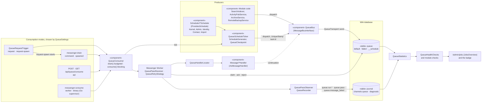
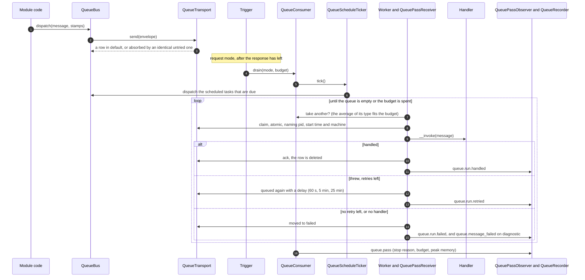
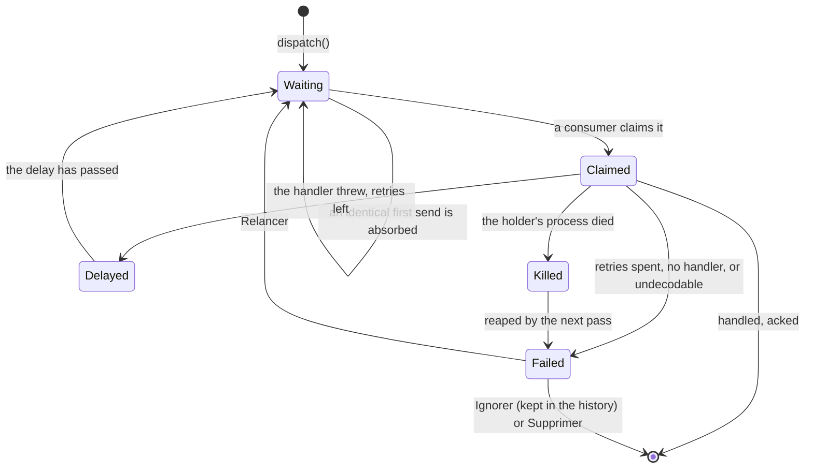
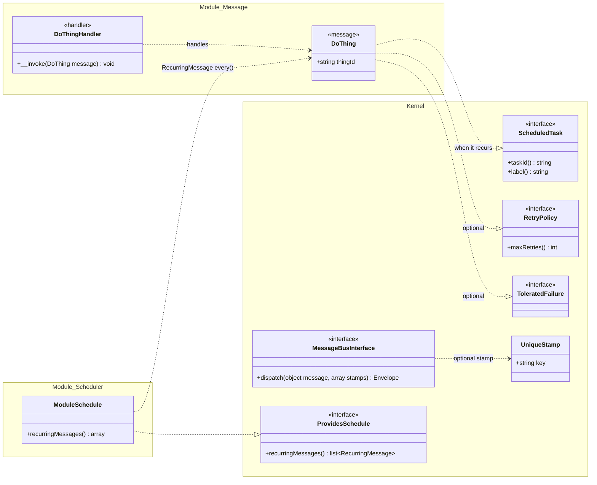

# Background work goes through one queue

YesWiki defers work in seven home-made ways built on four primitives: a closure parked in
`AfterResponse` for ActivityPub delivery, a `search_queue` table drained by a shutdown function,
by the maintenance sweep and by a detached `search:reindex --drain`, `maintenance.after` listeners
that start `contact:send-digest` and `importer:sync` detached or fall back to shutdown, an
`ArchiveService` that spawns `core:archive` and tracks it in files under `cache/archive/`, a remote
backup whose state machine only advances while a browser tab polls it, and the sweep itself, run
before the page of whichever visitor arrives half an hour after the last one. Most of them swallow
their errors. A digest that failed was marked as sent, a sync that failed wrote to
`cache/importer/<id>.log` and nowhere else, an archive whose process died stayed "in progress" for
weeks, and a listener of `maintenance.after` that threw silently skipped the listeners after it.
Nothing shows what waits, what failed, or whether anything is consuming at all, and the installs
that need this most are the ones with no shell, no cron and nobody who would go looking
(ADR-0023 keeps them first-class).

We decided that **every piece of work the wiki defers is a Message on one queue, held in the wiki's
own database and observed in one place, and that the periodic work is a Scheduler that produces
messages onto that same queue**. How the queue gets consumed is a setting with six values, none of
which needs anything installed except the ones that name what they need, and the default works on
an install nobody touches. A page, `/admin/jobs`, and a set of Health checks (ADR-0026) say when
work waits, fails or has nothing consuming it, and push that to the admin as a badge.

The pieces are `symfony/messenger` and `symfony/scheduler`, wired by hand into the container since
the kernel has no FrameworkBundle. Messages are small immutable objects (identifiers, never
entities) in a module's `Message/`, each beside its handler, an `#[AsMessageHandler]` service found
by `QueueHandlerLocator`; a module declares its recurring work in its `Scheduler/`, through
`ProvidesSchedule`, the way it declares Health checks. The last section of this ADR is the guide to
adding either.

## Architecture

Work enters the queue from two producers: module code that dispatches, and the Scheduler that turns
the tasks which are due into messages. It is stored in the wiki's own database and taken out by one
consumer, whichever of the six modes started it. What happened is then read back, from the queue
and from the Journal, by the Health checks and the jobs page. The producers never call the consumer:
the table is all the two halves share.

The `__schedule` queue holds the Scheduler's state: one row per task, plus the checkpoint. No
consumer reads it. The dashed arrow is a handler that splits its work and dispatches its own
continuation.

A budgeted pass in `request` mode runs once the response has left. `command`, `api` and a spawned
`messenger:drain` run the same pass. `worker` and `binary` run `consume()` instead: it loops over the
same steps with no budget to stop it, and ticks the Scheduler whenever the queue is empty.

A message is **killed** when its holder's process died while it ran. It is reaped by the next pass,
announced as `queue.message_killed`, and never retried by itself (see below). Only a human brings a
failed message back.

## The decision, piece by piece

**The transport is the wiki's database, on `DbService` and the dialects.** `QueueTransport` keeps
messages in the one table the queue adds, `queue` (queue name `default` or `failed`), with an atomic
claim that works on MySQL, PostgreSQL and SQLite (modelled on the one `search_queue` had). The rest is
not a table of its own, because the project keeps its number of tables down. The Scheduler's state
(one row per task, and its checkpoint) is rows of the same table in a reserved queue, `__schedule`,
which no consumer reads and which every query on messages leaves out; a task is found by `task_id`,
a nullable unique column that every message leaves NULL, and its fields are JSON in `body`. What was
handled (with duration and error) and the consumer's passes (one row per pass or per blocking
consumer's life) are rows of the Journal's third channel, `queue` (ADR-0025): `queue.run.<status>`
(the message type as target, the mode as actor) and `queue.pass` (the reason it stopped as target),
kept 7 days on `last_at` (`journal_queue_purge_time`) and pruned by the Journal itself.
`QueueRecorder` writes them by direct SQL, never through `Journal::store()`, so that none of them
reaches stderr, the daily ceiling and the fingerprint dedup do not apply, and their times stay UTC.
`failed` is kept 30 days. `dispatch()` only writes, in every mode and in the CLI too: nothing
runs because it was sent. A message may carry a dedup key, which collapses a **first send** into an
identical message still waiting and never tried; a retry, or a failure, is never swallowed by it.

**There are six consumption modes**, chosen by `YESWIKI_QUEUE_CONSUMER`:

| Mode            | Who consumes                                                                   | Budgeted |
| --------------- | ------------------------------------------------------------------------------ | -------- |
| `request`       | the end of each web request, after the response has left where the SAPI allows | yes      |
| `request-spawn` | a detached `messenger:drain` the end of a request starts, one a minute at most | yes      |
| `command`       | a crontab running `./yeswicli messenger:drain`                                 | yes      |
| `api`           | `/api/queue/consume`, POST or GET, with the secret as header or `?secret=`     | yes      |
| `worker`        | `./yeswicli messenger:consume`, kept alive by systemd or similar               | no       |
| `binary`        | the Go binary, which supervises a `messenger:consume --supervised` per wiki    | no       |

The variable is read from the real environment, then `private/.env` (the only way on a host with
no environment), then `queue_consumer` in the configuration, then the default: `binary` under the
binary and `request` anywhere else. It needs an explicit mapping, not an entry in `KNOWN_KEYS`,
which would read `QUEUE_CONSUMER`. The binary sets **no** `YESWIKI_QUEUE_CONSUMER`: it sets
`YESWIKI_SERVED_BY_BINARY`, so a wiki of a farm can choose another mode, and `binary` without the
marker is detectable and reported. An unknown value does not stop the wiki; it gets the default and
keeps the origin it was found in, so the page can say where to correct it, and "origin is `default`"
keeps meaning that nobody chose. A `request-spawn` launch that cannot start a process is journaled
and consumes nothing: the fallback below takes over. The `api` route is public as far as the ACL goes and the
secret is the whole check, compared in constant time; with no secret set it answers 401 to
everybody. It answers 409 when another pass runs, which is the caller's cue to come back, not a
fault. It also answers GET with the secret in a `secret` query parameter, a deliberate departure
from HTTP: some hosts schedule nothing but a GET without custom headers, and `api` is the only mode
left to them. The header wins when both are sent, and stays the advice, since a query string lands
in access logs.

**Budgeted and blocking consumption are two ways to run one consumer.** `QueueConsumer` is the
only code that takes messages, over Messenger's `Worker`, so the observation is the same in every
mode. `drain()` runs a **Pass**: it ticks the Scheduler, then consumes until the queue is empty or
the **Budget** is spent, and never waits. `consume()` blocks like `messenger:consume`, with a time
limit, a memory limit and a message limit, ticks the Scheduler whenever it is idle, and leaves a
heartbeat. Only one pass runs at a time per wiki, behind a non-blocking `RuntimeLock`
(`cache/queue-pass.lock`); a blocking consumer does not take it, since the atomic claim already
keeps them apart. Neither runs while the wiki is hibernated, archiving or updating, read from the
configuration as it is now since an archive sets it while a consumer is running. A blocking consumer
idles through that rather than returning, because returning would look to the supervisor like a
crash.

**The budget is computed, not configured.** A pass takes `max_execution_time` less what the request
already used, less a margin (2 s plus a tenth of the limit), then the mode's ceiling: 3 s while a
visitor waits for a response that cannot leave before the script ends (mod_php, CGI), 20 s once it
has, 50 s for an API call, 300 s from a CLI with no PHP limit. Memory is 80 % of `memory_limit`.
The consumer takes the next message only if the average duration of its type fits, except the first
message of a pass nobody waits for (response already sent, command, API, spawned process): that one
is taken whatever its average, or a type longer than any pass of its mode would block the queue for
good; if PHP cuts it, it is failed as killed below. The same figures
give each claim its **kill limit**. A claim also names the process that holds it: its pid, its
start time, and the machine (host name and pid namespace), read from `/proc`. If that process
dies (PHP's limit, the OOM killer, a host's request timeout, a restart), the message stays
claimed, and the next pass moves it to `failed`, recording the mode that cut it: **at once** when
the holder's process is gone from the machine the pass runs on; **past the limit plus a minute**
when nothing can be told of it (another machine, no `/proc`, or a server's process -- FPM, Apache,
FrankenPHP -- which lives on after the request that held the claim); and a process of its own (the
CLI) that is still there keeps its message up to a **6-hour ceiling**, since PHP's limit counts CPU
time on Linux and a handler waiting on the network outlives it. A consumer whose process ends in
the middle of a message (a fatal error, PHP's limit, an `exit` in a handler) fails it itself, from
a shutdown function; and an ack or reject deletes only a row still under its own claim, so a holder
declared dead that finishes after all leaves its failure in place and the Journal says how it
ended. **A message killed this way is not retried by itself**, because it would be cut again, and
`/admin/jobs` says to change mode and retry it by hand.

Each message found killed is announced on the wiki's own dispatcher as **`queue.message_killed`**
(`QueueConsumer::MESSAGE_KILLED`), once it is in `failed`, with `messageId`, `type` (its class),
`mode` (the one it was killed in) and `message` (null when it cannot be read back). Each listener
is called on its own: one that throws is journaled as `queue.listener_failed` and stops neither the
next nor the pass. That is how a backup PHP killed lifts the `archiving` status it left, with
nobody on the backups page; a module whose message holds some state of the wiki listens the same
way. Reaping changes no content, so a paused pass still reaps, and goes on once a listener has
lifted the pause. Work that splits
(remote backup, mass reindexing) does a bounded slice and dispatches its own continuation, so it
runs in every mode. The one exception is a backup or restore an admin starts: it keeps a path
through the admin's own request, **pinned** to the end of that request with no budget and
`set_time_limit(0)`, in `request`, `api`, `command` and `request-spawn`, the modes that would
otherwise run it only when something calls them -- in `request-spawn` nothing says before the launch
that its process will run. In `worker` and `binary` it is queued for the worker while the worker is
seen at work, and pinned too when it is not (`QueueFallback::consumerIsGone()`): left to the end of
visitors' requests, on a request's budget, PHP would cut it. Where the response cannot leave before
the script ends (mod_php, CGI), the request hands each message it pinned to a process of its own
(`messenger:drain --message=<id>`), as `core:archive` was detached before the queue, so that the admin
does not wait for the whole backup and a wiki fetching one does not give up; the request runs it
itself only when no process can be started. A wiki
installed and forgotten must still back itself up before an update. The queue's table and the Journal's
`queue` rows are the running instance's state, not the wiki's content: a backup leaves them out, and
a restore neither drops, replaces nor fills the table (it creates it when the database has none) and
puts the live Journal `queue` rows back in place of any the dump brings, or a restored copy would
hold the backup's own message as running, replay what was pending then, show passes that never
close, and acknowledge the restore by an id in a table it has just replaced.

**The Scheduler produces, the queue consumes.** Each maintenance step (`revisions`, `journal`,
`recovery-keys`, `activation-keys`, `bot-guard`) is its own recurring task, every 30 minutes as
before, so that one failing hides none. Digests are one task per period and the marker is written
after a successful send, not before. A data source that syncs itself is a task per source, at its
own interval. `maintenance.before` and `maintenance.after` are still dispatched, by a task of their
own (`extension-hooks`), and a listener that throws is traced and no longer stops the next. Their
context keeps its keys but not all its meaning, which an extension author should know: the
listeners run in a queue pass, with no request, no logged-in user and no session; `previousRun` is
when the `extension-hooks` task last finished (null before its first run); and `duration`, on
`maintenance.after`, measures only the `before` listeners -- close to zero -- since the
housekeeping steps no longer run between the two. A late task runs once at the
next pass, not once per period missed. The schedule's state is rows of the `__schedule` queue of the `queue` table,
behind a `RuntimeLock` of its own.

**Failures are visible, and rare ones are retried.** Messenger's retry gives three further attempts
after 60 s, 5 min and 25 min (a message class can say otherwise), and a message
with no handler goes straight to `failed`. Every definitive failure is a Journal entry on the
`diagnostic` channel (the `queue.message_failed` family stays there, whatever the `queue` channel
also records of the attempt: one says what broke, the other keeps the history). The one thing that is exempt from the generic failed-messages alert is a
message class marked `ToleratedFailure`: a delivery to a fediverse server that is gone is routine,
and a permanent red badge teaches the admin to ignore every badge (ADR-0026). The module that owns
such a message raises its own, calibrated check instead, and that check can ask the jobs page for
"Relancer" and "Ignorer" buttons that act on every failed message of the type (the "all" buttons of the
generic alert skip it). "Ignorer" on `/admin/jobs` **acknowledges**
the failures present: they leave `failed` and the alert and stay in the history, and a new failure
brings the alert back. There is deliberately no way to mute a cause.

**The checks are the product.** Fourteen Health checks (`queue-tables`, `queue-fallback`, `queue-stalled`,
`queue-failed`, `queue-killed`, `queue-task-overdue`, `queue-task-failing`, `queue-backlog`,
`queue-consumer-restarts`, `queue-consumer-memory`, `queue-config`, `queue-spawn-unavailable`,
`queue-no-budget`, `queue-visitor-cost`) are re-derived from the `queue` table and the Journal's `queue` channel whenever they
are asked. "Nothing is consuming" is judged on **consumer activity**, not message age: messages
available and no pass, heartbeat or claim within its limit for 10 minutes in `worker` and `binary`,
3 hours in `command` and `api`, 24 hours in `request` and `request-spawn`. A queue that moves but
slowly is a backlog and only degraded (1 hour for the blocking modes, 6 for the others), and is
silent while the stall alert fires. A wiki that is hibernated is silent too. A wiki where no pass
has ever run falls back to the age of the oldest message, so a fresh install with messages and no
consumer alerts. The badge counts `Broken` only. The page is server-rendered Twig with htmx, behind
`@admins`, and every action ("Consommer maintenant", "Relancer", "Ignorer", "Lancer") answers with
the page fragment it changed.

**When the chosen consumer is gone, the end of requests stands in for it.** A worker that died, a
crontab a host dropped, an online cron that stopped calling, a `request-spawn` whose processes never
start or never consume: on a wiki nobody watches, maintenance and indexing would stop for weeks
unnoticed. `QueueFallback` decides it, from what is already recorded. Every pass row says what started
it (`origin` in its context, written only when it is not the consumer's own, so older rows read as the
consumer's): the consumer of the mode, the messages a request **pinned**, the jobs page's **manual**
button, or the **fallback**. Only the consumer's own passes make it "seen" (`lastSeenAt`), and so does
a live claim of its mode held by the process of one of its open passes, since a worker inside one long
message does not beat. A consumer's pass that finds `PASS_LOCK` taken, or the wiki hibernated, still
leaves a row, closed at once, outside `request`, so that a cron coming back while a fallback pass runs
is seen, and one that kept running while the wiki slept is not taken for gone when it wakes. The fallback
starts when work (an available message, or the schedule being due — on a quiet wiki nothing else is
queued while nothing ticks) has waited longer than the mode's stall delay and the consumer has not
been seen for as long; a schedule that never ticked has waited since the rule was first read
(`cache/queue-fallback-watch.lock`). For `request-spawn` it is the first launch left unanswered for
5 minutes (`cache/queue-spawn-unanswered.lock`); every launch, failed or not, stamps the throttle.
The fallback consumes as `request` does, and its passes carry `fallback_for`: it lasts until the
consumer is seen after its first fallback pass (`fallbackSince`), not until the queue is empty,
which would make it flap; changing the mode ends it too. Outside it, a request reads the rule at
most once a minute (`cache/queue-fallback-check.lock`, the answer kept as
`cache/queue-fallback-active.lock`), so a mode that does not consume at the end of requests still
costs a request a `stat` and no query. `queue-fallback` is **broken**, the jobs page lists it first
and keeps the chosen mode in its banner, with that consumer's last pass in red; `queue-stalled` is
then judged with `request`'s delay, so it speaks again only if the visits stop too.

**The binary supervises, and reads nothing of PHP's configuration.** For each open wiki it runs
`php-cli … messenger:consume --supervised --time-limit=3600 --memory-limit=128M` with the binary's
marker in the environment. That command works out the effective mode itself and, if it is not
`binary`, exits at once with 78 (`EX_CONFIG`), which the supervisor reads as "not my wiki" and does
not restart until a SIGHUP reload. A blocking consumer stops between two messages once the wiki's
configuration changed (a setting saved, `private/.env` edited) or its compiled container was
emptied (`migrate` after an upgrade, `cache:clear`), the two questions FrankenPHP's worker asks
too, since it would otherwise run on what it booted with for up to an hour. Supervised, it then
exits with **75** (`EX_TEMPFAIL`, stop reason `config-changed`), which the supervisor restarts at
once and does not count towards the backoff; unsupervised it exits 0, for systemd's
`Restart=always`. Any other exit restarts it: after a second if it lived at least 30 seconds (the ordinary end of
`--time-limit` or `--memory-limit`), after a delay that doubles from 1 s to 60 s while it keeps
dying young. A stop gives the message in hand 10
seconds, to stay under the unit's `TimeoutStopSec=30s` with Caddy's shutdown after it. The deciding
code lives apart from the FrankenPHP dependency so `go test ./...` runs without a PHP build.

**What goes away.** `AfterResponse` and its drain in `worker.php`, the request-time maintenance
sweep (`MaintenanceService::sweep/claim/dueOnRequest` and its call in `YesWikiRuntime::doRun`), the
`maintenance_trigger` setting and `cache/maintenance.lock`, the `register_shutdown_function` calls
that deferred search, digests and syncs, and the `maintenance-sweep` Health check. A wiki with
`maintenance_trigger: cron` and no explicit mode, outside the binary, is migrated to `command`,
since its crontab exists; under the binary the setting is simply removed. `core:maintenance` stays
as a deprecated alias of `messenger:drain` so existing crontabs keep working. What was synchronous
on purpose stays so: mail sends, webhooks, thumbnails, ActivityPub Follow/Accept, the Doryphore
arrival, and the explicit actions of a human or a webhook (`importer:sync`, `GET /api/import/sync`,
`{{sync}}`, the sync button).

## Considered Options

- **`symfony/doctrine-messenger` on `doctrine/dbal`** — rejected. The codebase has no Doctrine, the
  data layer is `DbService` and three dialect classes, and adding a second database abstraction for
  one table means two connections and two ways to be wrong about a transaction. The atomic claim is
  small and `SearchIndexer` already had one to copy.
- **A table each for messages, history, passes and tasks** — rejected, after being the first
  design. The project's convention is to minimise tables, and three of the four hold no message:
  the scheduled tasks fit rows of the messages' table under a reserved queue, and the history and
  the passes are what the Journal already is, a retained record of things that happened. The cost is
  a rule every query on messages must keep (filter on `queue_name`, or a task's row is counted,
  claimed or pruned as a message), a third Journal population with its own retention, and a
  backup/restore that must leave the Journal's `queue` rows out and keep the live ones.
- **Fixing each mechanism where it is** — rejected. Seven fixes would still be seven places an
  admin has to know to look, and nothing would answer "is anything consuming at all". The point is
  the single observable path.
- **Requiring a cron (or a worker)** — rejected. Shared Apache hosting with no shell is first-class
  (ADR-0023), and the third anti-objective of the work is a wiki that stops doing its housekeeping
  after an update because it was not configured. The default has to be a mode that needs nothing.
- **`request` as the only mode** — rejected as the whole answer, kept as the default. Work moves
  only when someone visits, a quiet wiki lags, a visitor on mod_php waits for it, and a job longer
  than a request can never finish. Hence five more modes and a page that says which one is in force
  and what it costs.
- **Symfony's `MessageGenerator` with its `Checkpoint`** — rejected. `MessageGenerator::checkpoint()`
  is typed to the final `Checkpoint` class, whose persistence wants a PSR cache pool and
  `symfony/lock`, neither of which the wiki has and the second of which is excluded. `ScheduleGenerator`
  is the generator's loop against `CheckpointInterface`, and a differential run against the
  original over four hundred ticks found no difference. The cost is a port to keep in step with
  upstream on a Scheduler upgrade.
- **Retrying a killed message automatically** — rejected. It was cut by the limit of its mode and
  will be cut by it again; this is anti-objective four, "a job too long for the mode relaunched
  forever". It waits for a human who has changed mode.
- **Judging "nothing is consuming" on the age of the oldest message** — rejected after being the
  first design. A worker alive and draining a long queue is a backlog, not a stall, and for four of
  the six modes the backlog check could then never fire. Activity is the right signal.
- **Muting an alert by cause** — rejected for ADR-0026's reason and anti-objective one: it would be
  a button that hides a real outage. Acknowledging the failures that exist is not the same thing.
- **Priorities and several queues** — not now. One `default` queue and `failed`; a priority lane for
  delivery over mass reindexing is acceptable the day it is needed.
- **Storing alerts, or mailing them** — rejected. Alerts are re-derived (ADR-0026) and shown in the
  admin interface; a mail would be one more thing that fails on the installs this is for.

## Consequences

- **The wiki gains one table and a write on every dispatch.** That is the price of a transport in
  the one store a shared host reliably has. A request with nothing to do costs two indexed reads
  (is a message available now, is the schedule due), not a pass row, and a pass that finds the lock
  taken or the wiki asleep writes none in `request` mode, where that is most requests. A cron, an
  API call or a spawned process that finds them writes one, closed at once, so that it is seen
  coming back, or still coming while the wiki slept, rather than taken for gone.
- **A delayed retry is not work.** The end-of-request check reads the oldest _available_ message,
  not the count of waiting ones, or a single message failing for half an hour would run a full pass
  on every request.
- **The default mode makes a visitor's request longer on mod_php and CGI**, up to the 3 s ceiling,
  and `queue-visitor-cost` says so once the average passes a second. Choosing `request-spawn`,
  `command` or `worker` removes it, which is why the page names the cost beside the mode.
- **The end of a request assumes nothing of the SAPI it runs under**, since `request` is the
  default everywhere. It works from `YESWIKI_INSTANCE_DIR`, as mod_php may run shutdown functions
  elsewhere (FPM and `php -S` do not, checked) and an instance's extensions are autoloaded by a
  relative path. Where the response has not left (mod_php, CGI, `php -S`), it drops what the pass
  prints, which would land in the page. It calls `ignore_user_abort()` only where the host has not
  disabled it. The processes it starts (`request-spawn`, a pinned message on mod_php or CGI) go
  through `ConsoleService::startDetachedConsole()`: no pipes, which the dropped `Process` closes
  and so kills the child with SIGPIPE, the instance's folder, and the console's ownership check
  lifted for the web server's user. How each SAPI fares is in `docs/fr/async.md`.
- **Under worker mode** the consumer holds no request state: the budget context is cleared at the
  end of each pass, the pinned messages are the request's own and forgotten at the next, and the
  ratchet on `$GLOBALS` does not move (ADR-0024).
- **Every module with deferred work now owns messages, handlers and a schedule**, and the work of
  migrating each mechanism is a commit of its own, which is how this ADR and its mechanisms stay
  separate in history. Until the last one moves, the old and new paths coexist.
- **The queue's rows in the Journal are hidden unless asked for.** `/admin/logs` lists `audit` and
  `diagnostic` by default and shows the `queue` channel only when it is chosen, so a pass every few
  minutes does not bury the acts and errors the screen exists for. Their times are UTC, written from
  PHP, and the screen converts them to the wiki's zone for that channel alone.
- **A wiki with the table missing keeps serving pages.** The checks that read the table are silent
  until the migration has run, and `queue-tables` says why, and the request trigger journals one failure a day instead of
  breaking the page.
- **One replica is still the rule.** The queue is in the shared database, so several nodes can share
  it safely, but the pass lock and the schedule lock are local files: N nodes run N passes and N
  ticks, and a due task can be queued by each. The dedup key limits the copies; the real fix stays
  with the horizontal-scaling work CONTEXT.md defers.
- **Search reindexes through the queue alone.** `search_queue`, its own claim and its slicing
  `DrainSearchQueue` were a second queue beside this one; they are gone, and each Content to reindex
  is a `ReindexContent` of its own, handled one at a time. A full reindex is as many rows on
  `/admin/jobs` and in the Journal as the wiki has Contents, which is the price of one place to look.
- **`/admin/jobs` renders error text it did not write** (a handler's exception message), so it is
  escaped everywhere and never `|raw`.

## Developer guide: adding background work

Every message, handler and schedule of the codebase already has the shape below, and each step
names one to copy. The kernel's side (`Kernel/Queue`, the bus, the consumer) needs no change to
add work.

### A piece of deferred work

1. **The message** is `src/<Module>/Message/<Verb><Noun>.php`, or `messages/` in an extension.
   - It is a `final` class whose `public readonly` properties hold scalars and identifiers.
   - It is stored with PHP's `serialize()` (Messenger's `PhpSerializer`) and read back by another
     process, maybe hours later. So it carries no service, no entity and no closure, and what it
     carries must still mean something when it is handled.
   - Its class name is in every stored row. Renaming or moving a released message sends the rows
     still waiting to `failed`, as undecodable.
   - Its docblock says what it asks for, and why it is retried or not.
   - `Search/Message/ReindexContent` carries one tag, and `Federation/Message/DeliverActivity`
     carries all the delivery needs.
2. **The handler** is `<Message>Handler.php`, beside it.
   - The `#[AsMessageHandler]` attribute goes on the class, and `__invoke(<Message> $message): void`
     takes the message. The parameter's type declares what it handles: `YesWikiQueueCompilerPass`
     refuses any other shape.
   - The kernel registers the `*Handler.php` of a `Message/` folder as autowired services, and
     nothing else in that folder. `ArchitectureTest` holds both halves to the convention.
   - It may run twice for one dispatch (a retry, or a killed message an admin retries), so it is
     idempotent, or it checks first.
   - It reads the wiki as it is now, not as the consumer booted with it:
     `HibernationService::isWikiHibernatedNow()`, or a marker that moved since the message was sent.
     `Contact/Message/SendDigestHandler` does both.
   - It has no request, no signed-in user and no session. It keeps nothing from one message to the
     next, since a blocking consumer handles thousands (ADR-0024).
   - It fails by throwing. A swallowed exception is recorded as handled; a thrown one is retried,
     then shown on `/admin/jobs` and journaled.
3. **The send**: inject `MessageBusInterface` (that is `QueueBus`) and call
   `dispatch(new DoThing($id))`. It only writes the row, in every mode and in the CLI too, and never
   breaks the caller: a queue it cannot write to is journaled as `queue.dispatch_failed`.
   - `UniqueStamp('<module>:<what>')` is for work that only needs doing once more, however many
     times it was asked for. The send is absorbed into an identical message that is still waiting
     and untried (`ReindexContent::uniqueStamp()`, one key per Content).
   - Messenger's `DelayStamp` is for work that should wait.
4. **Work longer than a pass** is done in slices. Each slice dispatches the next, so the work runs
   in every mode.
   - `QueueBudgetContext::sliceSeconds($atMost)` says how long a slice may take under the running
     pass's budget.
   - The continuation is sent under a `UniqueStamp`. A "look again later" gets a key of its own, or
     it would absorb the next real send and make it wait out its delay.
   - Work that splits into independent items is better sent as one message per item: the
     consumer's budget already spreads them over passes (`Search/Message/ReindexContent`).
5. **When they apply:**
   - **`RetryPolicy::maxRetries()`**, when the default (three retries, after 60 s, 5 min and 25
     min) is wrong. Use 0 for work whose second run would do harm, such as a half-sent digest
     (`SendDigest`). Use more for a remote server that comes and goes (`DeliverActivity`).
   - **`ToleratedFailure`**, when failures are routine. The generic `queue-failed` alert then leaves
     the type out, and the module declares a `ProvidesHealthChecks` of its own to judge it. That
     check reads `QueueStatistics::outcomesOfType()` and `failedGroups()`, and offers the jobs
     page's buttons with `->offers(QueueHealthChecks::offeringFailedOf(DoThing::class))`
     (`FederationQueueHealthChecks`).
   - **A subscriber of `QueueConsumer::MESSAGE_KILLED`**, when the message holds some state of the
     wiki that a killed run would leave behind (`ArchiveService::releaseWhatAKilledRunLeft()`).
6. **Not done:**
   - calling the handler from the code that sends, or consuming from there;
   - pinning a message to the request (`QueueRequestTrigger::pin()`), unless an admin started it
     and waits for it, as for a backup.

### A scheduled task

1. **Its message implements `ScheduledTask`.**
   - `taskId()` is the task's identity in its `__schedule` row and in its dedup key (`task:<id>`).
     It is stable across releases and at most `ScheduledTask::MAX_ID_LENGTH` characters long.
   - `label()` is what `/admin/jobs` shows, through `_t()`.
   - A recurring message that is not a `ScheduledTask` is still sent when due, but with no dedup,
     no row, and nothing on the page.
2. **The module's schedule** is `src/<Module>/Scheduler/<Module>Schedule.php`, or `schedulers/` in
   an extension. It implements `ProvidesSchedule` and declares all of the module's tasks. It is a
   service tagged by autoconfiguration, so there is no list to add it to.
   - `RecurringMessage::every(<seconds, or '24 hours'>, $message)` is for a fixed period. The
     housekeeping steps share `KernelSchedule::HOUSEKEEPING_EVERY` (`AdminSchedule`).
   - `RecurringAfterLastRun::every($seconds, $message, $lastRunAt, $now)` is for a task that
     remembers when it last ran, so that a run by hand or by cron postpones the scheduled one
     (`ContactSchedule`, `ImportSchedule`).
   - `RecurringMessage::cron()` is not available, since `dragonmantank/cron-expression` is not
     installed.
3. **The schedule is built anew** at each tick where something is due.
   - It may depend on the configuration, and a task it stops declaring leaves the page.
   - A schedule that cannot read what it decides from throws, rather than declaring nothing. The
     ticker then journals `queue.schedule_provider_failed` and keeps the tasks it knew, which show
     as overdue.
4. **A late task runs once.** A task ten periods late runs once at the next pass, and the very first
   tick only starts the schedule. The same work may also run another way: a command, or "Lancer",
   which queues a run at once. In that case the handler checks its own marker before doing it again
   (`SendDigestHandler`).
5. **An extension that only wants a periodic hook** may still listen to `maintenance.after`, with
   the caveats given under "The Scheduler produces". A task of its own is shown, retried and alerted
   on; a listener's failure is only traced.

### Testing it

- `tests/src/Kernel/QueueTestKit.php` builds a queue and its consumer on a throw-away SQLite file.
  1. Build it with `new QueueTestKit([DoThing::class => fn (DoThing $m) => $handler($m)])`.
  2. Send with `$kit->bus->dispatch(...)`.
  3. Consume with `$kit->consumer->handleById($id, QueueConsumerMode::Command)` or `drain(...)`.
  4. Assert on `$kit->statistics`: `pendingCount()`, `failedCount()`, `failed()`.
  5. Call `dispose()` in `tearDown()`.

  `tests/src/Contact/SendDigestTest.php` does all of this.

- Against the dev wiki, skip while the queue is not there yet: `QueueSchema::exists()`
  (`tests/src/Search/ReindexContentTest.php`).
- The container is compiled: run `./yeswicli cache:clear` after adding a handler or a schedule.

### Checklist

- [ ] `Message/<X>.php`: final, readonly, identifiers only; its docblock says why it is retried or not
- [ ] `Message/<X>Handler.php`: the attribute, a typed `__invoke()`; idempotent, reads the state as it
      is now, throws to fail
- [ ] sent under a `UniqueStamp` when the work is idempotent; long work in slices
- [ ] `RetryPolicy`, `ToleratedFailure` with a check of the module's own, a `MESSAGE_KILLED`
      subscriber: each when it applies
- [ ] recurring: a `ScheduledTask` with a stable id and a translated label, declared in
      `Scheduler/<Module>Schedule.php`
- [ ] a test through `QueueTestKit`, then `./yeswicli cache:clear`
