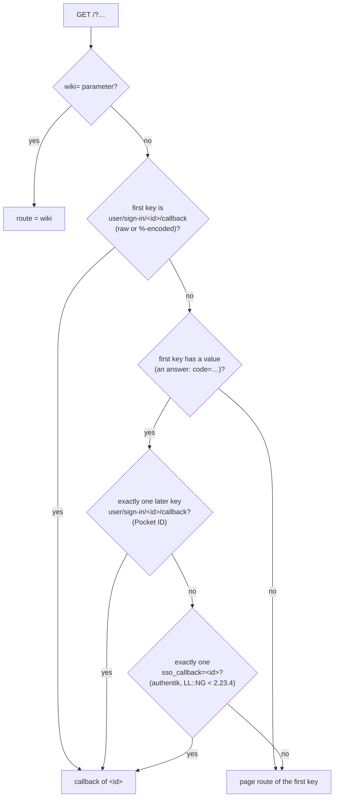
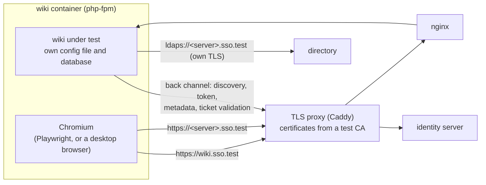

# Sign-in providers replace the login extensions

Wikis run as a company's internal wiki had to sign people in through the company's identity
server, and three Doryphore extensions did it: `loginsso` (OAuth2 and OpenID Connect),
`loginldap` and `logincas`. Their flows mostly worked. What did not was everything around them:
only one could be active at a time, each had its own configuration and its own features, SAML
did not exist, and when a sign-in was refused nobody could see why. The employee got an
unhelpful message, the admin got nothing, and the only way to find out what the identity server
had sent was a developer with a debugger. Ectoplasme also took away two things they leaned on:
core keeps no PHP session any more (replicas sign people in from a signed `yw-auth` cookie), and
under FrankenPHP's worker mode request state may never be global (ADR-0024).

We decided that **sign-in is one system of Providers in core, configured in one setting,
`sso_providers`, and that local accounts are a Provider like the others.** A Provider has an
identifier (the array key, immutable once created), a type (`local`, `oidc`, `saml`, `cas`,
`ldap`, or one an extension registers), settings and switches. Any number can be on at once, two
of one type included; with no setting, local is on. The three extensions are retired and a
migration converts their settings. Five decisions shape the rest, and each was taken against a
cheaper alternative.

**The setting is kept in the database.** Like every setting an administration screen saves,
`sso_providers` is a row of the wiki's database, and the running wiki never writes
`yeswiki.config.php`. The sign-in screen and the upgrade save it there, and from then on it
replaces whatever section the file holds; the file is read while nothing is stored, so a
deployment can seed it. Two consequences follow: editing the file is no way back in, so
`./yeswicli sign-in:enable` and `sign-in:disable` switch a Provider from a shell; and the upgrade
removes the Doryphore keys from the file itself, its one write to it, since `sso_config` holds
client secrets the database copy makes redundant.

**Plan, then apply.** Once a Provider has said who someone is, `SignInService::plan()` decides
everything (which account, whether it is created, linked or refused, which groups it joins and
leaves, what its profile becomes) and changes nothing. `apply()` carries a plan out, and writes
only what changed. The admin's Test runs the real protocol and then calls `plan()` alone, so what
a test shows is by construction what a real sign-in would do: there is no second copy of the
rules for a test to drift from.

**The Account link lives in the account's own page.** Two keys of the user page's body,
`sso_provider` and `sso_subject`, tie an account to the one Provider it belongs to and to that
Provider's stable user ID. An account without them is local. They sit outside the User form and
join the keys no profile edit may set (`UserManager::updatableKeys()`, beside `activation_status`),
and only `PageManager::saveAccountLink()` writes them, for `AccountLinks::link()` and
`UserManager::createLinked()`, with one exception: the upgrade from `loginsso`
(`LoginExtensionsBecomeProviders`) writes them once, turning each account's `loginsso_id` into a
link while it converts the configuration.

**Failed sign-ins go to the Journal's two existing channels** (ADR-0025), with no table, setting
or purge task of their own. Every refusal and every wrong password is a `login.failed` audit row
(who, which Provider, the reason code, no attributes), kept 365 days, one row per attempt. A
refusal after the Provider has answered, or a technical failure, is also a diagnostic,
`login.refused.<reason>.<provider>`, holding the last step reached, the attributes returned and
what each was used as, the group mapping result and the raw error after scrubbing; it collapses
per Provider, reason and day, and is kept 14 days. Successful sign-ins and test runs write nothing.

**phpCAS is used, and confined.** It is the protocol's official PHP client, maintained, and
supports PHP 8.4. It was written for one request per process and a PHP session, so
`CasProvider` builds a `CAS_Client` for each call and never touches the static `phpCAS`
facade, opens a session of its own for the call (sending no cookie) and destroys it when the call
ends, makes phpCAS throw instead of `exit`, never lets it redirect by itself, throws away what it
prints, hands it the ticket from the request rather than letting it read `$_GET`, and always
gives it a CA bundle, the configured one or the system's.

**The callback address names its Provider twice.** A redirect Provider sends people back to one
address, OpenID Connect's redirect URI, SAML's ACS URL and CAS's service alike:
`?user/sign-in/<id>/callback&sso_callback=<id>`, built by `SignInCallback::url()`. YesWiki routes
on the first key of the query, and that key has no value. RFC 6749 §3.1.2 says the query of a
redirect URI "MUST be retained", but widespread servers rebuild it as a form when they add `code`
and `state`, and a key without a value does not survive: authentik (Python's `parse_qs` without
`keep_blank_values`) and LemonLDAP::NG before 2.23.4 (Perl's `URI::QueryParam`, #3707). Others
keep it but reorder the query: Pocket ID sorts the keys
(`?code=…&user%2Fsign-in%2F<id>%2Fcallback=`). `YesWikiInit` reads the route from the key when it
is first. At the root (`/?…`, no `wiki` parameter), when the query starts with an answer,
`SignInCallback::routeIn()` looks for the key later in the query, and failing that for exactly one
`sso_callback=<id>` whose identifier has the characters a callback key may have; either routes the
request to `user/sign-in/<id>/callback`. A page named first without a value (`?Page&sso_callback=x`)
keeps its route. The request guards' CSRF exemption follows the same reading: the callback route
declares the option `RouteProvider::CROSS_SITE`, and a request is let through when the route
matching the page and method `YesWikiInit` read from its address (held by `PageContext`) declares
it. authentik also appends its errors after a second `?`, so its error lands in the pair's value
(`sso_callback=<id>?error=…`); the OpenID Connect Provider reads it back from there, and the
administrator sees the server's error instead of a missing code.

No URL rewriting is needed on the hosting; a standards-compliant server is not affected, since it
brings the key back first; and the fallback is narrow (root only, after an answer, one pair, a
well-formed identifier), and harmless when it fires, since the callback refuses whatever has no
sign-in in progress.

## Considered Options

- **Keep the three extensions and make them better** — rejected. The blindness was the shared
  problem, and fixing it three times would have left three configurations, three feature sets and
  still one extension at a time. A wiki needing SAML would have needed a fourth.
- **Keeping the section in `yeswiki.config.php`**, written by the sign-in screen — rejected:
  replicas share no file, so a change made on one would not reach the others, and every other
  setting an administration screen saves is already a row of the database.
- **A table of account links** — rejected. A link is a fact about one account and nothing else,
  and the user page already holds that account's facts, versioned (ADR-0003). A table would have
  brought a unique index, which is the one thing the page body cannot give: two first sign-ins of
  one person at the same instant could create two accounts. A `Locks` lock named after the
  Provider and the user ID, held while an account is linked or created, gives the same guarantee
  without the table. Lookups use `jsonExtract` on both keys, as `resolveTagFromEmail()` does.
- **A table of sign-in attempts** — rejected. It would have needed its own retention, purge task,
  screen and backup rule, all of which the Journal already has. One row per person in the
  diagnostic channel was rejected too: during a misconfiguration every employee is refused for the
  same reason, and one row each would use up the channel's 500 rows a day and hide real errors.
  The audit rows still name everyone refused; to see one person's attributes, they try again or
  the admin uses Test.
- **Recording successful sign-ins** — rejected by the project lead. It is a log of who was
  present when, kept for nothing the wiki does.
- **A test mode with its own logic** — rejected for plan-then-apply: a test that reimplements the
  decision can say yes where the real sign-in says no.
- **`ecphp/cas-lib`, which has no global state** — rejected. Its last release was in October 2024
  and it brings several new dependencies. A maintained library, confined, is a smaller risk than
  a clean one nobody releases.
- **Writing a CAS client** — rejected. The protocol is small, but its validation response,
  proxies and error codes are where hand-written clients go wrong, and nobody would maintain it.
- **A callback address without the pair**, `?user/sign-in/<id>/callback`, documenting the servers
  that drop it as unusable — rejected: authentik is widespread, and LemonLDAP::NG 2.21 and 2.16
  are still in service, the fix never backported.
- **Giving the callback key a value**, `?user/sign-in/<id>/callback=1` — rejected: those servers
  would keep it, but the router reads a key's value as part of the method (`callback=1`), so every
  reading of the key (first, after an answer, the request guard) would change.
- **A path route**, `/user/sign-in/<id>/callback` — rejected: it needs URL rewriting on the
  hosting, which YesWiki does not require and many of its hosts do not set up.

## Consequences

- `/admin/sign-in` lists the Providers, edits, tests and switches them, and saves the setting
  through `ConfigurationService::write`, like the other admin screens, so every replica sees a
  change at its next request. It refuses to switch off, or delete, the last Provider still on, and
  a Provider with accounts attached can be switched off but not deleted.
- The address to register at a server is the callback with its pair: the admin screen, the SAML
  metadata and the guides show it.
- An account belongs to exactly one place. Linking a local account clears its password; a linked
  account's email, mapped extra fields and password are read-only for everyone, admins
  included, and lost password and password change refuse it. Accounts on a Provider switched off
  lose their sign-in at the next request.
- A Provider sign-in lasts the remembered lifetime, 90 days renewed at half-life, as the
  extensions did. Ending someone's access means deleting the account or switching the Provider
  off, and the admin guide says so.
- The Journal writes every event to stderr with its whole context, so a refusal's attributes
  reach the server's log. They are personal data, and the admin guide says so. Secrets, tokens,
  passwords, assertions and cookies are written nowhere; attributes are size-limited.
- The round trip to a redirect Provider keeps its state in a signed cookie, `yw-sign-in`, living
  10 minutes and deleted when used, so any replica can finish a sign-in another one started. It is
  sent `SameSite=None; Secure` on https whatever `cookies_samesite` says, because SAML comes back
  with a cross-site POST; on plain http it falls back to `Lax`, and SAML then needs the wiki and
  the identity server to be same-site.
- A Provider type is one service implementing `ProviderType`. Core's five types register exactly
  the way an extension's does, which keeps the contract honest; an extension adds a protocol and
  cannot change the account rules.
- `ext-ldap` becomes a suggested PHP extension, and health checks report what keeps sign-in from
  working: no Provider on, broken entries, accounts on a Provider that is gone, LDAP without its
  module, and Providers reached over plain http.
- phpCAS's confinement is a list of rules in `CasProvider`, and whoever upgrades phpCAS has to
  check them again: the failure classification reads phpCAS's English messages.
- The upgrade turns match by name and by email on for the Providers converted from `loginldap`
  and `logincas`, and match by email for `loginsso`'s: whoever gets, as their user ID at an LDAP
  or CAS server, the name of an existing account not yet linked, or gets the email of an existing
  account at any of these servers, can take it, administrators included. This deliberately
  favours the continuity of Doryphore's accounts over a secure default. The trade-off is two
  settings with an on-screen warning; `UPGRADE.md` gives its mitigations.

## Testing against a real server

The automated tests run against mocks (MockServer, and in PHPUnit a scripted LDAP stub), and the
mocks are the reference. But a mock only says what it was told to say, so before a server is
listed in the admin guide, the plan of this section is run against it by hand, at an exact
released version. Nothing that runs a real server is kept in the repository: each tester builds
the setup below on their own machine, outside git (`tmp/` is ignored).

### What "validated" means

A pair of server and protocol is validated when its three parts pass:

1. **Association**: the server is declared with the fields of `?admin/sign-in` alone, the server
   accepts what the wiki publishes (callback address; for SAML, entity ID, ACS and metadata), and
   the admin's **Test** shows the expected attributes and groups.
2. **Sign-in**: a real browser sign-in creates the account with its attributes and mapped groups,
   a second sign-in finds the same account, and linking by email works when it is switched on.
3. **Failures**: every failure case ends in a clean refusal (a readable message, the expected
   Journal rows), never a 500, a blank page or a PHP trace.

A server is validated, and listed, when **every protocol the wiki supports and the server speaks**
is validated. Only an exact version counts, never a neighbouring one: when no image exists, it is
built from the sources or a distribution package.

### The environment

- **A second wiki**, on the same checkout: a php-fpm container built like the dev stack's, with
  `YESWIKI_CONFIG_FILE` pointing to a configuration file of its own and its own database, so the
  dev wiki and `yeswiki_test` stay untouched. Install it with the base URL
  `https://wiki.sso.test/?`, and give its configuration `trusted_proxies` covering the Docker
  network, or every POST behind the proxy is refused with a 403.
- **HTTPS everywhere.** SAML comes back with a cross-site POST, which only carries the
  `yw-sign-in` cookie when it is `SameSite=None; Secure`, so plain http does not test SAML. Create a
  test CA (`openssl req -x509 …`), issue a certificate with a SAN for each name, and put a Caddy in
  front of the wiki and of each server (`<name> { tls <crt> <key>; reverse_proxy <container>:<port> }`).
- **The wiki trusts the CA through the system store**: mount `ca.crt` in
  `/usr/local/share/ca-certificates/` and run `update-ca-certificates` before php-fpm starts. PHP,
  curl and ldap then verify every server as they would in production. The browser does not read
  that store: let it ignore certificate errors (`ignoreHTTPSErrors`), the wiki never does.
- **Names**: `wiki.sso.test` and `<server>.sso.test` are network aliases of the proxy on the dev
  stack's Docker network, so the wiki, the servers and a browser run inside the wiki container all
  resolve them. A directory speaking LDAPS mounts its own pair from the CA and gets its own alias.
  Adding an alias means recreating the proxy container; a Caddy reload is not enough.
- **Writing the Providers**: `php tests/e2e/helpers/set-sso-providers.php '<sso_providers as JSON>'`,
  run in the wiki container, writes the section to the file and forgets what the admin screen saved
  in the database. The web server's opcode cache needs about 3 seconds to see the new file.
- **Reading the wiki**: `php tests/e2e/helpers/sso-wiki.php` lists the Journal rows
  (`journal 'login%'`), forgets the diagnostics (`forget-diagnostics`) and the accounts
  (`forget <email>…`), finds an account (`account <email>`) and its groups (`groups <account>`),
  and adds one to a group (`add-to-group <group> <account>`). `?admin/logs` shows the same Journal.
- **In the wiki**: create the groups `Staff` and `Editors`, and a text field `service` in the User
  form.
- Run one heavy server at a time (Keycloak, Apereo CAS, Shibboleth, authentik, ZITADEL, FreeIPA
  each want several GB of memory), and remove its containers and volumes once it is done.

### The data set, on every server

| Login | Password | Email | Groups | `department` |
| --- | --- | --- | --- | --- |
| `marie` | `TestPassword1!` | `marie.dupont@acme.example`, and `marie@alt.example` where an attribute may hold several | `staff`, `wiki-editors` | `R&D` |
| `jean` | `TestPassword1!` | `jean.martin@acme.example` | `staff` | |
| `nomail` | `TestPassword1!` | none, where the server allows it | `staff` | |

The accent, the hyphen, the `&` and the second email are there on purpose: they are where real
servers differed from the mocks. Every Provider gets the group mapping `staff` → `Staff` and
`wiki-editors` → `Editors`, written with the value the Test screen shows when the server sends
another form (`/staff`, a DN, a cn), and the extra field `service` ← `department`. A server that
cannot hold some of this (no second email, no `department`) is tested without it. When a server cannot provide something out of the box, it is
configured as in production to provide it (Dex behind an LDAP connector for groups, an attribute
release policy at Apereo CAS) before the case is called not applicable.

Register, for each protocol, a client or an application with the address the wiki's edit screen
shows: `https://wiki.sso.test/?user/sign-in/<id>/callback&sso_callback=<id>`, and for SAML the
entity ID and metadata `https://wiki.sso.test/?user/sign-in/<id>/metadata`. Keep the seeding of the
server in a script, and the commands the cases need (remove `marie` from `wiki-editors`, change
her department, put things back, stop and start the server, forget a consent) in another: the cases are then
quick to replay.

### The cases

Every case starts from no diagnostics and none of the data set's accounts in the wiki
(`sso-wiki.php forget-diagnostics`, `forget <the three emails>`), except N3 and N4, which go on
from N2. Wherever the wiki refuses, the Journal holds one `login.failed` audit row (with `provider`
and `reason`) and one `login.refused.<reason>.<provider>` diagnostic, except `wrong_credentials`,
which writes the audit row alone. A success and an admin Test write nothing. Never, in the Journal
or the server's log: a secret, a password, a key, a token or a SAML response. A person refused by
a redirect Provider sees "We couldn't sign you in" naming the Provider; a person refused by LDAP
sees a message on the form.

| Case | Do | Expect |
| --- | --- | --- |
| N1 Association and Test | Write the Provider. Check that the sign-in page offers it (a "Continue with …" button, or a tab for LDAP). In `?admin/sign-in`, click Test and sign in as `marie`. | The Test shows her email, `department` and every group value exactly as sent, and what a real sign-in would do. The admin stays signed in; no account; nothing in the Journal. |
| N2 First sign-in | `marie` signs in through the Provider. | Signed in. One account, with the first email, `service` = `R&D` intact, `sso_provider` = the Provider's id, a non-empty `sso_subject`, no password, the groups `Staff` and `Editors` and no other mapped one. |
| N3 Second sign-in | Clear the cookies, `marie` signs in again. | The same account, still one with her email, its page revision unchanged (nothing rewritten), the same groups. |
| N4 Change at the server | Add `marie` to a wiki group `Handmade` by hand. At the server, remove her from `wiki-editors` and change her `department`; she signs in again; then put the server back. | The same account, the new `service`, `Editors` gone, `Staff` and `Handmade` kept. |
| N5 Link by email | Create a local account `JeanLocal` with `jean`'s email and a password; switch on `match_by_email`; `jean` signs in through the Provider. | `JeanLocal` is linked, its password is cleared, no second account, `jean`'s mapped groups. |
| N6 Sign out | `marie` signed in, she signs out of the wiki. | The sign-in form again. The browser makes no request to the server: the wiki alone is signed out. |
| E1 Wrong password | `marie` with a wrong password. | LDAP: a message on the wiki's form, `wrong_credentials`, audit row only. Redirect protocols: the server shows its own error and keeps the browser; the wiki writes nothing. |
| E2 No email | `nomail` signs in. | Refused, no account, `missing_attribute` naming the email attribute. |
| E3 Wrong user ID attribute | Set the Provider's `attributes.id` to `no_such_attribute`; `marie` signs in. | Refused, no account, `missing_attribute` naming `no_such_attribute`. |
| E4 Wrong secret | OIDC: a wrong `client_secret`. LDAP with a search account: a wrong `search_password`. Not applicable to SAML, CAS and LDAP bound by a DN template. | Refused, no account. OIDC: `provider_rejected`. LDAP: `configuration_invalid` or `provider_rejected`, never `wrong_credentials`. The wrong secret appears nowhere. |
| E5 Callback not registered | Unregister the wiki's address at the server, or write the same Provider under another id, whose address the server never saw. Not applicable to LDAP. | The server shows its own refusal and the browser never comes back; the wiki writes nothing. |
| E6 Refusal at the server | `marie` signs in, then refuses consent or cancels at the server. Not applicable to LDAP. | Back on the wiki's refusal page, `provider_rejected`. Many servers offer no refusal that reaches the client. |
| E7 Bad signature | SAML: the `idp_certificate` of another issuer. OIDC: a wrong `issuer`. Not applicable to CAS and LDAP. | Refused, no account, `invalid_response`. |
| E8 Server unreachable | Stop the server just before the browser comes back to the wiki (LDAP: before the form is sent), start it again after. SAML only when the Provider uses `metadata_url`, which the wiki reads again on the way back. | A technical refusal, `provider_unreachable`, with its diagnostic. |
| E9 Replayed code or ticket | Sign in once, keep the `code` (OIDC) or `ticket` (CAS) the server sent; start a new sign-in and bring it back with the old one. Not applicable to SAML and LDAP. | Refused, no account, `provider_rejected`. CAS: bring the old ticket back in the new sign-in's return address; the old address whole carries the old sign-in's `sso_state`, and the wiki refuses it before asking the server (`invalid_response`). |
| E10 No account creation | `create_accounts: false`; `marie`, unknown to the wiki, signs in. | Refused naming the Provider and her email, no account, `no_account`. |

A case is marked not applicable only for the protocol reasons given in the table, or with a
written reason. Any other result is a deviation.

### When something breaks

First decide whose it is:

- **The test setup** (a seeding mistake, a server not configured as in production): fix it and
  replay the case. It is not a deviation.
- **A defect of the wiki**: write first a unit test (`tests/src/Identity/SignIn/`) or an e2e test
  on mocks (`tests/e2e/tests/sign-in-*.spec.ts`, with `tests/e2e/helpers/idp.ts`) that reproduces
  exactly what the server sent, anonymised; see it fail; fix the wiki; run the Identity unit tests
  and the e2e sign-in suite; replay the case at the server; commit the test and the fix together
  (`fix(sso): …`). A mock test is never bent to fit a server: it states what the wiki should do.
- **A setting the admin screen does not offer**, that a compliant server requires: it is a limit,
  not fixed. The pair fails, and the server is not listed.
- **A server that does not follow its protocol**: no fix in the wiki. If it passes once configured
  otherwise, the server is listed and the admin guide's _Settings the identity server may need_ says how; if not, it is not
  listed.

When a fix touches a protocol a listed server speaks, that pair is replayed; a failure that cannot
be fixed removes the server from the admin guide's table.

### Adding a server

1. Pick an exact released version, and the protocols it speaks among OIDC, SAML, CAS and LDAP.
2. Run it on the dev stack's network: issue its certificate from the test CA, add its proxy block
   and alias (or its own TLS for a directory), check the version it reports.
3. Seed the data set and register one client or application per protocol with the wiki's
   addresses.
4. Write one Provider per protocol (a distinct id each, e.g. `<server>-oidc`), with the
   `?admin/sign-in` fields only, and run N1 to E10 for each.
5. Handle each failure as above.
6. When every protocol passes, add a row to the admin guide's _Validated identity servers_ table (in
   `docs/en/sign-in-providers.md` and `docs/fr/connexion-sso.md`), and to its _Settings the
   identity server may need_ whatever the server needed beyond its defaults, in one commit
   (`docs(sso): <Server> <version> validated …`). A server that does not pass gets no row.

The cases can be scripted: a Playwright script run inside the wiki container, reading one JSON
file per pair (the `sso_providers` entry, the selectors of the server's sign-in form and its
consent and refusal buttons, the error texts expected at E1 and E5, the server commands of N4 and
E8, and the cases not applicable with their reason), drives them all. No such script is kept in
the repository; the cases above are written so that they can also be run by hand.
