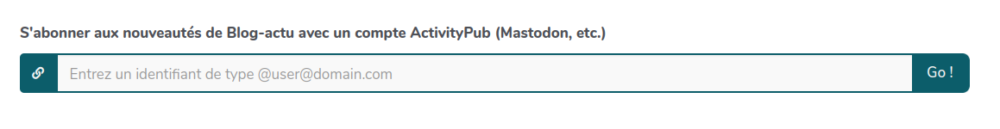

# Activer la compatibilité ActivityPub

Les fiches Bazar étant structurées, il est possible de les rendre compatible
ActivityPub. Chaque formulaire devient un acteur ActivityPub que l'on peut
suivre, et qui envoie des activités `Create`, `Update` et `Delete`. Le
formulaire lui-même peut suivre d'autres acteurs, et les fiches qu'il reçoit
vont être ajoutées automatiquement dans la liste.

Cela peut permettre de synchroniser deux instances YesWiki, ou alors de
permettre à n'importe quel utilisateur Mastodon d'être averti lorsqu'il y a des
nouveaux éléments qui sont postés. D'autres usages seront possible dans le
futur.

## Activer ActivityPub sur un formulaire Bazar

- Editer le formulaire et cliquez sur le bouton "Configuration avancée" tout en
  bas.
- Cochez la case "Activer ActivityPub pour ce formulaire"
- Entrez une template sémantique (utilisée pour convertir les données YesWiki en
  données ActivityPub - voir ci-dessous)
- Entrez une template sémantique inverse (utilisée pour convertir les données
  ActivityPub en YesWiki - voir ci-dessous)

Après avoir validé la modification, il devrait y avoir deux nouveaux éléments
dans la liste des formulaires:

- Dans la colonne "Format de données", un bouton "AP" qui renvoie vers l'acteur
  ActivityPub du formulaire
- Dans les actions, un bouton "ActivityPub", visible des administrateurs

Ce bouton mène à une page en deux onglets. Le compte n'existe pour les autres
serveurs qu'une fois un nom d'utilisateur choisi et le profil enregistré.

## Configuration du serveur web

Les autres serveurs joignent le compte par deux adresses à la racine du
domaine, en dehors du `?` des pages du wiki :

- `/.well-known/webfinger`, qui transforme `@agenda@monwiki.org` en adresse
  d'acteur ;
- `/actors/<identifiant du formulaire>`, l'acteur, avec `/inbox`, `/outbox`,
  `/followers` et `/following`.

Sans règle de réécriture, ces adresses répondent 404 et l'abonnement depuis
Mastodon échoue. L'adresse de l'acteur ne reprend que le domaine de la
`base_url` : ActivityPub ne fonctionne que pour un wiki installé à la racine
d'un domaine ou d'un sous-domaine. Dans un sous-dossier, deux wikis du même
domaine donneraient le même identifiant `@agenda@monwiki.org`.

Pour vérifier, `https://monwiki.org/actors/2` et
`https://monwiki.org/.well-known/webfinger?resource=acct:agenda@monwiki.org`
doivent répondre en JSON.
Sur une installation neuve, la case "Publier le blog et l'agenda sur le
Fédivers" de la configuration avancée fait tout cela pour les formulaires
Agenda et Blog-actu, avec les noms d'utilisateur `agenda` et `blog`. Elle est
cochée d'office quand le wiki est à la racine de son domaine.

## Configurer le serveur web

Les autres serveurs du fédivers cherchent un compte à deux adresses, toujours à
la racine du domaine :

- `/.well-known/webfinger?resource=acct:blog@monwiki.org`, qui transforme
  l'identifiant `@blog@monwiki.org` en adresse du compte ;
- `/actors/<identifiant du formulaire>`, le compte lui-même, avec ses boîtes
  `/inbox` et `/outbox` et ses collections `/followers` et `/following`.

Le wiki doit donc être servi à la racine de son domaine (`https://monwiki.org/`
et non `https://exemple.org/monwiki/`), et le serveur web doit transmettre ces
deux adresses au wiki. Sinon, la page ActivityPub du formulaire et l'action
`bazarfollow` affichent un avertissement aux administrateurs, qui dit laquelle
des deux adresses ne répond pas.

### Apache

YesWiki est livré avec un fichier `.htaccess` qui contient ces règles. Il faut
que le module `mod_rewrite` soit actif et que la configuration d'Apache autorise
les fichiers `.htaccess` à s'en servir (`AllowOverride FileInfo` ou
`AllowOverride All`).

La mise à jour automatique n'écrase jamais un `.htaccess` existant : elle ne
l'ajoute que s'il manque. Si vous avez déjà votre propre fichier, ajoutez-y ces
lignes :

```apache
<IfModule mod_rewrite.c>
  RewriteEngine On
  RewriteRule ^actors/([0-9]+)(/(?:outbox|inbox|followers|following))?$ index.php?wiki=api/forms/$1/actor$2 [QSA,L]
  RewriteRule ^\.well-known/webfinger$ index.php?wiki=api/webfinger [QSA,L]
</IfModule>
```

Le paramètre `wiki` est nécessaire : YesWiki lit la page demandée dans l'adresse
d'origine, qu'une réécriture Apache ne change pas. Certains hébergements
refusent les adresses qui commencent par un point (403 sur
`/.well-known/webfinger`) : il faut alors autoriser ce chemin dans leur
configuration.

### nginx

Ajoutez ces deux lignes dans le bloc `server` du wiki :

```nginx
rewrite ^/actors/(\d+)(/(?:outbox|inbox|followers|following))?$ /index.php?wiki=api/forms/$1/actor$2 last;
rewrite ^/\.well-known/webfinger$ /index.php?wiki=api/webfinger last;
```

La configuration de l'image Docker
([`docker/nginx.conf`](https://github.com/YesWiki/yeswiki/blob/doryphore-dev/docker/nginx.conf))
contient les deux blocs `location`.

Le paquet YunoHost de YesWiki contient déjà ces règles.

## Profil du compte

L'onglet "Profil" règle ce que voient les personnes qui consultent ou suivent le
compte depuis Mastodon, GoToSocial, etc. :

- le nom d'utilisateur (par exemple "agenda" ou "blog"), qui donne
  l'identifiant `@agenda@monwiki.org` ;
- la présentation. Laissée vide, c'est la description du formulaire qui sert.
  Les adresses web deviennent des liens ;
- l'image de profil et la bannière : une adresse complète, le chemin d'une
  image du wiki, ou un fichier envoyé (PNG, JPEG, GIF ou WebP, 5 Mo au plus),
  rangé dans `files/` ;
- jusqu'à six informations, libellé et valeur. Mastodon en affiche quatre,
  GoToSocial six.

La page enregistre le tout dans `wakka.config.php`, sous la clé
`activitypub_profiles`, rangé par identifiant de formulaire. Le serveur web doit
donc pouvoir écrire ce fichier. On peut aussi l'éditer à la main :

```php
'activitypub_profiles' => [
    2 => [
        'username' => 'agenda',
        'summary' => "Les rencontres et ateliers du collectif.",
        'icon' => 'files/Logo_agenda.png',
        'image' => 'https://monwiki.org/files/Banniere.jpg',
        'fields' => [
            'Site' => 'https://monwiki.org/',
            'Contact' => 'contact@monwiki.org',
        ],
    ],
],
```

Les serveurs distants gardent le profil en cache : un changement peut mettre
quelques heures à apparaître chez eux. Changer le nom d'utilisateur ne fait pas
perdre les abonnés, car l'adresse de l'acteur reste celle du formulaire, mais
l'ancien identifiant ne mène plus au compte.

## Abonnements et abonnés

L'onglet "Abonnements" liste les comptes que le formulaire suit. On peut y :

- s'abonner à un nouveau compte en entrant son identifiant ;
- synchroniser toutes les fiches d'un compte suivi ;
- se désabonner.

L'onglet "Abonnés" liste les comptes qui suivent le formulaire. On peut y suivre
un abonné en retour ou le retirer.

Par défaut, une demande d'abonnement est acceptée tout de suite. En cochant
"Valider les abonnés à la main" dans le profil, chaque demande attend dans
l'onglet "Abonnés", avec un bouton pour l'accepter ou la refuser. Si l'acceptation
automatique n'a pas pu être envoyée au serveur distant, la demande reste
affichée de la même façon, et le bouton "Accepter" la renvoie.

## Clés de signature

Chaque compte signe ses échanges avec une clé RSA. YesWiki la crée au premier
besoin dans `private/activitypub/<identifiant du formulaire>.pem`, lisible
seulement par le serveur web. Elle n'est ni en base de données ni dans l'API.

Gardez ce fichier dans vos sauvegardes : sans lui, YesWiki génère une nouvelle
clé. Mastodon recharge alors le profil de lui-même. GoToSocial, lui, refuse un
compte dont la clé a changé ("pubkey has changed" dans ses journaux) : il garde
l'ancien profil et ignore les messages du compte. Un administrateur de chaque
instance GoToSocial concernée doit alors faire expirer les clés du domaine du
wiki, depuis les actions d'administration de GoToSocial.

## Compatibilité GoToSocial

GoToSocial refuse toute requête non signée, y compris la simple lecture d'un
profil. YesWiki signe donc avec la clé du formulaire toutes ses requêtes vers
les autres serveurs : lecture des profils, des clés et des boîtes d'envoi.

Le bouton de l'action `bazarfollow` redirige vers le serveur de la personne
quand celui-ci propose l'abonnement à distance (Mastodon le fait). Sinon,
l'action affiche l'identifiant du compte, à chercher depuis son propre compte
avant de s'abonner.

Un abonnement demandé depuis l'onglet des abonnements reste marqué "en
attente d'acceptation" jusqu'à ce que le compte distant l'accepte.

## Journal des échanges

Pour comprendre pourquoi un abonnement ou une publication ne passe pas, activez
le journal dans `wakka.config.php` :

```php
'activitypub_log' => true,
```

YesWiki écrit alors une ligne JSON par échange dans
`private/activitypub/log/<date>.jsonl`, et efface les fichiers de plus de 14
jours. Le champ `direction` dit de quel échange il s'agit :

- `in` : une activité reçue dans la boîte de réception, avec la clé qui l'a
  signée (`request.keyId`), le logiciel distant (`request.userAgent`), la
  réponse de YesWiki (`status`) et la raison d'un refus (`error`) ;
- `out` : une activité envoyée à un abonné ou à un compte suivi, avec la
  boîte de réception visée et la réponse du serveur distant ;
- `get` : un serveur distant qui lit le profil, une collection, la boîte
  d'envoi, une fiche ou la réponse WebFinger. Mobilizon relit une fiche
  supprimée et doit obtenir 404 ;
- `sync` : une publication que la synchronisation n'a pas pu importer.

Pour suivre les échanges en direct :

```bash
tail -f private/activitypub/log/$(date +%F).jsonl | jq -c '{time, direction, type, peer, status, error}'
```

Le journal contient le texte des publications reçues et envoyées, et
l'adresse IP des serveurs distants. Désactivez-le une fois les essais finis.

## Exemples de templates

Voilà ci-dessous deux exemples de template. A noter que, si l'on veut que
ActivityPub soit utilisé pour synchroniser deux instances YesWiki, il est
important que tous les champs soient inclus, sinon des données seront perdues.

### Agenda

Le formulaire Agenda installé par défaut publie chaque fiche comme un événement
(`Event`) que Mobilizon, Mastodon et un autre YesWiki savent lire. Ses deux
templates se trouvent dans `tools/bazar/templates/activitypub/` :
`agenda-event.json.twig` et `agenda-event.reverse.json.twig`. Copiez-les dans
la configuration avancée d'un autre formulaire d'agenda pour lui donner le même
comportement.

Ce que le template fait pour Mobilizon :

- une date sans heure (événement sur la journée) part à minuit, et une date de
  fin sans heure à 23:59:59. Toutes les dates portent leur décalage horaire,
  sans quoi Mobilizon refuse l'événement ;
- `timezone` reprend le fuseau du wiki (`timezone` dans `wakka.config.php`).
  Mobilizon ne le garde que si l'événement a un lieu ;
- l'image devient la bannière : un `Document` nommé `Banner` ;
- le site internet devient un lien nommé `Website`, que Mobilizon affiche
  comme l'adresse de l'événement ;
- la latitude et la longitude partent en nombres décimaux. Envoyées en texte,
  Mobilizon les ignore ;
- la description est mise en forme (HTML), comme pour le blog.

Le template inverse accepte les événements Mobilizon : bannière, lien
`Website` (sinon la page de l'événement sur Mobilizon), lieu donné en texte ou
en adresse complète, et dates ramenées au fuseau du wiki. La description HTML
est convertie en Markdown.

#### Refuser un objet

Un template inverse peut renvoyer `null` : l'objet est alors ignoré, sans
compter comme un échec de synchronisation. Celui de l'agenda ignore tout ce qui
n'est pas un `Event`. C'est utile avec Mobilizon, dont les groupes publient
aussi les commentaires de leurs événements :

```twig

{ "bf_titre": {{ name | json_encode }} }

null

```

#### Recevoir les événements d'un groupe Mobilizon

Dans l'onglet "Abonnements" du formulaire, abonnez-vous au groupe
(`@legroupe@mobilizon.fr`). Mobilizon accepte tout de suite, sauf si le groupe
valide ses abonnés à la main. Chaque nouvel événement public du groupe arrive
ensuite dans l'agenda. Il est signé par la personne qui l'a créé, et c'est
elle seule qui peut ensuite le modifier ou le supprimer dans le wiki. Le bouton
"Synchroniser" importe les événements déjà publiés.

Les événements en brouillon ou non listés ne sont jamais envoyés par
Mobilizon.

#### Envoyer l'agenda vers une instance Mobilizon

Une personne de Mobilizon ne peut suivre qu'un groupe, pas un compte d'un autre
logiciel. C'est donc l'administration de l'instance qui s'abonne à l'agenda :
dans la partie Fédération de son administration, elle ajoute l'identifiant
du formulaire (`@agenda@monwiki.org`). Mobilizon ne propose pas d'abonnement par
simple nom de domaine pour YesWiki. L'interface peut afficher une erreur
alors que l'abonnement est bien parti : vérifiez l'onglet "Abonnés" du
formulaire.

Une fois l'abonnement accepté, Mobilizon lit la boîte d'envoi du formulaire
pour importer les événements existants, puis reçoit les nouveaux au fil de
l'eau.

Mobilizon relit chaque événement à son adresse, celle de la fiche, avec
l'en-tête `Accept: application/activity+json`. YesWiki y répond par l'objet
ActivityPub de la fiche. Une fiche supprimée répond 404 : sans cela, Mobilizon
ne supprime pas l'événement. La fiche doit donc rester lisible par tout le
monde.

Une instance Mobilizon refuse un événement dont le titre fait moins de trois
caractères.

### Blog

Note: Nous n'utilisons pas la propriété `summary` car Mastodon l'interprête
comme s'il fallait cacher le contenu du texte. Le titre n'est pas afficher par
Mastodon. Il serait possible d'améliorer ça en agrégeant le titre, le chapeau et
le contenu dans la propriété `content`, mais il faudrait prévoir de les séparer
dans la template inverse (ce qui est possible avec Twig, mais peut demander un
peu de travail)

#### Template du blog

```json
{
  "@context": "https://www.w3.org/ns/activitystreams",
  "type": "Note",
  "name": {{ bf_titre | json_encode }},
  "preview": {{ bf_chapeau | default("") | json_encode }},
  "content": {{ bf_description | default("") | json_encode }},
  "published": {{ date_creation_fiche | replace({" ": "T"}) | json_encode }},
  "updated": {{ date_maj_fiche | replace({" ": "T"}) | json_encode }},
  "attachment": [
    
    {
      "type": "Image",
      "url": {{ fileUrl(imagebf_image) | json_encode }}
    }
    
  ]
}
```

### Template inverse du blog

```json
{
  "bf_titre": {{ name | json_encode }},
  "bf_chapeau": {{ preview | default("") | json_encode }},
  "bf_description": {{ content | default("") | json_encode }},
  "imagebf_image": {{ (attachment | first).url | default("") | json_encode }}
}
```

## Actions

### `bazarfollow`

Si vous avez activés ActivityPub pour un formulaire Bazar, vous pouvez utiliser
cette action pour permettre à n'importe qui de suivre l'acteur avec un compte
ActivityPub (par exemple Mastodon).

Elle prend comme unique paramètre l'ID du formulaire:

```text
{{bazarfollow id="3"}}
```

Cela affiche un champ comme ça:



Lorsque l'utilisateur entre son identifiant ActivityPub, cela le redirige vers
la page de l'acteur formulaire sur sa propre instance.
