# Traitements en arrière-plan

Un wiki fait beaucoup de choses en dehors de l'affichage des pages : il tient à
jour l'index de la recherche, envoie les e-mails récapitulatifs, synchronise les
sources de données, livre les publications aux autres sites du fédivers,
fabrique les sauvegardes, et fait régulièrement le ménage (anciennes révisions,
anciennes lignes du Journal, clés de récupération et d'activation périmées...).
Rien de tout cela ne doit faire attendre la personne qui lit une page : le wiki
note le travail à faire dans une **file d'attente**, et quelque chose doit
ensuite **traiter cette file**. Ce « quelque chose » s'appelle le **mode de
traitement**.

Si rien n'est jamais traité, personne ne voit une page cassée : c'est la
recherche qui n'est plus à jour, les récapitulatifs qui ne partent pas, les
sauvegardes qui n'avancent pas. C'est pourquoi la page **Traitements** de
l'administration existe : elle dit ce qui attend, ce qui a échoué, si quelque
chose traite la file, et elle allume une pastille rouge dès qu'un problème
demande votre attention.

Pour l'ouvrir, allez dans la gestion du site, menu **Système**, entrée
**Traitements** (adresse `?admin/jobs`). Il faut être identifié comme
administrateurice. Le chiffre rouge à côté de l'entrée compte les problèmes qui
demandent votre attention ; le même problème apparaît aussi sur la page
**Santé**.

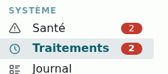

**Vous n'avez rien à régler pour que ça marche.** Le mode par défaut convient à
la plupart des wikis. Le reste de cette page sert à choisir mieux si votre wiki
est très visité, si vos traitements sont longs, ou si la page Traitements vous
signale un problème.

## Ce qui passe par la file

**Ce qui est ajouté à la file quand quelque chose se passe :**

- les **sauvegardes** et les **restaurations**, y compris la sauvegarde faite
  avant une mise à jour (voir
  [sauvegardes et restaurations](async.md#sauvegardes-et-restaurations)) ;
- la récupération d'une **sauvegarde d'un autre wiki** : elle avance étape par
  étape dans la file (une tranche d'environ 20 secondes par passage, la suivante
  attendant le passage d'après), et continue même si vous fermez la page des
  sauvegardes ;
- l'**indexation de la recherche** : chaque page ou fiche modifiée est
  réindexée peu après son enregistrement ;
- la **livraison des publications ActivityPub** aux serveurs abonnés, une par
  destinataire.

**Ce qui revient régulièrement (les « tâches planifiées ») :**

| Tâche                                                                         | Fréquence                                                                                                   |
| ----------------------------------------------------------------------------- | ----------------------------------------------------------------------------------------------------------- |
| suppression des anciennes révisions de pages                                  | toutes les 30 minutes                                                                                       |
| nettoyage du Journal au-delà de sa durée de conservation                      | toutes les 30 minutes                                                                                       |
| suppression des clés de récupération de mot de passe et d'activation expirées | toutes les 30 minutes                                                                                       |
| nettoyage des jetons et compteurs anti-robots                                 | toutes les 30 minutes                                                                                       |
| tâches qu'une extension déclare                                               | selon l'extension                                                                                           |
| envoi des e-mails récapitulatifs                                              | à 7 h à l'heure du wiki : chaque jour, chaque lundi ou chaque 1er du mois, selon l'abonnement               |
| synchronisation automatique de chaque source de données                       | selon le réglage de la source, au plus toutes les 30 minutes ; la première un intervalle après l'activation |
| ménage de la file elle-même                                                   | une fois par jour                                                                                           |

Une fréquence se compte à partir du dernier lancement de la tâche : « toutes
les 30 minutes » veut dire 30 minutes après le précédent lancement, et un
passage en retard décale d'autant les suivants. Les heures fixes, comme les 7 h
des récapitulatifs, suivent le fuseau du wiki et ne bougent pas. Une tâche que
le wiki découvre (une source qu'on vient d'activer, un premier abonné aux
récapitulatifs, une extension installée) attend sa première échéance au lieu de
tourner tout de suite.

Une tâche en retard (parce que rien n'a traité la file pendant un moment) ne
tourne qu'**une fois** au passage suivant, pas autant de fois qu'elle a été
manquée.

**Ce qui reste immédiat**, sans passer par la file : les e-mails de
notification (commentaires, inscriptions, mot de passe oublié...), les imports
CSV lancés depuis le navigateur, le bouton « synchroniser » d'une source de
données et l'action `{{sync}}`.

## Choisir le mode de traitement

| Mode                        | Qui traite la file                                                                     | Délai attendu                                                                           | Désavantage                                                                                                                                          | Hébergement                                        |
| --------------------------- | -------------------------------------------------------------------------------------- | --------------------------------------------------------------------------------------- | ---------------------------------------------------------------------------------------------------------------------------------------------------- | -------------------------------------------------- |
| `request` (défaut, partout) | la fin de chaque visite, une fois la page envoyée                                      | dès la fin de la visite qui l'ajoute, sinon à la visite suivante (voir sous le tableau) | rien n'avance sans visite ; un traitement long garde un processus du serveur occupé tant qu'il dure ; sur certains serveurs, les visiteurs attendent | tous, même un mutualisé sans cron                  |
| `api`                       | un service de cron en ligne                                                            | 1 min (appel toutes les minutes)                                                        | dépend d'un service extérieur ; un traitement long garde l'appel ouvert tant qu'il dure                                                              | mutualisé sans cron                                |
| `--drain` par cron          | une ligne de crontab toutes les minutes, à côté de la fin des visites (mode `request`) | 1 min                                                                                   | une ligne à installer ; un processus PHP lancé chaque minute ; sur certains serveurs, les visiteurs attendent toujours                               | tout hébergement avec un crontab                   |
| `worker`                    | un processus qui tourne en continu, relancé par le serveur ou par le binaire YesWiki   | quelques secondes                                                                       | un processus PHP par wiki, gardé en mémoire en permanence ; hors du binaire, un service à installer et surveiller                                    | serveur privé ou dédié, conteneur, binaire YesWiki |

En `request`, ce qu'une visite ajoute à la file est traité
dès la fin de cette visite, une fois la page envoyée : la page que vous venez
d'enregistrer est réindexée tout de suite, sans attendre une autre visite. Ce
qui ne vient pas d'une visite attend en revanche la visite suivante : les
nouvelles tentatives d'un traitement qui a échoué, le travail ajouté en ligne de
commande, et ce qu'un traitement ajoute à la file pendant un passage : un passage
traite ce qui attendait quand il a commencé, le reste attend le passage suivant.
Les tâches planifiées arrivées à échéance, elles, sont ajoutées au début du
passage et traitées dans le même.

Comment choisir, en pratique :

- **Wiki sur un hébergement mutualisé, sans accès au serveur** : laissez
  `request`. Si les pages sont lentes à s'afficher de temps en temps, ou si la
  page Traitements dit que « les visiteurs attendent pendant le traitement »,
  passez à `api` dès que vous avez un service de cron en ligne à disposition.
- **Wiki très peu visité** : en `request`, rien n'est traité tant que personne
  ne vient. Un wiki qui reçoit une visite par jour traite donc ses tâches une
  fois par jour. Préférez `--drain` par cron si vous avez un crontab, sinon
  `api`, ou `worker`.
- **Hébergement avec un crontab, sans processus permanent possible** :
  [`--drain` toutes les minutes](async.md#traiter-la-file-par-cron-ou-à-la-main).
- **Traitements longs** (synchronisations de grosses sources, par exemple) :
  `worker`, ou `--drain` par cron : en ligne de commande, PHP n'a pas de limite
  de temps. Les autres modes relèvent la limite de temps de PHP au début de
  chaque passage, jusqu'à 20 minutes et autant que l'hébergeur le permet (voir
  plus bas, sous le tableau des serveurs). Le passage
  s'arrête avant qu'elle soit atteinte et laisse le reste pour le suivant ; un
  traitement qui, à lui seul, dure plus longtemps que ce que PHP laisse est
  coupé et passe en échec. Dans tous les modes, un traitement dont le
  processus tourne encore n'est jamais déclaré arrêté, quelle que soit sa
  durée. Les
  sauvegardes et restaurations sont un cas à part, voir
  [plus bas](async.md#sauvegardes-et-restaurations).
- **Wiki servi par le binaire YesWiki** : `request` suffit, comme ailleurs.
  Passez à `worker` si le wiki est peu visité ou si ses traitements sont longs :
  le binaire s'occupe alors du processus, il n'y a rien à installer.

### `request` selon la façon dont le serveur lance PHP

`request` fonctionne partout, mais pas de la même manière. Ce qui change d'un
serveur à l'autre, c'est si la page peut partir avant le traitement :

| Le serveur lance PHP avec…                                            | La page part avant le traitement ?                      | Ce qu'il faut savoir                                                                                                                                                                                                             |
| --------------------------------------------------------------------- | ------------------------------------------------------- | -------------------------------------------------------------------------------------------------------------------------------------------------------------------------------------------------------------------------------- |
| PHP-FPM (nginx, Apache avec `proxy_fcgi`, Caddy)                      | oui                                                     | le visiteur n'attend pas ; le passage dispose de 20 minutes de calcul au plus (voir sous le tableau)                                                                                                                             |
| FrankenPHP, avec ou sans son mode worker                              | oui                                                     | rien                                                                                                                                                                                                                             |
| LiteSpeed (fréquent en mutualisé)                                     | oui                                                     | si la page Traitements montre des traitements interrompus en fin de visite, LiteSpeed arrête sans doute PHP quand la connexion se ferme : ajoutez `<IfModule Litespeed>` `SetEnv noabort 1` `</IfModule>` au `.htaccess` du wiki |
| PHP intégré à Apache (`mod_php`), PHP en CGI ou FastCGI par `php-cgi` | non                                                     | le visiteur attend la fin du passage, d'où l'alerte « Attente ajoutée aux pages »                                                                                                                                                |
| serveur intégré de PHP (`php -S`)                                     | non                                                     | réservé au développement : il ne sert qu'une page à la fois, et chaque traitement bloque les autres visites                                                                                                                      |
| plateforme « serverless » (AWS Lambda avec Bref, Cloud Run…)          | oui, mais l'exécution est gelée une fois la page partie | `request` ne convient pas : le traitement est figé puis compté comme interrompu. Choisissez `api`                                                                                                                                |

`request` fonctionne aussi sur un hébergement qui désactive `ignore_user_abort`
ou `set_time_limit` (réglage `disable_functions` de PHP).

**La limite de temps de PHP est relevée au début de tout passage qui a au moins
un traitement à faire** : la fin d'une visite une fois la page partie, le mode
de secours, un appel `api` et le bouton **Consommer maintenant**. Elle monte par
paliers (1, 2, 4, 8 et 16 minutes) jusqu'à 20 minutes, et s'arrête au premier
palier que l'hébergeur refuse. Elle l'est avant le premier traitement, même
quand il est court : la limite de PHP compte le temps de calcul cumulé de toute
la requête, page déjà servie comprise, si bien qu'un traitement qui paraît court
peut quand même être coupé. Le passage cesse de prendre de nouveaux traitements
à 80 % de la limite obtenue (16 minutes au plafond) et le reste attend le
passage suivant. Si l'hébergeur n'a rien accepté (`php_admin_value`,
`set_time_limit` désactivé), ces 80 % se comptent depuis le début de la requête.
En ligne de commande (`--drain`), PHP n'a pas de limite de temps et le wiki n'en
ajoute pas. Sans moyen d'envoyer la page avant la fin du traitement (`mod_php`,
CGI), le visiteur attend la fin du passage. Deux conséquences :

- sous Linux, la limite ne compte que le temps de calcul : un traitement qui
  boucle en calculant est coupé, mais pas un traitement bloqué sur le réseau ou
  la base de données, qui garde son processus jusqu'à ce que l'hébergeur ou vous
  l'arrêtiez (la limite `request_terminate_timeout` de PHP-FPM ne s'applique
  pas, par défaut, après l'envoi de la page) ;
- quand un traitement s'arrête, le wiki le sait **tout de suite** ; s'il ne
  peut pas le vérifier (dossier `cache/` non inscriptible), seulement **une
  heure et une minute** après le début du traitement.

**Recommandation : dans l'interface de votre hébergeur, augmentez la limite de
temps de PHP (`max_execution_time`) à la valeur maximale proposée.**

### Où se règle le mode

Le mode se choisit dans le fichier `private/.env` du wiki, avec une ligne comme
celle-ci (modèle dans le fichier `.env.example` livré avec YesWiki) :

```
YESWIKI_QUEUE_CONSUMER=worker
```

Il peut aussi se lire dans l'environnement du serveur. Il ne se règle pas
depuis la page « Fichier de configuration » de la gestion du site. S'il est
indiqué aux deux endroits, l'environnement du serveur l'emporte sur
`private/.env`. La
page Traitements indique le mode en vigueur, mais pas d'où vient le réglage : si
une modification ne change rien, cherchez une autre définition plus haut dans
cette liste.


### Mettre en place `api`

1. Réglez `YESWIKI_QUEUE_CONSUMER=api` dans `private/.env`. Tant qu'aucun
   secret n'est défini, la page Traitements affiche une alerte rouge : l'adresse
   d'appel refuse tout le monde. L'alerte du
   [mode de secours](async.md#le-mode-de-secours) s'y ajoute jusqu'au
   premier appel réussi : c'est normal pour un wiki qui vient de passer en `api`.

   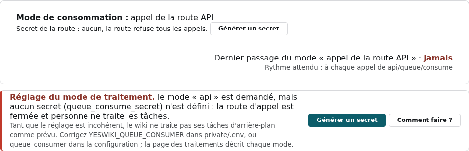

2. Cliquez sur **Générer un secret** et copiez-le tout de suite : il n'est
   affiché qu'une fois. La page donne aussi l'appel tout prêt à programmer.
   (Un nouveau clic, sur **Remplacer le secret** cette fois, invalide l'ancien :
   pensez à mettre à jour le service qui appelle.)

   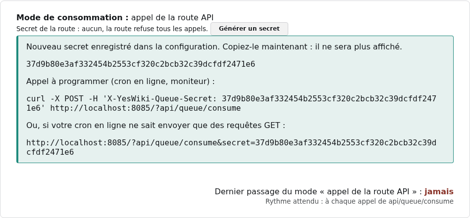

3. Dans votre service de cron en ligne, programmez **toutes les minutes** (ou
   au plus court que le service permet) une requête `POST` sur
   `https://votre-site/?api/queue/consume`, avec l'en-tête
   `X-YesWiki-Queue-Secret` contenant le secret. Avec `curl` :

```
curl -X POST -H 'X-YesWiki-Queue-Secret: LE-SECRET' 'https://votre-site/?api/queue/consume'
```

Si votre service ne sait programmer qu'une requête `GET`, sans en-tête, mettez
le secret dans l'adresse. Le secret apparaît alors dans les journaux du
serveur : préférez l'en-tête quand c'est possible.

```
https://votre-site/?api/queue/consume&secret=LE-SECRET
```

Le wiki répond `401` si le secret est faux ou absent, et `200` sinon, avec le
nombre de traitements effectués et ce qui reste. Un appel qui arrive pendant
qu'un autre passage tourne travaille à côté de lui : un long traitement en
cours n'empêche pas les autres d'avancer.

L'appel dure aussi longtemps que les traitements en attente quand il a
commencé : le wiki ne le borne pas. Trois précautions en découlent :

- le service de cron doit accepter une réponse longue. Les services en ligne
  coupent souvent l'appel au bout de 30 secondes environ, et certains
  désactivent une tâche dont les appels échouent : réglez un délai d'attente
  long, de plusieurs minutes, ou plus si vous avez de gros traitements ;
- le serveur web peut couper le passage lui-même : `request_terminate_timeout`
  de PHP-FPM, `fastcgi_read_timeout` de nginx, ou la limite d'un proxy. Le
  traitement en cours est alors coupé en route (voir
  [Traitements trop longs pour le mode choisi](async.md#traitements-trop-longs-pour-le-mode-choisi-rouge)) ;
- si ces limites sont courtes et que vous ne pouvez pas les relever, préférez
  `worker`.

### Mettre en place `worker`

Sous le binaire YesWiki, voir
[plus bas](async.md#worker-sous-le-binaire-yeswiki) : il suffit d'une
ligne dans `private/.env`.

Ailleurs, c'est un travail pour la personne qui administre le serveur : une
commande à garder en vie, avec un service systemd par exemple. Elle se lance
depuis le dossier du wiki, avec le compte qui possède ses fichiers :

```
php -d memory_limit=256M src/commands/console messenger:consume --time-limit=3600 --memory-limit=128M
```

Le processus s'arrête de lui-même de temps en temps (au
bout d'une heure, quand il a utilisé trop de mémoire, ou quand la configuration
du wiki change) : le service doit le relancer à chaque fois (`Restart=always`
pour systemd).

Dites aussi au wiki lui-même qu'il est dans ce mode, à l'endroit que lit sa
partie web : la ligne `YESWIKI_QUEUE_CONSUMER=worker` dans `private/.env`. Sans cela, les
visites continuent de traiter la file en fin de page et la page Traitements
affiche « fin de requête ». Un exemple complet de service est donné dans
[INSTALL.md](https://github.com/YesWiki/yeswiki/blob/ectoplasme/INSTALL.md#housekeeping).

#### Les limites du processus

Ces options disent quand le processus doit s'arrêter pour laisser le service en
relancer un neuf. Elles sont vérifiées **entre deux traitements** et n'en coupent
jamais un : le processus termine celui en cours, puis s'arrête normalement (code
de sortie 0). Elles ne bornent donc pas la durée d'un traitement : une
synchronisation de deux heures va au bout avec `--time-limit=3600`. Leur rôle est
de repartir régulièrement d'un processus propre.

| Option           | Le processus s'arrête…                                                          | Défaut             | Motif dans l'onglet _Consommateurs_ |
| ---------------- | ------------------------------------------------------------------------------- | ------------------ | ----------------------------------- |
| `--time-limit`   | après ce nombre de secondes                                                     | `3600` (une heure) | « durée de vie atteinte »           |
| `--memory-limit` | quand sa mémoire dépasse cette taille (`128M`, `512K`, `-1` pour aucune limite) | `128M`             | « mémoire pleine »                  |
| `--limit`        | après ce nombre de traitements                                                  | aucune limite      | « nombre de traitements atteint »   |

`--memory-limit` n'est pas la limite de PHP (`memory_limit`). La première demande
un redémarrage propre une fois le traitement fini. La seconde arrête PHP net : le
traitement en cours est perdu et passe en échec comme « coupé ». Donnez donc à
PHP une limite nettement plus haute que `--memory-limit`, d'où le
`-d memory_limit=256M` de l'exemple. Avec 128 Mo des deux côtés, PHP s'arrêterait
avant le redémarrage propre.

Recommandations :

- **Commencez avec les valeurs de l'exemple**, sans `--limit` : elles conviennent
  à la plupart des wikis. Le binaire YesWiki utilise les mêmes `--time-limit` et
  `--memory-limit`, qui ne se règlent pas de son côté.
- **`--time-limit`** : gardez une heure, ou moins si vous le souhaitez, mais pas
  moins de 5 minutes. Ne dépassez pas une heure : quand personne ne visite le
  site, c'est au redémarrage que le processus remet en ligne un wiki resté bloqué
  par une sauvegarde interrompue.
- **`--memory-limit`** : si l'onglet _Consommateurs_ montre « mémoire pleine » à
  chaque passage ou presque, passez à `256M`, en relevant `memory_limit` dans la
  même proportion (`512M`). Évitez `-1` : le processus ne se renouvellerait plus
  pour cause de mémoire, et seule la limite de PHP l'arrêterait.
- **`--limit`** : inutile en temps normal. Il peut servir si la mémoire d'un
  processus grimpe sans raison apparente, avec une valeur élevée (`1000` par
  exemple).
- **Des limites trop basses déclenchent une fausse alerte** : plus de 5 démarrages
  en 10 minutes allument
  [« Processus de traitement qui redémarre en boucle »](async.md#processus-de-traitement-qui-redémarre-en-boucle-rouge).
  Les redémarrages dus à un changement de configuration ne comptent pas.

### Traiter la file par cron ou à la main

Depuis un terminal, dans le dossier du wiki :

```
./yeswicli messenger:consume --drain
```

ajoute à la file les tâches planifiées qui sont dues, traite ce qui attend dans
la file, puis s'arrête. Une tâche planifiée qui n'est pas encore due n'est pas
lancée en avance, et il n'y a pas de limite de temps. La commande s'arrête aussi
quand la mémoire utilisée dépasse 80 % de celle que PHP accorde (`memory_limit`) :
relancez-la pour traiter le reste.

Lancée **toutes les minutes** par un crontab, cette commande est une façon à
part entière de traiter la file en dehors des visites :

```
* * * * * cd /home/jdoe/www/wiki && ./yeswicli messenger:consume --drain > /dev/null
```

Programmez-la avec le compte qui possède les fichiers du wiki : la commande
refuse de tourner sous un autre. Sa sortie est écartée pour ne pas recevoir un
e-mail par minute ; les échecs restent visibles sur la page Traitements et dans
le Journal.

Ce n'est pas une valeur de `YESWIKI_QUEUE_CONSUMER` : laissez le mode à
`request`. La page Traitements affiche donc « fin de requête », ces passages
apparaissent en mode `request`, et les visites continuent de traiter la file à
côté d'eux. Sur un wiki réglé en `api` ou `worker`, ils ne remplacent pas le mode
choisi : si celui-ci ne répond plus, le wiki passe quand même en mode de secours.

Un passage encore en cours à la minute suivante ne gêne pas : le nouveau travaille
à côté de lui, et chaque traitement n'est pris que par l'un des deux.

Quand la page ne peut pas partir avant la fin du traitement (`mod_php`, CGI),
une sauvegarde lancée depuis l'administration est exécutée dans un processus à
part, avec le `php` en ligne de commande que le wiki trouve à côté de celui du
serveur. Certains serveurs en ont plusieurs, de versions différentes, et le
premier trouvé n'est pas toujours le bon. Dans ce cas, indiquez le chemin du bon
dans `private/.env`, par exemple `ASYNC_PHP_BINARY=/usr/bin/php8.4`.

### `worker` sous le binaire YesWiki

Quand le wiki est servi par le binaire YesWiki (`yeswiki serve`, ferme
comprise), il traite sa file en `request` tant qu'il ne demande rien d'autre.
Avec `YESWIKI_QUEUE_CONSUMER=worker` dans `private/.env`, c'est le binaire qui
lance et surveille le processus de ce wiki, et le relance s'il s'arrête : pas
de service à écrire. Les tâches avancent sans visite, en quelques secondes, et
peuvent durer aussi longtemps qu'il le faut. En contrepartie, un processus PHP
reste en mémoire en permanence pour ce wiki : c'est pourquoi ce n'est pas le
défaut. La page Traitements indique alors le rythme « en continu
(messenger:consume) », comme pour tout `worker`.

Le changement est pris en compte au prochain redémarrage du binaire, ou au
prochain rechargement de la ferme.

## Le mode de secours

Le mode choisi peut tomber en panne sans prévenir : le service `worker` s'est
arrêté, le service de cron en ligne n'appelle plus. Pour que la maintenance, la recherche et les envois ne
s'arrêtent pas pendant des semaines sans que personne ne s'en aperçoive, le wiki
vérifie que le mode choisi travaille bien. Quand ce n'est plus le cas, il passe
en **mode de secours** : il traite la file à la fin des visites, comme en
`request`, et il le signale par une alerte rouge.

Le secours se déclenche dès que le mode choisi n'a pas été vu au travail
depuis :

| Mode choisi | Délai avant le secours                 |
| ----------- | -------------------------------------- |
| `worker`    | 10 minutes                             |
| `api`       | 3 heures                               |
| `request`   | jamais : c'est déjà le mode de secours |

Le mode choisi est « vu » tant qu'un de ses passages est en cours (son
processus est là), ou qu'il en a terminé un depuis moins que ce délai. Seuls
comptent les passages qu'il lance lui-même : le bouton **Consommer
maintenant**, la commande `--drain`, les sauvegardes et le secours lui-même
s'enregistrent en `request` et ne le font pas paraître vivant. Un mode qui n'a
**jamais** été vu, par exemple un wiki qu'on vient de passer en `worker` avant
que son processus ne démarre, compte comme absent : le secours commence tout de
suite, et s'arrête au premier passage de ce mode. La fin des visites vérifie
cette règle au plus une fois par minute.

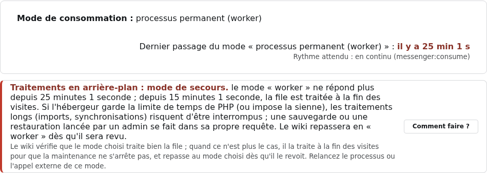

Pendant le secours :

- le bandeau du mode montre toujours le mode **choisi**, et la ligne « Dernier
  passage du mode... » passe en rouge : c'est la date à laquelle ce mode a été
  vu pour la dernière fois ;
- les traitements longs (imports, synchronisations) tournent dans le processus
  d'une visite, comme en `request` : ils risquent d'être coupés si l'hébergeur
  impose la limite de temps de PHP ;
- dans l'onglet _Consommateurs_, les passages faits en secours apparaissent en
  mode `request`, comme ceux d'une visite ordinaire.

Le wiki **repasse tout seul** au mode choisi dès qu'il le revoit au travail : il
n'y a rien à acquitter. Le secours ne s'arrête pas parce que la file est vide,
seulement quand le mode choisi est de retour. Le bouton **Consommer
maintenant** ne le fait pas disparaître non plus, puisqu'il ne prouve pas que le
mode choisi fonctionne. Si vous changez de mode, le secours de l'ancien mode
prend fin.

Pour savoir quoi vérifier, voir
[l'alerte du mode de secours](async.md#traitements-en-arrière-plan--mode-de-secours-rouge).

## Lire la page Traitements

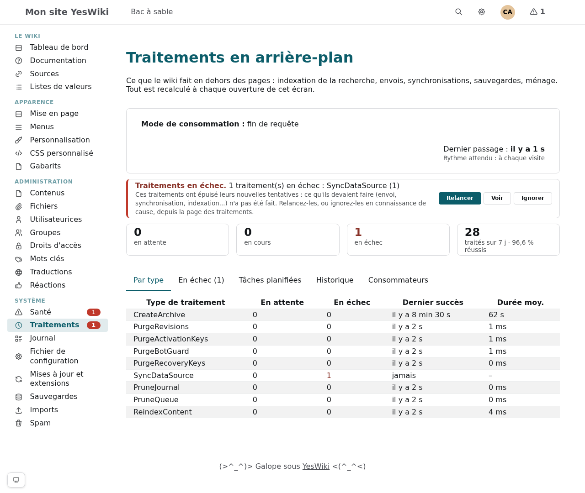

De haut en bas :

- **Le bandeau du mode** : le mode en vigueur, la date du dernier passage et
  le rythme attendu. Un « passage » est une séance de travail du wiki sur la
  file : il traite ce qui attendait quand il a commencé, puis s'arrête. Ce qu'un
  traitement ajoute à la file pendant le passage attend le passage suivant. Sur
  un serveur où PHP ne sait pas envoyer la page avant d'avoir fini (PHP intégré
  à Apache, ou lancé en CGI), le bandeau précise que les visiteurs attendent
  pendant le traitement.
- **Les alertes**, les plus graves d'abord. Une alerte **rouge** veut dire que
  quelque chose ne se fait plus ; elle allume aussi la pastille du menu et
  apparaît sur la page Santé. Une alerte **orange** est un avertissement. Chaque
  alerte dit ce qu'il en coûte et propose les boutons utiles ; le bouton
  **Comment faire ?** mène à cette page. Quand le problème disparaît, l'alerte
  disparaît : il n'y a rien à acquitter. S'il n'y a aucun problème, la page
  affiche « Rien à signaler ».

  

- **Les tuiles** : combien de traitements attendent (et depuis combien de temps
  pour le plus ancien), combien sont en cours, combien ont échoué, combien ont
  été traités ces 7 derniers jours (et quelle part a réussi).

  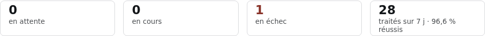

- **Les onglets**, décrits ci-dessous.

### Onglet _Par type_

Un traitement par ligne et par sorte de travail : combien attendent, combien
ont échoué, quand le dernier a réussi et combien de temps il prend en moyenne.
Les noms sont ceux qu'utilise le programme : `ReindexContent` pour l'indexation
de la recherche, `SyncDataSource` pour la synchronisation d'une source,
`CreateArchive` et `RestoreArchive` pour les sauvegardes et restaurations,
`SendDigest` pour les récapitulatifs, `DeliverActivity` pour les livraisons
ActivityPub, `Purge...` et `Prune...` pour le ménage.

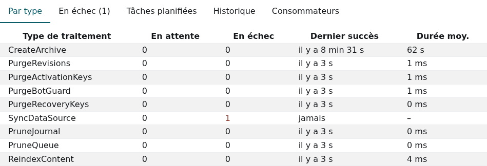

### Onglet _En échec_

Les traitements qui ont épuisé leurs tentatives, avec leur erreur. Pour chacun :

- **Relancer** le remet dans la file, avec de nouvelles tentatives. À utiliser
  une fois la cause réglée. Une sauvegarde, une restauration ou une étape de la
  récupération d'une sauvegarde d'un autre wiki n'a pas ce bouton : elle se
  relance depuis la page des sauvegardes ;
- **Ignorer** le retire de la liste (et de l'alerte), mais garde sa trace dans
  l'historique. Si le même problème revient, l'alerte revient : il n'existe pas
  de façon de « faire taire » une cause, ni d'effacer un échec sans en garder la
  trace.

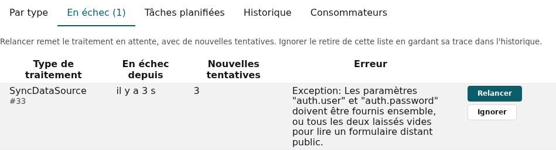

Un traitement qui échoue est **retenté automatiquement trois fois** (après 1
minute, puis 5, puis 25) avant d'être déclaré en échec. Les traitements en échec
sont conservés 30 jours, puis supprimés. Chaque échec définitif est aussi écrit
dans le Journal. Les livraisons ActivityPub font exception : voir
[les alertes propres à une fonctionnalité](async.md#alertes-propres-à-une-fonctionnalité).

### Onglet _Tâches planifiées_

Les tâches régulières, avec leur fréquence, leur dernière exécution, leur
résultat (et la dernière erreur si elle a échoué) et leur prochaine échéance.
**Lancer** met une tâche dans la file tout de suite, et sa prochaine échéance
compte alors à partir de ce lancement, comme le dit la page : « Lancer met la
tâche en file tout de suite ; sa prochaine échéance compte alors à partir de ce
lancement. » Pratique pour vérifier qu'une correction a marché.

Quand un module ou une extension n'arrive plus à dire quelles tâches il
planifie (une erreur dans son code ou dans sa configuration), ses tâches
disparaissent de l'onglet tant que l'erreur dure ; le Journal la signale
régulièrement parmi les erreurs.

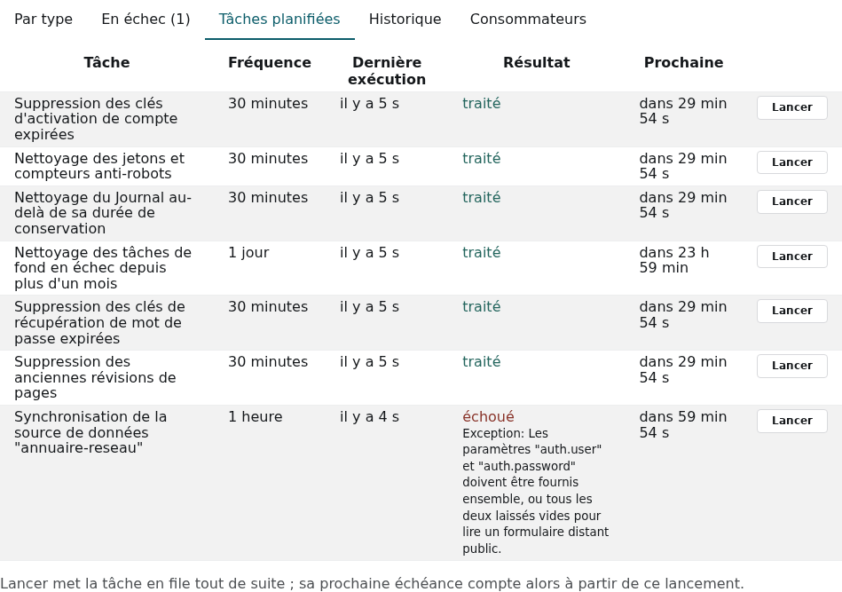

### Onglet _Historique_

Les 100 derniers traitements (l'historique, lui, en garde 7 jours) : quand,
quoi, avec quel résultat, dans quel mode et en combien de temps. Une tâche
planifiée y porte son nom, comme dans l'onglet _Tâches planifiées_ ; les autres
traitements portent le nom qu'utilise le programme. « nouvelle tentative
prévue » signale un échec qui sera retenté.

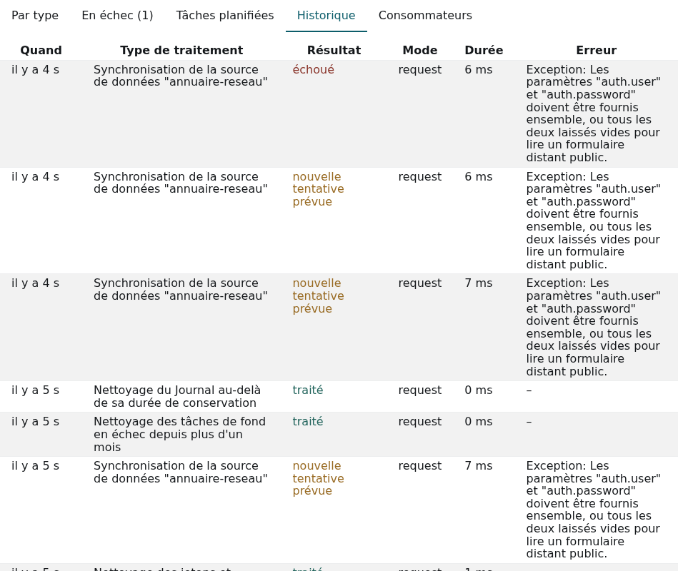

### Onglet _Consommateurs_

Les passages et les processus qui ont travaillé sur la file : quand, dans quel
mode, combien de temps, combien de traitements, pourquoi ils se sont arrêtés
(« plus rien à traiter », « limite de temps de PHP atteinte »...) et la mémoire
utilisée. C'est ici qu'on vérifie qu'un cron en ligne ou un worker passe vraiment : leurs
passages sont les seuls en mode `api` ou `worker`. Tout autre passage (fin de
visite, bouton **Consommer maintenant**, `--drain`, sauvegarde lancée par un
admin, mode de secours) apparaît en mode `request`.

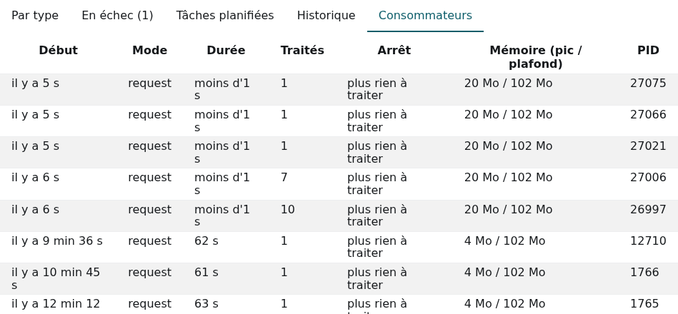

Un passage dont le processus a disparu (mémoire épuisée, processus arrêté par
le serveur...) n'est pas laissé « en cours » : le passage suivant le clôt avec
le motif « arrêtée avant la fin : son processus a disparu ». C'est immédiat ; si le
wiki ne peut pas le vérifier, il faut qu'une heure et une minute se soient
écoulées sans signe de vie. L'heure de fin affichée est celle
de son dernier signe de vie, pas celle du moment où le wiki s'en est aperçu.

### Les boutons des alertes

- **Consommer maintenant** lance un passage tout de suite, depuis votre
  navigation, quel que soit le mode. C'est le premier réflexe quand une alerte
  dit que « plus rien ne traite ». Comme tout passage, il traite ce qui
  attendait dans la file quand il a commencé (et les tâches planifiées arrivées
  à échéance), un traitement après l'autre, **jusqu'à 80 % de la limite de temps de PHP** ; ce qui
  arrive dans la file pendant ce temps attend le passage suivant. Il s'arrête
  quand il n'y a plus rien jusqu'à ce point, quand le wiki est en pause, quand
  la mémoire utilisée dépasse 80 % de celle que PHP accorde (cliquez de nouveau
  pour la suite), ou si le serveur le coupe. Les passages des visites continuent
  à côté de lui. Il peut donc durer longtemps, et la page attend sa réponse
  jusqu'au bout. Vos autres pages ne l'attendent pas : vous pouvez continuer à
  naviguer dans le wiki, dans un autre onglet, pendant qu'il tourne.
- **Relancer** et **Ignorer**, dans l'alerte « Traitements en échec », agissent
  sur tous les traitements en échec à la fois, sauf ceux qui ont été coupés en
  route : ceux-là relèvent de l'alerte « Traitements trop longs pour le mode
  choisi » et se relancent ou s'ignorent un par un dans l'onglet _En échec_.
  **Relancer** laisse en plus de côté les sauvegardes, les restaurations et les
  étapes d'une récupération de sauvegarde, qui se relancent depuis la page des
  sauvegardes ; **Ignorer** les retire, elles aussi. **Voir** ouvre l'onglet
  concerné.
- **Générer un secret** apparaît en mode `api` sans secret.
- **Comment faire ?** mène à cette page.

Pendant une sauvegarde ou une mise à jour, et tant que le wiki est en
hibernation, le wiki est « en pause » : rien n'est traité, aucune
tâche planifiée n'est lancée, et aucune alerte de retard ne se déclenche. Au
réveil, chaque tâche planifiée qui a manqué son heure tourne **une fois**, puis
reprend son rythme habituel.

## Sauvegardes et restaurations

Une sauvegarde ou une restauration lancée depuis la page **Sauvegardes** (ou
avant une mise à jour) passe par la file et apparaît sur la page Traitements
comme les autres. Il n'y a rien à régler : le wiki choisit qui l'exécute pour
qu'elle ne soit pas coupée en route.

- En mode `request` (le défaut), elle s'exécute à la fin de la requête de la
  personne qui l'a lancée, une fois la page envoyée, avec 20 minutes de calcul
  au plus quand l'hébergeur le permet, avec ce qui attendait déjà dans la file. La progression
  s'affiche pendant ce temps.
- En mode `api`, elle s'exécute de même dans la requête de la personne qui l'a
  lancée, une fois la page envoyée, sans attendre le prochain appel du cron.
- Sur un serveur qui ne sait pas envoyer la page avant d'avoir fini (PHP intégré
  à Apache, ou lancé en CGI), dans ces deux modes, le wiki la confie à un
  processus à part quand il le peut, pour ne pas vous faire attendre, ni faire
  attendre trop longtemps un autre wiki qui vient chercher la sauvegarde ; s'il
  ne peut en lancer aucun, elle s'exécute dans votre requête.
- En mode `worker`, c'est le processus qui traite la file qui l'exécute. La page
  des sauvegardes affiche « en attente de la file de traitements » jusqu'à ce
  qu'il la prenne. Si ce processus ne répond plus, la sauvegarde attend que le
  wiki passe en [mode de secours](async.md#le-mode-de-secours) (10
  minutes sans le voir), puis elle est traitée à la fin d'une visite, comme en
  `request`.

Une sauvegarde ne contient pas la file : ni les traitements en attente, ni son
historique, ni l'avancement des tâches planifiées. Une restauration remet le
contenu du wiki, mais laisse la file, son historique et les tâches planifiées là
où ils en étaient : rien de ce qui attendait au moment de la sauvegarde n'est
rejoué, et une tâche déjà passée ne repasse pas.

**Une sauvegarde ou une restauration n'est jamais relancée automatiquement** :
une restauration à moitié faite rejouée sans vous serait pire que l'échec. Si
elle échoue ou est arrêtée en route, la page des sauvegardes affiche l'erreur et
les dernières lignes écrites, et la page Traitements la liste parmi les
traitements en échec. Corrigez la cause, puis relancez-la **depuis la page des
sauvegardes**. La page Traitements ne propose pas de la **Relancer**, et le
**Relancer** de l'alerte la laisse en échec, avec un message qui renvoie à la
page des sauvegardes. Vous pouvez l'y **Ignorer**.

Si elle a été **arrêtée de force**, c'est le plus souvent que l'hébergeur coupe
les requêtes trop longues (limite de temps de PHP-FPM, d'un proxy) ou qu'il a
manqué de mémoire. Vous pouvez alors :

- sauvegarder un sous-ensemble plus petit du site (seulement les fichiers, ou
  seulement la base de données), pour que la sauvegarde tienne dans le temps
  accordé ;
- ou passer à un mode où un processus séparé traite la file (`worker`) : voir
  [choisir le mode de traitement](async.md#choisir-le-mode-de-traitement).

Les autres problèmes de sauvegarde (dossier non accessible en écriture,
`mysqldump` absent...) sont décrits dans
[la rubrique sauvegardes](admin.md#résoudre-les-problèmes-de-sauvegarde).

## Que faire pour chaque alerte

### Table de la file de traitements

Les tables du wiki qui contiennent la file n'existent pas, ou la base n'a pas
répondu. Tant que c'est le cas, rien de ce qui se fait en arrière-plan n'est
enregistré. La mise à jour du wiki crée ces tables : lancez-la depuis la page
**Mises à jour et extensions** (ou `./yeswicli migrate` si vous avez un
terminal). Si la base elle-même ne répond pas, contactez votre hébergeur.

### Traitements en arrière-plan : mode de secours (rouge)

Le mode choisi ne traite plus la file : le processus `worker` est
arrêté, ou le service de cron en ligne de `api` n'appelle plus. Le
wiki traite alors la file à la fin des visites (voir
[le mode de secours](async.md#le-mode-de-secours)). Une sauvegarde ou
une restauration que vous lancez se fait, elle, à la fin de votre propre
requête.

1. Vérifiez selon le mode : `worker` : le service tourne-t-il
   (`systemctl status`), ou, sous le binaire, le binaire YesWiki tourne-t-il ? ;
   `api` : le service de cron en ligne appelle-t-il toujours la bonne adresse
   avec le bon secret ?
2. Une fois le mode rétabli, l'alerte disparaît d'elle-même au premier passage
   de ce mode.
3. Si vous ne pouvez pas rétablir ce mode, choisissez `request` : le wiki ne
   fera alors plus que ce qu'il fait déjà en secours, sans alerte.

La même alerte apparaît sur la page **Santé** :

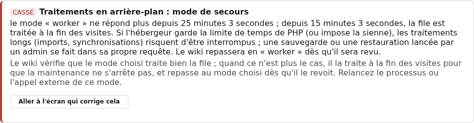

### Traitements en arrière-plan à l'arrêt (rouge)

Des traitements attendent et plus rien ne les traite depuis 24 heures : ni le
mode choisi, ni la fin des visites. En `api` ou en `worker`, l'absence du mode
choisi donne d'abord l'alerte du
[mode de secours](async.md#traitements-en-arrière-plan--mode-de-secours-rouge)
(au bout de 3 heures ou de 10 minutes) ; celle-ci n'apparaît que si les visites,
elles aussi, ne traitent plus rien. Conséquence : recherche pas à jour, e-mails
récapitulatifs qui ne partent pas, synchronisations en suspens.

1. Cliquez sur **Consommer maintenant** : si la file se vide, le wiki lui-même
   fonctionne et c'est le déclenchement automatique qui manque.
2. Vérifiez ensuite selon le mode : `request` attend des visites, donc un wiki peu visité semble à l'arrêt ; pour les autres modes,
   faites les vérifications du
   [mode de secours](async.md#traitements-en-arrière-plan--mode-de-secours-rouge).
3. Si vous ne pouvez rien installer sur le serveur, repassez à `request`.

### Traitements en échec (rouge)

Ces traitements ont épuisé leurs tentatives : ce qu'ils devaient faire (un
envoi, une synchronisation, une indexation...) n'a pas été fait. Cliquez sur
**Voir** pour lire l'erreur de chacun dans l'onglet _En échec_.

- Si la cause était passagère ou est réglée (serveur de mail rétabli, source de
  données de nouveau joignable, réglage corrigé) : **Relancer**.
- Si ce travail n'a plus d'objet (source supprimée depuis, destinataire disparu) :
  **Ignorer**. Il quitte la liste, et sa trace reste dans l'historique.

Une tâche planifiée qui échoue apparaît ici comme les autres traitements, et
l'onglet _Tâches planifiées_ affiche sa dernière erreur. Corrigez la cause
(réglage du mail, adresse ou identifiants d'une source de données...), puis
cliquez sur **Lancer** pour vérifier.

### Traitements trop longs pour le mode choisi (rouge)

Un traitement a été coupé en route, parce qu'il dépasse le temps dont il
disposait : la limite de temps de PHP, que le wiki relève jusqu'à 20 minutes
quand l'hébergeur le permet. Un traitement qui
commence trop tard n'est pas concerné : le passage s'arrête avant d'atteindre la
limite, sans rien commencer de nouveau.
Seul est coupé un traitement qui, à lui seul, est plus long que ce que PHP
laisse, ou une coupure extérieure à PHP (proxy, hébergeur). Le wiki ne le relance pas tout seul. Un traitement qui, à lui seul,
dépasse la limite échouera à chaque nouvel essai. Un traitement coupé par une
limite extérieure parce que l'ensemble du passage la dépassait peut en
revanche réussir si vous le relancez à la main depuis l'onglet « En échec ».

1. Pour un traitement plus long que cette limite, passez au mode `worker` : son
   processus n'en a pas.
2. Revenez sur la page Traitements, onglet _En échec_, et cliquez sur
   **Relancer**.

Si l'alerte parle d'un processus « arrêté de force » en mode `worker`,
c'est que le serveur l'a coupé, le plus souvent faute de mémoire :
augmentez la mémoire accordée à PHP ou demandez à votre hébergeur.

Si elle parle d'un traitement « coupé pendant un passage qu'une requête web a
lancé » alors que le wiki est en `api` ou en `worker`, il ne s'agit pas du mode
choisi : c'est une sauvegarde lancée depuis l'administration, le bouton
**Consommer maintenant** ou le mode de secours, coupés par la limite de temps de
cette requête, faute de mémoire, ou parce que l'hébergeur a arrêté le processus.
Relancez-le depuis l'onglet _En échec_, ou depuis la page des sauvegardes pour
une sauvegarde.

### Tâches planifiées en retard (rouge)

Une tâche régulière (ménage de l'historique, envoi des récapitulatifs,
synchronisation d'une source...) devrait avoir tourné et ne l'a pas fait. Les
mêmes vérifications que pour « à l'arrêt » s'appliquent. **Consommer
maintenant** la rattrape.

Si les passages ont bien lieu (l'onglet _Consommateurs_ en montre de récents)
et que l'alerte reste, c'est le lancement des tâches lui-même qui échoue : le
verrou `cache/queue-schedule.lock` ne peut pas être créé (vérifiez que le
serveur web peut écrire dans `cache/`), ou la base refuse d'enregistrer le
lancement. Le Journal, parmi les erreurs, dit lequel.

### Réglage du mode de traitement (rouge)

Le réglage est incohérent, et le wiki ne traite pas ses tâches comme prévu :

- **valeur inconnue** : ce qui est écrit n'est pas un des trois modes (une faute de
  frappe, souvent). Le mode par défaut est utilisé à la place. Corrigez la
  valeur là où elle est écrite (voir
  [où se règle le mode](async.md#où-se-règle-le-mode)) ;

  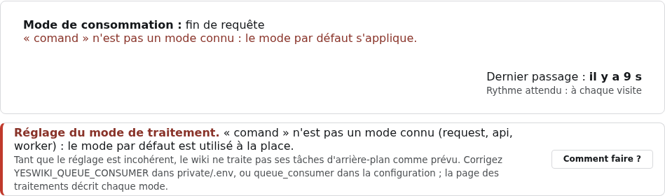

- **`api` sans secret** : l'adresse d'appel est fermée à tous. Cliquez sur
  **Générer un secret** et configurez votre service de cron en ligne (voir
  [mettre en place `api`](async.md#mettre-en-place-api)).

### Traitements en arrière-plan qui s'accumulent (orange)

Le wiki reçoit du travail plus vite qu'il ne le traite : les résultats arrivent
de plus en plus tard. Un mode qui traite plus régulièrement règle cela
(`api` appelé plus souvent, ou `worker`).

### Processus de traitement qui redémarre en boucle (rouge)

Seulement en `worker`. Le processus s'arrête presque aussitôt lancé :
rien n'avance. Son message d'erreur est dans le journal du service systemd ou
dans celui du binaire YesWiki. Les causes habituelles sont une erreur PHP, une
base injoignable ou une mémoire trop juste.

### Limite de temps de PHP impossible à relever (orange)

Cet hébergeur refuse que le wiki relève la limite de temps de PHP : des
traitements attendent le passage suivant, ou sont coupés en route. L'alerte
apparaît quand au moins 1 des 5 derniers passages (sans compter ceux qui ont
trouvé le wiki en pause) s'est arrêté sur cette limite sans avoir atteint les
20 minutes. Un arrêt à 20 minutes (« durée maximale d'un passage atteinte »)
n'est pas une alerte : le reste attend simplement le passage suivant. Autorisez
`set_time_limit` (fonction désactivée par `disable_functions`, ou limite imposée
par l'hébergeur), ou passez à `worker`, dont le processus n'a pas de limite de
temps.

### Attente ajoutée aux pages (orange)

Seulement en `request`. Sur ce serveur (PHP intégré à Apache, ou lancé en CGI),
la page n'est envoyée qu'une fois le traitement fini : les visiteurs attendent
que les traitements présents au début du passage soient terminés. `api` ou
`worker` les en dispense.

### Alertes propres à une fonctionnalité

Certaines fonctionnalités ajoutent leurs alertes à cette page. Par exemple, les
livraisons ActivityPub : des échecs vers des serveurs disparus sont normaux dans
le fédivers. Une livraison est retentée cinq fois, puis abandonnée sans rester
parmi les traitements en échec ; son échec reste visible dans l'onglet
_Historique_ et dans le Journal. L'alerte rouge « Envois ActivityPub »
n'apparaît que si aucune des livraisons terminées ces dernières 24 heures n'a
abouti (il en faut au moins 5) : un problème de votre côté (réseau, clé, DNS).
Une livraison coupée en route, elle, reste parmi les traitements en échec,
comme tout traitement coupé.

## Ailleurs dans l'administration

- **Santé** (`?admin/health`) reprend les alertes rouges et orange de la file,
  avec un bouton qui mène à la page Traitements.
- **Historique de la file** : la file garde la trace de son travail pendant 7
  jours (réglage `queue_history_purge_time`), sauf la dernière trace de chaque
  tâche planifiée et le dernier passage de chaque mode, gardés sans limite, dans
  une table à part que la page
  Traitements affiche ; le Journal (`?admin/logs`) n'en contient rien, mais
  chaque échec définitif y apparaît parmi les erreurs. La page Traitements
  affiche les heures dans le fuseau du wiki.
- **La recherche** : quand l'index est encore en construction, la page de
  résultats l'indique, avec un lien vers la page Traitements si rien n'avance.

## Après la mise à jour

Si votre wiki existait avant cette version :

- **Vous aviez un cron de maintenance** (`'maintenance_trigger' => 'cron'`) :
  le réglage disparaît, et avec lui la commande `./yeswicli core:maintenance`.
  La ligne de votre crontab qui l'appelait échoue désormais : remplacez-la par
  [`--drain` toutes les minutes](async.md#traiter-la-file-par-cron-ou-à-la-main).
  Sans elle, le wiki traite la file à la fin des visites, comme par défaut ;
  `worker` et `api` sont les autres façons de la traiter en dehors des visites
  (voir
  [choisir le mode de traitement](async.md#choisir-le-mode-de-traitement)).
- Une ligne `MAINTENANCE_TRIGGER` dans `private/.env` ne fait plus rien :
  supprimez-la.
- **Une extension écrite pour les versions alpha** qui faisait son ménage à
  chaque maintenance (en écoutant les événements `maintenance.*`) ne le fait
  plus : ces événements ont disparu. Mettez-la à jour : une extension à jour
  déclare ses propres tâches, visibles dans l'onglet _Tâches planifiées_.
- Le réglage `call_archive_async` des sauvegardes a disparu : c'est le mode de
  traitement qui décide maintenant comment une sauvegarde s'exécute.
- La maintenance ne se fait plus avant l'affichage d'une page : elle passe par
  la file comme le reste, découpée en petites tâches, et une tâche qui échoue
  n'empêche plus les autres de tourner.
