# Traitements en arrière-plan

Un wiki fait beaucoup de choses en dehors de l'affichage des pages : il tient à
jour l'index de la recherche, envoie les e-mails récapitulatifs, synchronise les
sources de données, livre les publications aux autres sites du fédivers,
fabrique les sauvegardes, et fait régulièrement le ménage (anciennes révisions,
anciennes lignes du Journal, clés de récupération et d'activation périmées...).
Rien de tout cela ne doit faire attendre la personne qui lit une page : le wiki
note le travail à faire dans une **file d'attente**, et quelque chose doit
ensuite **traiter cette file**. Ce « quelque chose » s'appelle le **mode de
traitement**.

Si rien n'est jamais traité, personne ne voit une page cassée : c'est la
recherche qui n'est plus à jour, les récapitulatifs qui ne partent pas, les
sauvegardes qui n'avancent pas. C'est pourquoi la page **Traitements** de
l'administration existe : elle dit ce qui attend, ce qui a échoué, si quelque
chose traite la file, et elle allume une pastille rouge dès qu'un problème
demande votre attention.

Pour l'ouvrir, allez dans la gestion du site, menu **Système**, entrée
**Traitements** (adresse `?admin/jobs`). Il faut être identifié comme
administrateurice. Le chiffre rouge à côté de l'entrée compte les problèmes qui
demandent votre attention ; le même problème apparaît aussi sur la page
**Santé**.

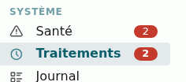

**Vous n'avez rien à régler pour que ça marche.** Le mode par défaut convient à
la plupart des wikis. Le reste de cette page sert à choisir mieux si votre wiki
est très visité, si vos traitements sont longs, ou si la page Traitements vous
signale un problème.

## Ce qui passe par la file

**Ce qui est ajouté à la file quand quelque chose se passe :**

- les **sauvegardes** et les **restaurations**, y compris la sauvegarde faite
  avant une mise à jour (voir
  [sauvegardes et restaurations](/docs/fr/async?id=sauvegardes-et-restaurations)) ;
- la récupération d'une **sauvegarde d'un autre wiki** : elle avance étape par
  étape dans la file, et continue même si vous fermez la page des sauvegardes ;
- l'**indexation de la recherche** : chaque page ou fiche modifiée est
  réindexée peu après son enregistrement ;
- la **livraison des publications ActivityPub** aux serveurs abonnés, une par
  destinataire.

**Ce qui revient régulièrement (les « tâches planifiées ») :**

| Tâche                                                                         | Fréquence                                                      |
| ----------------------------------------------------------------------------- | -------------------------------------------------------------- |
| suppression des anciennes révisions de pages                                  | toutes les 30 minutes                                          |
| nettoyage du Journal au-delà de sa durée de conservation                      | toutes les 30 minutes                                          |
| suppression des clés de récupération de mot de passe et d'activation expirées | toutes les 30 minutes                                          |
| nettoyage des jetons et compteurs anti-robots                                 | toutes les 30 minutes                                          |
| tâches de maintenance des extensions                                          | toutes les 30 minutes                                          |
| envoi des e-mails récapitulatifs                                              | chaque jour, chaque semaine ou chaque mois, selon l'abonnement |
| synchronisation automatique de chaque source de données                       | selon le réglage de la source, au plus toutes les 30 minutes   |
| ménage de la file elle-même                                                   | une fois par jour                                              |

Une tâche en retard (parce que rien n'a traité la file pendant un moment) ne
tourne qu'**une fois** au passage suivant, pas autant de fois qu'elle a été
manquée.

**Ce qui reste immédiat**, sans passer par la file : les e-mails de
notification (commentaires, inscriptions, mot de passe oublié...), les imports
CSV lancés depuis le navigateur, le bouton « synchroniser » d'une source de
données et l'action `{{sync}}`.

## Choisir le mode de traitement

| Mode                              | Qui traite la file                                              | Délai attendu                                                                            | Désavantage                                                                                                                                                   | Hébergement                         |
| --------------------------------- | --------------------------------------------------------------- | ---------------------------------------------------------------------------------------- | ------------------------------------------------------------------------------------------------------------------------------------------------------------- | ----------------------------------- |
| `request` (défaut)                | la fin de chaque visite, une fois la page envoyée               | dès la fin de la visite qui l'ajoute, sinon à la visite suivante (voir sous le tableau)  | rien n'avance sans visite ; un traitement plus long que le temps maximal d'une page (souvent 30 s) est coupé ; sur certains serveurs, les visiteurs attendent | tous, même un mutualisé sans cron   |
| `request-spawn`                   | un processus lancé à la fin d'une visite, au plus un par minute | dès la fin de la visite qui l'ajoute, sinon à une visite suivante (voir sous le tableau) | rien n'avance sans visite ; PHP doit pouvoir lancer des processus, ce qui est souvent interdit                                                                | mutualisé ou serveur qui le permet  |
| `command`                         | une tâche cron, planifiée chez votre hébergeur                  | 5 min (cron toutes les 5 min)                                                            | un cron à créer                                                                                                                                               | mutualisé avec cron, serveur        |
| `api`                             | un service de cron en ligne                                     | 5 min (appel toutes les 5 min)                                                           | dépend d'un service extérieur ; un traitement plus long que le temps maximal d'un appel (moins d'une minute) est coupé                                        | mutualisé sans cron                 |
| `worker`                          | un processus qui tourne en continu, relancé par le serveur      | quelques secondes                                                                        | un service à installer et surveiller, par wiki                                                                                                                | serveur privé ou dédié, conteneur   |
| `binary` (défaut sous le binaire) | le binaire YesWiki                                              | quelques secondes                                                                        | réservé au binaire YesWiki                                                                                                                                    | wiki ou ferme servis par le binaire |

En `request` et `request-spawn`, ce qu'une visite ajoute à la file est traité
dès la fin de cette visite, une fois la page envoyée : la page que vous venez
d'enregistrer est réindexée tout de suite, sans attendre une autre visite. Ce
qui ne vient pas d'une visite attend en revanche la visite suivante : les
tâches planifiées arrivées à échéance, les nouvelles tentatives d'un traitement
qui a échoué, le travail ajouté en ligne de commande, et ce qui n'a pas tenu
dans le temps d'un passage. En `request-spawn`, si un processus a été lancé il
y a moins d'une minute, aucun autre n'est lancé : le travail ajouté est pris par
ce processus s'il tourne encore, sinon par la première visite après cette
minute.

Comment choisir, en pratique :

- **Wiki sur un hébergement mutualisé, sans accès au serveur** : laissez
  `request`. Si les pages sont lentes à s'afficher de temps en temps, ou si la
  page Traitements dit que « les visiteurs attendent pendant le traitement »,
  passez à `command` (ou `api`) dès que vous avez un cron à disposition.
- **Wiki très peu visité** : en `request` et en `request-spawn`, rien n'est
  traité tant que personne ne vient. Un wiki qui reçoit une visite par jour
  traite donc ses tâches une fois par jour. Préférez `command`, `api` ou
  `worker`.
- **Traitements longs** (synchronisations de grosses sources, par exemple) :
  `worker` ou `binary`. Les autres modes ne laissent à un traitement que le
  temps que le serveur accorde à une page (ou, pour `command`, à une
  commande) : un traitement plus long est coupé et passe en échec. Les
  sauvegardes et restaurations sont un cas à part, voir
  [plus bas](/docs/fr/async?id=sauvegardes-et-restaurations).
- **Wiki servi par le binaire YesWiki** : ne touchez à rien.

### `request` selon la façon dont le serveur lance PHP

`request` fonctionne partout, mais pas de la même manière. Ce qui change d'un
serveur à l'autre, c'est si la page peut partir avant le traitement :

| Le serveur lance PHP avec…                                            | La page part avant le traitement ?                      | Ce qu'il faut savoir                                                                                                                                                                                                             |
| --------------------------------------------------------------------- | ------------------------------------------------------- | -------------------------------------------------------------------------------------------------------------------------------------------------------------------------------------------------------------------------------- |
| PHP-FPM (nginx, Apache avec `proxy_fcgi`, Caddy)                      | oui                                                     | rien : le traitement dispose de 20 s au plus, sans que le visiteur attende                                                                                                                                                       |
| FrankenPHP, avec ou sans son mode worker                              | oui                                                     | rien                                                                                                                                                                                                                             |
| LiteSpeed (fréquent en mutualisé)                                     | oui                                                     | si la page Traitements montre des traitements interrompus en fin de visite, LiteSpeed arrête sans doute PHP quand la connexion se ferme : ajoutez `<IfModule Litespeed>` `SetEnv noabort 1` `</IfModule>` au `.htaccess` du wiki |
| PHP intégré à Apache (`mod_php`), PHP en CGI ou FastCGI par `php-cgi` | non                                                     | le visiteur attend jusqu'à 3 s de traitement, d'où l'alerte « Attente ajoutée aux pages »                                                                                                                                        |
| serveur intégré de PHP (`php -S`)                                     | non                                                     | réservé au développement : il ne sert qu'une page à la fois, et chaque traitement bloque les autres visites                                                                                                                      |
| plateforme « serverless » (AWS Lambda avec Bref, Cloud Run…)          | oui, mais l'exécution est gelée une fois la page partie | `request` ne convient pas : le traitement est figé puis compté comme interrompu. Choisissez `api` ou `command`                                                                                                                   |

`request` fonctionne aussi sur un hébergement qui désactive `ignore_user_abort`
ou `set_time_limit` (réglage `disable_functions` de PHP).

### Où se règle le mode

Le mode se choisit dans le fichier `private/.env` du wiki, avec une ligne comme
celle-ci (modèle dans le fichier `.env.example` livré avec YesWiki) :

```
YESWIKI_QUEUE_CONSUMER=command
```

Il peut aussi se lire dans l'environnement du serveur, ou dans le fichier de
configuration (`'queue_consumer' => 'command'` dans `yeswiki.config.php`). Il ne
se règle pas depuis la page « Fichier de configuration » de la gestion du site.
S'il est indiqué à plusieurs endroits, le premier de cette liste l'emporte :
environnement du serveur, puis `private/.env`, puis `yeswiki.config.php`. La
page Traitements indique le mode en vigueur **et d'où vient le réglage**, ce qui
évite de modifier le mauvais fichier.


### Mettre en place `command`

Dans l'interface de votre hébergeur, créez une tâche planifiée (« cron »),
toutes les 5 minutes, qui lance :

```
cd /chemin/du/wiki && ./yeswicli messenger:drain
```

(`/chemin/du/wiki` est le dossier où est installé le wiki.) Réglez ensuite
`YESWIKI_QUEUE_CONSUMER=command` dans `private/.env`.

Chaque lancement traite ce qui est dû puis s'arrête tout seul. Si la commande
échoue, le cron de votre hébergeur peut vous envoyer un e-mail. Si votre cron
ne passait qu'une fois par heure, comme le conseillaient les anciennes
instructions, passez-le toutes les 5 minutes : il porte maintenant tout le
travail d'arrière-plan, pas seulement le ménage.

### Mettre en place `api`

1. Réglez `YESWIKI_QUEUE_CONSUMER=api` dans `private/.env`. Tant qu'aucun
   secret n'est défini, la page Traitements affiche une alerte rouge : l'adresse
   d'appel refuse tout le monde.

   

2. Cliquez sur **Générer un secret** et copiez-le tout de suite : il n'est
   affiché qu'une fois. La page donne aussi l'appel tout prêt à programmer.
   (Un nouveau clic, sur **Remplacer le secret** cette fois, invalide l'ancien :
   pensez à mettre à jour le service qui appelle.)

   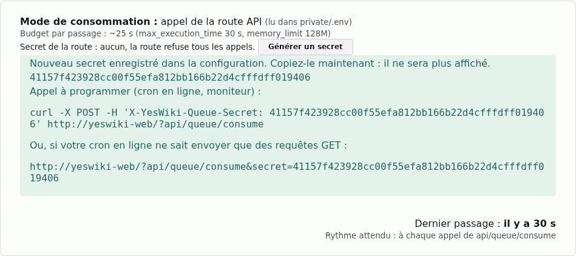

3. Dans votre service de cron en ligne, programmez toutes les 5 minutes une
   requête `POST` sur `https://votre-site/?api/queue/consume`, avec l'en-tête
   `X-YesWiki-Queue-Secret` contenant le secret. Avec `curl` :

```
curl -X POST -H 'X-YesWiki-Queue-Secret: LE-SECRET' 'https://votre-site/?api/queue/consume'
```

Si votre service ne sait programmer qu'une requête `GET`, sans en-tête, mettez
le secret dans l'adresse. Le secret apparaît alors dans les journaux du
serveur : préférez l'en-tête quand c'est possible.

```
https://votre-site/?api/queue/consume&secret=LE-SECRET
```

Le wiki répond `401` si le secret est faux ou absent, `409` si un autre
traitement est déjà en cours (rien de grave : le prochain appel traitera la
suite) et `200` sinon, avec le nombre de traitements effectués et ce qui reste.

### Mettre en place `worker`

C'est un travail pour la personne qui administre le serveur : une commande
`php src/commands/console messenger:consume` à garder en vie, avec un service
systemd par exemple. Le processus s'arrête de lui-même de temps en temps (au
bout d'une heure, quand il a utilisé trop de mémoire, ou quand la configuration
du wiki change) : le service doit le relancer à chaque fois (`Restart=always`
pour systemd).

Dites aussi au wiki lui-même qu'il est dans ce mode, à l'endroit que lit sa
partie web : la ligne `YESWIKI_QUEUE_CONSUMER=worker` dans `private/.env` (ou
`'queue_consumer' => 'worker'` dans `yeswiki.config.php`). Sans cela, les
visites continuent de traiter la file en fin de page et la page Traitements
affiche « fin de requête ». Un exemple complet de service est donné dans
[INSTALL.md](https://github.com/YesWiki/yeswiki/blob/doryphore-dev/INSTALL.md#housekeeping).

### Mettre en place `request-spawn`

Réglez `YESWIKI_QUEUE_CONSUMER=request-spawn`. La fin d'une visite lance alors
le traitement dans un processus à part, au plus une fois par minute, et le
visiteur n'attend jamais. Il faut que votre hébergeur autorise PHP à lancer des
processus (`proc_open`), ce que beaucoup d'hébergements mutualisés interdisent.
Si le processus ne peut pas être lancé, ou s'il ne traite rien, le wiki passe
en [mode de secours](/docs/fr/async?id=le-mode-de-secours) au bout de
5 minutes.

Le processus est lancé avec le `php` en ligne de commande que le wiki trouve à
côté de celui du serveur. Certains serveurs en ont plusieurs, de versions
différentes, et le premier trouvé n'est pas toujours le bon. Dans ce cas,
indiquez le chemin du bon dans `private/.env`, par exemple
`ASYNC_PHP_BINARY=/usr/bin/php8.4`. C'est aussi ce `php` qui exécute une
sauvegarde lancée depuis l'administration sur un serveur où la page ne peut
pas partir avant la fin du traitement (`mod_php`, CGI), quel que soit le mode.

### Le mode `binary`

Quand le wiki est servi par le binaire YesWiki (`yeswiki serve`, ferme
comprise), il n'y a rien à faire : le binaire lance et surveille le traitement
de chaque wiki, et le relance s'il s'arrête. Un wiki d'une ferme peut quand même
choisir un autre mode avec `YESWIKI_QUEUE_CONSUMER`.

## Le mode de secours

Le mode choisi peut tomber en panne sans prévenir : le service `worker` s'est
arrêté, l'hébergeur a supprimé la tâche cron, le service de cron en ligne
n'appelle plus. Pour que la maintenance, la recherche et les envois ne
s'arrêtent pas pendant des semaines sans que personne ne s'en aperçoive, le wiki
vérifie que le mode choisi travaille bien. Quand ce n'est plus le cas, il passe
en **mode de secours** : il traite la file à la fin des visites, comme en
`request`, et il le signale par une alerte rouge.

Le secours se déclenche quand du travail attend et que le mode choisi n'a pas
été vu au travail depuis :

| Mode choisi        | Délai avant le secours                 |
| ------------------ | -------------------------------------- |
| `worker`, `binary` | 10 minutes                             |
| `command`, `api`   | 3 heures                               |
| `request-spawn`    | 5 minutes                              |
| `request`          | jamais : c'est déjà le mode de secours |

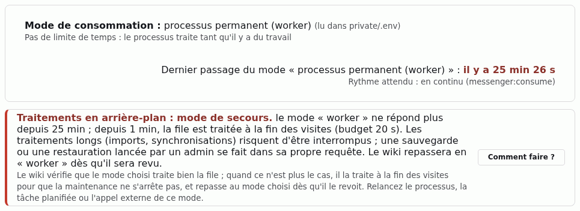

Pendant le secours :

- le bandeau du mode montre toujours le mode **choisi**, et la ligne « Dernier
  passage du mode... » passe en rouge : c'est la date à laquelle ce mode a été
  vu pour la dernière fois ;
- les traitements longs (imports, synchronisations) risquent d'être coupés,
  puisqu'ils n'ont que le temps d'une page ;
- l'onglet _Consommateurs_ marque les passages faits en secours.

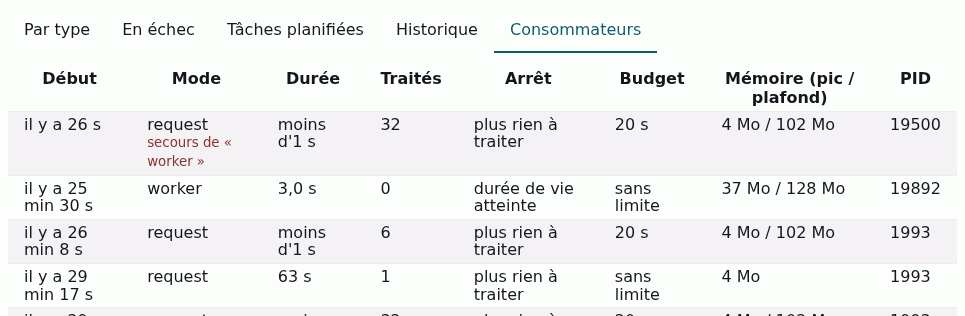

Le wiki **repasse tout seul** au mode choisi dès qu'il le revoit au travail : il
n'y a rien à acquitter. Le secours ne s'arrête pas parce que la file est vide,
seulement quand le mode choisi est de retour. Le bouton **Consommer
maintenant** ne le fait pas disparaître non plus, puisqu'il ne prouve pas que le
mode choisi fonctionne. Si vous changez de mode, le secours de l'ancien mode
prend fin.

Pour savoir quoi vérifier, voir
[l'alerte du mode de secours](/docs/fr/async?id=traitements-en-arrière-plan--mode-de-secours-rouge).

## Lire la page Traitements

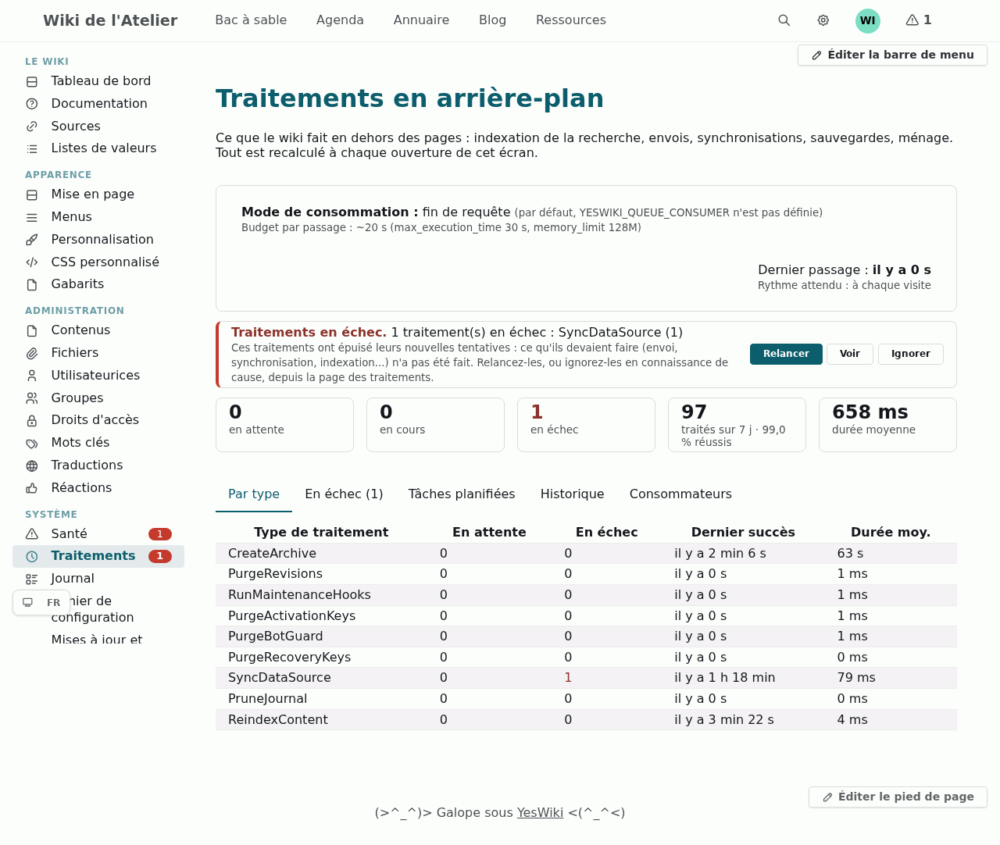

De haut en bas :

- **Le bandeau du mode** : le mode en vigueur et d'où vient le réglage, le
  temps accordé à chaque passage (le « budget »), la date du dernier passage et
  le rythme attendu. Un « passage » est une séance de travail du wiki sur la
  file : il traite ce qui attend jusqu'à ce que la file soit vide ou que le
  temps soit écoulé. Sur un serveur où PHP ne sait pas envoyer la page avant
  d'avoir fini (PHP intégré à Apache, ou lancé en CGI), le bandeau précise que
  les visiteurs attendent pendant le traitement.
- **Les alertes**, les plus graves d'abord. Une alerte **rouge** veut dire que
  quelque chose ne se fait plus ; elle allume aussi la pastille du menu et
  apparaît sur la page Santé. Une alerte **orange** est un avertissement. Chaque
  alerte dit ce qu'il en coûte et propose les boutons utiles ; le bouton
  **Comment faire ?** mène à cette page. Quand le problème disparaît, l'alerte
  disparaît : il n'y a rien à acquitter. S'il n'y a aucun problème, la page
  affiche « Rien à signaler ».

  

- **Les tuiles** : combien de traitements attendent (et depuis combien de temps
  pour le plus ancien), combien sont en cours, combien ont échoué, combien ont
  été traités ces 7 derniers jours (et quelle part a réussi), la durée moyenne.

  

- **Les onglets**, décrits ci-dessous.

### Onglet _Par type_

Un traitement par ligne et par sorte de travail : combien attendent, combien
ont échoué, quand le dernier a réussi et combien de temps il prend en moyenne.
Les noms sont ceux qu'utilise le programme : `ReindexContent` pour l'indexation
de la recherche, `SyncDataSource` pour la synchronisation d'une source,
`CreateArchive` et `RestoreArchive` pour les sauvegardes et restaurations,
`SendDigest` pour les récapitulatifs, `DeliverActivity` pour les livraisons
ActivityPub, `Purge...` et `Prune...` pour le ménage.

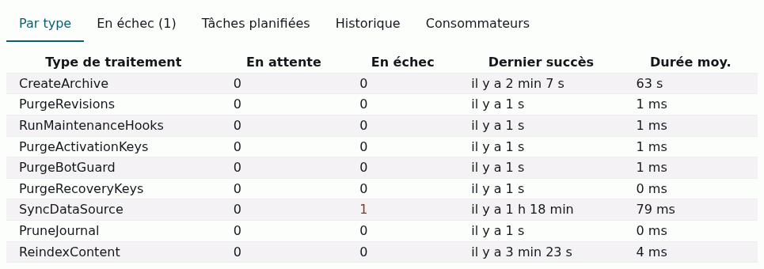

### Onglet _En échec_

Les traitements qui ont épuisé leurs tentatives, avec leur erreur. Pour chacun :

- **Relancer** le remet dans la file, avec de nouvelles tentatives. À utiliser
  une fois la cause réglée ;
- **Ignorer** le retire de la liste (et de l'alerte), mais garde sa trace dans
  l'historique. Si le même problème revient, l'alerte revient : il n'existe pas
  de façon de « faire taire » une cause ;
- **Supprimer** l'efface sans en garder la trace.

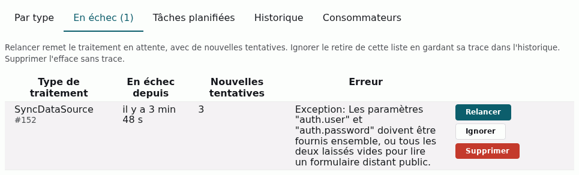

Un traitement qui échoue est **retenté automatiquement trois fois** (après 1
minute, puis 5, puis 25) avant d'être déclaré en échec. Les traitements en échec
sont conservés 30 jours, puis supprimés. Chaque échec définitif est aussi écrit
dans le Journal.

### Onglet _Tâches planifiées_

Les tâches régulières, avec leur fréquence, leur dernière exécution, leur
résultat (et la dernière erreur si elle a échoué) et leur prochaine échéance.
**Lancer** met une tâche dans la file tout de suite, sans changer son
calendrier : pratique pour vérifier qu'une correction a marché.

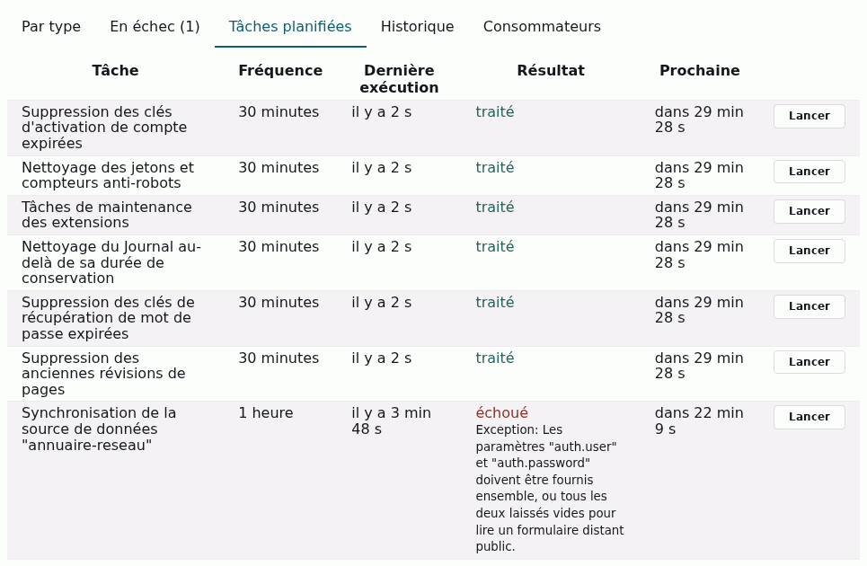

### Onglet _Historique_

Tout ce qui a été traité ces 7 derniers jours : quand, quoi, avec quel
résultat, dans quel mode et en combien de temps. « nouvelle tentative prévue »
signale un échec qui sera retenté.

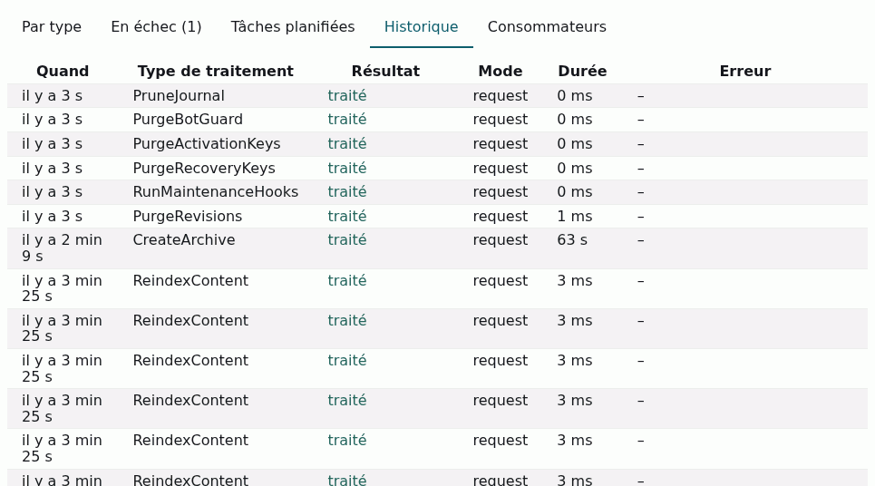

### Onglet _Consommateurs_

Les passages et les processus qui ont travaillé sur la file : quand, dans quel
mode, combien de temps, combien de traitements, pourquoi ils se sont arrêtés
(« plus rien à traiter », temps écoulé...), le budget et la mémoire utilisée.
C'est ici qu'on vérifie qu'un cron ou un worker passe vraiment.

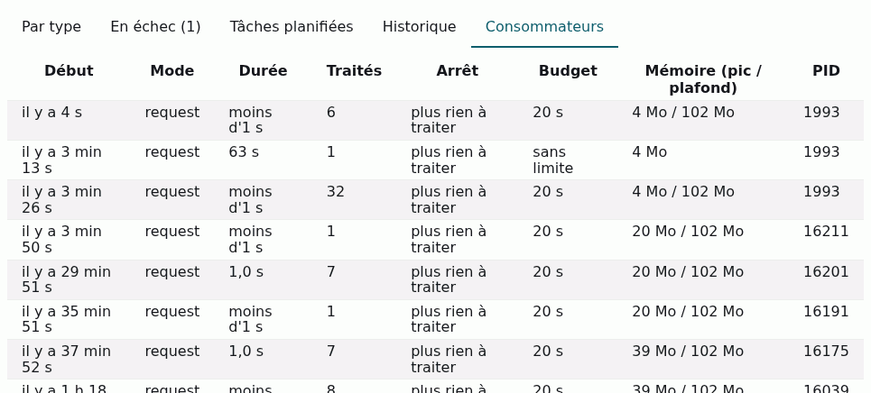

### Les boutons des alertes

- **Consommer maintenant** lance un passage tout de suite, depuis votre
  navigation, quel que soit le mode. C'est le premier réflexe quand une alerte
  dit que « plus rien ne traite ».
- **Relancer** et **Ignorer** agissent sur tous les traitements en échec à la
  fois ; **Voir** ouvre l'onglet concerné.
- **Générer un secret** apparaît en mode `api` sans secret.
- **Comment faire ?** mène à l'explication de l'alerte, sur cette page.

Pendant une sauvegarde, une restauration ou une mise à jour, le wiki est « en
pause » : rien n'est traité, et aucune alerte de retard ne se déclenche.

## Sauvegardes et restaurations

Une sauvegarde ou une restauration lancée depuis la page **Sauvegardes** (ou
avant une mise à jour) passe par la file et apparaît sur la page Traitements
comme les autres. Il n'y a rien à régler : le wiki choisit qui l'exécute pour
qu'elle ne soit pas coupée en route.

- En modes `request` (le défaut), `request-spawn`, `api` et `command`, elle
  s'exécute dans la requête de la personne qui l'a lancée, juste après que la
  page lui a été envoyée, sans limite de temps quand l'hébergeur le permet. La
  progression s'affiche pendant ce temps. Sur un serveur qui ne sait pas
  envoyer la page avant d'avoir fini (PHP intégré à Apache, ou lancé en CGI), le
  wiki la confie à un processus à part quand il le peut, pour ne pas vous faire
  attendre.
- En modes `worker` et `binary`, c'est le processus qui traite la file qui
  l'exécute. La page des sauvegardes affiche « en attente de la file de
  traitements » jusqu'à ce qu'il la prenne. Si ce processus n'est pas vu au
  travail (le wiki est en [mode de secours](/docs/fr/async?id=le-mode-de-secours)),
  elle s'exécute dans votre requête, comme en `request`.

**Une sauvegarde ou une restauration n'est jamais relancée automatiquement** :
une restauration à moitié faite rejouée sans vous serait pire que l'échec. Si
elle échoue ou est arrêtée en route, la page des sauvegardes affiche l'erreur et
les dernières lignes écrites, et la page Traitements la liste parmi les
traitements en échec. Corrigez la cause, puis relancez-la **depuis la page des
sauvegardes**. **Relancer** sur la page Traitements ne la rejoue pas : elle y
repasse en échec, sans rien toucher, avec un message qui renvoie à la page des
sauvegardes. Vous pouvez l'y **Ignorer** ou la **Supprimer**.

Si elle a été **arrêtée de force**, c'est le plus souvent que l'hébergeur coupe
les requêtes trop longues (limite de temps de PHP-FPM, d'un proxy) ou qu'il a
manqué de mémoire. Vous pouvez alors :

- sauvegarder un sous-ensemble plus petit du site (seulement les fichiers, ou
  seulement la base de données), pour que la sauvegarde tienne dans le temps
  accordé ;
- ou passer à un mode où un processus séparé traite la file (`worker` ou
  `binary`) : voir
  [choisir le mode de traitement](/docs/fr/async?id=choisir-le-mode-de-traitement).

Les autres problèmes de sauvegarde (dossier non accessible en écriture,
`mysqldump` absent...) sont décrits dans
[la rubrique sauvegardes](/docs/fr/admin?id=résoudre-les-problèmes-de-sauvegarde).

## Que faire pour chaque alerte

### Tables de la file de traitements

Les tables du wiki qui contiennent la file n'existent pas, ou la base n'a pas
répondu. Tant que c'est le cas, rien de ce qui se fait en arrière-plan n'est
enregistré. La mise à jour du wiki crée ces tables : lancez-la depuis la page
**Mises à jour et extensions** (ou `./yeswicli migrate` si vous avez un
terminal). Si la base elle-même ne répond pas, contactez votre hébergeur.

### Traitements en arrière-plan : mode de secours (rouge)

Le mode choisi ne traite plus la file : le processus `worker` ou `binary` est
arrêté, la tâche cron de `command` ne tourne plus, le service de cron en ligne de
`api` n'appelle plus, ou les processus de `request-spawn` ne démarrent pas. Le
wiki traite alors la file à la fin des visites (voir
[le mode de secours](/docs/fr/async?id=le-mode-de-secours)). Une sauvegarde ou
une restauration que vous lancez se fait, elle, dans votre propre requête.

1. Vérifiez selon le mode : `worker` : le service tourne-t-il
   (`systemctl status`) ? ; `binary` : le binaire YesWiki tourne-t-il ? ;
   `command` : la tâche cron existe-t-elle encore chez l'hébergeur ? ; `api` :
   le service de cron en ligne appelle-t-il toujours la bonne adresse avec le
   bon secret ? ; `request-spawn` : l'hébergeur autorise-t-il encore
   `proc_open` ?
2. Une fois le mode rétabli, l'alerte disparaît d'elle-même au premier passage
   de ce mode.
3. Si vous ne pouvez pas rétablir ce mode, choisissez `request` : le wiki ne
   fera alors plus que ce qu'il fait déjà en secours, sans alerte.

La même alerte apparaît sur la page **Santé** :

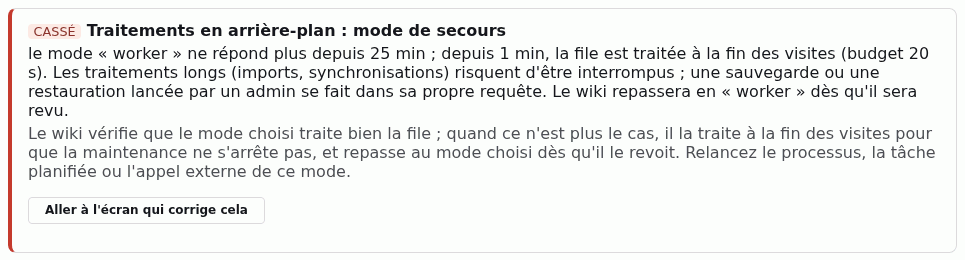

### Traitements en arrière-plan à l'arrêt (rouge)

Des traitements attendent et plus rien ne les traite depuis trop longtemps : 10
minutes pour `worker` et `binary`, 3 heures pour `command` et `api`, 24 heures
pour `request` et `request-spawn`. Conséquence : recherche pas à jour, e-mails
récapitulatifs qui ne partent pas, synchronisations en suspens.

1. Cliquez sur **Consommer maintenant** : si la file se vide, le wiki lui-même
   fonctionne et c'est le déclenchement automatique qui manque.
2. Vérifiez ensuite selon le mode : `request` et `request-spawn` attendent des
   visites, donc un wiki peu visité semble à l'arrêt ; pour les autres modes,
   faites les vérifications du
   [mode de secours](/docs/fr/async?id=traitements-en-arrière-plan--mode-de-secours-rouge).
3. Si vous ne pouvez rien installer sur le serveur, repassez à `request`.

### Traitements en échec (rouge)

Ces traitements ont épuisé leurs tentatives : ce qu'ils devaient faire (un
envoi, une synchronisation, une indexation...) n'a pas été fait. Cliquez sur
**Voir** pour lire l'erreur de chacun dans l'onglet _En échec_.

- Si la cause était passagère ou est réglée (serveur de mail rétabli, source de
  données de nouveau joignable, réglage corrigé) : **Relancer**.
- Si ce travail n'a plus d'objet (source supprimée depuis, destinataire disparu) :
  **Ignorer**, ou **Supprimer** si vous ne voulez pas en garder la trace.

### Traitements trop longs pour le mode choisi (rouge)

Un traitement a été coupé en route, parce qu'il dépasse le temps qu'un passage
du mode actuel peut lui consacrer. Il échouera à chaque nouvel essai : le wiki
ne le relance donc pas tout seul.

1. Passez à un mode qui ne coupe pas les traitements longs : `worker` ou
   `binary`. (`command` convient aussi si le PHP en ligne de commande de votre
   hébergeur n'a pas de limite de temps, ce qui est le cas le plus courant.)
2. Revenez sur la page Traitements, onglet _En échec_, et cliquez sur
   **Relancer**.

Si l'alerte parle d'un processus « arrêté de force » en mode `worker` ou
`binary`, c'est que le serveur l'a coupé, le plus souvent faute de mémoire :
augmentez la mémoire accordée à PHP ou demandez à votre hébergeur.

### Tâches planifiées en retard (rouge)

Une tâche régulière (ménage de l'historique, envoi des récapitulatifs,
synchronisation d'une source...) devrait avoir tourné et ne l'a pas fait. Les
mêmes vérifications que pour « à l'arrêt » s'appliquent. **Consommer
maintenant** la rattrape.

### Tâches planifiées qui échouent (rouge)

Une tâche régulière échoue à chaque passage depuis au moins trois fois de suite.
L'onglet _Tâches planifiées_ affiche sa dernière erreur. Corrigez la cause
(réglage du mail, adresse ou identifiants d'une source de données...), puis
cliquez sur **Lancer** pour vérifier.

### Réglage du mode de traitement (rouge)

Le réglage est incohérent, et le wiki ne traite pas ses tâches comme prévu.
L'alerte dit dans quel fichier elle a lu la valeur :

- **valeur inconnue** : ce qui est écrit n'est pas un des six modes (une faute de
  frappe, souvent). Le mode par défaut est utilisé à la place. Corrigez la
  valeur à l'endroit indiqué ;

  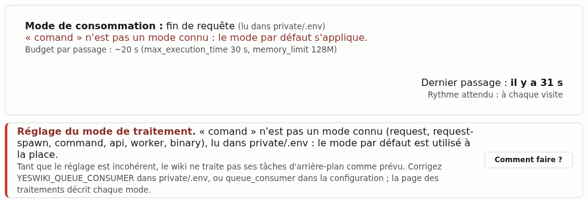

- **`binary` hors du binaire** : le wiki n'est pas servi par le binaire YesWiki,
  personne ne traite la file. Choisissez un autre mode ;
- **`api` sans secret** : l'adresse d'appel est fermée à tous. Cliquez sur
  **Générer un secret** et configurez votre service de cron en ligne (voir
  [mettre en place `api`](/docs/fr/async?id=mettre-en-place-api)).

### Traitements en arrière-plan qui s'accumulent (orange)

Le wiki reçoit du travail plus vite qu'il ne le traite : les résultats arrivent
de plus en plus tard. Un mode qui traite plus régulièrement règle cela
(`command` plus souvent, ou `worker`).

### Processus de traitement qui redémarre en boucle (rouge)

Seulement en `worker` et `binary`. Le processus s'arrête presque aussitôt lancé :
rien n'avance. Son message d'erreur est dans le journal du service systemd ou
dans celui du binaire YesWiki. Les causes habituelles sont une erreur PHP, une
base injoignable ou une mémoire trop juste.

### Processus de traitement à la limite de sa mémoire (orange)

Seulement en `worker` et `binary`. Le processus s'arrête pour repartir à neuf,
c'est sans gravité tant que c'est rare. Si cela revient souvent, un traitement
est trop gourmand : augmentez la mémoire du processus (option
`--memory-limit` de la commande).

### Lancement d'un processus de traitement impossible (orange)

Seulement en `request-spawn`. Le serveur interdit au wiki de lancer un processus
(`proc_open`) : rien ne traite la file avant que le mode de secours prenne le
relais (au bout de 5 minutes), à la fin des visites. Choisissez `request` ou
`command` pour que le réglage dise la vérité.

### Temps insuffisant pour traiter les tâches (orange)

Les pages arrivent déjà au bout du temps que PHP leur laisse : la file n'avance
pas. Augmentez `max_execution_time` dans la configuration PHP, ou passez à
`command` ou `worker`.

### Attente ajoutée aux pages (orange)

Seulement en `request`. Sur ce serveur (PHP intégré à Apache, ou lancé en CGI),
la page n'est envoyée qu'une fois le traitement fini : les visiteurs attendent.
`request-spawn` ou `command` les en dispense.

### Alertes propres à une fonctionnalité

Certaines fonctionnalités ajoutent leurs alertes à cette page, avec leurs
propres boutons. Par exemple, pour les livraisons ActivityPub, des échecs vers
des serveurs disparus sont normaux dans le fédivers : ils ne donnent qu'une
alerte orange, qui ne devient rouge que si aucune livraison n'aboutit (un
problème de votre côté : réseau, clé, DNS).

## Ailleurs dans l'administration

- **Santé** (`?admin/health`) reprend les alertes rouges et orange de la file,
  avec un bouton qui mène à la page Traitements.
- **Journal** (`?admin/logs`) garde la trace du travail de la file pendant 7
  jours (réglage `journal_queue_purge_time`). Ces lignes ne s'affichent que si
  vous choisissez le canal **Tâches de fond** ; chaque échec définitif apparaît
  aussi parmi les erreurs.

  

- **La recherche** : quand l'index est encore en construction, la page de
  résultats l'indique, avec un lien vers la page Traitements si rien n'avance.

## Après la mise à jour

Si votre wiki existait avant cette version :

- **Vous aviez un cron de maintenance** (`'maintenance_trigger' => 'cron'`) :
  la mise à jour passe le wiki en mode `command`, sans que vous ayez rien à
  faire. Votre crontab qui appelle `./yeswicli core:maintenance` continue de
  fonctionner (la commande affiche un avertissement) : remplacez-la par
  `./yeswicli messenger:drain` quand vous y pensez, et faites-la tourner toutes
  les 5 minutes.
- Une ligne `MAINTENANCE_TRIGGER` dans `private/.env` ne fait plus rien :
  supprimez-la, et mettez `YESWIKI_QUEUE_CONSUMER=command` à la place si c'est
  votre cron qui doit traiter la file.
- Le réglage `call_archive_async` des sauvegardes a disparu : c'est le mode de
  traitement qui décide maintenant comment une sauvegarde s'exécute.
- La maintenance ne se fait plus avant l'affichage d'une page : elle passe par
  la file comme le reste, découpée en petites tâches, et une tâche qui échoue
  n'empêche plus les autres de tourner.
