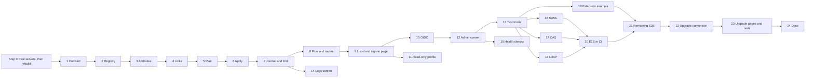

# Sign-in providers in the core: implementation plan

> **For agentic workers:** REQUIRED SUB-SKILL: Use superpowers:subagent-driven-development (recommended) or superpowers:executing-plans to implement this plan task-by-task. Steps use checkbox (`- [ ]`) syntax for tracking.

**Goal:** Replace the loginsso, loginldap and logincas extensions with one core system of sign-in providers (local, OIDC, SAML, CAS, LDAP, and types added by extensions), with clear refusals, admin diagnostics and an upgrade path from Doryphore.

**Architecture:** A `ProviderType` registry builds providers from one config section. Each provider only speaks its protocol and returns raw attributes. A shared `SignInService` plans (decides, changes nothing) and applies (writes) every sign-in, so test mode and real sign-ins cannot disagree. Links live in the account's page body, and failures go to the existing Journal.

**Tech Stack:** PHP 8.3+ on Symfony DI and routing, Twig, htmx and vanilla JS, PHPUnit, Playwright, `league/oauth2-client`, `firebase/php-jwt`, `onelogin/php-saml`, `apereo/phpcas`, `ext-ldap`, LemonLDAP::NG and OpenLDAP for tests.

**Spec:** `docs/superpowers/specs/2026-11-10-sso-design.md`. Read it with this plan. It holds the reasoning, the screens and the upgrade table.

## Where we are: read this first

A devcontainer rebuild ends the session and wipes everything outside `/var/www/html`, including `/home/yeswiki/.claude` and its memory. This section is what carries the work across. **Update it whenever the state below changes.**

**Current state:** every task (Step 0, Tasks 1 to 24) is implemented, reviewed and committed on `feat/sso`, followed by a final whole-branch review and one fix wave (head `b9e0558d2`). Not done: the E2E workflow has never run on GitHub Actions, and the binary (worker-mode) leg has never run anywhere. Both need a push by the project lead. `tests/e2e/reset.sh` deletes the git-ignored `yeswiki.config.php`, so back it up before any E2E run. The design is committed (`435e32c99`). This plan is not committed.

**Order of work, as the project lead set it:**

1. Do not implement anything, Step 0 included, until the project lead says go.
2. On go, do Step 0, then **stop** and ask them to rebuild the devcontainer.
3. After the rebuild, run `bash docker/sso-check.sh` and report the result. Fix the stack if a check fails.
4. Then implement every task in one batch, without stopping between tasks, validating against the real server as you go.

**Standing rules, which must survive the rebuild even if `~/.claude/CLAUDE.md` does not:**

- Never run `git push`, by any means. The project lead repeated this at go: NEVER PUSH IN GIT.
- Never open an SSH connection to an external server (ssh, scp, sftp, rsync over ssh). If a task needs one, stop and ask the project lead to do it.
- Never mention the agent in a commit message: no `Co-Authored-By`, no `Claude-Session`.
- To have the developer validate architecture, use UML: mermaid in markdown files, ASCII art in chat.

**Execution method:** subagent-driven, chosen by the project lead at go. Use the skill `superpowers:subagent-driven-development`. It lives in the `superpowers` plugin under `~/.claude`, which may need reinstalling after the rebuild with `/plugin`. Without it, follow the tasks by hand in order. Its ledger is `.superpowers/sdd/2026-11-10-sso/progress.md` (git-ignored, survives the rebuild): trust it for which tasks are done.

**Resuming after a rebuild:** read this section, the Global Constraints, then the spec. Check which step boxes are ticked and what `git log` shows on `feat/sso`, then carry on from the first unticked box.



## Global Constraints

- PHP: `composer.json` platform stays `8.3.0`. Every library must run on PHP 8.4, be maintained, and keep no per-request state in statics.
- Config lives in `sso_providers` in `yeswiki.config.php`. Array order is sign-in page order. No section means local is enabled. The array key is the immutable provider identifier.
- Link keys in the account's page body: `sso_provider` and `sso_subject`. No new table of any kind.
- Failures: audit action `login.failed` (target, provider, reason) and diagnostic action `login.refused.<reason>.<provider>`. Warnings: `login.warning.<kind>.<provider>`. Limit: `login.throttled`.
- Successful sign-ins write nothing to the Journal. Test runs write nothing to the Journal.
- Never written to the Journal, stderr, a page or `cache/container/`: passwords, tokens, client secrets, SAML assertions, cookies.
- Attempt limit: 5 failures per login in 15 minutes, for LDAP, local form and `/api/login`.
- Handshake cookie: signed with `SignedTokens`, 10 minutes, deleted when consumed, `SameSite=None; Secure` on https regardless of `cookies_samesite`, `Lax` on http.
- `match_by_name_until` is set 12 months after the upgrade.
- A provider sign-in calls `AuthenticationService::login($user, 1)` (90 days, renewed at half-life).
- Routes only in `<Module>/Controller/` or `<Module>/Api/`, and `/api/*` only in `<Resource>ApiController` (ADR-0013). No service depends on a controller. No request state in globals (ADR-0024). Vanilla JS and htmx only (ADR-0005). `yw-*` styles.
- Classes under `src/<Module>/Service/` are auto-registered. Value objects and provider classes built with a `ProviderConfig` live in `src/Identity/SignIn/`, outside any service layer.
- New strings go in `src/lang/yeswiki_en.php` and `src/lang/yeswiki_fr.php`.
- Commits: conventional style (`feat(sso): ...`), stage only the task's own paths, **no `Co-Authored-By` or any reference to an agent**. **Never `git push`. Never open an SSH connection.**
- Test command, shortened to `$PU` below: `php -d memory_limit=512M vendor/bin/phpunit --do-not-cache-result --stderr`. `require_once 'tests/YesWikiTestCase.php';` and extend `YesWiki\Test\Core\YesWikiTestCase` for tests needing the wiki.
- Real-server command, shortened to `$E2E` below: `bash tests/e2e/reset.sh && YESWIKI_BASE_URL=http://wiki.yeswiki.test YESWIKI_TEST_BASE_URL='http://wiki.yeswiki.test/?' npx playwright test`, run inside the devcontainer against the services of Step 0.

## Review Focus

- A provider sends a list, a number or binary data where one string is expected (multi-valued SAML `mail`, LDAP `jpegPhoto`): the first usable value is taken and nothing crashes or corrupts the Journal. Pinned in Task 3.
- An email differs only by case between provider and account (`Marie.Dupont@ACME.example`): the same account is found on MySQL, PostgreSQL and SQLite, and no duplicate appears. Pinned in Task 5.
- A callback arrives with no valid handshake (back button, double submit, expired cookie, another browser, replay): the employee gets the refused page with `invalid_response`, never a 500. Pinned in Task 8.
- A name yields an unusable account name (only CJK or emoji, `Admin`, `user`): the next candidate is used and the name is unique and not reserved. Pinned in Task 5.
- A hand-edited `sso_providers` has missing keys, a non-array entry or an unknown type: the sign-in page still renders the valid providers and the problem is reported. Pinned in Task 2.

---

## Step 0: real identity servers in the development environment

**Only after the project lead's go.** This step ends with a devcontainer rebuild, which ends the session. There is no Docker client inside the devcontainer, so nothing here can be started before that rebuild.

Once done, `auth.yeswiki.test` answers as OIDC provider, SAML identity provider and CAS server, `yeswiki-ldap` answers LDAP, and PHP has `ext-ldap`, so every provider task can be checked against a real server while it is written. The services are test-only: they never reach the binary or the production image.

**Files:**
- Modify: `docker/docker-compose.yml`, `docker/dockerfile`, `docker/dockerfile-prod`, `docker/dockerfile_test.yml`, `docker/.env.example`, `docker/README.md`
- Create: `docker/lemonldap-ng/conf/lmConf-1.json`, `docker/lemonldap-ng/test-keys/` (with a README saying these keys are for tests only), `docker/openldap/seed.ldif`, `docker/sso-check.sh`

**Interfaces (what the tasks rely on):**

| Item | Value |
|---|---|
| Portal service | `yeswiki-sso`, image `lemonldapng/lemonldap-ng:2.23.4`, network alias `auth.yeswiki.test`, published on `${YESWIKI_SSO_PORT:-8087}:80` |
| Directory service | `yeswiki-ldap`, image `bitnamilegacy/openldap:2.6.10-debian-12-r4`, port 1389, published on `${YESWIKI_LDAP_PORT:-1389}:1389` |
| Wiki | `yeswiki-web` gains the network alias `wiki.yeswiki.test`. Wiki and portal share `yeswiki.test`, so they are same-site on plain http and SAML's POST callback gets its `Lax` handshake cookie |
| Directory tree | Base `dc=acme,dc=example`, `ou=people`, `ou=groups`, admin `cn=admin,dc=acme,dc=example` / `AdminPassword1` |
| People, password `TestPassword1` | `marie` (Marie Dupont, `marie.dupont@acme.example`, groups `wiki-editors`, `staff`), `jean` (Jean Martin, `jean.martin@acme.example`, group `staff`), `nomail` (no `mail`) |
| OIDC client | `wiki-oidc`, secret `wiki-oidc-secret`, redirect `http://wiki.yeswiki.test/?user/sign-in/oidc/callback`, and the legacy `http://wiki.yeswiki.test/?api/auth_sso/callback=` |
| SAML clients | `saml-a` and `saml-b`, entity `http://wiki.yeswiki.test/?user/sign-in/<id>/metadata`, ACS `http://wiki.yeswiki.test/?user/sign-in/<id>/callback` |
| CAS application | `wiki-cas`, service `http://wiki.yeswiki.test/` |
| Exported by every client | `uid`, `mail`, `givenName`, `sn`, and `groups` as real multiple values |

- [x] **Step 0.1: Add the PHP module and the LDAP client tools to the images**

In `docker/dockerfile`, add `libldap-dev` and `ldap-utils` to the `apt-get install`, and before the existing `docker-php-ext-install` line add `RUN docker-php-ext-configure ldap --with-libdir=lib/$(uname -m)-linux-gnu/`, then add `ldap` to that install line. Add the same module to `docker/dockerfile-prod:31` and `docker/dockerfile_test.yml:27`, without `ldap-utils`.

- [x] **Step 0.2: Add the two services to `docker/docker-compose.yml`**, beside `yeswiki-s3`

Follow the file's conventions: `container_name: ${COMPOSE_PROJECT_NAME}-sso`, published ports configurable, a comment saying why they exist. Add the `wiki.yeswiki.test` alias under `yeswiki-web`. For the portal, set `SSODOMAIN=yeswiki.test`, `PORTAL_HOSTNAME=auth.yeswiki.test`, `MANAGER_HOSTNAME=manager.yeswiki.test`, leave `PRESERVEFILES` unset (the entrypoint would overwrite the configuration), and mount only the directory `./lemonldap-ng/conf` at `/var/lib/lemonldap-ng/conf`, writable. A single-file mount of `lemonldap-ng.ini` would make the entrypoint's `sed -i` abort before it sets up nginx. For the directory, set `LDAP_ROOT`, `LDAP_ADMIN_USERNAME=admin`, `LDAP_ADMIN_PASSWORD`, `LDAP_CUSTOM_LDIF_DIR=/ldifs`, and mount `./openldap` at `/ldifs`. Add the two commented port variables to `docker/.env.example`.

- [x] **Step 0.3: Write `docker/openldap/seed.ldif`** with the root entry, both `ou`s, the three people and `groupOfNames` entries `wiki-editors` and `staff`, per the table.

- [x] **Step 0.4: Generate the test keys and write `docker/lemonldap-ng/conf/lmConf-1.json` by hand**

Generate RSA keys with `openssl` for SAML and OIDC signing. Write the configuration with: `authentication`, `userDB` and `passwordDB` set to LDAP or the portal's equivalent values, pointing at `ldap://yeswiki-ldap:1389` with groups from `ou=groups`; `issuerDBOpenIDConnectActivation`, `issuerDBSAMLActivation`, `issuerDBCASActivation` on; the clients of the table. The image's entrypoint already sets `checkTime = 1`, so a configuration with a higher `cfgNum` applies without a container restart.

- [x] **Step 0.5: Write `docker/sso-check.sh`**, run from inside the devcontainer

It prints `ok` or `FAIL` per line and exits non-zero on any failure:

| Check | Command succeeds when |
|---|---|
| PHP module | `php -m` lists `ldap` |
| Wiki alias | `curl -fsS http://wiki.yeswiki.test/` answers |
| OIDC | `http://auth.yeswiki.test/.well-known/openid-configuration` contains `issuer` |
| SAML | `http://auth.yeswiki.test/saml/metadata` contains `EntityDescriptor` |
| CAS | `http://auth.yeswiki.test/cas/login` answers |
| LDAP bind | `ldapwhoami -x -H ldap://yeswiki-ldap:1389 -D uid=marie,ou=people,dc=acme,dc=example -w TestPassword1` |
| LDAP groups | `ldapsearch` under `ou=groups` for `member=uid=marie,...` returns `wiki-editors` |

- [x] **Step 0.6: Check what can be checked without Docker**

Run: `php -r 'json_decode(file_get_contents("docker/lemonldap-ng/conf/lmConf-1.json"), flags: JSON_THROW_ON_ERROR);' && php -r 'yaml_parse_file("docker/docker-compose.yml") or print("");' ; bash -n docker/sso-check.sh`
Expected: no error. The `yaml_parse_file` part may be skipped if the `yaml` module is missing.

- [x] **Step 0.7: Stop for the rebuild**

Tick the boxes above. Set "Current state" at the top of this plan to: *Step 0 written, waiting for the devcontainer rebuild, then run `bash docker/sso-check.sh`.* Tell the project lead the rebuild is ready, and what to say to the next session (see Step 0.8). Do nothing else.

- [x] **Step 0.8: After the rebuild, make the quick check**

The new session starts by being told: *Read `docs/superpowers/plans/2026-11-10-sso.md`, section "Where we are", and continue.*

Run: `bash docker/sso-check.sh`
Expected: every line `ok`. Report the result. When the portal's configuration is wrong, copy `lmConf-1.json` to `lmConf-2.json` with a higher `cfgNum` (an in-place edit keeps the cached version). Fold the change back into `lmConf-1.json` and delete the copy before committing; the same applies to later tasks. A change to the compose file or the Dockerfile needs another rebuild, so ask for it.

- [x] **Step 0.9: Commit**

```bash
git add docker/docker-compose.yml docker/dockerfile docker/dockerfile-prod docker/dockerfile_test.yml docker/.env.example docker/README.md docker/lemonldap-ng docker/openldap docker/sso-check.sh
git commit -m "chore(sso): LemonLDAP::NG and OpenLDAP in the development stack"
```

Then set "Current state" to the first task, and implement in one batch.

---

## Phase 1: core sign-in, with local accounts and OIDC

### Task 1: Dependencies and the public contract

**Files:**
- Modify: `composer.json`, `composer.lock`, `src/Kernel/Component/Setting.php`
- Create in `src/Identity/SignIn/Contract/`: `FailureReason.php`, `ProviderFailure.php`, `ProviderIdentity.php`, `ProviderConfig.php`, `Handshake.php`, `HandshakeMode.php`, `IdentityProvider.php`, `RedirectProvider.php`, `PasswordProvider.php`, `ProviderType.php`, `PublishesMetadata.php`
- Test: `tests/src/Identity/SignIn/ContractTest.php`

**Interfaces:**
- Produces:
  - `enum FailureReason: string` with the 13 codes of spec section 9.
  - `final class ProviderFailure extends \RuntimeException { __construct(public readonly FailureReason $reason, public readonly string $adminDetail = '', public readonly ?string $employeeMessage = null, public readonly array $attributes = []) }`
  - `final class ProviderIdentity { __construct(public readonly array $attributes) }`
  - `final class ProviderConfig` with readonly `string $id, $type, $label; bool $enabled, $createAccounts, $matchByEmail; array $connection, $attributes, $groupMapping, $extraFields; ?string $accountNameTemplate, $matchByNameUntil`, plus `static fromArray(string $id, array $raw, array $defaultAttributes = []): self`, `connection(string $key, mixed $default = null): mixed`, `isUpgradedDirectory(): bool` (true when the `match_by_name_until` key exists).
  - `enum HandshakeMode: string { Real = 'real'; Test = 'test'; }`
  - `final class Handshake` with readonly `string $providerId, $returnUrl, $callbackUrl; HandshakeMode $mode; int $expiresAt`, plus `set(string $key, string $value): void`, `get(string $key): ?string`, `toPayload(): array`, `static fromPayload(array $payload): ?self`.
  - `interface IdentityProvider { id(): string; label(): string; type(): string; }`
  - `interface RedirectProvider extends IdentityProvider { begin(Handshake $handshake): Response; complete(Request $request, Handshake $handshake): ProviderIdentity; }`
  - `interface PasswordProvider extends IdentityProvider { authenticate(string $login, #[\SensitiveParameter] string $password): ProviderIdentity; }`
  - `interface ProviderType { name(): string; label(): string; connectionSettings(): array; defaultAttributes(): array; create(ProviderConfig $config): IdentityProvider; }`
  - `interface PublishesMetadata { metadataResponse(): Response; copyableValues(): array; }`
  - `Setting::secret(string $name): self`

- [ ] **Step 1: Write the failing tests**

```php
public function testTheThirteenReasons(): void
{
    $this->assertSame(
        ['provider_unreachable', 'provider_rejected', 'invalid_response', 'configuration_invalid',
         'missing_attribute', 'email_conflict', 'linked_elsewhere', 'no_account', 'provider_disabled',
         'account_creation_failed', 'wrong_credentials', 'too_many_attempts', 'internal_error'],
        array_column(FailureReason::cases(), 'value')
    );
}

public function testConfigAppliesDefaultsAndTypeAttributes(): void
{
    $c = ProviderConfig::fromArray('acme', ['type' => 'oidc', 'attributes' => ['email' => 'mail']], ['id' => 'sub', 'email' => 'email']);
    $this->assertSame('acme', $c->label);
    $this->assertTrue($c->enabled);
    $this->assertTrue($c->createAccounts);
    $this->assertFalse($c->matchByEmail);
    $this->assertSame(['id' => 'sub', 'email' => 'mail'], $c->attributes);
    $this->assertFalse($c->isUpgradedDirectory());
    $this->assertTrue(ProviderConfig::fromArray('x', ['type' => 'ldap', 'match_by_name_until' => '2027-11-10'])->isUpgradedDirectory());
}

public function testHandshakeRoundTripsItsValues(): void
{
    $h = new Handshake('acme', '/back', 'https://w/cb', HandshakeMode::Test, 1000);
    $h->set('state', 'abc');
    $again = Handshake::fromPayload($h->toPayload());
    $this->assertSame('abc', $again->get('state'));
    $this->assertSame(HandshakeMode::Test, $again->mode);
    $this->assertNull(Handshake::fromPayload(['p' => 'only']));
}

public function testSecretSettingIsMarked(): void
{
    $this->assertSame('secret', Setting::secret('api_key')->toArray()['type']);
}
```

- [ ] **Step 2: Run them and see them fail**

Run: `$PU tests/src/Identity/SignIn/ContractTest.php`
Expected: FAIL, class `FailureReason` not found.

- [ ] **Step 3: Install the libraries**

Run: `composer require league/oauth2-client:^2.9 firebase/php-jwt:^7.2 onelogin/php-saml:^4.4 apereo/phpcas:^1.6.2`, then add `"ext-ldap": "Required by the LDAP sign-in provider"` under `suggest` in `composer.json`, then `composer update --lock`.
Expected: `composer validate` passes. `binary/build-static.sh` picks `ldap` up from `suggest` with no change.

- [ ] **Step 4: Implement the contract and `Setting::secret()`**

Value objects only. `ProviderConfig::fromArray` tolerates missing keys with the defaults of spec section 7 (`label` defaults to the id). `Handshake::fromPayload` returns null when a required key is missing or `mode` is unknown.

- [ ] **Step 5: Run them and see them pass**

Run: `$PU tests/src/Identity/SignIn/ContractTest.php`
Expected: PASS.

- [ ] **Step 6: Commit**

```bash
git add composer.json composer.lock src/Kernel/Component/Setting.php src/Identity/SignIn/Contract tests/src/Identity/SignIn/ContractTest.php
git commit -m "feat(sso): the public contract of sign-in providers"
```

### Task 2: Provider registry, and secrets out of the compiled container

**Files:**
- Create: `src/Identity/Service/SignIn/ProviderRegistry.php`, `src/Identity/Service/SignIn/Type/LocalType.php`, `src/Identity/SignIn/Provider/LocalProvider.php` (stub: `authenticate()` throws `ProviderFailure(InternalError)` until Task 9)
- Modify: `src/YesWikiKernel.php:42` (`AUTOCONFIGURED`), `src/Kernel/Service/ConfigurationSecrets.php`
- Test: `tests/src/Identity/SignIn/ProviderRegistryTest.php`, `tests/src/Kernel/ConfigurationSecretsSsoTest.php`

**Interfaces:**
- Consumes: Task 1 contract.
- Produces: `ProviderRegistry` with `__construct(#[AutowireIterator('yeswiki.sign_in_provider_type')] iterable $types, RuntimeConfig $config)`, `types(): array<string, ProviderType>`, `configs(): array<string, ProviderConfig>`, `config(string $id): ?ProviderConfig`, `get(string $id): ?IdentityProvider`, `enabled(): list<IdentityProvider>`, `isEnabled(string $id): bool`, `localEnabled(): bool`, `problems(): list<string>`. `ConfigurationSecrets::RUNTIME_ONLY = ['sso_providers']`.

- [ ] **Step 1: Write the failing tests**

```php
private function registry(array $section): ProviderRegistry
{
    $values = ['sso_providers' => $section];
    $config = new RuntimeConfig();
    $config->bind($values);

    return new ProviderRegistry([$this->fakeType('local'), $this->fakeType('oidc')], $config);
}

// fakeType(string $name): an anonymous ProviderType whose create() returns an anonymous IdentityProvider.

public function testNoSectionMeansLocalIsOn(): void
{
    $values = [];
    $config = new RuntimeConfig();
    $config->bind($values);
    $registry = new ProviderRegistry([$this->fakeType('local')], $config);
    $this->assertTrue($registry->localEnabled());
    $this->assertSame(['local'], array_map(fn ($p) => $p->id(), $registry->enabled()));
}

public function testOrderOfTheSectionIsKept(): void
{
    $r = $this->registry(['b' => ['type' => 'oidc'], 'a' => ['type' => 'oidc'], 'local' => ['type' => 'local']]);
    $this->assertSame(['b', 'a', 'local'], array_map(fn ($p) => $p->id(), $r->enabled()));
}

public function testASwitchedOffProviderIsNotEnabledButIsKnown(): void
{
    $r = $this->registry(['a' => ['type' => 'oidc', 'enabled' => false]]);
    $this->assertSame([], $r->enabled());
    $this->assertNotNull($r->config('a'));
    $this->assertFalse($r->isEnabled('a'));
}

// Review Focus: a hand-edited section.
public function testBrokenEntriesAreSkippedAndReported(): void
{
    $r = $this->registry(['ok' => ['type' => 'oidc'], 'noarray' => 'x', 'notype' => ['label' => 'y'], 'gone' => ['type' => 'saml']]);
    $this->assertSame(['ok'], array_map(fn ($p) => $p->id(), $r->enabled()));
    $this->assertCount(3, $r->problems());
    $this->assertNotNull($r->config('gone'), 'an unknown type stays known, as unavailable');
    $this->assertNull($r->get('gone'));
}

public function testACoreTypeNameCannotBeTaken(): void
{
    $values = [];
    $config = new RuntimeConfig();
    $config->bind($values);
    $core = self::getWiki()->services->get(LocalType::class);
    $registry = new ProviderRegistry([$this->fakeType('local'), $core], $config);
    $this->assertSame($core, $registry->types()['local']);
    $this->assertCount(1, $registry->problems());
}
```

```php
// ConfigurationSecretsSsoTest
public function testTheSectionIsNotCompiled(): void
{
    $config = ConfigurationSecrets::withPlaceholders(['sso_providers' => ['a' => ['connection' => ['client_secret' => 'hunter2']]], 'base_url' => 'x']);
    $this->assertArrayNotHasKey('sso_providers', $config);
    $this->assertSame('x', $config['base_url']);
}
```

- [ ] **Step 2: Run them and see them fail**

Run: `$PU tests/src/Identity/SignIn/ProviderRegistryTest.php tests/src/Kernel/ConfigurationSecretsSsoTest.php`
Expected: FAIL, class not found.

- [ ] **Step 3: Implement**

Add `\YesWiki\Identity\SignIn\Contract\ProviderType::class => 'yeswiki.sign_in_provider_type'` to `AUTOCONFIGURED`. Add `RUNTIME_ONLY` and `unset` those keys in `withPlaceholders()`. The registry reads `RuntimeConfig::getValue('sso_providers', [])` on each call and keeps no state across requests. When two types share a name, one from a class under `YesWiki\Identity\` wins, otherwise the first; the loser is a problem. `local` accepts only the key `local`.

- [ ] **Step 4: Run them and see them pass**

Run: `$PU tests/src/Identity/SignIn/ProviderRegistryTest.php tests/src/Kernel/ConfigurationSecretsSsoTest.php`
Expected: PASS.

- [ ] **Step 5: Commit**

```bash
git add src/YesWikiKernel.php src/Kernel/Service/ConfigurationSecrets.php src/Identity/Service/SignIn src/Identity/SignIn/Provider tests/src/Identity/SignIn/ProviderRegistryTest.php tests/src/Kernel/ConfigurationSecretsSsoTest.php
git commit -m "feat(sso): a registry of provider types, read from a section the container never compiles"
```

### Task 3: Reading attributes safely

**Files:**
- Create: `src/Identity/SignIn/AttributeReader.php`
- Test: `tests/src/Identity/SignIn/AttributeReaderTest.php`

**Interfaces:**
- Produces (static, pure): `AttributeReader::one(array $attributes, string $name): ?string`, `many(array $attributes, string $name): list<string>`, `forLog(array $attributes, int $maxBytes = 16384): array`.

- [ ] **Step 1: Write the failing tests**

```php
public function testOneTakesTheFirstUsableValue(): void
{
    $this->assertSame('a@x', AttributeReader::one(['mail' => ['a@x', 'b@x']], 'mail'));
    $this->assertSame('42', AttributeReader::one(['uid' => 42], 'uid'));
    $this->assertNull(AttributeReader::one(['mail' => ['', null]], 'mail'));
    $this->assertNull(AttributeReader::one([], 'mail'));
    $this->assertNull(AttributeReader::one(['mail' => ['nested' => ['x']]], 'mail'));
}

public function testManyAcceptsAStringOrAList(): void
{
    $this->assertSame(['a'], AttributeReader::many(['g' => 'a'], 'g'));
    $this->assertSame(['a', 'b'], AttributeReader::many(['g' => ['a', '', 'b']], 'g'));
    $this->assertSame([], AttributeReader::many([], 'g'));
}

// Review Focus: binary and oversized attributes.
public function testBinaryValuesAreDescribedNotCopied(): void
{
    $logged = AttributeReader::forLog(['jpegPhoto' => "\xFF\xD8\xFF\xE0binary", 'mail' => 'a@x']);
    $this->assertSame('(binary, 8 bytes)', $logged['jpegPhoto']);
    $this->assertSame('a@x', $logged['mail']);
    $this->assertNotFalse(json_encode($logged));
    $this->assertNull(AttributeReader::one(['photo' => "\xFF\xD8"], 'photo'));
}

public function testLogSizeIsCapped(): void
{
    $logged = AttributeReader::forLog(['groups' => array_fill(0, 5000, str_repeat('x', 40))], 1000);
    $this->assertLessThanOrEqual(1000, strlen((string)json_encode($logged)) );
    $this->assertArrayHasKey('_truncated', $logged);
}
```

- [ ] **Step 2: Run them and see them fail**

Run: `$PU tests/src/Identity/SignIn/AttributeReaderTest.php`
Expected: FAIL, class not found.

- [ ] **Step 3: Implement `AttributeReader`** using `mb_check_encoding($value, 'UTF-8')` to tell binary from text. When over the cap, `forLog` drops the largest keys and lists them under `_truncated`.

- [ ] **Step 4: Run them and see them pass**

Run: `$PU tests/src/Identity/SignIn/AttributeReaderTest.php`
Expected: PASS.

- [ ] **Step 5: Commit**

```bash
git add src/Identity/SignIn/AttributeReader.php tests/src/Identity/SignIn/AttributeReaderTest.php
git commit -m "feat(sso): attributes read safely, whatever shape a provider sends"
```

### Task 4: Account links in the user page, and the new profile fields

**Files:**
- Create: `src/Identity/Service/SignIn/AccountLinks.php`
- Modify: `src/Identity/Entity/User.php`, `src/Identity/Service/UserManager.php` (`updatableKeys`, new `createLinked`), `src/Identity/Service/Guard.php:100`, `src/Content/Service/PageManager.php:617` (`save`), `src/Content/Entity/ContentTypeSchema.php:30`
- Test: `tests/src/Identity/SignIn/AccountLinksTest.php`

**Interfaces:**
- Produces:
  - `User::provider(): ?string` (read from `sso_provider` in the constructor's input, without touching `PROPS_LIST`).
  - `AccountLinks` constants `PROVIDER_KEY = 'sso_provider'`, `SUBJECT_KEY = 'sso_subject'`, and `__construct(DbService $db, ContainerInterface $container)`, `find(string $providerId, string $subject): ?User`, `findByEmail(string $email): ?User` (case-insensitive), `subjectOf(User $user): ?string`, `link(User $user, string $providerId, string $subject): void` (also clears the password), `guardBody(string $tag, array $body): array`, `countByProvider(): array<string, int>`.
  - `UserManager::createLinked(string $tag, string $email, array $profile, string $providerId, string $subject): ?User`.

- [ ] **Step 1: Write the failing tests**

```php
public function testFindsTheAccountByProviderAndSubject(): void
{
    $user = $this->makeUser('SsoLinkA', 'ssolinka@example.com');
    $this->links->link($user, 'acme', 'sub-1');
    $this->assertSame('SsoLinkA', $this->links->find('acme', 'sub-1')?->getName());
    $this->assertNull($this->links->find('other', 'sub-1'));
    $this->assertNull($this->links->find('acme', 'sub-2'));
}

public function testLinkingClearsThePassword(): void
{
    $user = $this->makeUser('SsoLinkB', 'ssolinkb@example.com');
    $this->links->link($user, 'acme', 'sub-1');
    $this->assertSame('', $this->users->getOneByName('SsoLinkB')->getPassword());
    $this->assertSame('acme', $this->users->getOneByName('SsoLinkB')->provider());
}

public function testUserUpdateCannotSetTheKeys(): void
{
    $user = $this->makeUser('SsoLinkC', 'ssolinkc@example.com');
    $this->users->update($user, ['sso_provider' => 'evil', 'sso_subject' => 'x', 'motto' => 'm']);
    $this->assertNull($this->users->getOneByName('SsoLinkC')->provider());
}

public function testAnyPageSaveKeepsTheStoredKeys(): void
{
    $user = $this->makeUser('SsoLinkD', 'ssolinkd@example.com');
    $this->links->link($user, 'acme', 'sub-1');
    $pages = $this->services->get(PageManager::class);
    $body = $pages->getOne('SsoLinkD', null, true, true)['body'];
    $body['sso_subject'] = 'stolen';
    unset($body['sso_provider']);
    $pages->save('SsoLinkD', $body, '', true);
    $this->assertSame('sub-1', $this->links->subjectOf($this->users->getOneByName('SsoLinkD')));
    $this->assertSame('acme', $this->users->getOneByName('SsoLinkD')->provider());
}

public function testAPageSaveCannotLinkALocalAccount(): void
{
    $user = $this->makeUser('SsoLinkE', 'ssolinke@example.com');
    $pages = $this->services->get(PageManager::class);
    $body = $pages->getOne('SsoLinkE', null, true, true)['body'];
    $body['sso_provider'] = 'acme';
    $pages->save('SsoLinkE', $body, '', true);
    $this->assertNull($this->users->getOneByName('SsoLinkE')->provider());
}

public function testTheKeysAreHiddenFromGenericReads(): void
{
    // through Guard, the path every generic page read uses
    $user = $this->makeUser('SsoLinkF', 'ssolinkf@example.com');
    $this->links->link($user, 'acme', 'sub-1');
    self::actAs(null);
    $page = $this->services->get(PageManager::class)->getOne('SsoLinkF');
    $this->assertArrayNotHasKey('sso_provider', $page['body']);
    $this->assertArrayNotHasKey('sso_subject', $page['body']);
}

public function testFirstAndLastNameAreLockedFieldsOfTheUserForm(): void
{
    $this->assertTrue(ContentTypeSchema::isLocked('user', 'first_name'));
    $this->assertTrue(ContentTypeSchema::isLocked('user', 'last_name'));
    $this->assertSame('texte', ContentTypeSchema::lockedFieldType('user', 'first_name'));
}

public function testCreateLinkedMakesAnAccountWithNoPassword(): void
{
    $user = $this->users->createLinked('SsoLinkG', 'ssolinkg@example.com', ['first_name' => 'A', 'last_name' => 'B'], 'acme', 'sub-9');
    $this->assertSame('', $user->getPassword());
    $this->assertSame('acme', $user->provider());
    $this->assertFalse($this->services->get(AuthenticationService::class)->checkPassword('', $user));
}

public function testCountsByProvider(): void
{
    $this->links->link($this->makeUser('SsoLinkH', 'h@example.com'), 'countme', 's1');
    $this->assertSame(1, $this->links->countByProvider()['countme']);
}
```

- [ ] **Step 2: Run them and see them fail**

Run: `$PU tests/src/Identity/SignIn/AccountLinksTest.php`
Expected: FAIL, class `AccountLinks` not found.

- [ ] **Step 3: Implement**

`find` and `findByEmail` follow `UserManager::resolveTagFromEmail()` with `DbService::jsonExtract`, using `LOWER(...) = LOWER(?)` for email. `guardBody` reads the stored keys by SQL and forces them onto `$body` (removing them when the account has none) unless inside `AccountLinks::link`'s own write, tracked by a private flag restored in `finally`. `PageManager::save` calls it through `$this->container->get(AccountLinks::class)` when the row is a `user` page. Add both keys to `$never` and to `Guard::USER_ALWAYS_HIDDEN_FIELDS`. Add `first_name` and `last_name` (`texte`, labels `Prénom` and `Nom`) to `ContentTypeSchema`, after `email`.

- [ ] **Step 4: Run them and see them pass, with the neighbours**

Run: `$PU tests/src/Identity tests/src/Content/Service`
Expected: PASS.

- [ ] **Step 5: Commit**

```bash
git add src/Identity/Service/SignIn/AccountLinks.php src/Identity/Entity/User.php src/Identity/Service/UserManager.php src/Identity/Service/Guard.php src/Content/Service/PageManager.php src/Content/Entity/ContentTypeSchema.php tests/src/Identity/SignIn/AccountLinksTest.php
git commit -m "feat(sso): an account's provider lives in its own page, out of reach of any edit"
```

### Task 5: Planning a sign-in

**Files:**
- Create: `src/Identity/SignIn/PlanAction.php`, `src/Identity/SignIn/SignInPlan.php`, `src/Identity/Service/SignIn/SignInService.php`, `src/Identity/Service/SignIn/AccountNamer.php`
- Test: `tests/src/Identity/SignIn/SignInPlanTest.php`, `tests/src/Identity/SignIn/AccountNamerTest.php`

**Interfaces:**
- Consumes: `ProviderConfig`, `ProviderIdentity`, `AttributeReader`, `AccountLinks`.
- Produces:
  - `enum PlanAction: string { UseLinked; LinkExisting; ReplaceSubject; Create; UseLocal; Refuse; }`
  - `SignInPlan` readonly: `string $providerId; ?string $subject; PlanAction $action; ?string $accountTag; ?FailureReason $refusal; string $refusalDetail; array $profile; array $groupsToAdd; array $groupsToRemove; array $groupsIgnored; array $warnings; array $attributeUse; array $attributes; string $who`.
  - `SignInService::plan(ProviderConfig $config, ProviderIdentity $identity): SignInPlan`. No write of any kind.
  - `AccountNamer::suggest(ProviderConfig $config, array $attributes): string`.

- [ ] **Step 1: Write the failing tests**

One test per branch of spec 5.1. `$this->config(...)` builds an `oidc` `ProviderConfig` with id `acme` mapping `id=>sub, email=>email, first_name=>given_name, last_name=>family_name, groups=>groups`. Fixtures: `none`; `local` (unlinked account, `local@x`); `linked-here-s` (`a@x`, linked to `acme`, subject `s`); `linked-other` (`other@x`, linked to `other`); `linked-here-old` (`here@x`, linked to `acme`, subject `old`).

```php
public static function branches(): array
{
    return [
        'no user id'               => [[],                                  ['email' => 'a@x'],                'none',              PlanAction::Refuse, FailureReason::MissingAttribute],
        'no email'                 => [[],                                  ['sub' => 's'],                    'none',              PlanAction::Refuse, FailureReason::MissingAttribute],
        'linked here'              => [[],                                  ['sub' => 's', 'email' => 'a@x'],  'linked-here-s',     PlanAction::UseLinked, null],
        'unknown, creation on'     => [[],                                  ['sub' => 's', 'email' => 'new@x'],'none',              PlanAction::Create, null],
        'unknown, creation off'    => [['create_accounts' => false],        ['sub' => 's', 'email' => 'new@x'],'none',              PlanAction::Refuse, FailureReason::NoAccount],
        'email taken, matching off'=> [[],                                  ['sub' => 's', 'email' => 'local@x'],'local',           PlanAction::Refuse, FailureReason::EmailConflict],
        'email taken, matching on' => [['match_by_email' => true],          ['sub' => 's', 'email' => 'local@x'],'local',           PlanAction::LinkExisting, null],
        'unverified email'         => [['match_by_email' => true],          ['sub' => 's', 'email' => 'local@x', 'email_verified' => false],'local', PlanAction::Refuse, FailureReason::EmailConflict],
        'tied to another provider' => [['match_by_email' => true],          ['sub' => 's', 'email' => 'other@x'],'linked-other',    PlanAction::Refuse, FailureReason::LinkedElsewhere],
        'new server, same provider'=> [['match_by_email' => true],          ['sub' => 'new-id', 'email' => 'here@x'],'linked-here-old', PlanAction::ReplaceSubject, null],
    ];
}

#[DataProvider('branches')]
public function testBranch(array $settings, array $attributes, string $fixture, PlanAction $action, ?FailureReason $reason): void
{
    $this->prepareFixture($fixture);
    $plan = $this->service->plan($this->config($settings), new ProviderIdentity($attributes));
    $this->assertSame($action, $plan->action);
    $this->assertSame($reason, $plan->refusal);
}

public function testMissingAttributeNamesWhatWasExpectedAndWhatCame(): void
{
    $plan = $this->service->plan($this->config(), new ProviderIdentity(['sub' => 's', 'nickname' => 'n']));
    $this->assertStringContainsString('email', $plan->refusalDetail);
    $this->assertStringContainsString('nickname', $plan->refusalDetail);
}

public function testNameMatchOnlyForAnUpgradedProviderBeforeItsDate(): void
{
    $this->makeUser('jdupont', 'jd@x');
    $on = $this->config(['match_by_name_until' => '2099-01-01']);
    $this->assertSame(PlanAction::LinkExisting, $this->service->plan($on, new ProviderIdentity(['sub' => 'jdupont', 'email' => 'other@y']))->action);
    $past = $this->config(['match_by_name_until' => '2000-01-01']);
    $this->assertSame(PlanAction::Create, $this->service->plan($past, new ProviderIdentity(['sub' => 'jdupont', 'email' => 'other@y']))->action);
}

public function testNameMatchNeverTakesALinkedAccount(): void
{
    $this->links->link($this->makeUser('jmartin', 'jm@x'), 'other', 'z');
    $on = $this->config(['match_by_name_until' => '2099-01-01']);
    $plan = $this->service->plan($on, new ProviderIdentity(['sub' => 'jmartin', 'email' => 'new@y']));
    $this->assertNotSame('jmartin', $plan->accountTag);
}

public function testUpgradedDirectoryMaySignInWithoutEmailOnlyWithAnExistingAccount(): void
{
    $this->makeUser('nomail', 'stored@x');
    $on = $this->config(['match_by_name_until' => '2099-01-01']);
    $found = $this->service->plan($on, new ProviderIdentity(['sub' => 'nomail']));
    $this->assertSame(PlanAction::LinkExisting, $found->action);
    $this->assertArrayNotHasKey('email', $found->profile);
    $this->assertNotEmpty($found->warnings);
    $unknown = $this->service->plan($on, new ProviderIdentity(['sub' => 'nobody']));
    $this->assertSame(FailureReason::MissingAttribute, $unknown->refusal);
}

public function testGroupsAreComputedFromTheMappingOnly(): void
{
    // account in Editors and Hand; mapping names Editors and Readers; provider sends wiki-readers and staff
    $plan = $this->planWithGroups(['Editors', 'Hand'], [['provider' => 'wiki-editors', 'wiki' => 'Editors'], ['provider' => 'wiki-readers', 'wiki' => 'Readers']], ['wiki-readers', 'staff']);
    $this->assertSame(['Readers'], $plan->groupsToAdd);
    $this->assertSame(['Editors'], $plan->groupsToRemove);
    $this->assertSame(['staff'], $plan->groupsIgnored);
}

public function testOneProviderGroupCanFeedSeveralWikiGroups(): void
{
    $plan = $this->planWithGroups([], [['provider' => 'staff', 'wiki' => 'A'], ['provider' => 'staff', 'wiki' => 'B']], ['staff']);
    $this->assertSame(['A', 'B'], $plan->groupsToAdd);
}

public function testAnEmailUsedElsewhereKeepsTheOldOneAndWarns(): void
{
    // linked account a@x; provider now sends taken@x, used by another account
    $this->assertArrayNotHasKey('email', $plan->profile);
    $this->assertSame('email_collision', $plan->warnings[0]['kind']);
}

public function testPlanningWritesNothing(): void
{
    $before = $this->countUserRevisions();
    $this->service->plan($this->config(['match_by_email' => true]), new ProviderIdentity(['sub' => 's', 'email' => 'local@x']));
    $this->assertSame($before, $this->countUserRevisions());
}

// Review Focus: case of the email.
public function testAnEmailDifferingByCaseIsTheSameAccount(): void
{
    $this->makeUser('CaseUser', 'marie.dupont@acme.example');
    $plan = $this->service->plan($this->config(['match_by_email' => true]), new ProviderIdentity(['sub' => 's', 'email' => 'Marie.Dupont@ACME.example']));
    $this->assertSame(PlanAction::LinkExisting, $plan->action);
    $this->assertSame('CaseUser', $plan->accountTag);
}
```

```php
// AccountNamerTest. Review Focus: unusable names.
public function testNamesFromFirstAndLastName(): void
{
    $this->assertSame('marie-dupont', $this->namer->suggest($this->config(), ['given_name' => 'Marie', 'family_name' => 'Dupont', 'email' => 'x@y', 'sub' => 's']));
}

public function testTemplateIsUsedWhenPresent(): void
{
    $this->assertSame('mdupont-acme', $this->namer->suggest($this->config(['account_name_template' => '#[uid] Acme']), ['uid' => 'mdupont', 'sub' => 's']));
}

public function testFallsBackWhenTheNameYieldsNothing(): void
{
    $this->assertSame('jdoe', $this->namer->suggest($this->config(), ['given_name' => '🎉', 'family_name' => '', 'email' => 'jdoe@x', 'sub' => 's']));
}

public function testNeverReturnsAReservedOrTakenName(): void
{
    $name = $this->namer->suggest($this->config(), ['given_name' => 'Admin', 'family_name' => '', 'email' => 'admin@x', 'sub' => 's']);
    $this->assertFalse(ReservedTags::isReserved($name));
    $this->makeUser('marie-dupont', 'md@x');
    $this->assertSame('marie-dupont-2', $this->namer->suggest($this->config(), ['given_name' => 'Marie', 'family_name' => 'Dupont', 'sub' => 's']));
}
```

- [ ] **Step 2: Run them and see them fail**

Run: `$PU tests/src/Identity/SignIn/SignInPlanTest.php tests/src/Identity/SignIn/AccountNamerTest.php`
Expected: FAIL, class not found.

- [ ] **Step 3: Implement `SignInService::plan` and `AccountNamer::suggest`**

Follow spec 5.1 in its order. `AccountNamer` tries, in order: `account_name_template` (substituting `#[attribute]`), first plus last name, email local part, user ID, through `FormPropertiesService::generateTag()` then `PageManager::suggestFreeTag()`. `generateTag` returns `entry` for an empty slug, so a candidate is skipped when that happens and the input was not literally `entry`.

- [ ] **Step 4: Run them and see them pass**

Run: `$PU tests/src/Identity/SignIn/SignInPlanTest.php tests/src/Identity/SignIn/AccountNamerTest.php`
Expected: PASS.

- [ ] **Step 5: Commit**

```bash
git add src/Identity/SignIn/PlanAction.php src/Identity/SignIn/SignInPlan.php src/Identity/Service/SignIn/SignInService.php src/Identity/Service/SignIn/AccountNamer.php tests/src/Identity/SignIn
git commit -m "feat(sso): every sign-in is planned before anything changes"
```

### Task 6: Applying a plan

**Files:**
- Create: `src/Identity/Service/SignIn/ProfileSync.php`, `src/Identity/Service/SignIn/GroupSync.php`
- Modify: `src/Identity/Service/SignIn/SignInService.php`
- Test: `tests/src/Identity/SignIn/SignInApplyTest.php`

**Interfaces:**
- Consumes: `SignInPlan`, `AccountLinks`, `UserManager::createLinked`, `UserManager::update`, `GroupManager`, `Locks`, `HibernationService`.
- Produces: `SignInService::apply(SignInPlan $plan): User`, throwing `ProviderFailure` for a refusal or a failed creation. `ProfileSync::apply(User $user, array $profile): bool`. `GroupSync::apply(User $user, array $add, array $remove): list<array{kind: string, message: string}>`.

- [ ] **Step 1: Write the failing tests**

```php
public function testCreatesAndLinks(): void
{
    $user = $this->apply(['sub' => 'a1', 'email' => 'apply1@x', 'given_name' => 'Ann', 'family_name' => 'Lee']);
    $this->assertSame('apply1@x', $user->getEmail());
    $this->assertSame($user->getName(), $this->links->find('acme', 'a1')?->getName());
}

public function testAnUnchangedSignInWritesNoRevision(): void
{
    $this->apply(['sub' => 'a2', 'email' => 'apply2@x', 'given_name' => 'Ann']);
    $before = $this->revisionsOf('apply2@x');
    $this->apply(['sub' => 'a2', 'email' => 'apply2@x', 'given_name' => 'Ann']);
    $this->assertSame($before, $this->revisionsOf('apply2@x'));
}

public function testTheProviderWinsOnAChange(): void
{
    $this->apply(['sub' => 'a3', 'email' => 'apply3@x', 'given_name' => 'Ann']);
    $user = $this->apply(['sub' => 'a3', 'email' => 'apply3b@x', 'given_name' => 'Anna']);
    $this->assertSame('apply3b@x', $user->getEmail());
    $this->assertSame('Anna', $this->bodyOf($user)['first_name']);
}

public function testExtraAttributesFillAccountFields(): void
{
    // config extra_fields ['department' => 'motto'], attribute department=Marketing
    $this->assertSame('Marketing', $this->bodyOf($user)['motto']);
}

public function testGroupsMoveAndOthersStay(): void
{
    // account in Editors and Hand; mapping names Editors and Readers; provider sends only wiki-readers
    $user = $this->applyWithGroups(['Editors', 'Hand'], ['wiki-readers']);
    $this->assertContains($user->getName(), $this->groups->getMembers('Readers'));
    $this->assertNotContains($user->getName(), $this->groups->getMembers('Editors'));
    $this->assertContains($user->getName(), $this->groups->getMembers('Hand'));
}

public function testAMissingWikiGroupIsCreated(): void
{
    $this->assertTrue($this->groups->groupExists('SsoNewGroup'));
}

public function testAdminsIsNeverLeftEmpty(): void
{
    // sole member of admins, mapping names admins, provider stops sending it
    $this->assertContains($user->getName(), $this->groups->getMembers('admins'));
    // and a warning of kind 'last_admin' is returned
}

public function testALostLockRetriesThenFindsTheLink(): void
{
    // Locks fake: refuses twice, then the link exists
    $this->assertSame('winner-account', $user->getName());
}

public function testHibernationSignsAKnownAccountWithoutWriting(): void
{
    // HibernationService fake returns true; linked account, changed profile
    $this->assertSame('old@x', $this->users->getOneByName('Hib')->getEmail());
}

public function testHibernationRefusesANewAccount(): void
{
    $this->expectException(ProviderFailure::class);
    // reason AccountCreationFailed
}

public function testRefusalThrowsItsReason(): void
{
    try { $this->service->apply($this->refusedPlan(FailureReason::NoAccount)); $this->fail(); }
    catch (ProviderFailure $f) { $this->assertSame(FailureReason::NoAccount, $f->reason); }
}
```

- [ ] **Step 2: Run them and see them fail**

Run: `$PU tests/src/Identity/SignIn/SignInApplyTest.php`
Expected: FAIL, method `apply` not found.

- [ ] **Step 3: Implement**

The lock is named `sign-in:<provider>:<sha256 of subject>`, taken only for `Create`, `LinkExisting` and `ReplaceSubject`, retried up to 5 times 200 ms apart, re-reading the link each time, and released in `finally`. `ProfileSync` compares against the stored body and calls `UserManager::update` only for values that differ. `GroupSync` uses `GroupManager::addMembers`, `removeMembers`, `create`, `groupExists`, catching `\Throwable` per group and returning warnings. Under hibernation, `UseLinked` skips all writes.

- [ ] **Step 4: Run them and see them pass**

Run: `$PU tests/src/Identity/SignIn/SignInApplyTest.php`
Expected: PASS.

- [ ] **Step 5: Commit**

```bash
git add src/Identity/Service/SignIn tests/src/Identity/SignIn/SignInApplyTest.php
git commit -m "feat(sso): applying a plan, writing only what changed"
```

### Task 7: Journal entries and the attempt limit

**Files:**
- Create: `src/Identity/SignIn/SignInTrace.php`, `src/Identity/Service/SignIn/SignInJournal.php`, `src/Identity/Service/SignIn/AttemptLimiter.php`
- Modify: `src/Identity/Service/AuthenticationService.php:309` (`recordFailedLogin`), `src/Kernel/Database/SqlDialect.php`, `MySqlDialect.php`, `PostgreSqlDialect.php`, `SqliteDialect.php`, `src/Kernel/Service/DbService.php:638`
- Test: `tests/src/Identity/SignIn/SignInJournalTest.php`, `tests/src/Identity/SignIn/AttemptLimiterTest.php`

**Interfaces:**
- Produces:
  - `SignInTrace` readonly: `string $lastStep; array $attributes; array $attributeUse; array $groups; ?string $account; string $error`. Steps: `sent_to_provider`, `provider_answered`, `attributes_read`, `account_matched`, `groups`.
  - `SignInJournal::failure(ProviderConfig $config, string $who, FailureReason $reason, SignInTrace $trace): void`, `warning(ProviderConfig $config, string $who, string $kind, string $message): void`, `scrub(string $text, ProviderConfig $config): string`.
  - `AttemptLimiter` constants `MAX_FAILURES = 5`, `WINDOW_MINUTES = 15`, and `isBlocked(string $who): bool`, `static normalize(string $login): string`, `recordThrottled(string $providerId, string $who): void`.
  - `recordFailedLogin(string $username, string $reason, ?string $provider = null): void`.
  - `DbService::dateSubMinutes(int $minutes): string`.

- [ ] **Step 1: Write the failing tests**

```php
public function testARefusalWritesOneAuditRowAndOneDiagnostic(): void
{
    $this->journal->failure($this->config('jrnl'), 'marie@x', FailureReason::EmailConflict, $this->trace(['email' => 'marie@x']));
    $audit = $this->rows("channel = 'audit' AND action = 'login.failed' AND target = 'marie@x'");
    $this->assertCount(1, $audit);
    $this->assertSame(['reason' => 'email_conflict', 'provider' => 'jrnl'], json_decode($audit[0]['context'], true));
    $diagnostic = $this->rows("channel = 'diagnostic' AND action = 'login.refused.email_conflict.jrnl'");
    $this->assertCount(1, $diagnostic);
    $context = json_decode($diagnostic[0]['context'], true);
    $this->assertSame('marie@x', $context['attributes']['email']);
    $this->assertSame('account_matched', $context['last_step']);
}

public function testSameProviderAndReasonCollapse(): void
{
    $this->failTwice('a@x', 'b@x');
    $rows = $this->rows("action = 'login.refused.email_conflict.jrnl'");
    $this->assertCount(1, $rows);
    $this->assertSame(2, (int)$rows[0]['repeat']);
    $this->assertSame('b@x', $rows[0]['target']);
    $this->assertCount(2, $this->rows("channel = 'audit' AND action = 'login.failed'"));
}

public function testAWrongPasswordHasNoDiagnostic(): void
{
    $this->journal->failure($this->config('jrnl'), 'x', FailureReason::WrongCredentials, $this->trace());
    $this->assertCount(0, $this->rows("action LIKE 'login.refused.%'"));
}

public function testSecretsAreScrubbed(): void
{
    $config = $this->config('jrnl', ['client_secret' => 'hunter2']);
    $this->journal->failure($config, 'x', FailureReason::ProviderRejected, $this->trace([], 'bad client hunter2'));
    $this->assertStringNotContainsString('hunter2', $this->rows("action LIKE 'login.refused.%'")[0]['context']);
}

public function testTheLimitBlocksAfterFiveFailures(): void
{
    for ($i = 0; $i < 4; $i++) { $this->fail('limit@x'); }
    $this->assertFalse($this->limiter->isBlocked('limit@x'));
    $this->fail('limit@x');
    $this->assertTrue($this->limiter->isBlocked('limit@x'));
    $this->assertFalse($this->limiter->isBlocked('someone-else@x'));
}

public function testAThrottledAttemptDoesNotExtendTheLimit(): void
{
    $this->limiter->recordThrottled('p', 'quiet@x');
    $this->assertCount(1, $this->rows("action = 'login.throttled'"));
    $this->assertFalse($this->limiter->isBlocked('quiet@x'));
}

public function testNormalize(): void
{
    $this->assertSame('marie', AttemptLimiter::normalize('  MaRie '));
}

public function testDateSubMinutesRunsOnThisDialect(): void
{
    $this->assertNotNull($this->db->scalar('SELECT ' . $this->db->dateSubMinutes(15), null));
}
```

- [ ] **Step 2: Run them and see them fail**

Run: `$PU tests/src/Identity/SignIn/SignInJournalTest.php tests/src/Identity/SignIn/AttemptLimiterTest.php`
Expected: FAIL, class not found.

- [ ] **Step 3: Implement**

`failure()` calls `recordFailedLogin` always, except that `TooManyAttempts` goes through `recordThrottled`. It writes a diagnostic with `Journal::warning($message, ['action' => "login.refused.{$reason->value}.{$config->id}", 'target' => $who, 'last_step' => ..., 'attributes' => AttributeReader::forLog(...), 'attribute_use' => ..., 'groups' => ..., 'account' => ..., 'error' => scrub(...)])`, except for `WrongCredentials` and `TooManyAttempts`. `InternalError` and `ProviderUnreachable` use `error`. All call sites are the single line in this method, so collapse depends only on provider and reason. `scrub` replaces the values of the type's `secret` settings. The `AttemptLimiter` query: `channel = 'audit' AND action = 'login.failed' AND target = ? AND at >= <dateSubMinutes(15)>`.

- [ ] **Step 4: Run them and see them pass**

Run: `$PU tests/src/Identity/SignIn/SignInJournalTest.php tests/src/Identity/SignIn/AttemptLimiterTest.php`
Expected: PASS.

- [ ] **Step 5: Commit**

```bash
git add src/Identity/SignIn/SignInTrace.php src/Identity/Service/SignIn src/Identity/Service/AuthenticationService.php src/Kernel/Database src/Kernel/Service/DbService.php tests/src/Identity/SignIn
git commit -m "feat(sso): failures go to the Journal, and repeated wrong passwords are stopped"
```

### Task 8: The flow, its routes and the refused page

**Files:**
- Create: `src/Identity/Service/SignIn/HandshakeCookie.php`, `src/Identity/Service/SignIn/SignInFlow.php`, `src/Identity/SignIn/SignInOutcome.php`, `src/Identity/Controller/SignInController.php`, `src/Identity/Controller/RendersSignInOutcome.php` (trait), `templates/account/sign-in-refused.twig`
- Modify: `src/Identity/Service/RequestGuard.php`, `src/lang/yeswiki_en.php`, `src/lang/yeswiki_fr.php`
- Test: `tests/src/Identity/SignIn/HandshakeCookieTest.php`, `tests/src/Identity/SignIn/SignInFlowTest.php`, `tests/src/Identity/SignIn/SignInCallbackGuardTest.php`

**Interfaces:**
- Consumes: Tasks 2 to 7.
- Produces:
  - `HandshakeCookie` with `NAME = 'yw-sign-in'`, `LIFETIME = 600`, `encode(Handshake $h): string`, `issue(Handshake $h): void`, `read(Request $r, int $now): ?Handshake`, `clear(): void`, `options(int $expires): array`.
  - `SignInFlow::begin(string $providerId, string $returnUrl, HandshakeMode $mode = HandshakeMode::Real): Response|SignInOutcome`, `callback(Request $request, ?string $providerId): Response|SignInOutcome` (null takes the id from the handshake), `password(string $providerId, string $login, string $password, bool $remember, HandshakeMode $mode = HandshakeMode::Real): SignInOutcome`, `callbackUrlFor(ProviderConfig $config): string`.
  - `SignInOutcome` static constructors `signedIn(string $url)`, `refused(?ProviderConfig $config, FailureReason $reason, string $who, string $detail = '')`, `formError(string $message)`, `tested(ProviderConfig $config, SignInPlan $plan, array $steps, string $error)`; public readonly `kind`, `url`, `config`, `reason`, `who`, `detail`, `plan`, `steps`, `message`, `error`.
  - Routes: `GET /user/sign-in/{id}`, `GET|POST /user/sign-in/{id}/callback`, `GET /user/sign-in/{id}/metadata`, all `options: ['acl' => ['public']]`.
  - Language keys `SIGN_IN_REFUSED_TITLE`, `SIGN_IN_REFUSED_TODO`, `SIGN_IN_BACK`, and `SIGN_IN_REFUSED_<CODE>`, `SIGN_IN_ADMIN_<CODE>`, `SIGN_IN_FIX_<CODE>` for each of the 13 reasons.

- [ ] **Step 1: Write the failing tests**

```php
// HandshakeCookieTest
public function testIssuedCookieIsReadBackAndATamperedOneIsNot(): void
{
    $value = $this->cookie->encode($this->handshake(expires: 2000));
    $this->assertSame('acme', $this->cookie->read($this->requestWith($value), 1000)->providerId);
    $this->assertNull($this->cookie->read($this->requestWith($value . 'x'), 1000));
    $this->assertNull($this->cookie->read($this->requestWith($value), 2001));
}

public function testSameSiteIgnoresTheWikiSetting(): void
{
    $this->withConfig(['cookies_samesite' => 'Strict'], 'https://w/');
    $options = $this->cookie->options(1000);
    $this->assertSame('None', $options['samesite']);
    $this->assertTrue($options['secure']);
    $this->withConfig(['cookies_samesite' => 'None'], 'http://w/');
    $this->assertSame('Lax', $this->cookie->options(1000)['samesite']);
}
```

```php
// SignInFlowTest, with a fake RedirectProvider type registered
public function testBeginRedirectsAndIssuesTheHandshake(): void
{
    $response = $this->flow->begin('fake', '/?PagePrincipale');
    $this->assertSame(302, $response->getStatusCode());
    $this->assertNotEmpty($this->issuedCookie('yw-sign-in'));
}

public function testAnExternalReturnUrlIsDropped(): void
{
    $this->flow->begin('fake', 'https://evil.example/');
    $this->assertStringNotContainsString('evil.example', $this->lastHandshake()->returnUrl);
}

public function testADisabledProviderIsRefused(): void
{
    $this->assertSame(FailureReason::ProviderDisabled, $this->flow->begin('off', '/')->reason);
}

public function testASuccessfulCallbackSignsInRememberedAndWritesNoJournal(): void
{
    $outcome = $this->flow->callback($this->callbackRequest(), 'fake');
    $this->assertSame('signed_in', $outcome->kind);
    $this->assertSame(0, $this->countJournal("action LIKE 'login.%'"));
    $this->assertNotEmpty($this->issuedCookie('yw-auth'));
}

public function testAWarningIsRecordedWithoutRecordingTheSuccess(): void
{
    // the account's new email is already used by another account
    $this->assertSame('signed_in', $this->flow->callback($this->callbackRequestWithTakenEmail(), 'fake')->kind);
    $this->assertSame(1, $this->countJournal("action = 'login.warning.email_collision.fake'"));
    $this->assertSame(0, $this->countJournal("action = 'login.failed'"));
}

public function testAProviderFailureIsRefusedAndJournaled(): void
{
    $this->fake->failWith(new ProviderFailure(FailureReason::ProviderRejected, 'access_denied'));
    $outcome = $this->flow->callback($this->callbackRequest(), 'fake');
    $this->assertSame(FailureReason::ProviderRejected, $outcome->reason);
    $this->assertSame(1, $this->countJournal("action = 'login.refused.provider_rejected.fake'"));
}

public function testAnUnexpectedExceptionBecomesInternalError(): void
{
    $this->fake->failWith(new \LogicException('boom'));
    $this->assertSame(FailureReason::InternalError, $this->flow->callback($this->callbackRequest(), 'fake')->reason);
}

// Review Focus: a callback with no valid handshake.
#[DataProvider('badHandshakes')]
public function testNoValidHandshakeIsARefusedPageNotACrash(?string $cookie): void
{
    $outcome = $this->flow->callback($this->requestWithCookie($cookie), 'fake');
    $this->assertSame('refused', $outcome->kind);
    $this->assertSame(FailureReason::InvalidResponse, $outcome->reason);
}
// badHandshakes: null (other browser), 'garbage', an expired cookie, a cookie for another provider

public function testAHandshakeCannotBeReplayed(): void
{
    $this->flow->callback($this->callbackRequest(), 'fake');
    $this->assertNotEmpty($this->clearedCookie('yw-sign-in'));
}

public function testBlockedLoginNeverReachesTheProvider(): void
{
    for ($i = 0; $i < 5; $i++) { $this->flow->password('fakepw', 'locked', 'bad', false); }
    $outcome = $this->flow->password('fakepw', 'locked', 'good', false);
    $this->assertSame(FailureReason::TooManyAttempts, $outcome->reason);
    $this->assertSame(5, $this->fakePw->calls);
}

public function testWrongCredentialsStayOnTheForm(): void
{
    $this->assertSame('form_error', $this->flow->password('fakepw', 'x', 'bad', false)->kind);
}
```

```php
// SignInCallbackGuardTest
public function testACrossSitePostToTheCallbackIsAllowed(): void
{
    $request = Request::create('/user/sign-in/acme/callback', 'POST', server: ['HTTP_SEC_FETCH_SITE' => 'cross-site']);
    $this->assertNull($this->guard->refusal($request));
}

public function testACrossSitePostElsewhereIsStillRefused(): void
{
    $request = Request::create('/user', 'POST', server: ['HTTP_SEC_FETCH_SITE' => 'cross-site']);
    $this->assertNotNull($this->guard->refusal($request));
}

public function testTheQueryStringFormOfTheCallbackIsAllowed(): void
{
    $request = Request::create('/?user/sign-in/acme/callback', 'POST', server: ['HTTP_SEC_FETCH_SITE' => 'cross-site']);
    $this->assertNull($this->guard->refusal($request));
}
```

- [ ] **Step 2: Run them and see them fail**

Run: `$PU tests/src/Identity/SignIn/HandshakeCookieTest.php tests/src/Identity/SignIn/SignInFlowTest.php tests/src/Identity/SignIn/SignInCallbackGuardTest.php`
Expected: FAIL, class not found.

- [ ] **Step 3: Implement**

The cookie value is `base64url(json payload) . '.' . SignedTokens::sign('yw-sign-in:' . payload)`, sent with `setcookie` using `WikiCookies::options()` with `samesite` overridden. `RequestGuard::refusal()` returns null at its start for a path or first query key matching `#^/?user/sign-in/[^/]+/callback$#`; the callback carries its own protection. `SignInFlow` wraps everything in `try/catch`: `ProviderFailure` keeps its reason, any other `\Throwable` is `InternalError`. A signed-in result calls `AuthenticationService::login($user, 1)` for redirect providers, or the form's `$remember` for password ones, then writes the plan's and `GroupSync`'s warnings through `SignInJournal::warning`. `callbackUrlFor` returns `connection.legacy_callback` when set, otherwise the absolute `UrlFormatter` link. `SignInController` and the trait render `signed_in` as `RedirectResponse` and `refused` through `@core/account/sign-in-refused.twig` (extends `@core/account/guest-layout.twig`, spec 8.2) with status 403.

- [ ] **Step 4: Run them and see them pass, with the architecture test**

Run: `$PU tests/src/Identity/SignIn tests/src/ArchitectureTest.php`
Expected: PASS.

- [ ] **Step 5: Commit**

```bash
git add src/Identity/Service/SignIn src/Identity/SignIn/SignInOutcome.php src/Identity/Controller/SignInController.php src/Identity/Controller/RendersSignInOutcome.php src/Identity/Service/RequestGuard.php templates/account/sign-in-refused.twig src/lang/yeswiki_en.php src/lang/yeswiki_fr.php tests/src/Identity/SignIn
git commit -m "feat(sso): the round trip to a provider, and a refusal that explains itself"
```

### Task 9: Local accounts as a provider, and the sign-in page

**Files:**
- Modify: `src/Identity/SignIn/Provider/LocalProvider.php`, `src/Identity/Service/SignIn/Type/LocalType.php`, `src/Identity/Service/SignIn/SignInService.php`, `src/Identity/Action/LoginAction.php`, `src/Identity/Api/AuthApiController.php`, `src/Identity/Controller/AccountController.php`, `src/Identity/Service/AuthenticationService.php` (`stillValid`, `requiresPasswordReset`, `login`, remove `hasLoginExtensions`), `templates/login-form.twig`, `templates/account/login.twig`, lang files, `styles/yw-admin.css`
- Test: `tests/src/Identity/SignIn/LocalProviderTest.php`, `tests/src/Identity/SignIn/SignInPageTest.php`, `tests/src/Identity/SignIn/SessionFollowsProviderTest.php`

**Interfaces:**
- Consumes: `SignInFlow::password`, `ProviderRegistry`, `AccountLinks`.
- Produces: `LocalProvider::__construct(ProviderConfig $config, AuthenticationService $auth, UserManager $users)`; `authenticate` returns `ProviderIdentity(['local_account' => <tag>])`; `plan()` maps it to `PlanAction::UseLocal` and `apply()` returns that account with no write. `LoginAction` reads an optional posted `provider` (default `local`).

- [ ] **Step 1: Write the failing tests**

```php
// LocalProviderTest
public function testGoodPasswordReturnsTheAccount(): void
{
    $this->assertSame('LocalA', $this->provider->authenticate('LocalA', 'a-long-enough-password')->attributes['local_account']);
}
public function testByEmailToo(): void { /* same with the address */ }
public function testWrongPassword(): void { $this->assertReason(FailureReason::WrongCredentials, 'LocalA', 'nope'); }
public function testUnknownUser(): void { $this->assertReason(FailureReason::WrongCredentials, 'Nobody', 'x'); }
public function testObsoleteMd5KeepsItsOwnMessage(): void
{
    $failure = $this->failureFor('Md5User', 'whatever');
    $this->assertSame(_t('LOGIN_PASSWORD_FORMAT_OBSOLETE'), $failure->employeeMessage);
}
public function testALinkedAccountCannotUseThePasswordForm(): void { $this->assertReason(FailureReason::LinkedElsewhere, 'LinkedA', 'x'); }
```

```php
// SessionFollowsProviderTest
public function testAnAccountOnASwitchedOffProviderLosesItsSignIn(): void
{
    // signed in through yw-auth, provider then disabled in RuntimeConfig
    $this->connectFromCookie();
    $this->assertSame('', $this->auth->signedInName());
}
public function testALocalAccountLosesItsSignInWhenLocalIsOff(): void { /* same with local off */ }
public function testAnUnregisteredTypeEndsTheSignInToo(): void { /* provider whose type is gone */ }
public function testALinkedAccountWithAnMd5LeftoverStaysSignedIn(): void
{
    $this->assertFalse($this->auth->requiresPasswordReset($this->linkedUserWithMd5()));
}
public function testActivationGateSkipsLinkedAccounts(): void { /* signup_email_activation on, linked account, login() succeeds */ }
```

```php
// SignInPageTest, rendering {{login}} through the action
public function testRedirectProvidersComeFirstAsButtons(): void
{
    $html = $this->render(['acme' => ['type' => 'fakeredirect', 'label' => 'Acme SSO'], 'local' => ['type' => 'local']]);
    $this->assertLessThan(strpos($html, 'name="password"'), strpos($html, 'Acme SSO'));
    $this->assertStringContainsString('user/sign-in/acme', $html);
}
public function testOnePasswordProviderHasNoTabs(): void { $this->assertStringNotContainsString('yw-sign-in__tabs', $this->render(['local' => ['type' => 'local']])); }
public function testTwoPasswordProvidersHaveTabs(): void { $this->assertStringContainsString('yw-sign-in__tabs', $this->render(['local' => ['type' => 'local'], 'dir' => ['type' => 'fakepw']])); }
public function testNoPasswordProviderHasNoForm(): void { $this->assertStringNotContainsString('name="password"', $this->render(['acme' => ['type' => 'fakeredirect']])); }
public function testLostPasswordAndSignupOnlyWithLocal(): void { $this->assertStringNotContainsString('user/signup', $this->render(['dir' => ['type' => 'fakepw']])); }
public function testNothingEnabledSaysSo(): void { $this->assertStringContainsString(_t('SIGN_IN_NO_PROVIDER'), $this->render(['local' => ['type' => 'local', 'enabled' => false]])); }
```

Add to `tests/src/Identity/AccountRoutesTest.php`: `/user/signup` and `/user/lost-password` redirect to `/user` when local is off. Add to an API test: `POST /api/login` answers 403 when local is off, and 429 with `too_many_attempts` once the login is blocked.

- [ ] **Step 2: Run them and see them fail**

Run: `$PU tests/src/Identity/SignIn/LocalProviderTest.php tests/src/Identity/SignIn/SignInPageTest.php tests/src/Identity/SignIn/SessionFollowsProviderTest.php`
Expected: FAIL.

- [ ] **Step 3: Implement**

`LoginAction::login()` delegates to `SignInFlow::password()`, and renders `form_error` and `refused` through the existing `FlashMessageService` and redirect. `stillValid()` adds: `$user->provider() === null ? registry->localEnabled() : registry->isEnabled($user->provider())`. `requiresPasswordReset` is false when `provider() !== null`. Replace `!$this->hasLoginExtensions()` in `login()` with `$user`'s provider being null. `renderForm` passes `redirectProviders` and `passwordProviders`. `login-form.twig` follows spec 8.1 and keeps its existing blocks. Tabs are vanilla JS with class `yw-sign-in__tabs`.

- [ ] **Step 4: Run them and see them pass, with the neighbours**

Run: `$PU tests/src/Identity`
Expected: PASS.

- [ ] **Step 5: Commit**

```bash
git add src/Identity templates/login-form.twig templates/account/login.twig src/lang/yeswiki_en.php src/lang/yeswiki_fr.php styles/yw-admin.css tests/src/Identity
git commit -m "feat(sso): local accounts become a provider, and the sign-in page lists them all"
```

### Task 10: OIDC

**Files:**
- Create: `src/Identity/Service/SignIn/Type/OidcType.php`, `src/Identity/SignIn/Provider/OidcProvider.php`, `src/Identity/Service/SignIn/OidcDiscovery.php`, `src/Identity/SignIn/IdTokenVerifier.php`, `src/Identity/Api/SsoCallbackApiController.php`, `tests/e2e/helpers/sso.ts`, `tests/e2e/helpers/set-sso-providers.php`
- Test: `tests/src/Identity/SignIn/OidcProviderTest.php`, `tests/src/Identity/SignIn/IdTokenVerifierTest.php`, `tests/e2e/tests/sign-in-providers.spec.ts`

**Interfaces:**
- Consumes: Task 1 contract, `RendersSignInOutcome`, `SignInFlow::callback`.
- Produces: `OidcProvider::__construct(ProviderConfig $config, OidcDiscovery $discovery, ?\GuzzleHttp\ClientInterface $http = null)`; `OidcDiscovery::endpoints(ProviderConfig $config): array{authorize: string, token: string, userinfo: string, issuer: ?string, jwks_uri: ?string}`; `IdTokenVerifier::verify(string $jwt, string $jwksUri, string $issuer, string $audience, string $nonce): array`; route `GET /api/auth_sso/callback`, `options: ['acl' => ['public']]`. `connection` keys: `discovery_url`, `authorize_url`, `token_url`, `userinfo_url`, `issuer`, `jwks_uri`, `client_id`, `client_secret` (secret), `scopes`, `scope_separator`, `legacy_callback`.

- [ ] **Step 1: Write the failing tests**

Use Guzzle's `MockHandler` for the provider and `MockHttpClient` for discovery.

```php
public function testBeginStoresStateNonceAndPkce(): void
{
    $h = $this->handshake();
    $url = $this->provider()->begin($h)->headers->get('Location');
    $this->assertStringContainsString('code_challenge_method=S256', $url);
    $this->assertStringContainsString('state=' . $h->get('state'), $url);
    $this->assertStringContainsString('nonce=' . $h->get('nonce'), $url);
    $this->assertNotEmpty($h->get('pkce'));
}

public function testExplicitEndpointsUseConfiguredRedirectUri(): void { /* redirect_uri equals handshake callbackUrl, legacy value included */ }
public function testAWrongStateIsAnInvalidResponse(): void { $this->assertFails(FailureReason::InvalidResponse, ['state' => 'other', 'code' => 'c']); }
public function testAnErrorFromTheProviderIsRejected(): void { $this->assertFails(FailureReason::ProviderRejected, ['state' => $s, 'error' => 'access_denied']); }
public function testTheTokenEndpointErrorBodyReachesTheAdminDetail(): void { /* 400 {"error":"invalid_client"}, adminDetail contains invalid_client */ }
public function testANetworkFailureIsUnreachable(): void { /* MockHandler ConnectException, ProviderUnreachable */ }
public function testUserinfoBecomesTheAttributes(): void { $this->assertSame('m@x', $this->completeOk()->attributes['email']); }

public function testVerifiedIdTokenClaimsAreMerged(): void { /* discovery config, valid token, claim from token present */ }
public function testAnInvalidIdTokenIsRefusedWhenItCanBeVerified(): void { $this->assertFails(FailureReason::InvalidResponse, /* tampered */); }
public function testAnIdTokenIsIgnoredWithExplicitEndpointsAndNoJwks(): void { /* tampered id_token in response, completes from userinfo */ }
public function testDiscoveryFailureIsConfigurationInvalidOrUnreachable(): void { /* 404 => ConfigurationInvalid, transport error => ProviderUnreachable */ }
```

```php
// IdTokenVerifierTest with a generated RSA key
public function testValidToken(): void {}
public function testWrongAudience(): void {}
public function testWrongIssuer(): void {}
public function testExpired(): void {}
public function testWrongNonce(): void {}
public function testWrongSignature(): void {}
```
Each `test*` failure asserts `ProviderFailure` with `InvalidResponse`.

- [ ] **Step 2: Run them and see them fail**

Run: `$PU tests/src/Identity/SignIn/OidcProviderTest.php tests/src/Identity/SignIn/IdTokenVerifierTest.php`
Expected: FAIL, class not found.

- [ ] **Step 3: Implement**

`GenericProvider` with `clientId`, `clientSecret`, `redirectUri` (from the handshake), `urlAuthorize`, `urlAccessToken`, `urlResourceOwnerDetails`, `scopes` (default `['openid', 'email', 'profile']`), `scopeSeparator`, `pkceMethod => 'S256'`. Pass `nonce` in the authorization options and `setPkceCode($handshake->get('pkce'))` before the exchange. A provider rejecting PKCE keeps working, since a server ignoring `code_challenge` still completes. `OidcType::connectionSettings()` declares the settings of spec section 6, with `client_secret` as `Setting::secret`, and `defaultAttributes()` is `id=sub, email=email, first_name=given_name, last_name=family_name, groups=groups`. `SsoCallbackApiController::callback()` calls `SignInFlow::callback($request, null)`.

- [ ] **Step 4: Run them and see them pass**

Run: `$PU tests/src/Identity/SignIn/OidcProviderTest.php tests/src/Identity/SignIn/IdTokenVerifierTest.php tests/src/ArchitectureTest.php`
Expected: PASS.

- [ ] **Step 5: Write the real-server spec and validate against the portal**

`sso.ts` exports `PORTAL = 'http://auth.yeswiki.test'`, `PORTAL_HOST`, `setProviders(section: object): void` (runs `set-sso-providers.php`, which writes the section with `ConfigurationService`), `signInAtPortal(page, login, password): Promise<void>`, `bindAs(dn: string, password: string): boolean`, and `PROVIDERS: Record<'oidc' | 'saml' | 'cas' | 'ldap', object>` built from the Step 0 table. `sign-in-providers.spec.ts` loops over `const TYPES = ['oidc']`, to which the next tasks add their type:

```ts
test(`${type}: a first sign-in creates the account`, ...)      // Marie arrives signed in; /?user shows Marie Dupont
test(`${type}: a return visit refreshes the profile`, ...)     // directory value changed, new value after sign-in
test(`${type}: mapped groups are added and removed`, ...)      // wiki-editors → Editors; removed when the mapping no longer applies; a hand-made group stays
test(`${type}: a refusal explains itself`, ...)                // create_accounts off: refused page names the provider; /admin/logs has the audit row and the diagnostic with `mail`
test(`${type}: a success writes nothing to the journal`, ...)  // no login.* row
test(`${type}: test mode signs nobody in`, ...)                // written in Task 13: test.fixme until then
test(`${type}: nomail is refused naming the attribute`, ...)   // refused page and diagnostic name `mail`
```

Also, for `oidc` only: the provider configured with explicit endpoints and `legacy_callback` completes on `/?api/auth_sso/callback=`.

Run: `$E2E tests/e2e/tests/sign-in-providers.spec.ts -g oidc`
Expected: PASS, against the real portal.

- [ ] **Step 6: Commit**

```bash
git add src/Identity/Service/SignIn src/Identity/SignIn src/Identity/Api/SsoCallbackApiController.php tests/src/Identity/SignIn tests/e2e/helpers/sso.ts tests/e2e/helpers/set-sso-providers.php tests/e2e/tests/sign-in-providers.spec.ts
git commit -m "feat(sso): OpenID Connect and plain OAuth2 providers"
```

### Task 11: A linked account's profile is read-only

**Files:**
- Modify: `src/Identity/Service/UserOperationsService.php:121`, `src/Identity/Action/UserSettingsAction.php:239`, `templates/usersettings.twig`, lang files
- Test: `tests/src/Identity/SignIn/LinkedProfileTest.php`

**Interfaces:**
- Consumes: `User::provider()`, `ProviderRegistry::config()`.
- Produces: `UserOperationsService::managedKeys(User $user): list<string>`, returning `first_name`, `last_name`, `email`, the provider's `extra_fields` values and `password` for a linked account, and `[]` otherwise.

- [ ] **Step 1: Write the failing tests**

```php
public function testUpdateIgnoresManagedFieldsOnALinkedAccount(): void
{
    $this->ops->update($this->linked, ['email' => 'hacked@x', 'first_name' => 'Evil', 'motto' => 'mine', 'password' => 'a-long-enough-password']);
    $user = $this->users->getOneByName('LinkedP');
    $this->assertSame('linkedp@x', $user->getEmail());
    $this->assertSame('', $user->getPassword());
    $this->assertSame('mine', $user['motto']);
    $this->assertSame('Marie', $this->bodyOf($user)['first_name']);
}

public function testAnAdminIsBoundByTheSameRule(): void { /* actAs admin, same assertions */ }
public function testALocalAccountStaysEditable(): void { /* email and first_name change */ }

public function testSignInStillWrites(): void { /* ProfileSync::apply on the same account changes the email */ }

public function testTheFormShowsTheNoticeAndNoPasswordSection(): void
{
    $html = $this->renderSettingsFor('LinkedP');
    $this->assertStringContainsString('Acme SSO', $html);
    $this->assertStringContainsString(_t('USERSETTINGS_MANAGED_BY_PROVIDER', ['provider' => 'Acme SSO']), $html);
    $this->assertStringNotContainsString('name="oldpass"', $html);
    $this->assertMatchesRegularExpression('/name="email"[^>]*disabled/', $html);
}
```

- [ ] **Step 2: Run them and see them fail**

Run: `$PU tests/src/Identity/SignIn/LinkedProfileTest.php`
Expected: FAIL.

- [ ] **Step 3: Implement**

`UserOperationsService::update` removes `managedKeys()` from `$newValues` first; this also covers `UserUpdateCommand` and `FormPropertiesService`. `renderProfileFields` uses `renderStaticIfPermitted` for managed fields. `usersettings.twig` adds the spec 8.4 notice, disables the email input and hides the password section when `managedBy` is set.

- [ ] **Step 4: Run them and see them pass**

Run: `$PU tests/src/Identity`
Expected: PASS.

- [ ] **Step 5: Commit**

```bash
git add src/Identity/Service/UserOperationsService.php src/Identity/Action/UserSettingsAction.php templates/usersettings.twig src/lang/yeswiki_en.php src/lang/yeswiki_fr.php tests/src/Identity/SignIn/LinkedProfileTest.php
git commit -m "feat(sso): what a provider supplies cannot be edited here, and the page says why"
```

## Phase 2: administration and diagnostics

### Task 12: The admin screen

**Files:**
- Create: `src/Identity/Controller/AdminSignInController.php`, `src/Identity/Service/SignIn/ProvidersEditor.php`, `templates/admin/sign-in.twig`, `templates/admin/sign-in-edit.twig`, `templates/admin/_sign-in-setting.twig`, `javascripts/admin-sign-in.js`
- Modify: `templates/dashboard/layout.twig` (the section holding `admin/users`), `templates/users-table.twig:36`, `src/Identity/Action/UsersTableAction.php`, lang files
- Test: `tests/src/Identity/SignIn/ProvidersEditorTest.php`, `tests/e2e` follows in Task 21

**Interfaces:**
- Consumes: `ProviderRegistry`, `AccountLinks::countByProvider`, `ConfigurationService`, `FormManager::getByContentType`.
- Produces: `ProvidersEditor::create(string $type, array $posted): string|array` (new id or errors), `update(string $id, array $posted): array`, `setEnabled(string $id, bool $on): ?string`, `delete(string $id): ?string`, `all(): array`. Routes under `/admin/sign-in`, `options: ['acl' => ['@admins']]`: index, `/new/{type}` (GET, POST), `/{id}/edit` (GET, POST), `/{id}/toggle` (POST), `/{id}/delete` (POST).

- [ ] **Step 1: Write the failing tests**

```php
public function testCreatingGeneratesAStableIdFromTheLabel(): void
{
    $id = $this->editor->create('oidc', ['label' => 'Acme SSO', 'connection' => ['discovery_url' => 'https://a/x', 'client_id' => 'c', 'client_secret' => 's']]);
    $this->assertSame('acme-sso', $id);
    $this->assertSame('acme-sso-2', $this->editor->create('oidc', ['label' => 'Acme SSO', 'connection' => ['discovery_url' => 'https://a/x', 'client_id' => 'c', 'client_secret' => 's']]));
}
public function testAMissingRequiredSettingIsAnError(): void { $this->assertNotEmpty($this->editor->create('oidc', ['label' => 'X', 'connection' => []])); }
public function testABlankSecretKeepsTheStoredOne(): void { /* update with client_secret '' keeps 's' */ }
public function testAFilledSecretReplacesIt(): void {}
public function testKeysTheScreenDoesNotShowSurvive(): void { /* account_name_template and match_by_name_until unchanged after update */ }
public function testTheTypeCannotChange(): void { /* posted type ignored */ }
public function testTheLastEnabledProviderCannotBeSwitchedOff(): void { $this->assertNotNull($this->editor->setEnabled('local', false)); }
public function testAProviderWithAccountsCannotBeDeleted(): void { $this->assertNotNull($this->editor->delete('used')); }
public function testAnUnavailableProviderIsLeftUntouchedByASaveOfAnother(): void {}
public function testLocalCannotBeDeleted(): void { $this->assertNotNull($this->editor->delete('local')); }
```

Also, render tests in the same file: the edit page never contains the stored secret, the index lists every registered type, and the users table shows a linked account's provider label.

- [ ] **Step 2: Run them and see them fail**

Run: `$PU tests/src/Identity/SignIn/ProvidersEditorTest.php`
Expected: FAIL, class not found.

- [ ] **Step 3: Implement**

Writes follow `ExtensionsThatRanKeepRunning`: `ConfigurationService::getConfiguration(ConfigurationFileProvider::getConfigFileFromEnv())`, `load()`, change `sso_providers`, `write()`. The edit screen renders `connectionSettings()` through `_sign-in-setting.twig` (text, url, checkbox, choice, secret) and the spec 8.3 sections. The extra-fields select lists the User form's fields. Add the nav entry `{ route: 'admin/sign-in', icon: 'login', label: _t('DASHBOARD_ADMIN_SIGN_IN') }`. Add the Provider column to the users table, using `User::provider()` and the provider's label.

- [ ] **Step 4: Run them and see them pass**

Run: `$PU tests/src/Identity/SignIn/ProvidersEditorTest.php tests/src/ArchitectureTest.php`
Expected: PASS.

- [ ] **Step 5: Commit**

```bash
git add src/Identity/Controller/AdminSignInController.php src/Identity/Service/SignIn/ProvidersEditor.php templates/admin/sign-in.twig templates/admin/sign-in-edit.twig templates/admin/_sign-in-setting.twig javascripts/admin-sign-in.js templates/dashboard/layout.twig templates/users-table.twig src/Identity/Action/UsersTableAction.php src/lang/yeswiki_en.php src/lang/yeswiki_fr.php tests/src/Identity/SignIn/ProvidersEditorTest.php
git commit -m "feat(sso): an admin screen to add, edit and switch providers"
```

### Task 13: Testing a provider

**Files:**
- Create: `templates/admin/sign-in-test.twig`
- Modify: `src/Identity/Service/SignIn/SignInFlow.php`, `src/Identity/Controller/AdminSignInController.php`, `src/Identity/Controller/RendersSignInOutcome.php`, lang files
- Test: `tests/src/Identity/SignIn/TestModeTest.php`

**Interfaces:**
- Consumes: `SignInService::plan`, `HandshakeMode::Test`.
- Produces: routes `GET /admin/sign-in/{id}/test` (starts a redirect provider or shows a password form) and `POST /admin/sign-in/{id}/test`.

- [ ] **Step 1: Write the failing tests**

```php
public function testATestSignsNobodyInAndChangesNothing(): void
{
    $before = $this->countUserRevisions();
    $outcome = $this->flow->callback($this->testCallback(attributes: ['sub' => 's', 'email' => 'new@x']), 'fake');
    $this->assertSame('tested', $outcome->kind);
    $this->assertSame($before, $this->countUserRevisions());
    $this->assertSame('', $this->issuedCookie('yw-auth'));
}
public function testATestWritesNothingToTheJournal(): void { $this->assertSame(0, $this->countJournal("action LIKE 'login.%'")); }
public function testAFailedTestShowsTheErrorAndWritesNothing(): void { /* ProviderFailure: tested outcome with error, no journal */ }
public function testATestRequiresAnAdmin(): void { /* actAs a plain user, reason InvalidResponse */ }
public function testATestWorksOnASwitchedOffProvider(): void {}
public function testAPasswordProviderTestDoesNotCountAgainstTheLimit(): void { /* 6 failing tests, isBlocked false */ }
// and replace the test.fixme of sign-in-providers.spec.ts: banner, attributes shown, no new account.
public function testTheScreenStatesWhatARealSignInWouldDo(): void
{
    $html = $this->renderTested($this->createPlan());
    $this->assertStringContainsString(_t('SIGN_IN_TEST_BANNER'), $html);
    $this->assertStringContainsString('marie-dupont', $html);
    $this->assertStringContainsString('given_name', $html);
}
```

- [ ] **Step 2: Run them and see them fail**

Run: `$PU tests/src/Identity/SignIn/TestModeTest.php`
Expected: FAIL.

- [ ] **Step 3: Implement**

In `callback` and `password`, `HandshakeMode::Test` requires `AclService::isAdmin` on the signed-in name, calls only `plan()`, and returns `tested`. Steps are computed from how far the run got.

- [ ] **Step 4: Run them and see them pass**

Run: `$PU tests/src/Identity/SignIn/TestModeTest.php`
Expected: PASS.

- [ ] **Step 5: Commit**

```bash
git add src/Identity/Service/SignIn/SignInFlow.php src/Identity/Controller templates/admin/sign-in-test.twig src/lang/yeswiki_en.php src/lang/yeswiki_fr.php tests/src/Identity/SignIn/TestModeTest.php
git commit -m "feat(sso): an admin can test a provider without touching anything"
```

### Task 14: Reading failures in `/admin/logs`

**Files:**
- Modify: `src/Admin/Api/AdminLogsApiController.php`, `templates/admin/logs.twig`, `templates/admin/logs-table.twig`, `templates/admin/sign-in.twig`, lang files
- Create: `templates/admin/_logs-sign-in-detail.twig`
- Test: `tests/src/Admin/AdminLogsSignInTest.php`

**Interfaces:**
- Consumes: the diagnostic context of Task 7.
- Produces: query parameter `target` on `/api/admin/logs`. `present()` adds `sign_in` (`last_step`, `attributes`, `attribute_use`, `groups`, `account`, `error`, `reason`, `provider`) when the action starts with `login.refused.`.

- [ ] **Step 1: Write the failing tests**

```php
public function testFilterOnTarget(): void
{
    $html = $this->get(['target' => 'marie@x']);
    $this->assertStringContainsString('marie@x', $html);
    $this->assertStringNotContainsString('jean@x', $html);
}
public function testADiagnosticShowsItsAttributesAndAFix(): void
{
    $html = $this->get(['action' => 'login.refused.email_conflict.acme']);
    $this->assertStringContainsString('given_name', $html);
    $this->assertStringContainsString(_t('SIGN_IN_FIX_EMAIL_CONFLICT'), $html);
    $this->assertStringContainsString('admin/sign-in/acme/edit', $html);
}
public function testAttributesAreEscaped(): void { /* value <script> appears as &lt;script&gt; */ }
public function testAnAuditRowShowsNoAttributes(): void {}
public function testAJournalPhraseExistsForThrottled(): void { $this->assertNotSame('JOURNAL_ACTION_LOGIN_THROTTLED', _t('JOURNAL_ACTION_LOGIN_THROTTLED')); }
```

- [ ] **Step 2: Run them and see them fail**

Run: `$PU tests/src/Admin/AdminLogsSignInTest.php`
Expected: FAIL.

- [ ] **Step 3: Implement**

Add `target` to the `['actor', 'action']` loop of `buildWhere`, and a search input to `logs.twig`. The detail is a `<details>` beside the existing `frames` block, including `_logs-sign-in-detail.twig`. On `admin/sign-in`, link to `/admin/logs` with a `login.failed` filter.

- [ ] **Step 4: Run them and see them pass**

Run: `$PU tests/src/Admin/AdminLogsSignInTest.php`
Expected: PASS.

- [ ] **Step 5: Commit**

```bash
git add src/Admin/Api/AdminLogsApiController.php templates/admin/logs.twig templates/admin/logs-table.twig templates/admin/_logs-sign-in-detail.twig templates/admin/sign-in.twig src/lang/yeswiki_en.php src/lang/yeswiki_fr.php tests/src/Admin/AdminLogsSignInTest.php
git commit -m "feat(sso): failed sign-ins are read in the existing log screen"
```

### Task 15: Health checks

**Files:**
- Create: `src/Identity/Service/SignIn/SignInHealthChecks.php`
- Test: `tests/src/Identity/SignIn/SignInHealthChecksTest.php`

**Interfaces:**
- Consumes: `ProviderRegistry::problems`, `AccountLinks::countByProvider`.
- Produces: `ProvidesHealthChecks` with ids `sign-in-no-provider`, `sign-in-config`, `sign-in-orphan-accounts`, `sign-in-ldap-module`, each `linkedTo('admin/sign-in')`.

- [ ] **Step 1: Write the failing tests**

```php
public function testNoEnabledProviderIsBroken(): void { $this->assertNotNull($this->check('sign-in-no-provider', ['local' => ['type' => 'local', 'enabled' => false]])->failure()); }
public function testUnknownTypeIsReported(): void { $this->assertStringContainsString('gone', $this->check('sign-in-config', ['a' => ['type' => 'gone']])->failure()); }
public function testAccountsOnAVanishedProviderAreReported(): void {}
public function testLdapWithoutTheModuleIsReported(): void {}
public function testAHealthyWikiReportsNothing(): void { /* every failure() is null */ }
```

- [ ] **Step 2: Run them and see them fail**

Run: `$PU tests/src/Identity/SignIn/SignInHealthChecksTest.php`
Expected: FAIL.

- [ ] **Step 3: Implement `SignInHealthChecks`** following `SearchHealthChecks`, with `_t` strings.

- [ ] **Step 4: Run them and see them pass**

Run: `$PU tests/src/Identity/SignIn/SignInHealthChecksTest.php`
Expected: PASS.

- [ ] **Step 5: Commit**

```bash
git add src/Identity/Service/SignIn/SignInHealthChecks.php src/lang/yeswiki_en.php src/lang/yeswiki_fr.php tests/src/Identity/SignIn/SignInHealthChecksTest.php
git commit -m "feat(sso): health checks for a sign-in setup that cannot work"
```

## Phase 3: the other protocols

### Task 16: SAML

**Files:**
- Create: `src/Identity/Service/SignIn/Type/SamlType.php`, `src/Identity/SignIn/Provider/SamlProvider.php`
- Modify: `src/Identity/Controller/SignInController.php` (metadata route body)
- Test: `tests/src/Identity/SignIn/SamlProviderTest.php`, fixtures in `tests/fixtures/saml/`

**Interfaces:**
- Consumes: contract, `PublishesMetadata`.
- Produces: `SamlProvider implements RedirectProvider, PublishesMetadata`, constructed `(ProviderConfig $config, string $spEntityId, string $acsUrl)`. `connection` keys: `metadata_url`, `metadata_xml`, `idp_entity_id`, `idp_sso_url`, `idp_certificate`, `sp_certificate`, `sp_private_key` (secret).

- [ ] **Step 1: Write the failing tests**

Fixtures: signed responses generated once with a test key, and committed.

```php
public function testBeginRedirectsToTheIdpAndKeepsTheRequestId(): void { /* Location starts with the idp sso url; $h->get('request_id') not empty */ }
public function testAValidResponseReturnsItsAttributes(): void { /* attributes include NameID under 'name_id', mail, groups as a list */ }
public function testAnUnsignedResponseIsRefused(): void { /* InvalidResponse */ }
public function testAResponseForAnotherAudienceIsRefused(): void {}
public function testAnExpiredResponseIsRefused(): void {}
public function testAWrongInResponseToIsRefused(): void {}
public function testAStatusFailureIsRejected(): void { /* ProviderRejected */ }
public function testAnXxePayloadIsRefused(): void {}
public function testMetadataContainsTheAcsUrlAndCertificateWhenSet(): void {}
public function testWithAKeyRequestsAreSigned(): void { /* Signature parameter in Location */ }
public function testNoAssertionIsInTheFailureDetail(): void { /* adminDetail does not contain the base64 response */ }
```

- [ ] **Step 2: Run them and see them fail**

Run: `$PU tests/src/Identity/SignIn/SamlProviderTest.php`
Expected: FAIL, class not found.

- [ ] **Step 3: Implement**

`OneLogin\Saml2\Auth` with `strict => true`, `security.wantAssertionsSigned => true`, `security.wantMessagesSigned => false`, `baseurl` from the wiki; `authnRequestsSigned` true only with a key. `login(..., stay: true)` returns the URL, and `getLastRequestID()` goes in the handshake. `processResponse($handshake->get('request_id'))`. `Utils::setBaseURL` is static, so `baseurl` is set on every construction. Metadata via `Settings::getSPMetadata()`. Default attributes: `id=name_id, email=mail, first_name=givenName, last_name=sn, groups=groups`.

- [ ] **Step 4: Run them and see them pass**

Run: `$PU tests/src/Identity/SignIn/SamlProviderTest.php`
Expected: PASS.

- [ ] **Step 5: Validate against the portal**

Add `saml` to `TYPES`, using `saml-a`. Add a test where `saml-a` and `saml-b` are both on and each links its own account.

Run: `$E2E tests/e2e/tests/sign-in-providers.spec.ts -g saml`
Expected: PASS.

- [ ] **Step 6: Commit**

```bash
git add src/Identity/Service/SignIn/Type/SamlType.php src/Identity/SignIn/Provider/SamlProvider.php src/Identity/Controller/SignInController.php tests/src/Identity/SignIn/SamlProviderTest.php tests/fixtures/saml tests/e2e/tests/sign-in-providers.spec.ts
git commit -m "feat(sso): SAML providers"
```

### Task 17: CAS

**Files:**
- Create: `src/Identity/Service/SignIn/Type/CasType.php`, `src/Identity/SignIn/Provider/CasProvider.php`, `src/Identity/SignIn/CaBundle.php`
- Modify: `src/YesWikiRuntime.php` (one boot call)
- Test: `tests/src/Identity/SignIn/CasProviderTest.php`

**Interfaces:**
- Produces: `CasProvider::__construct(ProviderConfig $config, SessionRequirement $sessions, string $baseUrl)`; `CaBundle::path(?string $configured): string`. `connection` keys: `server_url`, `version` (`2.0` or `3.0`), `ca_cert`.

- [ ] **Step 1: Write the failing tests**

Use phpCAS's `CAS_Request_RequestInterface` test double through `setRequestImplementation()` to return canned `serviceValidate` XML.

```php
public function testBeginRedirectsToLoginWithTheService(): void { /* Location = server/login?service=<encoded callback> */ }
public function testAValidTicketReturnsUserAndAttributes(): void { /* attributes['user'] and ['mail'] */ }
public function testAnInvalidTicketIsRejectedWithItsCasCode(): void { /* ProviderRejected, adminDetail contains INVALID_TICKET */ }
public function testAMissingTicketIsInvalid(): void { /* InvalidResponse */ }
public function testNothingIsPrintedOnFailure(): void { /* expectOutputString('') */ }
public function testTheSessionIsDestroyedAfterwards(): void { /* no phpCAS key in $_SESSION, no carried user on a second run */ }
public function testNeverDisablesCertificateChecks(): void { /* grep-style: source of CasProvider does not contain setNoCasServerValidation */ }
public function testConfiguredCaIsUsedElseTheSystemOne(): void { /* CaBundle::path('/x') === '/x'; CaBundle::path(null) is a readable file */ }
public function testTheServerUrlIsUsedAsConfigured(): void { /* http://auth.yeswiki.test/cas: login and validation go there, with no forced https */ }
```

- [ ] **Step 2: Run them and see them fail**

Run: `$PU tests/src/Identity/SignIn/CasProviderTest.php`
Expected: FAIL, class not found.

- [ ] **Step 3: Implement per spec section 6**

Follow each of the six confinement bullets. phpCAS always builds `https://` server URLs, so call `setServerLoginURL()` and `setServerServiceValidateURL()` from `connection.server_url`, which also lets the development portal run on plain http. `CaBundle::path` tries the configured path, `openssl_get_cert_locations()['default_cert_file']`, `ini_get('curl.cainfo')`, then `/etc/ssl/certs/ca-certificates.crt`, and throws `ProviderFailure(ConfigurationInvalid)` if none is readable. `throwInsteadOfExiting()` goes once at boot in `YesWikiRuntime`. The default attributes are `id=user, email=mail, first_name=givenName, last_name=sn, groups=groups`.

- [ ] **Step 4: Run them and see them pass**

Run: `$PU tests/src/Identity/SignIn/CasProviderTest.php`
Expected: PASS.

- [ ] **Step 5: Validate against the portal**

Add `cas` to `TYPES`.

Run: `$E2E tests/e2e/tests/sign-in-providers.spec.ts -g cas`
Expected: PASS.

- [ ] **Step 6: Commit**

```bash
git add src/Identity/Service/SignIn/Type/CasType.php src/Identity/SignIn/Provider/CasProvider.php src/Identity/SignIn/CaBundle.php src/YesWikiRuntime.php tests/src/Identity/SignIn/CasProviderTest.php tests/e2e/tests/sign-in-providers.spec.ts
git commit -m "feat(sso): CAS providers, with phpCAS kept in its box"
```

### Task 18: LDAP

**Files:**
- Create: `src/Identity/Service/SignIn/Type/LdapType.php`, `src/Identity/SignIn/Provider/LdapProvider.php`, `src/Identity/SignIn/Provider/LdapConnection.php`, `src/Identity/SignIn/Provider/NativeLdapConnection.php`
- Modify: `templates/admin/sign-in-edit.twig`
- Test: `tests/src/Identity/SignIn/LdapProviderTest.php`, `tests/e2e/tests/sign-in-providers.spec.ts`

**Interfaces:**
- Produces: `interface LdapConnection { connect(string $uri, bool $startTls): void; bind(?string $dn, #[\SensitiveParameter] ?string $password): bool; search(string $base, string $filter): array; lastErrorCode(): int; lastError(): string; }`; `LdapProvider::__construct(ProviderConfig $config, LdapConnection $connection)`. `connection` keys: `uri`, `start_tls`, `bind_dn_template`, `search_dn`, `search_password` (secret), `base_dn`, `user_filter` (default `(uid={login})`), `group_base`, `group_filter` (default `(member={dn})`).

- [ ] **Step 1: Write the failing tests**, with a fake `LdapConnection`

```php
public function testDirectBindUsesTheTemplate(): void { /* bind called with uid=marie,ou=people,dc=acme */ }
public function testSearchThenBind(): void { /* binds search_dn, searches, binds the found dn */ }
public function testAnEmptyPasswordNeverBinds(): void { /* WrongCredentials, bind not called */ }
public function testTheLoginIsEscapedInDnAndFilter(): void { /* login 'a,b)(x' is escaped in both */ }
public function testAttributesComeBackAfterBind(): void { /* uid, mail, memberOf list */ }
public function testGroupSearchFillsGroups(): void {}
public function testBadCredentialsAre49Or50(): void { /* WrongCredentials */ }
public function testAServerFailureIsUnreachableWithItsMessage(): void { /* errno -1, ProviderUnreachable, adminDetail contains Can't contact LDAP server */ }
public function testNoAccountInTheDirectoryIsWrongCredentials(): void {}
public function testAMissingModuleIsConfigurationInvalid(): void {}
public function testThePasswordIsNotInAnyFailure(): void {}
```

- [ ] **Step 2: Run them and see them fail**

Run: `$PU tests/src/Identity/SignIn/LdapProviderTest.php`
Expected: FAIL, class not found.

- [ ] **Step 3: Implement**

`NativeLdapConnection` sets protocol 3, referrals 0, network timeout 5, and uses `ldap_escape` with `LDAP_ESCAPE_DN` and `LDAP_ESCAPE_FILTER`. The edit screen warns when `uri` starts with `ldap://` and `start_tls` is off. Default attributes: `id=uid, email=mail, first_name=givenName, last_name=sn, groups=memberOf`.

- [ ] **Step 4: Run them and see them pass**

Run: `$PU tests/src/Identity/SignIn/LdapProviderTest.php`
Expected: PASS.

- [ ] **Step 5: Validate against the directory**

Add `ldap` to `TYPES`, with `group_base` set to `ou=groups,dc=acme,dc=example` and `groups` read from the group search. Add a test where LDAP and local both stop at the sixth attempt with the limit message.

Run: `$E2E tests/e2e/tests/sign-in-providers.spec.ts -g ldap`
Expected: PASS.

- [ ] **Step 6: Commit**

```bash
git add src/Identity/Service/SignIn/Type/LdapType.php src/Identity/SignIn/Provider templates/admin/sign-in-edit.twig tests/src/Identity/SignIn/LdapProviderTest.php tests/e2e/tests/sign-in-providers.spec.ts
git commit -m "feat(sso): LDAP providers"
```

### Task 19: A provider type from an extension

**Files:**
- Create: `extensions/helloworld/services/HelloPasswordType.php`, `extensions/helloworld/services/HelloPasswordProvider.php`, `tests/src/Identity/SignIn/ExtensionProviderTest.php`
- Modify: `extensions/helloworld/lang/helloworld_en.inc.php`, `helloworld_fr.inc.php`, `docs/en/dev.md`, `docs/fr/dev.md`

**Interfaces:**
- Consumes: `ProviderType`, `PasswordProvider`, `Setting::secret`.
- Produces: type name `hello-password`, connection key `password`. `HelloPasswordProvider` carries `#[Exclude]`, because `services/` classes are autowired and it takes a `ProviderConfig`.

- [ ] **Step 1: Write the failing tests**

```php
public function testTheTypeIsFoundWithNoOtherRegistration(): void
{
    $this->assertArrayHasKey('hello-password', $this->registryWithHelloworld()->types());
}
public function testWithoutAConfiguredPasswordNothingSignsIn(): void { /* authenticate('a', '') and ('a','x') fail with WrongCredentials */ }
public function testItSignsInThroughTheCoreFlow(): void { /* SignInFlow::password creates and links an account */ }
public function testACoreRuleStillApplies(): void { /* matchByEmail off, existing email: EmailConflict */ }
public function testASwitchedOffExtensionLeavesItsProviderUnavailable(): void { /* config kept, not on the sign-in page, problem reported */ }
```

- [ ] **Step 2: Run them and see them fail**

Run: `$PU tests/src/Identity/SignIn/ExtensionProviderTest.php`
Expected: FAIL.

- [ ] **Step 3: Implement the type and provider**, comparing with `hash_equals` and returning attributes `uid` and `mail` (`<login>@example.invalid`). Add a "Add a sign-in provider" section to both `dev.md` files after "Custom Service and Controller", using this example and listing what core provides.

- [ ] **Step 4: Run them and see them pass**

Run: `$PU tests/src/Identity/SignIn/ExtensionProviderTest.php`
Expected: PASS.

- [ ] **Step 5: Commit**

```bash
git add extensions/helloworld docs/en/dev.md docs/fr/dev.md tests/src/Identity/SignIn/ExtensionProviderTest.php
git commit -m "feat(extensions): helloworld shows how to add a sign-in provider type"
```

## Phase 4: end-to-end tests

### Task 20: The identity servers in CI

**Files:**
- Modify: `.github/workflows/e2e.yml`, `Makefile`, `docker/lemonldap-ng/conf/lmConf-1.json`

**Interfaces:**
- Consumes: Step 0's services and configuration, and `sign-in-providers.spec.ts`.

- [ ] **Step 1: Start the services in `e2e.yml`**

After checkout, start `yeswiki-ldap` and `yeswiki-sso` with `docker run`, as `phpunit.yml` starts SeaweedFS, mounting the same files, and publishing the portal on port 80. Wait for the portal to answer. Add `127.0.0.1 wiki.yeswiki.test auth.yeswiki.test` to the runner's `/etc/hosts`, so that the names work there too. The portal reaches the directory by container name, so put both on one Docker network.

- [ ] **Step 2: Accept CI's wiki addresses at the portal**

CI serves the wiki on ports 8080 and 8081. Add those variants of the redirect URLs, ACS URLs and service pattern to `lmConf-1.json`. Set `YESWIKI_BASE_URL` and `YESWIKI_TEST_BASE_URL` in `e2e.yml` to `http://wiki.yeswiki.test:<port>` for the sign-in specs.

- [ ] **Step 3: Check nothing regressed locally**

Run: `$E2E tests/e2e/tests/sign-in-providers.spec.ts`
Expected: PASS for all four types.

- [ ] **Step 4: Commit**

```bash
git add .github/workflows/e2e.yml Makefile docker/lemonldap-ng/conf/lmConf-1.json
git commit -m "test(sso): the identity servers in CI"
```

### Task 21: The remaining end-to-end specs, under both runtimes

**Files:**
- Create: `tests/e2e/tests/sign-in-admin.spec.ts`, `tests/e2e/tests/sign-in-extension.spec.ts`
- Modify: `tests/e2e/tests/sign-in-providers.spec.ts`

**Interfaces:**
- Consumes: `sso.ts` from Task 10.

- [ ] **Step 1: Write the specs**

In `sign-in-providers.spec.ts`, add: local keeps working beside a provider, with lost password and sign-up only on its tab.

`sign-in-admin.spec.ts`: add an OIDC provider through the screen, a blank secret keeps the stored one, the last provider cannot be switched off, the linked profile is read-only with its notice.

`sign-in-extension.spec.ts`: `./yeswicli extension:enable helloworld`, add a `hello-password` provider through its generated form, sign in, get a recorded refusal on a conflict; disable the extension and see it unavailable.

- [ ] **Step 2: Run them under php-fpm**

Run: `bash tests/e2e/reset.sh && npx playwright test tests/e2e/tests/sign-in-`
Expected: PASS.

- [ ] **Step 3: Run them under the binary, in worker mode**

Run: `make test-e2e-binary`
Expected: PASS, with no entry in `/tmp/yeswiki-e2e-crashes.log`.

- [ ] **Step 4: Commit**

```bash
git add tests/e2e/tests/sign-in-providers.spec.ts tests/e2e/tests/sign-in-admin.spec.ts tests/e2e/tests/sign-in-extension.spec.ts
git commit -m "test(sso): the admin screens and extensions end to end, under php-fpm and the binary"
```

## Phase 5: upgrade and documentation

### Task 22: Converting Doryphore's configuration and accounts

**Files:**
- Create: `src/Identity/Service/SignIn/DoryphoreSsoConversion.php`, `src/Identity/SignIn/SsoConversionResult.php`, `src/migrations/20261111100000_LoginExtensionsBecomeProviders.php`
- Modify: `src/Identity/Service/UserManager.php:302` (`buildBody` keeps `loginsso_id`), `src/Kernel/Service/DoryphoreLeftovers.php:14`
- Test: `tests/src/Identity/SignIn/DoryphoreSsoConversionTest.php`, `tests/src/migrations/LoginExtensionsBecomeProvidersTest.php`

**Interfaces:**
- Produces:
  - `DoryphoreSsoConversion::convert(array $config, array $installedTools, string $baseUrl, \DateTimeImmutable $now): SsoConversionResult`, pure.
  - `SsoConversionResult` readonly: `array $providers; list<string> $removedKeys; list<string> $messages; ?string $inCharge; list<string> $loginssoIds`.

- [ ] **Step 1: Write the failing tests**

Each row of spec section 11's table:

```php
public function testLoginssoBecomesOidcWithExplicitEndpoints(): void
{
    $r = $this->convert(['sso_config' => ['providers' => [$this->ssoEntry()]]], ['loginsso']);
    $p = $r->providers['my-auth-server'];
    $this->assertSame('oidc', $p['type']);
    $this->assertSame('https://s/auth', $p['connection']['authorize_url']);
    $this->assertSame('https://s/token', $p['connection']['token_url']);
    $this->assertSame('https://s/userinfo', $p['connection']['userinfo_url']);
    $this->assertSame('sub', $p['attributes']['id']);
    $this->assertTrue($p['match_by_email']);
    $this->assertSame([['provider' => 'g', 'wiki' => 'w']], $p['group_mapping']);
}
public function testFinalEqualKeepsTheRegisteredCallback(): void { /* 'https://w/?api/auth_sso/callback=' ; without '=' when addFinalEqual false */ }
public function testCreateUserFromBecomesTheTemplate(): void {}
public function testNoCreateUserFromTurnsCreationOff(): void {}
public function testNamesComeFromBazarMappingElseStandardClaims(): void {}
public function testLdapWithBase(): void { /* uri ldap://h:389, bind_dn_template uid={login},ou=u,dc=x */ }
public function testLdapWithOrganisationAndGroup(): void { /* uid={login},ou=g,o=o */ }
public function testLdapFullUriIsKept(): void { /* ldaps://h:636 */ }
public function testLdapAndCasMatchByEmailAndNameForTwelveMonths(): void { /* match_by_name_until = now + 12 months */ }
public function testCasFields(): void { /* server_url https://h:443/cas, version 2.0, ca_cert */ }
public function testCasNamesFromItsBazarMapping(): void {}
public function testOnlyTheOneInChargeIsOn(): void
{
    $r = $this->convert($this->allThree(), ['loginsso', 'loginldap', 'logincas']);
    $this->assertSame('loginsso', $r->inCharge);
    $this->assertFalse($r->providers['ldap']['enabled']);
    $this->assertFalse($r->providers['cas']['enabled']);
}
public function testLocalIsOffWhenAnExtensionWasInCharge(): void { $this->assertFalse($this->convertLdap()->providers['local']['enabled']); }
public function testLocalStaysOnWhenNothingConverts(): void { $this->assertTrue($this->convert([], [])->providers['local']['enabled'] ?? true); }
public function testKeysAreRemovedAndDropsAreSaid(): void { /* removedKeys list; messages mention bazar mapping and the CAS CA */ }
```

Migration, on real data:

```php
public function testOneLoginssoProviderTurnsTheColumnIntoLinks(): void { /* body loginsso_id 'x' becomes sso_provider, sso_subject; loginsso_id gone */ }
public function testSeveralProvidersDropTheColumnWithNoLink(): void {}
public function testMd5IsClearedOnAnLdapWikiIncludingRevisions(): void { /* every revision's password '' */ }
public function testMd5IsKeptOnACasWiki(): void {}
public function testBcryptIsLeftAlone(): void {}
public function testTheConfigIsRewritten(): void {}
public function testRunningTwiceChangesNothing(): void {}
public function testBuildBodyKeepsLoginssoId(): void { /* migrateLegacyUser with loginsso_id: body has it */ }
```

- [ ] **Step 2: Run them and see them fail**

Run: `$PU tests/src/Identity/SignIn/DoryphoreSsoConversionTest.php tests/src/migrations/LoginExtensionsBecomeProvidersTest.php`
Expected: FAIL, class not found.

- [ ] **Step 3: Implement**

The conversion follows the table and rules of spec section 11. Its identifier comes from the slugged button label. `connection.legacy_callback` is the literal URL: base URL without its trailing `?`, then `/?api/auth_sso/callback`, then `=` unless `addFinalEqual` is false. Endpoints use the `connection` keys of Task 10. The migration reads the installed tools from `private/doryphore/tools/` or `tools/`, writes the config, then walks `user` pages with raw SQL so that no revision is added. Add `loginsso`, `loginldap` and `logincas` to `CORE_TOOLS`. Report through `say()`.

- [ ] **Step 4: Run them and see them pass**

Run: `$PU tests/src/Identity/SignIn/DoryphoreSsoConversionTest.php tests/src/migrations/LoginExtensionsBecomeProvidersTest.php`
Expected: PASS.

- [ ] **Step 5: Commit**

```bash
git add src/Identity/Service/SignIn/DoryphoreSsoConversion.php src/Identity/SignIn/SsoConversionResult.php src/migrations/20261111100000_LoginExtensionsBecomeProviders.php src/Identity/Service/UserManager.php src/Kernel/Service/DoryphoreLeftovers.php tests/src/Identity/SignIn/DoryphoreSsoConversionTest.php tests/src/migrations/LoginExtensionsBecomeProvidersTest.php
git commit -m "feat(sso): wikis using the login extensions arrive with their sign-in converted"
```

### Task 23: Retired actions and the upgrade end to end

**Files:**
- Create: `src/migrations/20261111100100_LoginssoActionsBecomeLinks.php`, `tests/e2e/tests/sign-in-upgrade.spec.ts`, `tests/e2e/helpers/doryphore-fixture.php`
- Test: `tests/src/migrations/LoginssoActionsBecomeLinksTest.php`

**Interfaces:**
- Consumes: Task 22 migration, `sso.ts`.

- [ ] **Step 1: Write the failing tests**

```php
public function testLinkToProfileBecomesALink(): void { /* '{{linktouserprofil dash="1"}}' in PageMenuUser becomes '[[user <label>]]' */ }
public function testUserEntriesBecomesALink(): void { /* '{{userentries}}' becomes '[[user/entries <label>]]' */ }
public function testOtherPagesAreUntouched(): void {}
public function testRunningTwiceChangesNothing(): void {}
```

`sign-in-upgrade.spec.ts`, for each of loginsso, loginldap, logincas: load the fixture config and accounts, run migrations, and assert that Marie reaches her existing account (same tag, same content, hand-made group kept), no duplicate exists, and the migrated loginsso provider completes on the legacy callback.

- [ ] **Step 2: Run them and see them fail**

Run: `$PU tests/src/migrations/LoginssoActionsBecomeLinksTest.php`
Expected: FAIL.

- [ ] **Step 3: Implement the migration** on the latest revision of those pages, in the `[[Target Label]]` syntax loginsso already used, with `_t` labels.

- [ ] **Step 4: Run them and see them pass**

Run: `$PU tests/src/migrations/LoginssoActionsBecomeLinksTest.php && npx playwright test tests/e2e/tests/sign-in-upgrade.spec.ts`
Expected: PASS.

- [ ] **Step 5: Commit**

```bash
git add src/migrations/20261111100100_LoginssoActionsBecomeLinks.php tests/src/migrations/LoginssoActionsBecomeLinksTest.php tests/e2e/tests/sign-in-upgrade.spec.ts tests/e2e/helpers/doryphore-fixture.php src/lang/yeswiki_en.php src/lang/yeswiki_fr.php
git commit -m "feat(sso): pages using loginsso's actions keep working, and the upgrade is tested end to end"
```

### Task 24: Documentation

**Files:**
- Create: `docs/adr/0031-sign-in-providers-replace-the-login-extensions.md`, `docs/fr/connexion-sso.md`, `docs/en/sign-in-providers.md`
- Modify: `CONTEXT.md`, `UPGRADE.md`, `INSTALL.md` if it lists PHP modules, `docs/fr/_sidebar.md`

**Interfaces:** none.

- [ ] **Step 1: Write the ADR**, in the repository's style, recording the plan-then-apply split, links in the page body, the use of the Journal, and why phpCAS is confined.

- [ ] **Step 2: Add `Provider` and `Account link` to `CONTEXT.md`** using the wording of spec section 4, each with an `_Avoid_:` line.

- [ ] **Step 3: Write the admin guides** in both languages, with one walkthrough per provider type and these required statements: a sign-in lasts 90 days, so ending access means deleting the account or switching off the provider; provider attributes reach the server's log; how to get back in with the config file and `yeswicli`; the SAML key `openssl` command; replicas that do not share the config file must manage it by deployment.

- [ ] **Step 4: Add the `UPGRADE.md` section**, stating what the migration converts, that LDAP and CAS wikis arrive with local switched off and what an outage then means, that an empty CAS certificate path now verifies against the system's CAs, that restricted CAS servers must allow the new service URL, and what was dropped.

- [ ] **Step 5: Run the whole suite and static analysis**

Run: `bash tests/tests.sh && vendor/bin/phpstan analyse --memory-limit=1G`
Expected: PASS, with no new baseline entries.

- [ ] **Step 6: Commit**

```bash
git add docs/adr/0031-sign-in-providers-replace-the-login-extensions.md docs/fr/connexion-sso.md docs/en/sign-in-providers.md docs/fr/_sidebar.md CONTEXT.md UPGRADE.md INSTALL.md
git commit -m "docs(sso): decision record, admin guides and upgrade notes"
```
