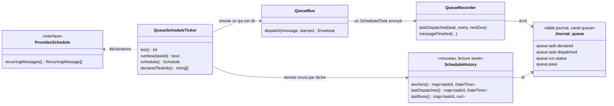
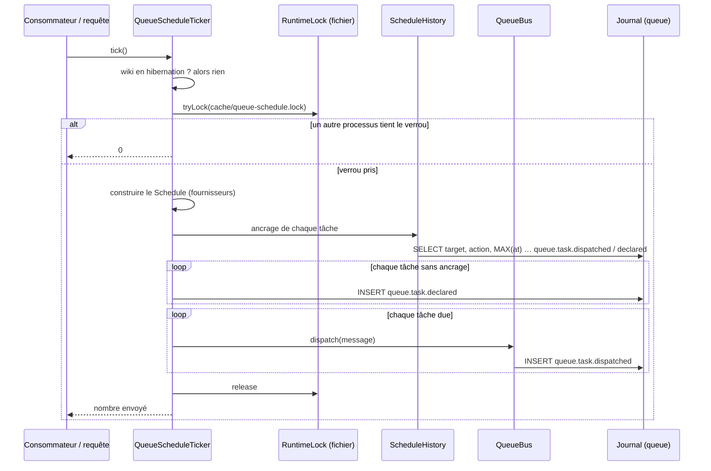

# Le Journal, seule source de vérité du Scheduler

Date : 2026-11-03 · Branche : `feat/messenger` (feature branch d'`ectoplasme`, pas encore sortie)

## Intention

Aujourd'hui, trois endroits racontent l'histoire des tâches planifiées :

- le checkpoint de Symfony, dans les triples `queue:checkpoint` (`QueueCheckpoint`), sous un verrou de fichier ;
- une ligne d'état par tâche dans la file réservée `__schedule` de la table `queue` (`QueueTaskRows`, écrite par `QueueRecorder`) ;
- le Journal, canal `queue`, qui enregistre chaque exécution (`queue.run.<status>`).

Ces trois sources peuvent se contredire. Il a aussi fallu réécrire à la main le générateur de Symfony (`ScheduleGenerator`) pour y brancher le checkpoint. L'utilisateur veut **une seule source de vérité sur les exécutions passées du Scheduler : le Journal**, pour que le code soit plus lisible et moins source d'erreurs.

## Objectifs

- Le Scheduler décide de ce qui est dû en lisant uniquement le Journal et la déclaration des tâches (les `*Schedule` des modules).
- La page des jobs et les Health checks tirent du Journal ce qu'ils montrent sur les tâches : dernier envoi, dernier résultat, échecs consécutifs, prochaine échéance.
- Disparaissent : `QueueCheckpoint`, `QueueTaskRows`, `ScheduleGenerator`, la file `__schedule`, la colonne `task_id` de la table `queue` et son index unique, et les triples `queue:checkpoint`.

## Non-objectifs

- Changer les tâches elles-mêmes, leurs fréquences ou leurs crons.
- Modifier le transport, le consommateur, les modes de consommation ou le fallback, au-delà de ce qu'ils lisent du checkpoint.
- Rattraper plusieurs exécutions manquées : une tâche en retard tourne **une fois**, comme aujourd'hui.

## Anti-objectifs (ce qui serait un échec même si ça marche)

- Recréer un état à côté du Journal : un cache persistant de « prochaine échéance », une colonne ou un triple. Un mémo en mémoire, le temps d'une requête ou d'un worker, reste permis : il disparaît avec le processus et n'est jamais lu par un autre.
- Une tâche qui tourne deux fois pour un seul envoi, ou deux envois pour une seule échéance quand deux processus tournent en même temps.
- Une page de fin de requête plus lente pour les visiteurs. La vérification « y a-t-il du travail ? » doit rester légère.

## Décisions de l'utilisateur

1. **Le Journal est la seule source de vérité** sur les exécutions passées du Scheduler.
2. **La purge du Journal épargne la dernière ligne de chaque tâche.** Le canal `queue` ne garde ses lignes que 7 jours (`journal_queue_purge_time`), alors que certaines tâches tournent moins souvent (digest mensuel). « Aucune trace dans le Journal » veut donc toujours dire « jamais exécutée ».
3. **Une tâche jamais vue note son apparition dans le Journal et attend sa première échéance.** La première fois que le Scheduler voit une tâche déclarée, il écrit une ligne `queue.task.declared` sans rien envoyer. Cette ligne ancre la tâche tant qu'elle n'a jamais été envoyée. Une première idée, « jamais envoyée = due tout de suite », a été abandonnée : un wiki déjà actif peut voir apparaître une tâche sans aucune trace, et ses digests partiraient alors à n'importe quelle heure (le mensuel le 17, puis de nouveau le 1er). C'est le cas au premier abonné, à la réactivation des digests, après une restauration sur une nouvelle installation ou une mise à jour depuis une version sans file.
4. **L'intervalle se compte depuis l'envoi du message par le Scheduler**, pas depuis son exécution.
5. **Un lancement manuel (« Lancer » sur la page des jobs) décale le planning** : la prochaine échéance se compte depuis ce lancement. **C'est indiqué dans l'interface et dans la documentation utilisateur.**

6. **Toutes les machines qui traitent un même wiki partagent son dossier `cache/`.** Le verrou de fichier suffit donc à empêcher deux ticks simultanés, sans verrou en base.

## Le modèle

`ScheduleHistory` est un nom de travail : le constructeur peut ranger cette lecture ailleurs, par exemple dans `QueueStatistics`, s'il le juge plus clair. Ce qui compte, c'est qu'un seul endroit sache lire l'histoire des tâches dans le Journal.

### Une nouvelle ligne : l'envoi d'une tâche

Le Journal n'enregistre aujourd'hui que les fins d'exécution. Il enregistrera aussi chaque **envoi** d'une tâche planifiée : une ligne `queue.task.dispatched` du canal `queue`, dont le `target` est le `task_id`. Ce choix permet d'utiliser l'index existant `(channel, target, at)`. Le contexte peut porter `every_seconds` et le libellé, si la page des jobs en a besoin quand le fournisseur de la tâche ne répond plus.

*Mon choix :* la ligne est écrite **là où passe tout envoi**, dans `QueueBus::dispatch()`, pour tout message `ScheduledTask` qui n'est ni un `ReceivedStamp` ni une nouvelle tentative de Messenger. Elle couvre ainsi les trois producteurs : le Scheduler, le bouton « Lancer » et la première synchronisation qu'`ImportSchedule` envoie elle-même une minute après l'enregistrement d'une source. Sans ça, cette première synchronisation ne laisserait pas de trace d'envoi, et la tâche serait jugée « jamais exécutée », donc due tout de suite une seconde fois.

*Mon choix :* le **rejeu** d'un message en échec depuis la page des jobs (« Relancer ») n'écrit pas de ligne d'envoi. C'est le même run qui reprend, pas une nouvelle échéance.

*Mon choix :* quand le transport **absorbe** l'envoi parce qu'un message de la même tâche attend déjà (clé de dédoublonnage `task:<id>`), la ligne d'envoi est quand même écrite. Le Scheduler a bien envoyé le message à ce moment-là : l'intervalle part de là, comme le checkpoint le fait aujourd'hui. Sinon, après un embouteillage, la tâche tournerait deux fois de suite. Un envoi qui échoue (`queue.dispatch_failed`) n'écrit rien.

### Une ligne d'apparition : la tâche est vue pour la première fois

Au tick, sous le verrou, chaque tâche déclarée qui n'a **ni** ligne `queue.task.dispatched` **ni** ligne `queue.task.declared` reçoit une ligne `queue.task.declared` du canal `queue`, datée de maintenant, avec le `task_id` en `target`. Rien n'est envoyé.

### Ce qui est dû

L'**ancrage** d'une tâche est la date de son dernier envoi, ou de son apparition si elle n'a jamais été envoyée. Pour chaque tâche déclarée :

- sans ancrage : on écrit la ligne d'apparition, et la tâche n'est pas due ;
- sinon : due quand `trigger->getNextRunDate(ancrage) <= maintenant`.

Une tâche de ménage (`every 24 hours`) d'un wiki neuf tourne donc pour la première fois 24 h après le premier tick. Un digest qui apparaît attend son prochain 7 h, son prochain lundi ou son prochain 1er du mois. La première synchronisation d'une source d'import n'attend pas : `ImportSchedule` l'envoie elle-même, et cet envoi écrit une ligne d'envoi.

*Comportement connu, identique à aujourd'hui :* une tâche qui disparaît puis réapparaît (digests désactivés puis réactivés) retrouve sa dernière ligne d'envoi, épargnée par la purge. Si une échéance est passée entre-temps, elle tourne une fois tout de suite.

*Mon choix :* un message récurrent qui n'est pas un `ScheduledTask` n'a pas d'identité stable à retrouver dans le Journal, et serait envoyé à chaque tick. Aucun module n'en déclare. Le Scheduler le journalise en erreur (`queue.schedule_provider_failed`) et l'ignore, et l'ADR-0030 exige désormais `ScheduledTask` pour toute tâche récurrente.

C'est le comportement de `processOnlyLastMissedRun` : une seule exécution, quel que soit le nombre d'échéances manquées. Le Schedule, les `RecurringMessage` et les triggers de Symfony restent le langage de déclaration. Seul le générateur disparaît.

Un tick est donc :

*Décision 6, et mon choix :* **le verrou de fichier reste** autour d'un tick (`RuntimeLock`, `cache/queue-schedule.lock`, toujours épargné par `CacheClearer`). Ce n'est pas un état, seulement une exclusion mutuelle : deux processus ne lisent pas le même « dernier envoi » pour envoyer chacun la même échéance. La lecture du Journal se fait **sous** le verrou.

### La prochaine échéance, sans état

`QueueRequestTrigger::hasWork()` (fin de requête), `QueueFallback::entersNow()` et le retour immédiat de `tick()` lisent aujourd'hui `QueueCheckpoint::dueAt()`. Ils la calculeront à partir des mêmes éléments que le tick : le Schedule déclaré et l'ancrage de chaque tâche. La prochaine échéance du planning est le minimum, sur les tâches déclarées, de `getNextRunDate(ancrage)`. Elle vaut « maintenant » s'il existe une tâche sans ancrage, pour que le tick suivant écrive sa ligne d'apparition. Juste après ce tick, l'échéance retombe sur la vraie prochaine date : le tick n'a rien envoyé, et la vérification ne reste pas vraie à chaque requête.

*Mon choix :* ce calcul est mémorisé **en mémoire** dans le ticker, comme `dueAt`/`learntAt` aujourd'hui, et relu au bout de `RECHECK_SECONDS`. Il n'est jamais persisté. Le constructeur **mesure** le coût d'un `hasWork()` sur un wiki qui a plusieurs sources d'import et les trois digests. Si ce coût dépasse nettement celui de la lecture d'un triple, il revient vers l'utilisateur avant d'ajouter quoi que ce soit de persistant.

Une tâche qui n'est plus déclarée sort simplement du calcul. Il n'y a plus de `forgetTasksExcept()`.

### Ce que la page des jobs et les Health checks lisent

La liste des tâches est celle du **Schedule déclaré**. Le libellé et la fréquence viennent de la déclaration, et quand un fournisseur ne répond pas, des tâches vues dans les lignes d'envoi (c'est le rôle actuel de `declaredTaskIds()`). Pour chaque tâche :

| Champ (`QueueStatistics::tasks()`) | Aujourd'hui (`__schedule`) | Demain (Journal) |
|---|---|---|
| `lastDispatchedAt` | `last_dispatched_at` | dernière `queue.task.dispatched` |
| `nextDueAt` | `next_due_at` | `getNextRunDate(lastDispatchedAt)`, ou maintenant |
| `lastFinishedAt`, `lastStatus`, `lastError` | champs de la ligne | dernière `queue.run.*` dont le contexte a ce `task_id` |
| `consecutiveFailures` | compteur | voir ci-dessous |
| `everySeconds`, `label` | champs de la ligne | déclaration (`periodOf`, `label()`) |

*Mon choix :* `consecutiveFailures` est porté par la ligne de run elle-même. Chaque `queue.run.*` d'une tâche planifiée note dans son contexte le nombre d'échecs consécutifs qu'elle conclut, calculé à l'écriture depuis la ligne de run précédente de cette tâche : 0 si `handled`, +1 si `failed` ou `killed`, inchangé sinon. Ce n'est pas un second état, c'est un fait de la ligne. Le compte survit ainsi à la purge pour une tâche mensuelle.

*Contrainte pour le constructeur :* les lectures par tâche (dernier run, dernier envoi) doivent rester indexées et bornées. Le `task_id` d'un run est aujourd'hui dans le JSON `context`, qui n'est pas indexé. Au constructeur de choisir comment le rendre trouvable sans scanner 7 jours de runs, sur les trois dialectes : une colonne existante laissée vide par le canal `queue`, ou une requête bornée.

### La purge

`Journal::prune()`, pour le canal `queue`, épargne, pour chaque `task_id`, **la dernière ligne `queue.task.dispatched`, la dernière ligne `queue.task.declared` et la dernière ligne `queue.run.*`**. La décision de l'utilisateur porte sur « la dernière ligne de chaque tâche ». *Mon choix* d'épargner aussi le dernier run permet à la page des jobs de toujours montrer le dernier résultat d'une tâche mensuelle. Les lignes d'une tâche qui n'est plus déclarée finissent par partir : la purge épargne par `task_id`, sans consulter les déclarations, et ce point est laissé au constructeur s'il préfère l'inverse.

### Lancement manuel

`runNow()` envoie le message par `QueueBus`, ce qui écrit la ligne d'envoi : la prochaine échéance se compte depuis ce moment.

- **Interface** (`templates/admin/jobs-tab-tasks.twig`, `JobsApiController::runTask`) : le bouton **Lancer** dit qu'il repousse la prochaine échéance, par un `title` et une ligne d'aide sous le tableau. Le message de retour affiche la nouvelle échéance. Les textes passent par `src/lang/yeswiki_fr.php` et `src/lang/yeswiki_en.php`.
- **Documentation utilisateur** (`docs/fr/async.md`, onglet *Tâches planifiées*) : la phrase « sans changer son calendrier » devient « la prochaine échéance se compte à partir de ce lancement ». La phrase sur le réveil après hibernation (« tourne une fois, puis reprend son rythme ») reste vraie.

### Hibernation, sauvegarde et restauration

- **Hibernation :** inchangée. `tick()` ne fait rien tant que le wiki est en pause, et au réveil chaque tâche en retard tourne une fois.
- **Sauvegarde et restauration :** les lignes du canal `queue` du Journal restent l'état de l'instance qui tourne. Elles sont toujours laissées hors des sauvegardes et remises en place après une restauration, comme aujourd'hui. Les lignes d'envoi en font partie, donc « une tâche déjà passée ne repasse pas » reste vrai. Dans `DumpRewriter::leftOutRows()`, la condition sur les triples `queue:checkpoint` disparaît.

### Migration

*Mon choix :* la branche n'est pas sortie, donc la migration `20261023120000_TheQueueHasItsTables` et le DDL des trois dialectes sont **modifiés sur place** : plus de colonne `task_id` ni d'index `uniq_task_id`. Un wiki de développement qui a déjà la colonne la garde, sans effet. Ses triples `queue:checkpoint` restent orphelins, et un reset du wiki de dev suffit à les effacer.

## Ce qui est laissé au constructeur

- Le nom et l'emplacement de la lecture de l'historique (`ScheduleHistory` ou une méthode de `QueueStatistics`).
- Comment indexer la recherche d'un run par `task_id` (voir la contrainte plus haut).
- Le contexte exact de `queue.task.dispatched`, au-delà du `target` égal au `task_id`.
- La suppression des tests du checkpoint, du générateur et des lignes `__schedule`, et la réécriture de `QueueScheduleTickerTest` sur le nouveau modèle. Parmi les cas à couvrir : tâche vue pour la première fois (ligne d'apparition, rien d'envoyé, puis première échéance), tâche réapparue, ancrage sur l'envoi, absorption, lancement manuel qui décale, ticks concurrents, purge qui épargne, hibernation, première synchronisation d'`ImportSchedule`.
- La mise à jour d'ADR-0030 : schéma, sections « The Scheduler's checkpoint and ticker », file `__schedule`, rétention du Journal.
