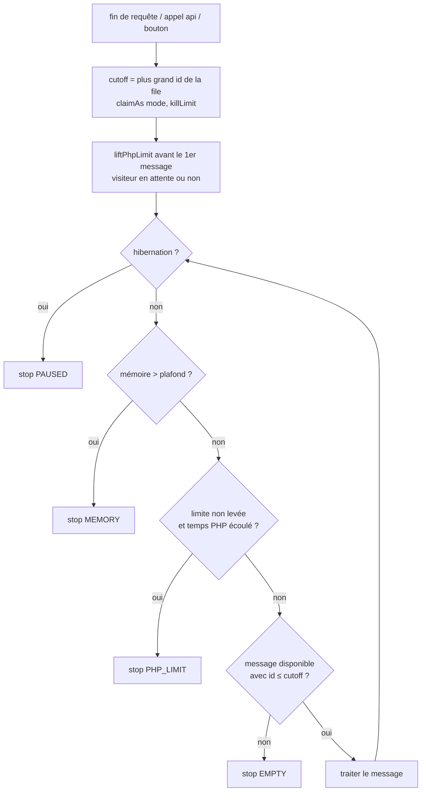

# File de traitements : suppression du budget de temps par passage

Date : 2026-11-06 — branche `feat/messenger`

## Intention

La branche a introduit un « budget » de temps pour chaque passage de consommation en mode web (`request`, `api`,
secours) : une échéance calculée depuis `max_execution_time`, plafonnée par mode (3 s / 20 s / 50 s), et une
anticipation de la durée du prochain message par la moyenne historique de son type. Le but était de ne jamais
commencer un message qui ne tiendrait pas dans le temps restant.

Le constat :

- la plupart des traitements sont très courts ;
- les traitements lents sont peu anticipables (un timeout sur une requête HTTP externe ne se prévoit pas par une
  moyenne) ;
- une évolution récente lève de toute façon la limite de PHP (`set_time_limit(0)`) et juge la vie d'un claim par un
  verrou de détenteur (`QueueHolderLock`), ce qui rend l'anticipation largement redondante.

Le budget ajoute de la complexité (factory, contexte, horloges, contrôles de santé, colonnes d'écran) sans protéger
efficacement les cas qu'il visait. On le supprime.

## Décision (validée par le développeur)

**Un passage web traite les messages jusqu'à ce que la file soit vide.** Même règle que la réponse ait déjà été
envoyée au visiteur ou non : sans `fastcgi_finish_request` (Apache mod_php, CGI), le visiteur attend que la file
soit vide.

**La file vide s'entend au début du passage** (validé) : un passage ne prend que les messages déjà présents
dans la file quand il commence. Un message mis en file pendant le passage, y compris par un traitement du
passage lui-même, attend le passage suivant. Raison : sans cela, un traitement qui se relance (le téléchargement
d'une sauvegarde distante, `RemoteBackupService::queueNextStep()`, remet sa tranche suivante en file sans délai) ou
un wiki très actif empêcheraient le passage de finir, et le visiteur attendrait indéfiniment.

**Quand la limite de PHP ne peut pas être levée** (validé) : `liftPhpLimit()` échoue (fonction désactivée,
limite imposée par l'hébergeur). Le passage cesse alors de prendre de nouveaux messages quand le temps que PHP lui
laisse est écoulé, moins une marge fixe. Il n'y a aucune estimation de la durée du prochain message, seulement une
comparaison avec la limite. Une alerte signale aux admins que la limite n'a pas pu être levée. Les coupures
extérieures à PHP (`request_terminate_timeout` de FPM, timeouts d'Apache, de fcgid ou d'un proxy) restent hors de
portée : un message coupé ainsi part en échec comme « tué », ce qui est le comportement actuel du juge.

Un passage s'arrête uniquement sur :

1. plus aucun message présent au début du passage n'est disponible (`EMPTY`) ;
2. wiki en hibernation (`PAUSED`) ;
3. mémoire au-delà du plafond (80 % de `memory_limit`, `MEMORY`) — garde-fou, pas une prévision ;
4. limite de PHP non levée et atteinte (`PHP_LIMIT`, nouveau) ;
5. erreur (`ERROR`).

Le mode `worker` (consommateur bloquant, `consume()`) et les messages épinglés (`handleById`) sont inchangés.

## Objectifs

- Supprimer toute anticipation de durée : échéance, `canAfford`, durée moyenne utilisée pour décider, plafonds par
  mode, motifs d'arrêt `BUDGET` / `NO_BUDGET`.
- Garder intacts : le verrou de passage (`PASS_LOCK`), le verrou de détenteur, le juge des claims morts
  (`reapKilled`, `closeDeadPasses`), le battement de cœur, l'hibernation, le plafond mémoire, les messages épinglés
  (`handleById`), le mode de secours.
- Le vocabulaire « budget » disparaît du code, de l'écran, des traductions et de la doc.

## Non-objectifs

- Ne pas toucher au mode `worker` ni à `messenger:consume`.
- Ne pas modifier le mécanisme de verrou de détenteur ni la durée de grâce (`KILL_GRACE_SECONDS`).
- Ne pas supprimer `QueueStatistics::averageDurationMs()` si l'écran Traitements l'affiche ailleurs (il n'est plus
  utilisé pour décider ; s'il n'a plus aucun appelant, il part).

## Anti-objectifs (échec même si « ça marche »)

- Un passage qui ne finit jamais parce que des messages continuent d'arriver.
- Un message pris par un passage puis jugé mort alors que son processus vit encore.
- Un passage web qui ne lève plus la limite de PHP avant son premier message.
- Une régression du mode `worker`.

## Ce qui change, pièce par pièce

### Supprimé

| Élément | Où |
|---|---|
| Échéance (`deadline`), `remainingSeconds()`, `canAfford()` | `src/Kernel/Queue/QueueBudget.php` |
| `forMode()`, `secondsPerPass()`, `capped()` (les marges et le calcul du temps restant à PHP restent, pour `phpStopsAt` et le kill limit) | `src/Kernel/Service/Queue/QueueBudgetFactory.php` |
| `passCeilingSeconds()` | `src/Kernel/Queue/QueueConsumerMode.php` |
| `QueueBudgetContext` (classe entière, service, `RequestScopedState`) | `src/Kernel/Service/Queue/QueueBudgetContext.php` |
| Estimation dans `reasonToStop()` (`$averages`, `UNKNOWN_DURATION_SECONDS`, `peekNextType` si plus utile), motifs `BUDGET` / `NO_BUDGET` | `QueueConsumer`, `QueuePassReport` |
| Contrôle de santé `queue-no-budget` (`noBudget()`, constantes `NO_BUDGET_*`), clé `budget` des données de santé | `QueueHealthChecks`, `JobsOverview` (l. 199) |
| Champ `budget_ms` écrit dans le contexte de la ligne de passage, `budgetMs` relu | `QueueRecorder`, `QueueStatistics`, `JobsOverview` |
| Colonne « Budget » de l'onglet Consommateurs, mention « Budget par passage » du bandeau | `templates/admin/jobs-tab-consumers.twig`, `templates/admin/jobs-alerts.twig`, `JobsOverview` (l. 262, 401) |
| Traductions `QUEUE_HEALTH_NO_BUDGET*`, `QUEUE_STOP_BUDGET`, `QUEUE_STOP_NO_BUDGET`, `ADMIN_JOBS_BUDGET*`, `ADMIN_JOBS_COL_BUDGET` | `src/lang/yeswiki_fr.php`, `src/lang/yeswiki_en.php` |

`budget_ms` est une clé du contexte JSON des lignes de journal, introduite par cette branche jamais publiée : aucune
migration, on cesse simplement de l'écrire et de la lire.

### Ajouté

- **Borne du passage (cutoff)** : au début de `drain()`, le passage lit le plus grand `id` de la file
  (`queue_name = default`) et ne réclame ensuite que des lignes `id <= cutoff` (en plus des conditions actuelles
  `delivered_at IS NULL AND available_at <= now`). Cela vaut pour tous les passages de `drain()` : fin de requête,
  `api`, secours, bouton de la page Traitements, `messenger:consume --drain`. *Mon choix* : le plus grand id plutôt
  qu'une date, parce qu'un message mis en file pendant la même seconde que le début du passage passerait le filtre
  par date. Un message déjà présent mais différé, qui devient disponible pendant le passage, est pris. Le cutoff est
  porté par `QueuePassReceiver` ou passé à `QueueTransport::claim()` / `peekNextType()` : à décider par le
  constructeur.
- **Échéance PHP quand la levée échoue** : `QueuePassLimits` garde un champ `phpStopsAt` (`?float`, `null` quand la
  limite est levée ou absente). La marge reprend celle d'aujourd'hui (2 s + 10 % de `max_execution_time`, *mon
  choix*). Le contrôle a lieu avant chaque message, y compris le premier. Le motif d'arrêt est
  `QueuePassReport::PHP_LIMIT = 'php-limit'`, libellé fr « limite de temps de PHP atteinte », en « PHP time limit
  reached ».
- **Contrôle de santé `queue-php-limit`** (orange, `degraded`), qui remplace `queue-no-budget` : il se déclenche
  quand au moins un des 5 derniers passages web (hors `worker`) s'est arrêté sur `php-limit` (*mon choix* de seuil).
  Message : la limite de temps de PHP n'a pas pu être levée sur cet hébergeur, des traitements attendront le passage
  suivant ou seront coupés. Conseil : autoriser `set_time_limit` ou passer au mode `worker`. La doc fr reçoit la
  section d'alerte correspondante à la place de « Temps insuffisant pour traiter les tâches ».

### Conservé, simplifié, renommé

- **`QueueBudget` → `QueuePassLimits`** (`memoryCeilingBytes`, `killLimitSeconds`, `memoryExhausted()`).
  *Mon choix* : renommer, le mot « budget » n'ayant plus de sens.
- **`QueueBudgetFactory` → `QueuePassLimitsFactory`** avec :
  - `forPass()` : plafond mémoire + kill limit (remplace `forMode()` et `forHand()` : un passage web n'a plus de
    paramètre `responseAlreadySent` ni de mode à distinguer) ;
  - `untilEmpty()` : inchangé (bouton de la page Traitements, pas de plafond mémoire) ;
  - `liftPhpLimit()` : inchangé ;
  - `bytes()` : inchangé (utilisé par `QueueConsumeCommand`) ;
  - `KILL_LIMIT_NO_PHP_LIMIT` (1 h) : inchangé, toujours référencé par `QueueTransport` et `QueueConsumer`.
- **Kill limit d'un passage web** : il continue d'être lu depuis ce qu'il reste à PHP au départ, puis
  `liftPhpLimit()` le porte à 1 h quand la levée réussit (comportement actuel). La différence : la levée a lieu
  **avant le premier message, toujours**, y compris quand le visiteur attend (aujourd'hui elle n'a lieu que si
  personne n'attend). Quand la levée échoue, le kill limit reste ce que PHP laissait, et `phpStopsAt` s'applique
  (voir « Ajouté »).
- **`QueueConsumerMode::isBudgeted()` → `endsByItself()`** : même valeur (vrai pour `request` et `api`), utilisé
  par `QueueFallback`, `QueueHealthChecks`, `QueueStatistics`, `QueueRequestTrigger`, `forPassFromTheWeb()`.
  *Mon choix* de nom ; il reprend le docblock actuel (« a pass in this mode has to end by itself »), reformulé :
  « une passe de ce mode s'arrête d'elle-même quand la file est vide ».
- **`RunsUnbudgeted` → `RunsForItsSender`** (`HELD_FOR_THE_SENDER_SECONDS = 300` inchangé), implémenté par
  `CreateArchive` et `RestoreArchive`, lu par `QueueBus`. Le rôle (tenu pour la requête qui l'envoie) ne dépend pas du
  budget. *Mon choix* de nom.
- **`RemoteBackupService`** : la tranche vaut `SLICE_SECONDS` (20 s), fixe. La dépendance à `QueueBudgetContext`
  disparaît.

### Appelants à adapter

- `QueueRequestTrigger::drain()` : `forPass()` au lieu de `forMode(Request, $responseAlreadySent)`.
- `QueueApiController` : `forPass()` au lieu de `forMode($mode, true)`.
- `QueueConsumer::consume()` : kill limit depuis la factory sans `forMode()`.
- `QueueConsumeCommand` : `forPass()` au lieu de `forHand()` (`--drain`, garde le plafond mémoire).
- `JobsApiController` : `untilEmpty()` inchangé.

## Tests

- Supprimer `tests/src/Kernel/QueueBudgetTest.php` ; le remplacer par un test de `QueuePassLimitsFactory` (plafond
  mémoire, kill limit, `liftPhpLimit`, `bytes`) reprenant les cas encore valables.
- `QueueConsumerTest` : supprimer les cas `BUDGET` / `NO_BUDGET` / anticipation. Vérifier :
  - un passage web traite la file jusqu'au bout, avant comme après l'envoi de la réponse ;
  - il s'arrête sur l'hibernation et sur le plafond mémoire ;
  - il lève la limite de PHP avant son premier message dans les deux cas ;
  - un message mis en file par un traitement du passage n'est pas pris par ce passage ;
  - un message différé déjà présent, devenu disponible pendant le passage, est pris ;
  - quand la levée échoue, le passage s'arrête sur `php-limit` une fois le temps de PHP écoulé, et ne s'arrête pas
    tant qu'il en reste.
- `QueueHealthChecksTest` : `queue-php-limit` se déclenche et ne se déclenche pas selon les derniers passages.
- `QueueHealthChecksTest`, `JobsControllerTest`, `QueueRecorderTest`, `RemoteBackupServiceTest`, `QueueTestKit` et
  les autres fichiers listés par `grep -il budget tests/` : adapter.
- `ArchitectureTest` / `GlobalsRatchetTest` : mettre à jour si les noms de classes y figurent.
- Critère de fin : suite PHPUnit (Kernel, Admin, Federation) verte, PHPStan sans nouvelle erreur.

## Documentation

- `docs/fr/async.md` :
  - retirer le « budget par passage » (bandeau, onglet Consommateurs) ;
  - remplacer la section d'alerte « Temps insuffisant pour traiter les tâches » par celle de `queue-php-limit` ;
  - reformuler « Attente ajoutée aux pages » : le visiteur attend désormais que les traitements présents au
    début du passage soient finis ;
  - dire qu'un traitement mis en file pendant un passage attend le suivant ;
  - corriger la légende de `images/async-bandeau-mode.png` (la capture elle-même ne peut pas être refaite ici :
    le signaler au développeur).
- `docs/adr/0030-...md` : réécrire « The fallback and the budget » et les passages du consommateur qui décrivent
  l'échéance et l'anticipation ; ajouter une note datée expliquant le retrait et pourquoi.
- `docs/adr/0015-...md` : vérifier la mention du budget dans l'amendement.
- `CONTEXT.md`, `INSTALL.md` : retirer ou corriger les mentions.

## Livraison

Plusieurs commits sur `feat/messenger`, sans `git push`, sans référence à l'agent dans les messages.
Ordre suggéré : consommateur et factory → appelants → santé et écran → traductions → tests → doc.

## Laissé au constructeur

- Le découpage exact des commits.
- Garder ou supprimer `peekNextType()` / `averageDurationMs()` selon qu'il leur reste des appelants.
