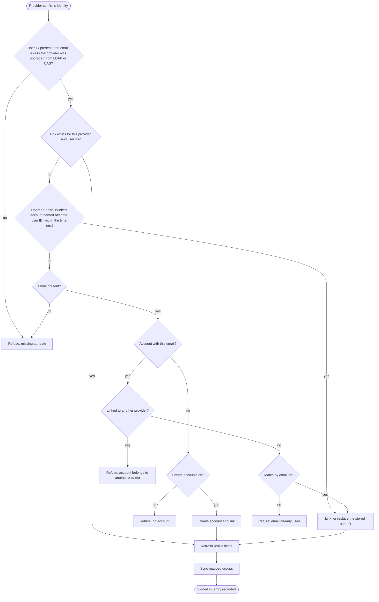
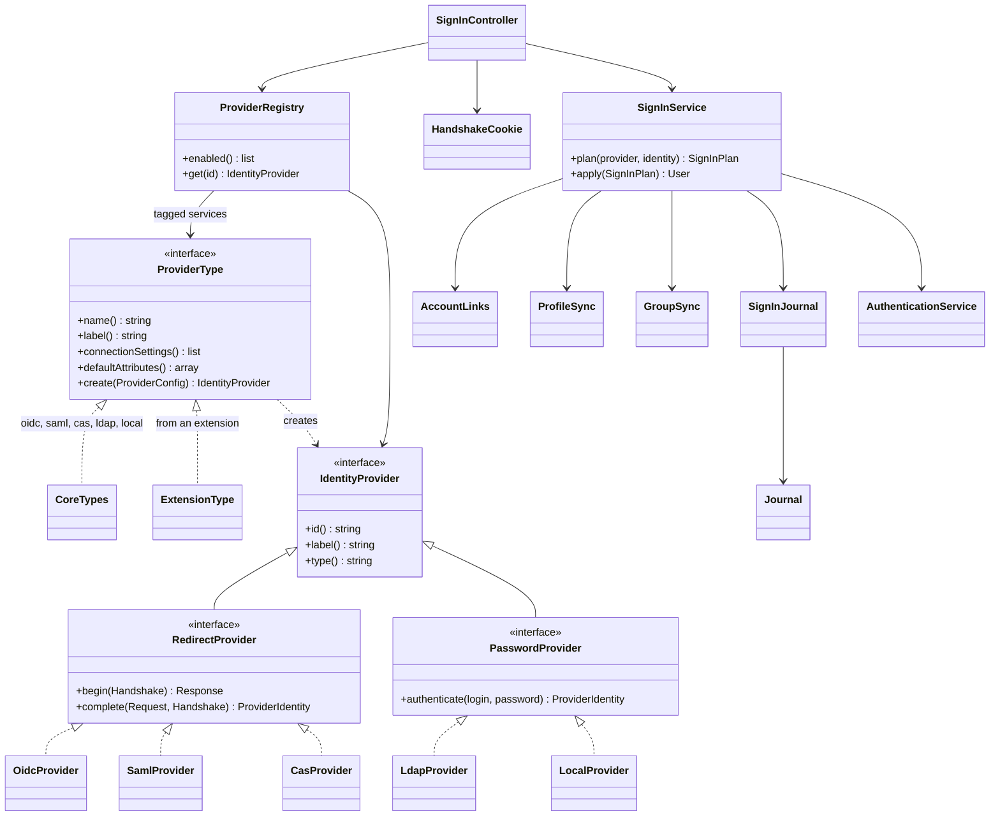
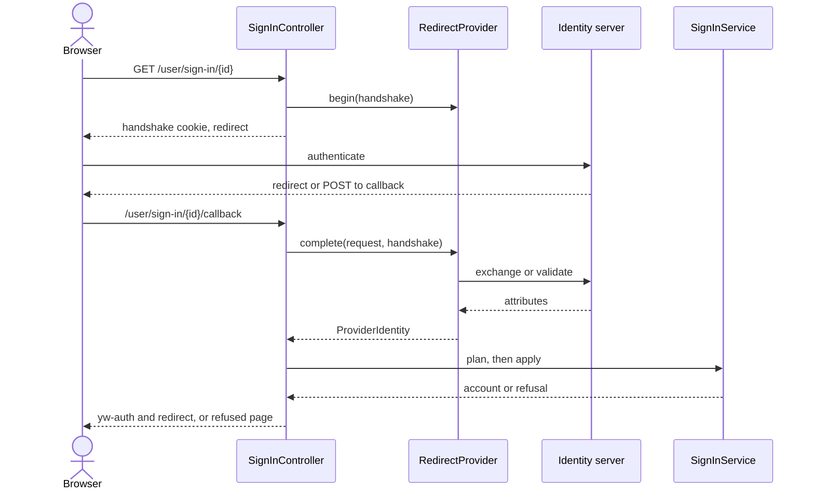

# Single sign-on in the core: sign-in providers replace the login extensions

Status: design, approved. Branch: `feat/sso`.

Decisions in this document are marked **(decided)** when the project lead made them and **(author's call)** when the author of this document made them. Section 15 lists the second kind again for review.

## 1. Intent

YesWiki is commonly deployed as an internal business wiki where people must sign in through their company's identity server. Three Doryphore extensions do this today: [loginsso](https://github.com/YesWiki/yeswiki-extension-loginsso) (OAuth2/OIDC), [loginldap](https://github.com/YesWiki/yeswiki-extension-loginldap) and [logincas](https://github.com/YesWiki/yeswiki-extension-logincas).

Their sign-in flows mostly work. The pain is being blind when setup or access goes wrong: the people who run these wikis cannot see what the provider returned or why someone was refused, and employees get unhelpful messages. Only one extension can be active at a time, each has its own configuration and its own feature set, and SAML does not exist.

This work brings sign-in into the core as one system of **providers**, and retires the three extensions. Ectoplasme is alpha, so breaking changes are allowed, but a wiki on the last stable Doryphore with any of these extensions must arrive on Ectoplasme with its sign-in still working.

Success looks like this: a wiki admin can connect a company provider, test it, and fix a refused employee on their own, without a developer.

## 2. Goals, non-goals, anti-goals

### Goals (decided)

- Provider types: local accounts, OIDC, SAML, CAS and LDAP.
- Any number of providers enabled at once, including several of one type (two SAML providers, for example).
- Local accounts are a provider like the others: enabled, disabled and combined at any time.
- Group mapping from provider groups to wiki groups, per provider.
- First name, last name and email imported from the provider.
- Extra provider attributes can be mapped onto account fields.
- Configuration in one home, a section of the config file, usable directly by a deployment and through an admin screen.
- The employee gets a comprehensive error message. The admin gets the error and the attributes the provider returned.
- Failed sign-ins are recorded for the admin through the existing Journal, with no new storage **(decided)**.
- Successful sign-ins are not logged **(decided)**.
- An extension can easily add a new type of provider (section 10).
- An upgrade path from the last stable Doryphore with the corresponding extensions.

### Non-goals

- **Moving accounts between providers or to local (decided).** Removed from the first iteration as too complex. No bulk move, no per-account move, no list of accounts waiting to link.
- **Creating a bazar entry at first sign-in, and its consent and anonymisation step (decided).** Replaced by mapping attributes onto account fields.
- **A read-only mode for the admin screen (decided).** The screen writes the config file, as the other admin screens do.
- An account linked to several providers **(decided)**.
- Single logout at the provider. Signing out of the wiki signs out of the wiki only, as the extensions do today **(author's call)**.
- SAML sign-in started from the provider's side. Only sign-ins started from the wiki **(author's call)**.
- Skipping the sign-in page when a single provider is enabled **(author's call)**.
- Provisioning or deprovisioning accounts outside a sign-in (SCIM, directory sync) **(author's call)**.

### Anti-goals: this fails even if it technically works when

- A refusal leaves the employee or the admin without the reason.
- A provider can take over an account the admin did not intend to give it.
- A secret, token, password or SAML assertion ends up in a log, in the compiled cache or in a page.
- Upgrading a Doryphore wiki locks its users out or silently creates duplicate accounts.

## 3. What the codebase imposes

These were checked by reading the code on this branch.

| Fact | Consequence |
|---|---|
| Core no longer keeps a session (replicas work). `LoginCookie` signs `yw-auth` with `SignedTokens`. | The round trip to a provider needs its own short-lived state that any replica can read. |
| Requests run in FrankenPHP worker mode, and request state may never be global (ADR-0024). | Any library must be checked for global state. phpCAS must be confined (section 6). |
| Accounts are `pages` rows of type `user`; `users` is dropped by migrations. The User form has locked fields (`username`, `password`, `email`, `profile_picture`) declared in `ContentTypeSchema` (ADR-0011). | First and last name need a home in that structure. |
| `MigrateUsersToPages` copies only named columns, so `loginsso_id` is lost when `DropUsersTable` runs. | That migration must carry it into the account's body. |
| LDAP and CAS created accounts with md5 passwords. `requiresPasswordReset()` treats md5 as "must reset", and `stillValid()` then ends the sign-in on the next request. | Linked accounts must be exempt, and their hashes cleared. |
| `ConfigurationSecrets::KEYS` keeps a fixed list of flat keys out of `cache/container/`. | Provider secrets are nested and need their own treatment. |
| Journal audit entries never collapse and are kept 365 days. Diagnostics collapse per day on level, action and call site, stop at 500 distinct rows a day, and are kept 14 days. Every event also reaches stderr with its whole context. | Failed sign-ins use both channels, each for what it is good at. See section 9. |
| `/user/signup`, `/user/lost-password`, `/api/login` and `LoginAction` assume local accounts. `hasLoginExtensions()` hardcodes extension names. | All of them must follow the local provider's state. The hardcoded check goes. |
| `binary/build-static.sh` builds its PHP extension list from `require` and `suggest` in `composer.json`. `ext-ldap` is in neither, nor in the Docker images. | Add `ext-ldap` to `suggest` and to the Docker images. |
| Routes live in `<Module>/Controller/` or `<Module>/Api/` (ADR-0013). | Everything here belongs to the `Identity` module. |
| Extension services are registered and autoconfigured, and core finds contributors through tagged interfaces (`ProvidesHealthChecks`, `ProvidesSchedule`). | Provider types are found the same way, so an extension needs no other registration. |

## 4. Vocabulary

To add to `CONTEXT.md`:

- **Provider**: one configured way of signing in, with a stable identifier, a type and settings. Local accounts are one.
- **Account link**: the tie between an account and the one provider it belongs to, holding that provider's stable user ID, stored in the account's own page. An account with no link is local.
## 5. Behaviour of a sign-in

### 5.1 Decision flow

Once a provider has confirmed who someone is:



Every refusal shows the employee a clear page (section 8.2) and is written to the Journal (section 9).

### 5.2 Account rules

- An account belongs to exactly one place: one provider, or local **(decided)**.
- A link is the provider's identifier plus that provider's stable user ID, so a later email change does not break it **(decided with the flow above)**.
- Match by email is a per-provider setting, **off by default (decided)**.
- Linking a local account clears its password, since it no longer signs in locally **(author's call)**.
- If an OIDC provider sends `email_verified: false`, match by email does not apply **(author's call)**.
- Create accounts is a per-provider setting, on by default **(accepted guess)**.
- A linked account has no password and cannot use the password form.
- An account name is built from first and last name with the core's name generator, falling back to the email's local part and then the user ID. The optional `account_name_template` key carries over loginsso's `create_user_from` and is available from the config file only **(author's call)**. The screen must keep keys it does not display.
- Accounts on a provider that is switched off cannot sign in, and an existing `yw-auth` stops being valid at the next request **(author's call)**.
- Linked accounts skip the `signup_email_activation` gate, replacing `hasLoginExtensions()`.
- A sign-in through a provider uses the remembered lifetime (90 days, renewed at half-life), as all three extensions do. Ending someone's access means deleting the account or switching off the provider, and the admin documentation says so **(author's call)**.

### 5.3 Profile fields

- First name, last name, email and mapped extra fields are refreshed at every real sign-in. The provider wins **(accepted guess)**.
- These fields are read-only for a linked account, with a message saying why and where to change them **(decided)**. This is enforced on the server, in the settings action and the user API, and not only in the form. Sign-in itself uses an internal write path. An admin editing a linked account follows the same rule **(author's call)**.
- A missing user ID or email refuses the sign-in and names the attribute. Missing names stay empty **(accepted guess for email, author's call for the rest)**.
- One exception for the upgrade: on a provider upgraded from LDAP or CAS, an existing account (linked, or found by name) may sign in with no email, because Doryphore accepted that. It keeps its stored email and a warning goes to the diagnostic channel. Creating an account or matching by email still needs one **(author's call)**.
- If a provider's new email is already used by another account, the old email stays, a warning goes to the diagnostic channel, and the sign-in proceeds **(author's call)**.
- First and last name become locked fields of the User form, editable on local accounts and optional **(author's call)**.

### 5.4 Groups

- Each provider has a mapping of provider group to wiki group. Several rows may share a provider group **(decided)**.
- At each real sign-in, only wiki groups named in that provider's mapping are added or removed. Everything else stays as the admin set it, as loginsso does today **(accepted guess)**.
- A provider may send a string or a list. Mapped wiki groups that do not exist are created, as loginsso does.
- A failed group update does not block the sign-in. It goes to the diagnostic channel as a warning.
- A sign-in never leaves the `admins` group empty **(author's call)**.

### 5.5 Changing SSO server

The admin edits the existing provider's connection in place, so accounts stay attached and keep their content and groups. Sign-ins only touch groups named in the mapping, so local customisations survive.

If the new server issues different user IDs, the admin turns on match by email for the switch. The flow then replaces the stored user ID on accounts already tied to this provider **(author's call, replaces the removed move feature)**.

A provider with accounts attached cannot be deleted from the screen, only switched off **(accepted guess)**.

### 5.6 Getting back in

Because providers live in the config file, anyone with file access can switch local back on if a provider's server dies. An admin account tied to the dead server has no password, so they create a new local admin with the existing `yeswicli` user and group commands **(author's call; the earlier idea of a dedicated command was removed with the move feature)**.

The screen refuses to switch off the last enabled provider. If the file leaves none enabled, the sign-in page says so and a health check reports it.

## 6. Provider types

These are the types core ships. Each is registered exactly the way an extension registers its own (section 10).

| Type | Kind | Connection settings | Notes |
|---|---|---|---|
| `local` | Password | None | At most one. Only an on/off switch. Keeps sign-up and lost password. |
| `oidc` | Redirect | Discovery URL, or explicit authorize, token and userinfo endpoints with optional `issuer` and `jwks_uri`; client ID; client secret; scopes | Explicit endpoints are needed because loginsso configs are plain OAuth2. Authorization code flow with PKCE when supported. Attributes come from userinfo, merged with `id_token` claims when the token can be verified (section 12). |
| `saml` | Redirect | Metadata URL or XML, or manual values; our metadata to copy; optional certificate and private key | Signed assertions required. With a key, requests are signed, encrypted assertions are decrypted and the certificate appears in our metadata. The admin supplies the pair, the documentation gives the `openssl` command, and there is no generation or rotation **(author's call)**. |
| `cas` | Redirect | Server URL, protocol version, CA certificate path | No CA path means the system's CAs. Certificate checks are never disabled. |
| `ldap` | Password | URI, TLS option; either a bind DN template or a search account with base DN and user filter | Attributes and groups are read after a successful bind. `memberOf` or a group search. |

OIDC uses `league/oauth2-client` **(decided)**, as loginsso did, through its `GenericProvider`, whose option names match what a migrated loginsso config holds. It handles the authorization redirect, `state`, PKCE S256 (`pkceMethod`, with `getPkceCode()` and `setPkceCode()` carrying the verifier in the handshake), the token exchange and the userinfo call, with no session or static state. `IdentityProviderException::getResponseBody()` supplies the admin's raw error. Version 2.9.1 supports PHP 8.4 and brings Guzzle and `guzzlehttp/psr7` as new dependencies.

The library does not handle discovery or `id_token` validation, so `OidcProvider` adds them: the discovery document is fetched with `symfony/http-client` (already in core), and `id_token` is verified with `firebase/php-jwt` **(author's call)**.

Other libraries **(author's call; the builder may substitute under the constraints in section 12)**: `onelogin/php-saml` for SAML and `ext-ldap` for LDAP.

CAS uses a maintained library **(decided)**, and that library is `apereo/phpcas` **(author's call)**. It is the protocol's official PHP client, and version 1.6.2 (April 2026) adds PHP 8.4 support. The alternative, `ecphp/cas-lib`, has no global state, but its last release was in October 2024 and it brings several new dependencies.

phpCAS was written for one request per process and a PHP session, so `CasProvider` confines it:

- Create a `CAS_Client` directly for each callback, with `changeSessionID` false. Never use the static `phpCAS::client()`.
- Start the database-backed session through `SessionRequirement` first, because the client needs `$_SESSION`, and destroy it when the callback ends so nothing carries over to another sign-in.
- Call `CAS_GracefullTerminationException::throwInsteadOfExiting()` once at boot, because its default is `exit`, which must not run in a worker.
- Call `setNoClearTicketsFromUrl()` and never `forceAuthentication()`. The login redirect is built from `getServerLoginURL()` and returned as a normal response.
- Buffer output around validation, because a failure prints HTML. The admin's detail comes from the `CAS_AuthenticationException` message.
- Always pass a CA bundle, `ca_cert` or the system's, because the client refuses to run without one. Never call `setNoCasServerValidation()`. The system bundle's path must be found at runtime, including under the static binary.

## 7. Configuration (decided: one home)

One section of `yeswiki.config.php`. Array order is the order on the sign-in page. With no section, local is enabled.

```php
'sso_providers' => [
    'local' => ['type' => 'local', 'enabled' => true],
    'acme-sso' => [
        'type' => 'oidc',
        'label' => 'Acme SSO',
        'enabled' => true,
        'connection' => [
            'discovery_url' => 'https://login.acme.example/.well-known/openid-configuration',
            'client_id' => 'yeswiki',
            'client_secret' => '...',
        ],
        'attributes' => [
            'id' => 'sub',
            'email' => 'email',
            'first_name' => 'given_name',
            'last_name' => 'family_name',
            'groups' => 'groups',
        ],
        'create_accounts' => true,
        'match_by_email' => false,
        'group_mapping' => [
            ['provider' => 'wiki-editors', 'wiki' => 'Editors'],
        ],
        'extra_fields' => ['department' => 'service'],
    ],
],
```

- The array key is the provider's identifier. It appears in callback URLs and is immutable once created.
- `type` names a registered provider type, from core or from an active extension. Everything under `connection` belongs to that type. The other keys mean the same for every type.
- The screen saves through `ConfigurationService::write`, like the other admin screens. On replicas that do not share the file, the file must be managed by the deployment. This is documented, not enforced.

## 8. Screens

All screens were reviewed as wireframes **(decided)**. Styling follows the existing `yw-*` tokens.

### 8.1 Sign-in page (decided: layout B)

Used by `{{login}}` and `/user`. Redirect providers are stacked full-width buttons at the top. Below, "or with a password" introduces a single form with one tab per password provider. With one password provider there are no tabs, and with none there is no form. Lost password and sign-up appear only on the local tab.

### 8.2 Refused page

Plain title ("We couldn't sign you in"), what happened in words that name the provider and, when relevant, the email, a "What to do" box telling them to contact the wiki admin with the time and the email or login shown, and a link back to the sign-in page. Wrong credentials on a password provider stay inline on the form.

### 8.3 Admin: `/admin/sign-in`

A list of providers, and a link to failed sign-ins in the existing `/admin/logs`.

- **Providers**: a table with name, type, status, number of accounts, with Edit, Test and on/off actions, and Delete when no accounts are attached. An "Add a provider" button offers every registered type, including those from active extensions. A provider whose type is no longer registered stays listed as unavailable.
- **Add or edit**: name on the button; type (fixed once created); on/off; a connection section generated from the settings the type declares, including the callback URL or our metadata to copy; attribute names for user ID, email, first name, last name and groups; the two account settings with a hint about trusting emails; the group mapping table; the extra attributes table, choosing from the User form's fields; Save and Test. Secrets are never displayed, and a blank secret field keeps the stored value.
- **Test**: runs the real protocol against the provider, in the admin's own browser, then shows the steps reached, every attribute returned and what it was used as, the group mapping result and any raw error, under a banner saying nobody was signed in and nothing was changed, with a sentence stating what a real sign-in would do. A password provider asks for a test login and password. Test works on a provider that is switched off, and writes nothing to the Journal. It is how an admin sees what a working sign-in returns.
- **Failed sign-ins** are read in the existing `/admin/logs` (section 9). That screen gains a filter on the target, and the detail of a refusal's diagnostic shows the steps reached (sent to provider, provider answered, attributes read, account matched, groups), why it failed in plain words, a link to the provider's settings, every attribute returned and what it was used as, the group mapping result, and the raw error.

The users screen gains a Provider column **(author's call)**.

### 8.4 Linked account's profile (decided)

A notice at the top says the name and email come from the named provider, cannot be changed here, how to correct them, and that the wiki picks up new values at the next sign-in. Provider-filled fields, including mapped extras **(accepted guess)**, are shown disabled. No password section **(accepted guess)**.

## 9. What is recorded

Failed sign-ins use the Journal's two existing channels, with no new table, setting or purge task **(decided)**. Successful sign-ins are not recorded anywhere **(decided)**.

| Channel | Written for | Holds | Kept |
|---|---|---|---|
| **Audit**: `login.failed`, through the existing `recordFailedLogin()` | Every refusal and every wrong password, on every provider | Who (target), provider, reason code. No attributes | 365 days, one row per attempt |
| **Diagnostic**: `Journal::warning()` or `error()`, with action `login.refused.<reason>.<provider>` | Refusals after the provider has answered, and technical failures. Not wrong passwords | Message, last step reached, attributes returned and their use, group mapping result, account matched, raw error after scrubbing | 14 days, one row per provider, reason and day |

Consequences:

- **A diagnostic shows the latest attempt.** Within a day, a later refusal with the same provider and reason replaces the row's target and context and raises its repeat count. The audit rows still name everyone refused and why. To see one person's attributes, the person tries again, or the admin uses Test **(author's call: one row per person would use up the 500-a-day ceiling during a misconfiguration and hide real errors)**.
- **Attributes reach stderr too.** The Journal writes every event to stderr with its whole context, so provider attributes end up in the server's log. The admin documentation says so, because they are personal data.
- A sign-in that succeeds with a warning (an email collision, a failed group update) writes a diagnostic with action `login.warning.<kind>.<provider>`, because something broke. It is not a record of the success.
- Attributes are size-limited before being written.
- Test runs write nothing.
- `/admin/logs` gains a filter on the target, and shows the extra context of these diagnostics in its detail column the way it shows `frames` today.
- As with every Journal write, recording is best-effort and never blocks a sign-in.

Never written, in either channel or on stderr: passwords, tokens, client secrets, SAML assertions, cookies.

Reasons, each with a translated employee message, an admin explanation and a suggested fix:

| Code | When |
|---|---|
| `provider_unreachable` | Network, DNS, TLS or timeout |
| `provider_rejected` | The provider returned an error, or refused the user |
| `invalid_response` | Bad state, signature, audience, expired assertion or handshake |
| `configuration_invalid` | Provider settings or the PHP module are unusable |
| `missing_attribute` | User ID or email not sent, naming the configured attribute and listing what came |
| `email_conflict` | Email used by an account and match by email off, or `email_verified` false |
| `linked_elsewhere` | The account belongs to another provider |
| `no_account` | No account and creation off |
| `provider_disabled` | The provider was switched off |
| `account_creation_failed` | The account could not be created |
| `wrong_credentials` | A password provider rejected the login or password (shown inline on the form) |
| `internal_error` | Anything unexpected |

## 10. Architecture



**Plan, then apply.** `plan()` decides everything and changes nothing. `apply()` carries it out. Test mode calls only `plan()`, so a test cannot disagree with a real sign-in.



**Handshake state.** A signed cookie made with `SignedTokens`, living 10 minutes and deleted when consumed. It holds the provider, state, nonce, PKCE verifier, SAML request ID, the return URL and the mode. It is sent `SameSite=None; Secure` on https regardless of `cookies_samesite`, because SAML's callback is a cross-site POST and a `Strict` setting would break the others. On plain http it falls back to `Lax`, and SAML's POST callback is then unsupported.

**Storage: no new table (decided).** The link lives in the account's own page, as two keys of its JSON body. An account without them is local.

```json
{
  "email": "marie.dupont@acme.example",
  "first_name": "Marie",
  "last_name": "Dupont",
  "password": "",
  "sso_provider": "acme-sso",
  "sso_subject": "8f3a91c2-77de"
}
```

- **Lookup.** `AccountLinks` finds an account the way `UserManager::resolveTagFromEmail()` does: `jsonExtract` on the latest `user` rows, here on both keys.
- **Protection (author's call).** The two keys stay outside the User form and join the `$never` list in `UserManager::updatableKeys()`, like `activation_status` and `activation_key`, so a profile edit cannot set them, even if a webmaster adds a field of that name. Only `AccountLinks` writes them. Every other path that writes or returns a user page's body must neither change them nor expose them to non-admins.
- **Concurrent first sign-ins (author's call).** With no database constraint, a `Locks` lock named after the provider and user ID is held while an account is linked or created, so two sign-ins at once cannot create two accounts. The one that loses the lock retries briefly, then finds the link.
- **Revisions.** A page save creates a revision, so `apply()` only saves when a value has changed. An unchanged sign-in writes nothing.
- **Hibernation.** A hibernated wiki accepts no writes. A known account signs in without a refresh, and anything that would need a link or a new account is refused.

A health check reports accounts naming a provider that no longer exists and enabled LDAP providers without `ext-ldap`.

**Secrets.** The `sso_providers` section, or at least its secret values, must not reach `cache/container/`. It is read at runtime, as `ConfigurationSecrets` does for flat keys. A test asserts this.

**Callback URLs.** `/user/sign-in/{id}/callback`, accepting GET and POST, and `/api/auth_sso/callback` for migrated loginsso providers (section 11).

### Adding a provider type from an extension (decided)

Adding a type must be easy. An extension supplies one service implementing `ProviderType`, in its `services/` folder, and nothing else is required. Autoconfiguration tags it, and `ProviderRegistry` collects the tagged services with `#[AutowireIterator]`. The types core ships use this same mechanism, with no special case, which proves the contract **(author's call)**.

```php
class AcmeTokenType implements ProviderType
{
    public function name(): string { return 'acme-token'; }
    public function label(): string { return _t('ACME_TOKEN_LABEL'); }

    public function connectionSettings(): array
    {
        return [
            Setting::url('server_url')->label(_t('ACME_SERVER'))->required(),
            Setting::secret('api_key')->label(_t('ACME_KEY'))->required(),
        ];
    }

    public function defaultAttributes(): array
    {
        return ['id' => 'uid', 'email' => 'mail'];
    }

    public function create(ProviderConfig $config): IdentityProvider
    {
        return new AcmeTokenProvider($config);
    }
}
```

What the extension writes is only the protocol: `begin()` and `complete()` for a redirect provider, or `authenticate()` for a password provider. It returns a `ProviderIdentity` holding every attribute the provider sent, or throws a `ProviderFailure` with a reason code from section 9 and a detail for the admin. Any other exception becomes `internal_error`.

What core then gives it, identical to the built-in types **(author's call for the boundary)**:

- its place on the sign-in page, by kind, and its entry in "Add a provider";
- an edit screen, generated from `connectionSettings()`;
- the generic start and callback routes and the handshake cookie;
- attribute mapping, account matching and creation, group mapping, and the read-only profile;
- the refused page, the Journal entries and test mode.

An extension cannot change the account rules of section 5, so a new type cannot weaken them.

Further points:

- `connectionSettings()` reuses `YesWiki\Kernel\Component\Setting`, gaining a `secret` kind that is never displayed and is scrubbed from stored errors. The builder may use a sibling class if `Setting` proves a poor fit for a server-rendered form.
- An optional interface lets a type publish something for the admin to copy or for the provider to fetch, served at `/user/sign-in/{id}/metadata` and shown on the edit screen. SAML uses it for its metadata.
- A provider whose type is no longer registered, because its extension was switched off, stays in the config untouched. It is left off the sign-in page, its accounts cannot sign in, the screen lists it as unavailable, and a health check reports it.
- A type name already used by core or by another extension is not registered, and a health check reports it.
- The interfaces and value objects form a public contract, in their own namespace under `Identity`, documented in `docs/en/dev.md`.
- `extensions/helloworld/` gains a minimal password type as the worked example, as it has for other extension points. Its password is a connection setting with no default, so it does nothing until an admin configures it.

## 11. Upgrade from Doryphore

The move to Ectoplasme sets `tools/` aside and renames `wakka.config.php`, and the config keys survive. The migrations below convert them. Alpha wikis that already migrated take the same path, without the `loginsso_id` capture.

| Doryphore | Provider setting |
|---|---|
| `sso_config.providers[i]` | One `oidc` provider per entry, identifier from the button label |
| `auth_options.clientId`, `clientSecret`, `urlAuthorize`, `urlAccessToken`, `urlResourceOwnerDetails`, `scopes`, `scopeSeparator` | `connection.*`, explicit endpoints |
| `addFinalEqual` and the old callback | `connection.legacy_callback`, so the `redirect_uri` registered at the provider stays identical |
| `id_sso_field`, `email_sso_field`, `groups_sso_field` | `attributes.*` |
| `bazar_mapping.fields.bf_prenom`, `bf_nom` | `attributes.first_name`, `last_name` when present, otherwise `given_name`, `family_name` |
| `groups_sso_mapping` | `group_mapping` |
| `create_user_from` set / unset | `create_accounts` true with `account_name_template` / false |
| (always attached by email) | `match_by_email` true |
| `button_style.button_label` | `label`. `button_class` and `button_icon` are dropped |
| `ldap_host`, `ldap_port` | `connection.uri` |
| `ldap_base`, or `ldap_group` and `ldap_organisation` | Bind DN template `uid={login},...` |
| (LDAP attributes) | `uid`, `mail`, `givenName`, `sn`. No groups |
| `cas_host`, `cas_port`, `cas_context` | `connection.server_url`, protocol 2.0 |
| `cas_server_ca_cert_path` | `connection.ca_cert`. Empty now means system CAs |
| (CAS attributes) | `name` as user ID, `mail` as email; names from `cas_bazar_mapping` when present |
| LDAP and CAS accounts | `create_accounts` true, `match_by_email` true, `match_by_name_until` set 12 months ahead |

Rules **(author's call unless noted)**:

- **Which provider is on.** Every configured block becomes a provider. Doryphore's alphabetical-last rule decides which was really in charge (`loginsso`, then `loginldap`, then `logincas`), and only that one is switched on. The others are created switched off.
- **Local (decided).** Local is switched off when an extension was in charge, for all three types. For LDAP and CAS this is a change: they showed the local form whenever their server was down or refused a sign-in, and after the upgrade an outage means nobody can sign in until someone switches local on in the config file. `UPGRADE.md` says so. If nothing could be converted, local stays on.
- **`match_by_name_until`** is an upgrade-only key. LDAP and CAS found existing accounts by wiki name, so until that date the first sign-in links an unlinked account named after the provider's user ID. It never touches an account already linked, is not offered on the screen, and can be deleted from the file at any time. The date limits how long a future directory user could claim an old account of the same name.
- **Renamed accounts.** A Doryphore user who shared a name with a page was renamed by the migration (`JeanDupont2`), misses the name match, and falls back to match by email, which is why it is on for these providers.
- **CAS certificates.** An empty `cas_server_ca_cert_path` disabled certificate checks on Doryphore and now means the system's CAs, so a server on a private CA fails until `ca_cert` is set. The migration says so, and the failure appears as `provider_unreachable` with the TLS error.
- **`loginsso_id`** is kept in the account's body by `MigrateUsersToPages`. The config conversion then turns it into the two link keys when there is exactly one loginsso provider. With several, the column has no provider, so it is removed and match by email does the work.
- **Passwords.** `requiresPasswordReset()` is false for linked accounts. On a wiki where LDAP was in charge, md5 hashes are cleared on every account including revisions, because they may be unsalted company passwords (ADR-0003 keeps hashes in the versioned body).
- **Bazar mappings** are not carried over. Existing entries stay as ordinary content, and the migration says so.
- **`{{linktouserprofil}}` and `{{userentries}}`**, which loginsso seeded into `PageMenuUser` and `UserEntries`, are rewritten to links to `/user` and `/user/entries`.
- **Dropped**: `login_username_initials`, `bazar_user_entry_id`, `fields_transformed`, and logincas's `/api/participant/*`, which lists accounts' emails to anonymous visitors.
- `DoryphoreLeftovers::CORE_TOOLS` gains the three extension folders. Old keys are removed from the config after conversion. The migration reports what it did through `say()`.
- `UPGRADE.md` gets a section, including that restricted CAS servers must allow the new service URL.

## 12. Security requirements

- OIDC: `state` and PKCE S256 where supported. With discovery, or with `issuer` and `jwks_uri` set, `id_token` signature, issuer, audience, expiry and `nonce` are checked. A provider with explicit endpoints and neither value, which is what a migrated loginsso provider has, ignores any `id_token` and takes the identity from userinfo over verified TLS, as loginsso did **(author's call)**.
- SAML: signature required; audience, time window and `InResponseTo` checked; external entities refused. The private key is a secret, handled like the client secret.
- CAS: ticket validated over verified TLS, with the same service URL.
- LDAP: DN and filter escaped; empty passwords refused before any bind (many servers accept an anonymous bind otherwise); the password is never stored; a warning on the screen when the connection is unencrypted.
- The return URL is checked with `UrlFormatter::isInternal`.
- Test mode requires an admin and is bound to the handshake, so a test can never sign anyone in.
- Raw provider errors are escaped when shown and scrubbed of secrets when stored.
- Libraries must run on PHP 8.4, must be maintained, and must not keep per-request state in statics. They must not rely on `$_SESSION`, except phpCAS confined as in section 6.

## 13. Testing and documentation

- Unit tests for `plan()` covering every branch of section 5.1, group and profile sync, and each row of the upgrade table.
- An upgrade test starting from Doryphore fixtures for each extension, including `loginsso_id` and md5 accounts. The converted providers sign in against the end-to-end stack below, including the legacy callback.
- Playwright coverage of the sign-in page, the refused page, the admin screens and the read-only profile.
- The helloworld provider type goes through the whole flow, from its generated edit screen to a completed sign-in and a recorded refusal, so the extension contract cannot silently break. A switched-off extension's provider is covered too.
- Tests that the link keys survive every path writing a user page, cannot be set through any of them, and are not returned to non-admins. Two simultaneous first sign-ins create one account.
- `tests/src/ArchitectureTest.php` and PHPStan stay green.
- An ADR for this decision, `CONTEXT.md` entries, admin documentation in `docs/en` and `docs/fr` with a walkthrough per provider type, and translations for every reason.

**End-to-end stack (decided).** Every provider type is tested end to end with LemonLDAP::NG as the identity server. It is a test-only dependency: not in Composer, the binary or the production image.

- **Service.** `yeswiki-sso`, image `lemonldapng/lemonldap-ng` at a pinned version (2.23.4 today), in `docker/docker-compose.yml` beside `yeswiki-s3`, with its published port configurable like the others. In CI it is started by `docker run` after the checkout, as `phpunit.yml` does for SeaweedFS, because it needs configuration files from the repository.
- **Configuration.** Committed under `docker/lemonldap-ng/` (`lemonldap-ng.ini` and `lmConf-1.json`), with test-only keys, and mounted at `/etc/lemonldap-ng` and `/var/lib/lemonldap-ng/conf`.
- **Protocols.** One portal acts as OIDC provider, SAML identity provider and CAS server at once. Two SAML registrations cover two providers of one type. Groups are exported explicitly for each protocol, as real multiple values, because LemonLDAP::NG keeps them as one `; `-separated string.
- **LDAP (author's call).** LemonLDAP::NG only reads directories and cannot answer LDAP clients, and its demo backend has no groups. So an OpenLDAP service, `yeswiki-ldap`, seeded with test users and groups, is both its user and group backend and the directory the LDAP provider talks to. The same people and groups then exist for every type.
- **Local** has no external server and goes through the same suite.
- **Coverage for each external type.** A first sign-in that creates an account, a returning sign-in that refreshes the profile, a group added and a group removed, a refusal showing its reason to the employee and, in `/admin/logs`, its audit row and its diagnostic with attributes, and test mode. A successful sign-in writes nothing to the Journal.
- **Runtimes.** The suite runs under both php-fpm and the binary, because worker mode is where session and static-state problems appear.
- **Hostnames.** The browser and the wiki must reach the portal under the same name. CI serves the wiki on plain `http://127.0.0.1`, where the handshake cookie falls back to `Lax`, so for SAML's POST callback the wiki and the portal must be same-site, or the stack must use https.

## 14. Left to the builder

- Class and column names and exact routes, within the architecture above.
- Wording of messages, in the spirit of section 8.2.
- The hostnames and TLS setup of the end-to-end stack.
- Whether attributes are read from `memberOf` or a group search first on LDAP, as long as both are possible.
- The order of delivery. Suggested: providers and sign-in flow with local and OIDC, then diagnostics and the admin screen, then SAML, CAS and LDAP, then the upgrade.

## 15. Author's calls to review

1. Linking a local account clears its password.
2. `email_verified: false` disables match by email.
3. Accounts on a switched-off provider lose their sign-in at the next request.
4. Linked accounts are read-only for admins too.
5. A new email that collides with another account keeps the old one and warns.
6. First and last name are locked fields of the User form.
7. A sign-in never empties `admins`.
8. Changing SSO server relies on editing the provider and on match by email replacing the stored user ID.
9. Getting back in uses the config file and existing `yeswicli` commands.
10. A diagnostic keeps only the latest attempt per provider, reason and day.
11. Non-goals: single logout, provider-initiated SAML, skipping the sign-in page, provisioning.
12. Library choices, including `apereo/phpcas` and how it is confined.
13. Upgrade: only the extension that was in charge is switched on; `match_by_email` is on for all three types; name matching for LDAP and CAS lasts 12 months.
14. Upgrade: md5 hashes are cleared on wikis where LDAP was in charge.
15. Upgrade: an existing account on an upgraded LDAP or CAS provider may sign in with no email.
16. Upgrade: an empty CAS certificate path now verifies against the system's CAs.
17. Features dropped at upgrade, including logincas's `/api/participant/*`.
18. The users screen gains a Provider column.
19. A provider sign-in lasts 90 days, renewed at half-life, as with the extensions.
20. An `id_token` is ignored when there is nothing to verify it with.
21. SAML keys are optional and supplied by the admin.
22. The end-to-end stack adds OpenLDAP beside LemonLDAP::NG.
23. Extensions add protocols only and cannot change the account rules of section 5.
24. Core's own types register through the same mechanism as an extension's.
25. helloworld gains a minimal provider type as the worked example.
26. The short reference on the refused page is dropped, because the Journal offers no way to search for it. The employee gives the admin the time and their email or login instead.
27. The provider list loses its "last sign-in" column, since successes are no longer recorded.
28. Test runs write nothing to the Journal.
29. The link keys sit outside the User form and are protected like `activation_status`.
30. A lock replaces the uniqueness a table would have given.
